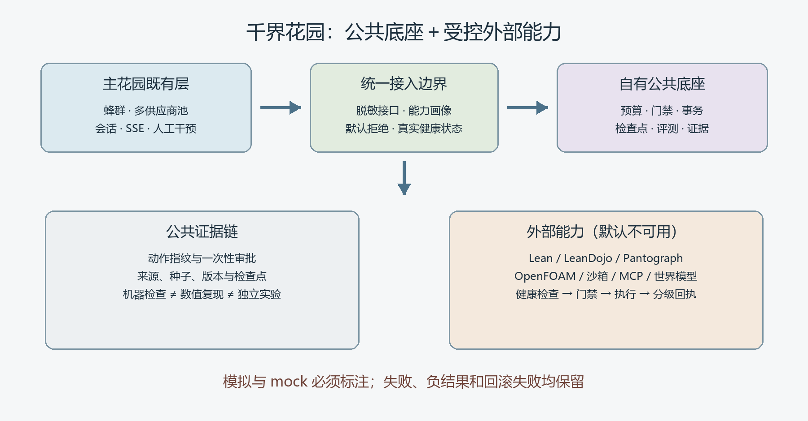

# Garden Ecosystem · 千界花园生态适配层

独立于 `bloombloomgarden` 的 Python 标准库项目。把公开代码生态中有价值的可靠性、世界状态、科研证据和评测机制做成可验证的小接口，而不是再复制一套大型智能体框架。



## 当前状态

- **已实现**：11 个公共模块、离线组合演示、98 项标准库 `unittest` 测试，以及真实 Lean 健康检查和受控 stdio 服务。
- **主花园桥接已合并**：两个桥接 PR 均已合并至各自 `main`，`POST /api/garden-ecosystem` 已完成真实 HTTP 验收，Vercel 预览部署也已通过；主花园既有蜂群、provider-pool、Next.js/SSE 逻辑保持不动。
- **真实 Lean 已接入**：本地安装官方 Lean 4.35.0 并校验 SHA-256，健康检查返回 `available` 与 `EXECUTED`，独立最小定理示例编译通过；适配器仍只允许版本操作。
- **未做**：真实模型实测、项目级 Lean 形式化验证、OpenFOAM 执行、沙箱隔离、模型权重下载、全球项目穷尽。不会把版本检查或 mock 冒称为机器证明。

## 快速开始

需要 Python 3.11+，核心功能没有第三方运行时依赖。

```bash
# Git Bash，在本仓库根目录
PYTHONPATH=src python -m garden_ecosystem
PYTHONPATH=src python -m unittest discover -s tests -v

# 或直接运行示例
python examples/demo.py
```

PowerShell 可使用：

```powershell
$env:PYTHONPATH = "src"
python -m garden_ecosystem
python -m unittest discover -s tests -v
```

演示只使用 mock：一次模拟限流后的供应商切换、一次预算不足拒绝、一次写入拦截、一次迁移回滚、两个可重放情景、空评测、默认关闭学习和显式 mock 验证回执。`ok: true` 只表示这些离线断言成立，不表示真实工具已经通过验证。

### 本地 Lean（可选）

```bash
# 官方发布包与 SHA-256 校验；已有目录不会被覆盖
python scripts/install_lean_local.py

# Git Bash，在本仓库根目录设置实际工具路径
export LEAN_EXECUTABLE="$PWD/.tools/lean-4.35.0/lean-4.35.0-windows/bin/lean.exe"
PYTHONPATH=src python -c "from garden_ecosystem.lean import LeanAdapter; print(LeanAdapter().health())"
```

工具链、下载缓存和最小示例均位于被忽略的 `.tools/` 目录，不进入 Git 或 Python 发布包。真实回执只覆盖版本命令；最小示例是环境验收，不是项目级证明。

## 模块与用途

| 模块 | 已实现能力 | 主要边界 |
|---|---|---|
| `security` | 规范 JSON、稳定哈希、原文与 JSON 转义脱敏 | 非有限浮点不进入证据 |
| `providers` | 能力画像、故障分类、有限回退、临时密钥作用域 | 认证/非法请求/上下文溢出/中止不切供应商 |
| `context` | token 估算、精确用量锚点、输出预算、工具输出与区间缓存 | 窗口不足拒绝；路径越界拒绝；估算不冒称真实计量 |
| `reliability` | `ALLOW/DENY/ASK/MODIFY`、一次性动作绑定审批、脱敏审计 | MODIFY 只建议；Guard 不是操作系统沙箱 |
| `worlds` | 稳定身份、生命周期、事务迁移、隔离往返自检 | 回滚失败明确 `recovery_required`，不声称恢复成功 |
| `evaluation` | 七领域五维评测、宏平均、共享 agent 轴、多种子情景 | 情景不是现实概率，评分不是科学事实 |
| `learning` | tentative→active→retired、正反证据、回滚、内容白名单 | 默认关闭；不存/执行代码、命令、工具配置或密钥 |
| `research` | 预登记冻结、追加观察、负结果、参数来源分层 | 外部标定不写成内生；冻结内容不可覆盖 |
| `receipts` | 运行清单、哈希检查点、外部健康状态、分级验证回执 | mock 明示；真实机器检查需要外部 attestation |
| `lean` | 真实 Lean 可执行文件探测、版本检查与执行回执 | 仅 `--version`；不是编译或定理证明 |
| `service` | 四类白名单动作的 stdio 请求与结构化响应 | 不开放任意命令、任意参数或任意文件 |

## 与千界花园的接口

完整手册与验证记录：[Markdown](docs/bridge-integration.md) · [原生 Word 图文版](docs/bridge-integration.docx)。

### 能力和健康状态

```python
from garden_ecosystem.bridge import capabilities, health
from garden_ecosystem.receipts import UnavailableExternalTool

print(capabilities())
print(health([UnavailableExternalTool("lean")]))
```

输出是可直接 JSON 序列化的字典，不含密钥。`health()["tools"]["lean"]["status"]` 为 `unavailable`，表示没有真实适配器，而不是 Lean 已安装或已运行。

### 供应商故障治理

```python
from garden_ecosystem.providers import ProviderPool, ProviderProfile

pool = ProviderPool([
    ProviderProfile("primary", "your-model", "PRIMARY_API_KEY", ("backup",)),
    ProviderProfile("backup", "your-model", "BACKUP_API_KEY"),
], environ={
    "PRIMARY_API_KEY": "local-only-primary-secret",
    "BACKUP_API_KEY": "local-only-backup-secret",
})
# 由主花园注入真实 transport；本仓库不会自行读取或持久化这些密钥。
# result = pool.call(request, transport)
```

协议画像支持 `chat_completions`、`responses`、`anthropic_messages`，但这只是传输适配器可消费的能力声明，不意味着本包已经实现所有服务商网络协议。密钥只保存在调用方环境中，审计仅保留 provider、错误分类和结果。

### 执行门禁

```python
from garden_ecosystem.reliability import Action, Guard

guard = Guard()
result = guard.execute(
    Action("research-agent", "write_file", "notes.md"),
    lambda action: {"written": True},
)
assert result["decision"] == "DENY"
assert result["executed"] is False
```

生产部署类 ASK 动作通过 `guard.approve(action, ttl_seconds=...)` 获取票据，再把票据传给 `execute`。票据绑定主体和完整动作指纹，过期或已消费后失效；批准一个目标不能用于另一个目标。

### 外部工具

`ExternalToolAdapter` 要求两个方法：

- `health() -> ToolHealth`：返回 `available / degraded / unavailable` 与原因。
- `execute(action) -> VerificationReceipt`：真实执行后返回分级回执。

接入 Lean、OpenFOAM 或其他 MCP/CLI 工具前，必须另做健康检查、工作区限制、超时、资源预算、许可证和安全评审。不要从演示或测试 mock 生成真实 `machine_checked` 回执；真实回执还需 `attested=True` 所代表的外部执行证明。

## 科学证据的五个级别

| 级别 | 含义 | 不应推断为 |
|---|---|---|
| `generated` | 产生候选 | 已验证 |
| `executed` | 工具真实运行 | 结果正确 |
| `machine_checked` | Lean、测试或确定性校验接受 | 物理真实、自然语言命题完全等价 |
| `numerically_reproduced` | 固定版本与输入下数值复现 | 全域普遍成立 |
| `externally_validated` | 有明确独立实验或评审来源 | 永久不可推翻 |

## 调研、版本与许可证

- [广泛调研与整体设计（Markdown）](research/landscape.md)
- [广泛调研与整体设计（原生 Word 图文版）](research/千界花园同类开源项目调研与总体设计.docx)
- [总体设计 v2](docs/superpowers/specs/2026-11-09-garden-ecosystem-design.md)
- [上游固定版本和实际读取范围](UPSTREAM.md)
- [王斌 Gitee 25 个公开仓库盘点](docs/gitee-dpsnet-inventory.md)
- [许可证与实现边界](NOTICE.md)

本轮公开 API 查询得到 852 条原始记录、797 个去重候选条目，含模型、镜像、广告与噪声；它不是“797 个可复用项目”的声明。原始元数据保留在 `research/`，仅作发现入口。MeowCode GPL、MiroFish/OpenViking AGPL、UlamAI 和其他未明确许可项目均不复制代码；所有上游源码只留在本机隔离参考目录，不进入本仓库。

本仓库原创代码采用 [MIT](LICENSE)。架构灵感来源和固定提交见 [NOTICE.md](NOTICE.md)。其上游理论、物理或性能声明不因列入调研而被本仓库认可。
