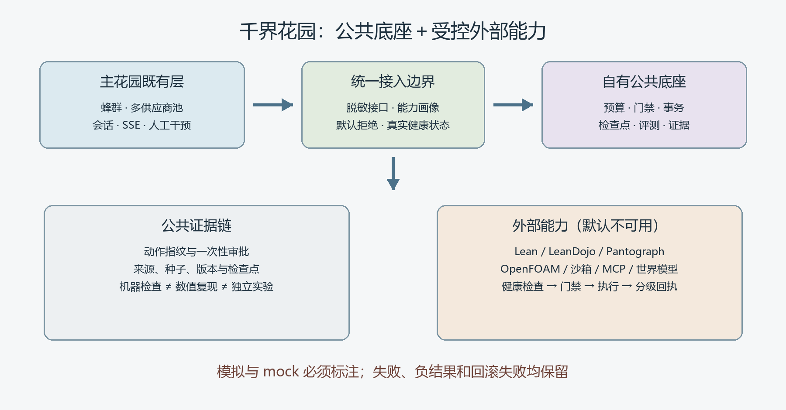

# 千界花园受控桥接使用手册与验证记录



图 1：公共底座与受控外部能力。真实 Lean 健康检查属于外部能力适配，未安装时明确返回 unavailable。

## 1. 组成

- `garden-ecosystem/src/garden_ecosystem/lean.py`：真实 Lean 可执行文件探测与版本检查。
- `garden-ecosystem/src/garden_ecosystem/service.py`：单请求、单响应的 stdio 服务。
- `bloombloomgarden/src/lib/garden-ecosystem.ts`：限制动作、环境、输入、输出和时间的 TypeScript 客户端。
- `bloombloomgarden/src/app/api/garden-ecosystem/route.ts`：Next.js API Route。

主花园修改位于独立 worktree 的 `feature/garden-ecosystem-bridge` 分支；适配项目修改位于 `feature/controlled-bridge` 分支。两个分支分别审查，不直接覆盖主花园其他未提交工作。

## 2. 本地配置

把两个仓库放在相邻目录，或者显式设置 `GARDEN_ECOSYSTEM_ROOT`。worktree 中会自动向工作区上一级查找相邻的 `garden-ecosystem`。

```bash
# 可选：非标准目录布局时设置，不要求把路径提交到仓库
GARDEN_ECOSYSTEM_ROOT=/absolute/path/to/garden-ecosystem
GARDEN_ECOSYSTEM_PYTHON=python
LEAN_EXECUTABLE=lean
```

主花园代理已有独立鉴权要求：运行时需要 `GARDEN_AGENT_TOKEN`，且长度至少 32 个字符。它是**入站请求令牌**，不是模型 API 密钥。调用方使用：

```http
Authorization: Bearer <local-agent-token>
Content-Type: application/json
```

该令牌不会出现在桥接模块的白名单环境中，因此不会转发给 Python 子进程。验收脚本只在内存中生成临时测试令牌，不落盘，也不绕过代理。

## 3. 四个动作

请求体最多 16 KiB：

```json
{"action":"lean_health","params":{}}
```

| 动作 | 含义 | 结果边界 |
|---|---|---|
| `capabilities` | 返回模块、协议和安全默认值 | 不代表所有外部能力已安装 |
| `health` | 返回整体健康与 Lean 状态 | 不读取模型密钥 |
| `lean_health` | 真实执行 `lean --version` 探测 | 文件缺失为 unavailable，异常为 degraded |
| `lean_receipt` | Lean 可用时生成版本执行回执 | 仅为 EXECUTED，不是 machine_checked |

stdio 内部格式带请求 ID：

```json
{"id":"request-id","action":"capabilities","params":{}}
```

服务只执行白名单动作，不支持 shell、任意 Python、任意 Lean 参数、Lean 文件或 OpenFOAM。Python 与 TypeScript 都有独立参数校验，不能通过 API 将 `operation` 改为 `compile`。

## 4. 安全边界

- 子进程仅接收白名单环境变量，不继承完整 API 密钥集合。
- 每次请求一个 Python 进程，不监听端口、不启动常驻 HTTP 服务。
- TypeScript 输入上限 16 KiB、stdout 上限 64 KiB、stderr 上限 16 KiB、桥接超时 10 秒。
- 响应 ID 必须匹配；错误 JSON、进程异常、超时和输出超限均失败。
- Next 使用 `runtime="nodejs"`、`dynamic="force-dynamic"`，并在运行前 `await connection()`。
- 版本检查不是定理证明，不能生成真实 `machine_checked` 结论。
- 测试 runner 和 mock spawn 只证明分支逻辑，不证明本机安装 Lean。

## 5. 依赖生成与 Windows 启动

主前端和后端是两套 Prisma schema，生成命令必须在各自目录运行，不能混用：

```bash
# 主前端目录
./node_modules/.bin/prisma generate

# 后端目录
cd backend
./node_modules/.bin/prisma generate
./node_modules/.bin/prisma db push
```

本次还修复了现有 `scripts/dev-all.mjs` 的 Windows 启动问题：带空格的 `.exe` 路径不再交给 `shell:true`，只有 `npm.cmd` 保留 Windows 所需处理方式。该修改通过真实 `npm run dev` 验证。

## 6. 验证命令与已观察结果

适配项目：

```bash
PYTHONPATH=src python -m unittest discover -s tests -v
PYTHONPATH=src python -m garden_ecosystem.service
# 在 stdin 输入：{"id":"one","action":"lean_health","params":{}}
```

主花园 worktree：

```bash
node --test tests/garden-ecosystem.test.mjs
./node_modules/.bin/tsc --noEmit
npm run build
python scripts/validate_bridge_preview.py
```

已观察：

- Python **98 项测试通过**，stdio 实际往返成功。
- TypeScript **10 项测试通过**，类型检查通过。
- 真实 TypeScript→Python 调用返回 11 个模块名。
- 本机 `LeanAdapter().health()` 返回 `unavailable`：没有找到 Lean 可执行文件；未安装或伪造 Lean。
- 真实 HTTP `capabilities` 成功，`lean_health` 返回 unavailable，未知 `shell` 返回 400。
- 验收脚本返回 `server_stopped: true`，Next、npm 与 Python 联调进程均未保留。
- Next 构建通过，但有一条 `unexpected file in NFT list` 警告。它提示动态外部运行目录可能导致过宽跟踪；不把该警告称为已消除，也不据此声称部署包已经优化。

## 7. 当前未覆盖

没有真实 Lean 编译、定理证明、模型推理、OpenFOAM、沙箱或模型权重验证。Lean 可用时也只允许版本操作。后续如需编译，必须另设文件白名单、工作区、工具链版本、公理与 `sorry` 审计、资源预算和独立回执，不能把当前健康接口直接扩展成任意执行器。
