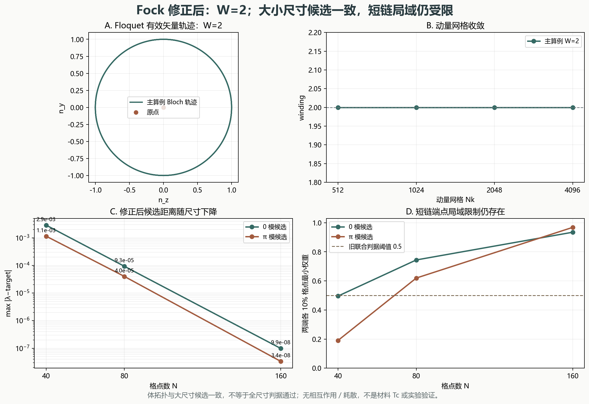

# Floquet–BdG 约定修复与联合拓扑诊断

> 2026-11-11。Fock 校验后的二次型 Kitaev 模型；不是材料超导增强或实验验证。

## 一、先修正旧实现，再讨论 0／π 模

旧 `research/floquet-bdg/floquet_bdg.py` 在 `H=iΣKΓΓ` 的完整反对称求和下漏除了 2，使目标模型的时间演化放大两倍。独立 Fock 探针给出：单格点 `U[0,1]=0.5702416578408517`，参考值 `0.2987666363611303`；双格点最大矩阵元差 `0.81`。旧静态零空间和正交性测试无法发现这一全局因子。

修正后的直接矩阵元为 `K[a_j,b_j]=−μ/2`、`K[a_j,b_(j+1)]=(Δ−γ)/4`、`K[a_(j+1),b_j]=−(Δ+γ)/4`。一／双格点 Fock 逐元素与 Heisenberg 演化检验已通过。旧结果、图件和 Word 保留原字节，影响范围见 `research/floquet-bdg/ERRATA.md`；本包不继承旧的 π 通过或 0 未决结论。

## 二、周期链拓扑：winding 与端点计数

采用负 hopping 约定的 `h(k)=2(−γcosk−μ0)τ_z+2Δsinkτ_y`，以及 `U(k)=e^{iμ1τ_z}e^{−ih(k)T}e^{iμ1τ_z}`。在 `0<φ<π` 分支提取 `n_y,n_z`，避免直接 `logm` 的分支切割；另用抽样 `logm` 核对方向。

| Nk | winding | 最近整数 | min sinφ |
|---:|---:|---:|---:|
| 512 | 2.000000000000 | 2 | 0.041654687 |
| 1024 | 2.000000000000 | 2 | 0.041613474 |
| 2048 | 2.000000000000 | 2 | 0.041605395 |
| 4096 | 2.000000000000 | 2 | 0.041604375 |

主算例在全部四种动量网格上均得到 `W=2`，与文献参考一致。

端点量 `b0=0.984466812`、`bπ=2.127323954`，限定域内每端 `p0=1`、`pπ=1`。负 hopping 下 `k=0` 对应 `bπ`、`k=π` 对应 `b0`，已显式核对。

有能隙静态平凡控制 `ω=17` 给出 `W=-0.0`；静态拓扑控制给出 `W=-1.0`。`|W|=2` 只给出总数，`p0/pπ` 才分别给出 0／π 端点计数。

## 三、修正后的开放链

| N | 模 | 最大候选距离 | 最大分离比 | 最小端点权重 | 全尺寸旧判据 |
|---:|:---:|---:|---:|---:|:---|
| 40 | 0 | 2.861021e-03 | 2.606785e-02 | 0.495972 | inconclusive |
| 40 | π | 1.142352e-03 | 2.475635e-02 | 0.190995 | inconclusive |
| 80 | 0 | 9.300728e-05 | 1.013293e-03 | 0.744090 | inconclusive |
| 80 | π | 3.995923e-05 | 9.219843e-04 | 0.619647 | inconclusive |
| 160 | 0 | 9.863124e-08 | 1.146792e-06 | 0.934641 | inconclusive |
| 160 | π | 3.356642e-08 | 7.953283e-07 | 0.968007 | inconclusive |

在 `N=160`，两类最近候选均满足分离比 `<0.1` 和端点权重 `>0.5`。最近四对谱还显示，第二近对不再被误当成体模：

| 模 | 第一对最大距离 | 第一对最小端点权重 | 第二对最大距离 | 第二对最大端点权重 |
|:---:|---:|---:|---:|---:|
| 0 | 9.863124e-08 | 0.934641 | 8.600624e-02 | 0.026619 |
| π | 3.356642e-08 | 0.968007 | 4.220448e-02 | 0.036683 |

但 `N=40` 的 0 模最小端点权重为 `0.495972`，略低于 0.5；π 模为 `0.190995`。因此不修改旧阈值，不宣称全尺寸序列通过。准确结论是：**体拓扑与大尺寸边缘候选相互支持；短链局域限制仍使全尺寸旧判据保持 `inconclusive`。**



图 1：A 为 Bloch 有效矢量轨迹；B 为 winding 网格收敛；C 为修正后候选距离；D 为端点权重。所有数据来自本次 Fock 校验后的计算。

## 四、验证与未竟边界

独立复核重新构造 Fock 参考、核对 winding 与控制组、重算 `N=160`、比较最近四对谱，并确认旧 `results.json` 哈希未改变。

```bash
python research/floquet-bdg-convention/test_convention.py -v
python research/floquet-bdg-convention/test_topology.py -v
python research/floquet-bdg-convention/verify_topology.py -v
python research/floquet-bdg-convention/run_verification.py
```

当前没有相互作用、耗散、自洽配对、材料 `Tc`、Meissner 或实验复现；有限尺寸和体不变量一致也不是热力学极限证明。连续驱动的 Fourier／时间步收敛、开放系统的占据与热管理仍是独立方向。

模型依据：Thakurathi et al., Phys. Rev. B 88, 155133 (2013), arXiv:1303.2300v2，Eq. (17)–(27)。参数适配和 Fock 检验均由本包独立完成。
