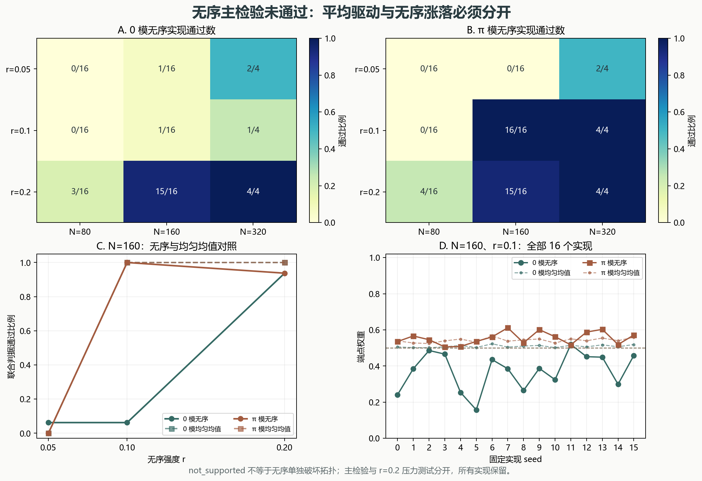

# 弱化学势无序下 Floquet 0／π 候选：均值匹配对照

> 2026-11-11。108 个无序实现＋108 个均匀均值对照；不是无序拓扑或实验结论。

## 一、结论

主检验状态为 **`not_supported`**：在 r=0.05、0.1 下，未满足所有实现及多数实现的联合判据。失败实现全部保留，没有更换种子或移动阈值。

但 **不能归因于无序单独破坏**：改变 r 同时改变平均 kick 与空间涨落。弱强度下，许多失败在相同平均 kick 的均匀链中也发生，反映平均驱动条件。部分模态在特定强度和尺寸下仍有稳健区域。

## 二、无序与均值匹配协议

无序脉冲为 `a_n=rβ_n`，均匀对照为 `a_n=r·mean(β)`；两者自由演化和周期相同。β 来自 `default_rng(20261111+seed).random(320)[:N]`，跨强度和尺寸复用。

N=80、160 各 16 个实现，N=320 取前 4 个；r=0.05、0.1 为主检验，r=0.2 为压力测试。另保留零 kick 参照。观测包括最近本征值、第三近模分离比、端点权重和基无关子空间 IPR，不把实现间本征值平均成单一物理样品。

## 三、通过数与均值对照

| N | r | 模 | 无序通过 | 均匀均值通过 | 判定一致数 |
|---:|---:|:---:|---:|---:|---:|
| 80 | 0.05 | 0 | 0/16 | 0/16 | 16/16 |
| 80 | 0.05 | π | 0/16 | 0/16 | 16/16 |
| 80 | 0.1 | 0 | 0/16 | 0/16 | 16/16 |
| 80 | 0.1 | π | 0/16 | 0/16 | 16/16 |
| 80 | 0.2 | 0 | 3/16 | 11/16 | 8/16 |
| 80 | 0.2 | π | 4/16 | 7/16 | 9/16 |
| 160 | 0.05 | 0 | 1/16 | 0/16 | 15/16 |
| 160 | 0.05 | π | 0/16 | 0/16 | 16/16 |
| 160 | 0.1 | 0 | 1/16 | 16/16 | 1/16 |
| 160 | 0.1 | π | 16/16 | 16/16 | 16/16 |
| 160 | 0.2 | 0 | 15/16 | 16/16 | 15/16 |
| 160 | 0.2 | π | 15/16 | 16/16 | 15/16 |
| 320 | 0.05 | 0 | 2/4 | 4/4 | 2/4 |
| 320 | 0.05 | π | 2/4 | 4/4 | 2/4 |
| 320 | 0.1 | 0 | 1/4 | 4/4 | 1/4 |
| 320 | 0.1 | π | 4/4 | 4/4 | 4/4 |
| 320 | 0.2 | 0 | 4/4 | 4/4 | 4/4 |
| 320 | 0.2 | π | 4/4 | 4/4 | 4/4 |

关键对照：N=160、r=0.1 时，0 模无序仅 **1/16** 通过，而均匀均值为 **16/16**；π 模两者均为 **16/16**。N=320 同一强度下，0 模分别为 1/4 和 4/4，π 模均为 4/4。这里确有模态与参数相关的无序敏感性，但不能推广成所有弱无序都会破坏拓扑。

r=0.2 压力测试中，N=160 的 0／π 无序均 15/16 通过，均匀均值为 16/16；N=320 两者均 4/4 通过。该结果不抵消主检验失败，只说明参数域和平均驱动十分关键。



图 1：A／B 为全部无序实现通过数；C 为 N=160 的无序与均匀均值通过比例；D 为 N=160、r=0.1 的全部 16 个实现端点权重。

## 四、独立复核与边界

独立检查重建了一个无序实现的自由部分和解析 kick，验证 Floquet 正交性、子空间旋转不变性、均值匹配、原始通过数、全部 CSV 与格点分布归一化。模型合同 5 项、独立检查 6 项均通过。

```bash
python research/floquet-bdg-disorder/run_disorder.py
python research/floquet-bdg-disorder/run_mean_controls.py
python research/floquet-bdg-disorder/test_disorder.py -v
python research/floquet-bdg-disorder/verify_disorder.py -v
python research/floquet-bdg-disorder/run_verification.py
```

平移不变 Bloch winding 不适用于这些无序链，未声称计算无序拓扑不变量。有限实现的稳健性不等于热力学极限、材料 `Tc`、非平衡稳态或实验验证。旧全尺寸 `inconclusive_preserved` 不变。

协议来源：Mondal、Sen、Dutta，arXiv:2203.16353v3 Eq. (7)。仅使用化学势 kick 的空间无序，不含 hopping 无序、时间噪声、相互作用或耗散。
