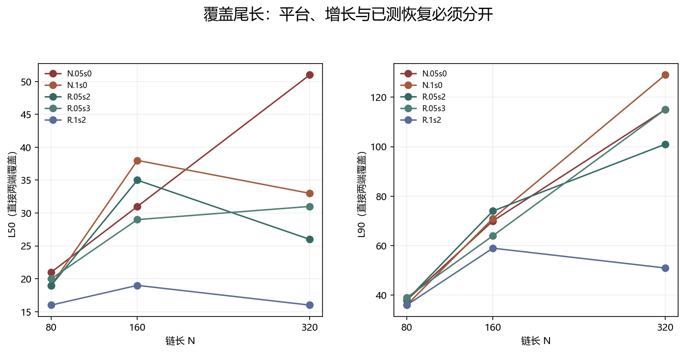
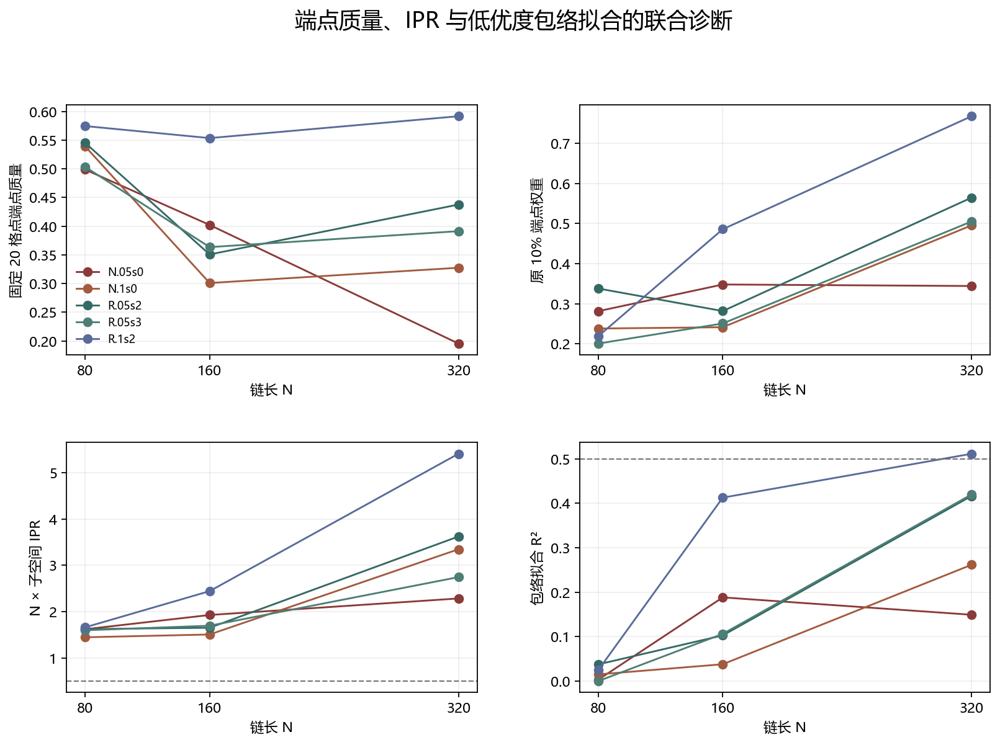

# Floquet-BdG 局域与恢复尺度分析

> 日期：2026-11-11。范围：5 个案例、N=80/160/320 的 15 个基无关 rank-2 子空间 profile。本文不把下一诊断尺寸写成恢复预测，也不包含 N=640 计算。

## 一、覆盖定义与判据

对原 profile q，直接计算两端累计质量：

$$C_m=\sum_{j=0}^{m-1}q_j+\sum_{j=N-m}^{N-1}q_j,\qquad L_p=\min\{m:C_m\geq p\}.$$

此前对平均序列 `(q+q[::-1])/2` 求累计会在 N/2 处恒得 0.5，不能作为 localization length。本报告改用上述直接两端和。

恢复平台判据：最近两尺寸 L50 相对变化 ≤0.25、固定 20 格点端点质量比 ≥0.8、N=320 分离度 <0.1。包络 R²<0.5 时不得用指数恢复律。

## 二、恢复分类与下一诊断尺寸

| 案例 | 状态 | L50（80/160/320） | L90（80/160/320） | 下一诊断尺寸 | 解释 |
|:---|:---|:---|:---|---:|:---|
| N.05s0 | not_established | [21, 31, 51] | [38, 70, 115] | 600 | plateau criteria failed; no recovery bracket is justified |
| N.1s0 | bounded_diagnostic | [19, 38, 33] | [36, 71, 129] | 400 | plateau criteria satisfied; next size is a diagnostic, not a recovery prediction |
| R.05s2 | measured_recovered | [19, 35, 26] | [38, 74, 101] | None | endpoint joint criterion already measured at N=320 |
| R.05s3 | measured_recovered | [20, 29, 31] | [39, 64, 115] | None | endpoint joint criterion already measured at N=320 |
| R.1s2 | measured_recovered | [16, 19, 16] | [36, 59, 51] | None | endpoint joint criterion already measured at N=320 |

N.1s0 的 L50 区间为 330–380，因此 N=400 是阈值边缘诊断；N.05s0 未满足平台条件，N=600 仅用于检验尾长是否继续增长。两者都不是恢复承诺，也没有选择 N=640 作为默认答案。

图 1 插入位置：恢复分类之后、详细数值之前。

**图 1**　直接两端覆盖 L50 与 L90。已恢复案例不自动等于短尾平台，未恢复案例也不等于拓扑消失。

## 三、逐尺寸证据

| 案例 | N | L50 | L90 | 固定20质量 | 中心20%质量 | N·IPR | 包络 R² |
|:---|---:|---:|---:|---:|---:|---:|---:|
| N.05s0 | 80 | 21 | 38 | 0.498719 | 0.195245 | 1.61985 | 0.00324816 |
| N.05s0 | 160 | 31 | 70 | 0.402263 | 0.149517 | 1.92775 | 0.188208 |
| N.05s0 | 320 | 51 | 115 | 0.195574 | 0.0499176 | 2.28472 | 0.149152 |
| N.1s0 | 80 | 19 | 36 | 0.539053 | 0.20117 | 1.44607 | 0.0150423 |
| N.1s0 | 160 | 38 | 71 | 0.301063 | 0.173354 | 1.50639 | 0.0378424 |
| N.1s0 | 320 | 33 | 129 | 0.32763 | 0.101029 | 3.3467 | 0.26156 |
| R.05s2 | 80 | 19 | 38 | 0.545169 | 0.210789 | 1.62319 | 0.0376123 |
| R.05s2 | 160 | 35 | 74 | 0.350805 | 0.181159 | 1.65178 | 0.102705 |
| R.05s2 | 320 | 26 | 101 | 0.437747 | 0.0506083 | 3.62305 | 0.416335 |
| R.05s3 | 80 | 20 | 39 | 0.503376 | 0.231936 | 1.59753 | -6.11828e-11 |
| R.05s3 | 160 | 29 | 64 | 0.363606 | 0.0989772 | 1.69576 | 0.106145 |
| R.05s3 | 320 | 31 | 115 | 0.391384 | 0.0457808 | 2.74556 | 0.419694 |
| R.1s2 | 80 | 16 | 36 | 0.574572 | 0.173406 | 1.66154 | 0.0250225 |
| R.1s2 | 160 | 19 | 59 | 0.553613 | 0.0781839 | 2.44309 | 0.412581 |
| R.1s2 | 320 | 16 | 51 | 0.591704 | 0.0114267 | 5.41056 | 0.511229 |

图 2 插入位置：逐尺寸证据之后、解释边界之前。

**图 2**　固定宽度端点质量、原端点权重、N·IPR 与包络拟合优度。虚线为相应阈值或参考线。

## 四、解释边界与后续实验

N.05s0 的 L50 从 21→31→51 增长，未满足平台条件；其包络 R² 最高仅约 0.188，不能给出恢复区间。N.1s0 满足机械平台条件，但 L90 仍从 36→71→129 增长，说明 90% 覆盖的尾部并不短，因此 N=400 只检验局部阈值穿越，不能证明整体局域化。

三个已恢复案例保留 measured_recovered，不要求它们同时满足所有平台子条件。N=640 尚未计算；后续应先做 N=400 的阈值边缘诊断与 N=600 的尾长增长诊断，并沿用逐网格检查点。

原始依据：floquet-bdg-disorder/profiles.npz 与 results.json；分析数据：localization_scale.json、localization_scale.csv。原始 profile 全部重新验证归一化和 N=320 端点权重一致性。
