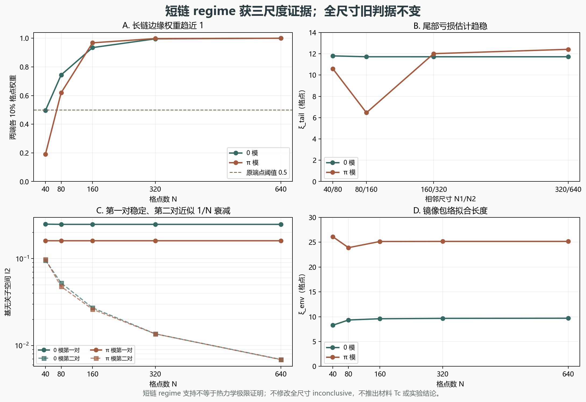

# Floquet–BdG 短链局域尺度：0／π 边缘模的基无关证据

> 2026-11-11。Fock 修正模型上的有限尺寸研究，不是材料或实验结论。

## 一、结论

预注册联合判据给出 **`short_chain_regime_supported`**：在当前二次型 Kitaev 参数下，N=40 的端点权重不足符合短链局域 regime。尾部、包络和基无关子空间 IPR 三类证据相互支持。

但旧的全尺寸 `inconclusive` 不变，仍不宣称热力学极限证明。N=40 的 0／π 端点权重分别为 0.495972 和 0.190995；没有移动 0.5 阈值，也没有把短链支持写成全尺寸通过。

## 二、方法修正：严格简并时不能用任意本征向量 IPR

长链接近严格简并时，单本征向量 IPR 可因子空间旋转而翻倍。为避免这种基依赖，对每个二维候选子空间做 QR 正交化，令 `ρ=QQ†`，使用基无关量 `I₂=Σ_mρ_mm²`，格点权重为 `w_j=[ρ_(a_j,a_j)+ρ_(b_j,b_j)]/2`。独立旋转测试和另一套 SciPy 本征求解器均验证了同一子空间结果。

最初草稿还误把延展态写成 `N×IPR` 增长；现已按定义修正为 **IPR 衰减、N×IPR 保持有限**。这属于方法纠错，不是根据结果调整物理阈值。详见 `METHOD.md` 的修正记录。

## 三、尾部亏损与包络尺度

尾部模型 `1−E_N=C exp(−0.2N/ξ_tail)` 给出：

| 模 | 40/80 | 80/160 | 160/320 | 320/640 |
|:---:|---:|---:|---:|---:|
| 0 | 11.802791 | 11.722160 | 11.721874 | 11.721854 |
| π | 10.600161 | 6.463119 | 12.013780 | 12.419694 |

| N | 0 模 ξ_env / R² | π 模 ξ_env / R² |
|---:|---:|---:|
| 40 | 8.281163 / 0.6181 | 26.106697 / 0.1652 |
| 80 | 9.340576 / 0.7089 | 23.900232 / 0.5054 |
| 160 | 9.589390 / 0.7411 | 25.145602 / 0.6031 |
| 320 | 9.664668 / 0.7547 | 25.165013 / 0.6366 |
| 640 | 9.695046 / 0.7610 | 25.164969 / 0.6513 |

0 模尾部估计最后两组为 11.721874 和 11.721854 格点；π 模为 12.013780 和 12.419694 格点。包络最后两组尺寸的长度变化分别为约 0.31% 和 0.00018%，且拟合 `R²>0.5`。单尺度包络只是描述，不能替代 IPR 或拓扑判据。

## 四、基无关 IPR 与延展第二对

| 模 | 第一对 I₂ 相对变化（320→640） | 第二对 I₂ 衰减因子 | 第二对 N×I₂ 比值 |
|:---:|---:|---:|---:|
| 0 | 1.119e-16 | 1.969078 | 1.015704 |
| π | 3.628e-15 | 1.975916 | 1.012189 |

第一对子空间 IPR 在长链上稳定，第二对近似按 1/N 衰减。这支持第一对为局域边缘候选、第二对为延展态，而不是将近零本征值一律标记为 Majorana。



图 1：A 为端点权重；B 为尾部估计；C 为第一／第二对子空间 IPR；D 为包络长度。所有曲线来自当前计算。

## 五、独立复核与边界

独立验证使用 `scipy.linalg.eig` 重算 N=640，对候选子空间重新构造 `ρ`，要求 IPR、逐格点权重和端点权重与主结果一致；6 项检查全部通过。

```bash
python research/floquet-bdg-localization/run_localization.py
python research/floquet-bdg-localization/test_localization.py -v
python research/floquet-bdg-localization/verify_localization.py -v
python research/floquet-bdg-localization/run_verification.py
```

当前研究没有相互作用、耗散、自洽配对、材料 `Tc` 或实验验证。短链 regime 支持也不改变 `inconclusive_preserved`，不替代 Floquet 拓扑不变量或热力学极限证明。

文献方法参照 Thakurathi、Patel、Sen、Dutta，Phys. Rev. B 88, 155133 (2013)，arXiv:1303.2300v2。检索元数据见 `sources/scholar-majorana.csv`；第三方动态引用次数不参与物理判据。
