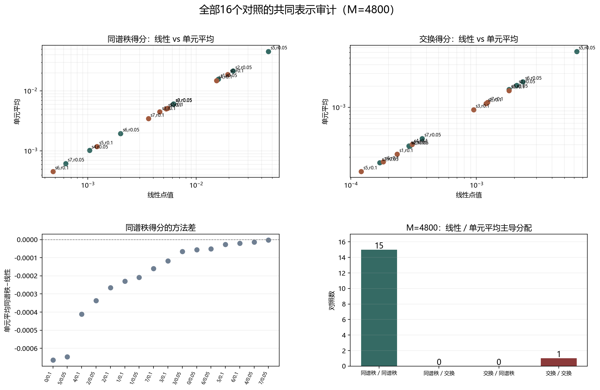

# Floquet-BdG 全样本共同表示审计

> 日期：2026-11-11。全部8个既有种子、2个强度、16个对照；两种共同表示、三个网格。只重算相同本征对，不新增类别、不补算体 winding，未计算 N=640。

## 一、全样本协议

线性点值和分片常数单元平均沿用前两轮实现。M=1200／2400／4800，最近对与次近对分别形成二维子空间。原剖面误差门槛为1e-10；前三例两种方法均必须复现到1e-12。

实测原剖面最大误差 4.163e-17；前三例线性最大复现差 0.000e+00，单元平均最大复现差 0.000e+00。

## 二、M=4800 的全样本结果

| seed | r | 线性同谱秩 | 单元平均同谱秩 | 线性交换 | 单元平均交换 | 线性主导 | 单元平均主导 |
|---:|---:|---:|---:|---:|---:|:---|:---|
| 0 | 0.05 | 0.0061647 | 0.0061089 | 0.0020878 | 0.002053 | diagonal | diagonal |
| 1 | 0.05 | 0.015994 | 0.015786 | 0.0018171 | 0.0017901 | diagonal | diagonal |
| 2 | 0.05 | 0.02185 | 0.021514 | 0.00029489 | 0.00028423 | diagonal | diagonal |
| 3 | 0.05 | 0.006131 | 0.0060647 | 0.00016976 | 0.00016671 | diagonal | diagonal |
| 4 | 0.05 | 0.0010358 | 0.0010217 | 0.00028952 | 0.00028638 | diagonal | diagonal |
| 5 | 0.05 | 0.046343 | 0.045698 | 0.0062807 | 0.0061818 | diagonal | diagonal |
| 6 | 0.05 | 0.0020069 | 0.0019562 | 0.0023464 | 0.0023031 | swapped | swapped |
| 7 | 0.05 | 0.00062424 | 0.00062123 | 0.00036949 | 0.0003659 | diagonal | diagonal |
| 0 | 0.1 | 0.01951 | 0.018845 | 0.0018118 | 0.0017383 | diagonal | diagonal |
| 1 | 0.1 | 0.0052712 | 0.0050418 | 0.00023372 | 0.00022128 | diagonal | diagonal |
| 2 | 0.1 | 0.0054298 | 0.0051648 | 0.0011905 | 0.0011412 | diagonal | diagonal |
| 3 | 0.1 | 0.0046004 | 0.0044832 | 0.00094909 | 0.00092995 | diagonal | diagonal |
| 4 | 0.1 | 0.01536 | 0.014948 | 0.00030697 | 0.00030278 | diagonal | diagonal |
| 5 | 0.1 | 0.0012165 | 0.0011897 | 0.0001208 | 0.0001259 | diagonal | diagonal |
| 6 | 0.1 | 0.00047716 | 0.00045766 | 0.00018075 | 0.00017252 | diagonal | diagonal |
| 7 | 0.1 | 0.0036192 | 0.0034596 | 0.0012219 | 0.0011782 | diagonal | diagonal |

图 1 插入位置：M=4800 全样本表之后、汇总结论之前。

**图 1**　上排为两种方法的得分比较，左下为方法差，右下为主导分配组合。所有图形只描述当前共同表示。

## 三、全网格汇总与交换候选

96个方法×案例×网格组合中，同谱秩分配占优 90/96；两种方法主导分配一致 48/48。全部六个方法网格均为同谱秩的对照有 15/16。

M=4800 上，两种方法主导分配一致 16/16。线性主导计数为 {"diagonal": 15, "swapped": 1}，单元平均为 {"diagonal": 15, "swapped": 1}。

交换候选：seed_6_r_0p05。这里的交换候选只表示至少一种方法在 M=4800 上交换得分更高，不是物理态交换证明。

两种方法同谱秩得分的最大绝对变化为 0.00068239。计数覆盖全部预登记对照，但不是统计总体推断或显著性检验。

## 四、结论与边界

前三例的方向结果不能未经验证就外推到全样本；本报告以全部16个对照的直接计算替代这种外推。若有交换候选，应检查其完整矩阵、网格变化和方法依赖，而不是直接命名态交换。

本轮没有证明表示不变性、同一物理态、真实态追踪、排序交换、网格收敛、次近对拓扑性或体 winding。原类别和响应计数未改变。

复现：`python research/floquet-bdg-tbc/analyze_embedding_census.py`。32个尺寸单元、96个方法网格、完整矩阵和来源哈希保存在 `embedding_census_analysis.json`。

## 五、交换候选 seed_6_r_0p05 的完整矩阵

线性同谱秩=0.0020069、交换=0.0023464；单元平均同谱秩=0.0019562、交换=0.0023031。两种方法在三个网格上均为交换分配占优。

矩阵最小主角度为 84.742°，绝对重叠仍弱，不能把这种相对优势写成高保真态交换。

| 方法 | O00 | O01 | O10 | O11 |
|:---|---:|---:|---:|---:|
| 线性点值 | 0.0033035 | 0.0042033 | 0.00048955 | 0.00071037 |
| 单元平均 | 0.0032101 | 0.0041261 | 0.00048011 | 0.00070237 |
