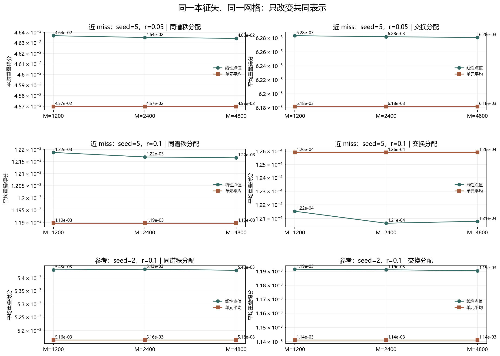

# Floquet-BdG 共同表示稳健性检验

> 日期：2026-11-11。仅重算三个既有对照、六个既有单元的相同本征对；比较线性点值与分片常数单元平均嵌入。不新增类别、不补算体 winding，未计算 N=640。

## 一、只改变共同表示

线性点值嵌入沿用上一轮的 np.interp 与 QR。单元平均嵌入把每个原始格点的复数旋量分量视为该格点单元上的常数；在 M 可整除 N 的嵌套网格上，每个原始值恰好复制到 M/N 个目标单元，再做 QR。

两种方法使用同一批本征矢、同一组 M=1200／2400／4800 和同一个主子空间重叠定义。上一轮线性结果必须逐项复现到1e-12，原冻结剖面必须复现到1e-10。

实测线性结果最大复现差 0.000e+00；原剖面最大误差 2.429e-17。

## 二、逐网格比较

| 对照 | M | 线性同谱秩 | 单元平均同谱秩 | 单元平均−线性 | 线性交换 | 单元平均交换 | 主导分配一致 |
|:---|---:|---:|---:|---:|---:|---:|:---:|
| 5／0.05 | 1200 | 0.0463688 | 0.0456978 | -0.000671032 | 0.00628333 | 0.00618183 | True |
| 5／0.05 | 2400 | 0.0463516 | 0.0456978 | -0.000653806 | 0.00628185 | 0.00618183 | True |
| 5／0.05 | 4800 | 0.0463435 | 0.0456978 | -0.000645708 | 0.00628073 | 0.00618183 | True |
| 5／0.1 | 1200 | 0.00121876 | 0.00118967 | -2.90946e-05 | 0.000121533 | 0.0001259 | True |
| 5／0.1 | 2400 | 0.0012169 | 0.00118967 | -2.72297e-05 | 0.00012066 | 0.0001259 | True |
| 5／0.1 | 4800 | 0.00121655 | 0.00118967 | -2.68777e-05 | 0.000120802 | 0.0001259 | True |
| 2／0.1 | 1200 | 0.00543156 | 0.00516477 | -0.000266798 | 0.00119156 | 0.00114117 | True |
| 2／0.1 | 2400 | 0.00543392 | 0.00516477 | -0.000269157 | 0.00119118 | 0.00114117 | True |
| 2／0.1 | 4800 | 0.0054298 | 0.00516477 | -0.000265033 | 0.00119046 | 0.00114117 | True |

图 1 插入位置：逐网格比较表之后、结论之前。

**图 1**　两种嵌入只改变共同表示；对数坐标显示弱重叠的不同数量级，不改变原始数值。

## 三、结论与解释边界

18个方法×案例×网格组合中，同谱秩分配占优 18/18；M=4800 上两种方法主导分配一致 3/3。两种方法的同谱秩得分最大绝对变化为 0.000671032。

单元平均的同谱秩得分在 9/9 个比较中更低。M=4800 的单元平均得分依次为 0.0456978、0.00118967、0.00516477，绝对重叠仍弱。方向稳定不等于高保真对应。

方法之间应分别比较分配方向和重叠幅度。即使方向一致，也不等于重叠不变；即使数值相近，也不等于物理态已经唯一确定。若方向改变，则先说明嵌入依赖，而不是选择更符合预期的方法。

本轮没有证明表示不变性、同一物理态或真实态追踪，也没有证明排序交换、网格收敛、次近对拓扑性或体 winding。原类别及此前响应计数未改变。

复现：`python research/floquet-bdg-tbc/analyze_embedding_robustness.py`。协议、两种完整重叠矩阵、逐网格差值和来源哈希保存在 `embedding_robustness_analysis.json`。
