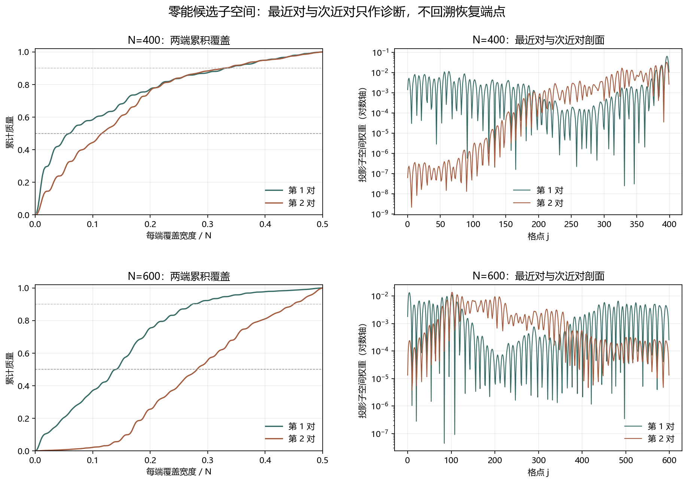

# Floquet-BdG 最近／次近零能子空间诊断

> 日期：2026-11-11。保留 N=400、r=0.1、seed=0 与 N=600、r=0.05、seed=0 的原有输入。仅比较最近两对候选模，未计算 N=640。

## 一、为什么检查次近对

W₀=1 而端点联合判据失败，可能来自候选子空间选择，也可能来自真实的端点非局域化。先检查次近对是否提供不同信息；第二对不回溯恢复，也不替换已经登记的最近邻判据。

| N | 子空间 | 端点权重 | 最大分离比 | L50 | L90 | 原判据 |
|---:|:---|---:|---:|---:|---:|:---|
| 400 | 最近对 | 0.584262 | 0.0010719 | 24 | 133 | 通过 |
| 400 | 次近对 | 0.444075 | 1 | 47 | 131 | 不通过／不提升 |
| 600 | 最近对 | 0.370468 | 0.00325002 | 85 | 164 | 不通过／不提升 |
| 600 | 次近对 | 0.0219004 | 1 | 169 | 270 | 不通过／不提升 |

图 1 插入位置：子空间指标之后、个案解释之前。

**图 1**　上排为 N=400，下排为 N=600；左列是两端累积覆盖，右列是投影子空间剖面。对数轴下界仅用于显示，原始权重保存在 JSON。

## 二、个案读数与选择边界

### N=400

最近对端点权重为 0.584262，次近对为 0.444075；次近对最大分离比为 1。

最近对左／右端权重分别为 0.134974／0.449289；次近对分别为 6.05824e-06／0.444069。

最近对的通过由右端主导，而不是两端同时达到 0.5。单端权重不等于拓扑证明；次近对也主要压在右端，但其最大分离比为 1，与第三近体距离重合，不能作为另一个隔离端点候选。

次近对没有显示更高的端部权重。本例不支持‘仅因最近邻选错子空间就造成端点未通过’这一充分解释。

### N=600

最近对端点权重为 0.370468，次近对为 0.0219004；次近对最大分离比为 1。

最近对左／右端权重分别为 0.225774／0.144694；次近对分别为 0.0139792／0.00792113。

次近对的中心 20% 质量增至 0.189476，L50 增至 169，且最大分离比为 1。它更接近体谱且更离域，因此不能把最近对未通过简单解释为选错备用端点。

次近对没有显示更高的端部权重。本例不支持‘仅因最近邻选错子空间就造成端点未通过’这一充分解释。

## 三、解释边界与下一步

N=400 的局部阈值穿越与 N=600 的尾长增长仍是两类不同边界现象。两个案例具有不同无序强度，不能把观测差异单独归因于链长 N。W₀=1 只保留其原有体不变量含义，不自动等于端点恢复或热力学体边对应。

本次没有计算 N=640。下一步应在同一无序强度、同一嵌套随机流下比较 profile 与候选子空间，区分无序强度效应和尺寸效应；在新对照完成前，不提出普适恢复标度。

复现：`python research/floquet-bdg-tbc/analyze_endpoint_subspaces.py`。原始数组、首对 SHA-256 和既有 winding／端点状态保存在 `endpoint_subspace_analysis.json`。
