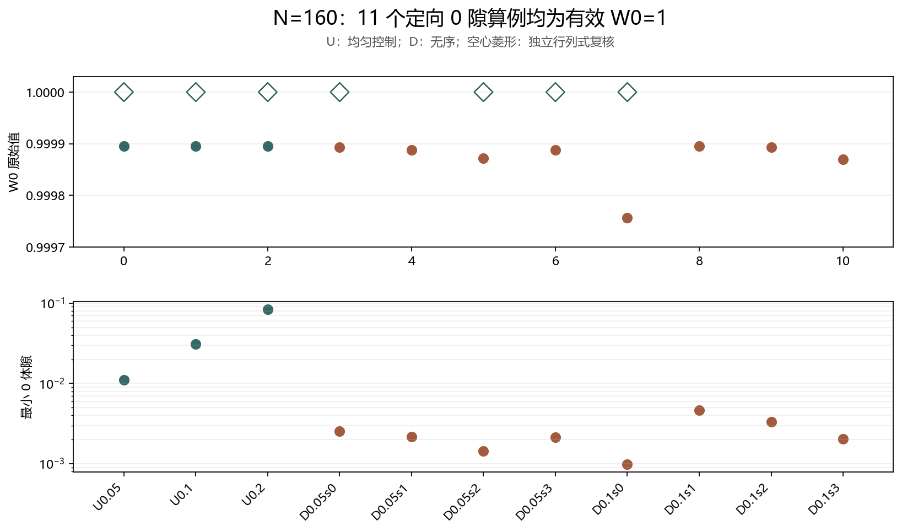
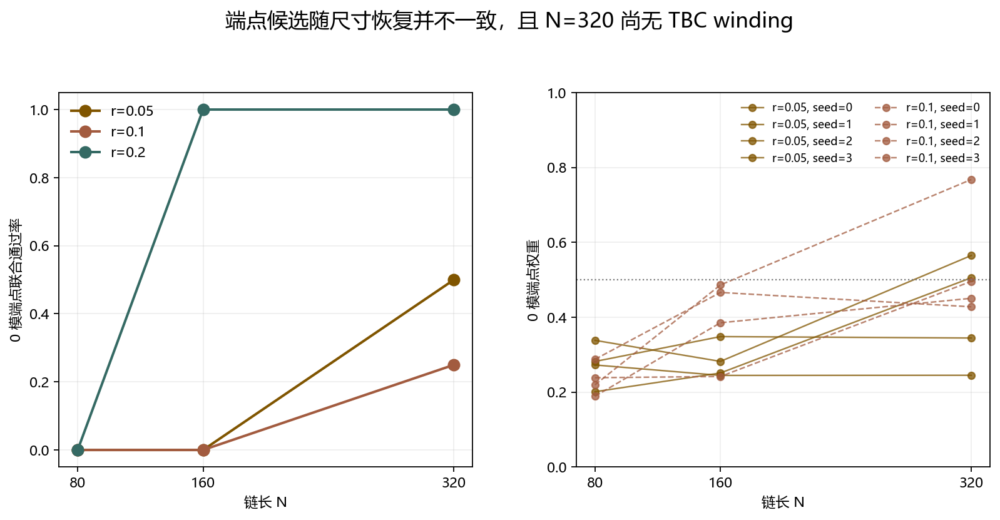

# N=160 Floquet-BdG TBC 0 隙有限尺寸对照

> 日期：2026-11-11。本文检验有限尺寸体 winding 与端点候选的对应关系，不宣称 N=320 winding、热力学极限或材料实验结论。

## 一、定向问题与 11 例注册

三种均匀控制（r=0.05/0.1/0.2）与两种无序强度（r=0.05/0.1）各 4 个固定 seed 组成 11 个 N=160 的 0 隙算例。K 矩阵参数为 rβ，半 kick 角为 rβ，完整对称旋转角为 2rβ。

| r | seed／控制 | 类型 | W0 原始值 | 整数 | 最小体隙 | 端点联合通过 |
|---:|:---:|:---|---:|---:|---:|:---:|
| 0.05 | — | 均匀均值 | 0.999895525013 | 1 | 0.0111281 | True |
| 0.1 | — | 均匀均值 | 0.999895564651 | 1 | 0.0309471 | True |
| 0.2 | — | 均匀均值 | 0.999895564672 | 1 | 0.0839051 | True |
| 0.05 | 0 | 无序 | 0.99989276206 | 1 | 0.00254094 | False |
| 0.05 | 1 | 无序 | 0.999888172153 | 1 | 0.00217039 | False |
| 0.05 | 2 | 无序 | 0.999872112976 | 1 | 0.00143798 | False |
| 0.05 | 3 | 无序 | 0.999887423017 | 1 | 0.00214579 | False |
| 0.1 | 0 | 无序 | 0.999756993098 | 1 | 0.000988875 | False |
| 0.1 | 1 | 无序 | 0.999894882777 | 1 | 0.00461644 | False |
| 0.1 | 2 | 无序 | 0.99989318965 | 1 | 0.00334163 | False |
| 0.1 | 3 | 无序 | 0.999870002524 | 1 | 0.00204504 | False |

全部 11 个主积分结果有效，最近整数均为 1。N=80 时 r=0.05、seed=2/3 的主积分未收敛，在 N=160 转为有效 1。

图 1 插入位置：11 例注册表之后、尺寸趋势之前。

**图 1**　所有 N=160 定向算例均为有效 W0=1；空心菱形为独立行列式复核。

## 二、N=80／160／320 端点趋势

| r | N | 0 模联合通过/4 | 端点权重中位数 | 分离度中位数 |
|---:|---:|---:|---:|---:|
| 0.05 | 80 | 0/4 | 0.277074 | 0.244514 |
| 0.05 | 160 | 0/4 | 0.266469 | 0.15597 |
| 0.05 | 320 | 2/4 | 0.424867 | 0.0184566 |
| 0.1 | 80 | 0/4 | 0.228923 | 0.268401 |
| 0.1 | 160 | 0/4 | 0.425609 | 0.118396 |
| 0.1 | 320 | 1/4 | 0.473033 | 0.0174658 |
| 0.2 | 80 | 0/4 | 0.364491 | 0.141806 |
| 0.2 | 160 | 4/4 | 0.626181 | 0.0210199 |
| 0.2 | 320 | 4/4 | 0.857288 | 6.63687e-05 |

图 2 插入位置：尺寸趋势表之后、逐 seed 对照之前。

**图 2**　端点恢复不是全体一致的单调过程。线段只连接三个已测尺寸，不表示连续相界。

| r | seed | N=80 W0 状态/整数 | N=160 W0 整数 | N=320 端点通过 | N=320 端点权重 |
|---:|---:|:---|:---|:---:|:---:|
| 0.05 | 0 | ok/1 | 1 | False | 0.344437 |
| 0.05 | 1 | ok/1 | 1 | False | 0.244917 |
| 0.05 | 2 | not_converged/None | 1 | True | 0.564727 |
| 0.05 | 3 | not_converged/None | 1 | True | 0.505297 |
| 0.1 | 0 | ok/1 | 1 | False | 0.495586 |
| 0.1 | 1 | ok/1 | 1 | False | 0.45048 |
| 0.1 | 2 | ok/1 | 1 | True | 0.767657 |
| 0.1 | 3 | ok/1 | 1 | False | 0.427787 |

N=320 的 TBC winding 尚未计算，表中只引用既有开链端点观测，不能从端点恢复反推体不变量。

## 三、独立复核与解释边界

独立行列式复核共 7 项，passed=true：三种均匀控制、两种强度的代表无序样本，以及 N=80 的两个原未收敛样本。所有整数一致。

N=160 的 r=0.05 与 r=0.1 无序 0 模端点联合判据均为 0/4 通过，而对应体 W0 均为 1。这真实确认了中间尺寸的判据分离。N=320 的部分端点恢复支持有限尺寸交叉作为后续假说，但尚不能证明热力学体边对应或排除所有体边失配。

下一步应选择 N=320 中端点已恢复的 r=0.05、seed=2/3 与 r=0.1、seed=2 做定向 TBC winding；未恢复的 seed 保留为对照。

复现：python research/floquet-bdg-tbc/run_finite_size.py --merge-only；python research/floquet-bdg-tbc/verify_finite_size.py --merge-only。原始证据：finite_size_zero.json、finite_size_independent.json 及既有 floquet-bdg-disorder/results.json。
