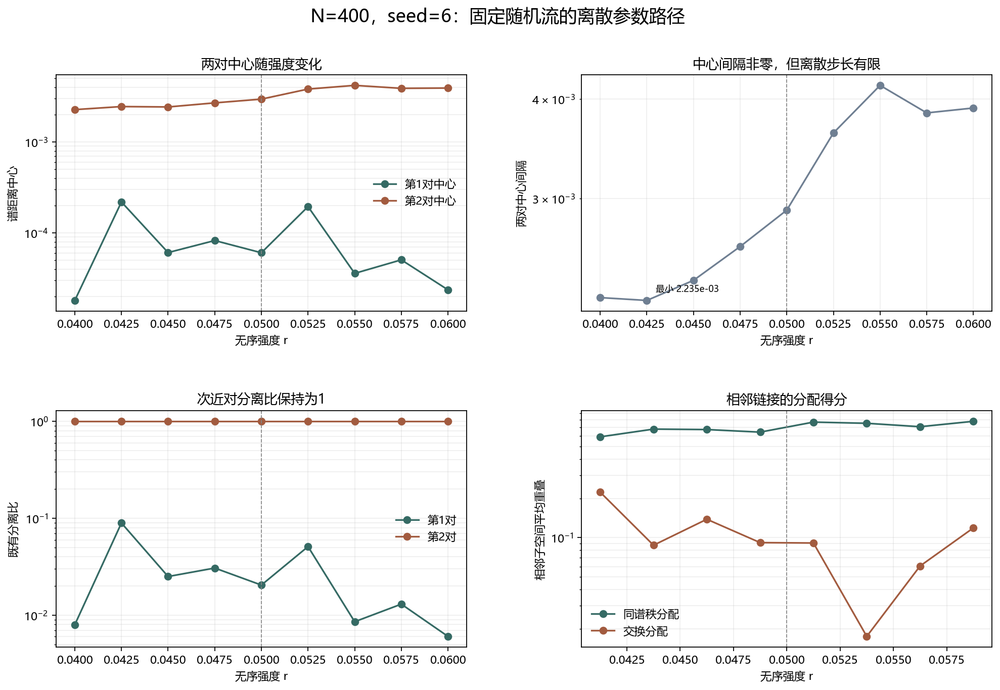

# Floquet-BdG 固定尺寸离散参数路径

> 日期：2026-11-11。N=400、seed=6、固定随机流；r=0.040–0.060 共9个预登记点、8条相邻链接。不新增类别、不补算体 winding，未计算 N=640。

## 一、路径与复核协议

所有强度点使用同一个 beta 随机流，因此变化只来自模型中的无序强度。相同 N 的二维子空间直接 QR 后比较，不再需要跨尺寸插值。

r=0.050 必须复现原冻结剖面、端点权重、谱距离和分离比，容差1e-10只用于复现，不是近简并或交叉阈值。

参考点最大剖面误差 0.000e+00，最大谱距离误差 0.000e+00。

## 二、逐点谱结构

| r | 最近对中心 | 次近对中心 | 中心间隔 | 最近对分离比 | 次近对分离比 | 最近对诊断 | 次近对诊断 |
|---:|---:|---:|---:|---:|---:|:---:|:---:|
| 0.04 | 1.81018e-05 | 0.00227129 | 0.00225319 | 0.00796985 | 1 | True | False |
| 0.0425 | 0.000219169 | 0.00245396 | 0.0022348 | 0.0893123 | 1 | True | False |
| 0.045 | 6.08334e-05 | 0.00242931 | 0.00236847 | 0.0250415 | 1 | True | False |
| 0.0475 | 8.25111e-05 | 0.00269408 | 0.00261157 | 0.0306268 | 1 | True | False |
| 0.05 | 6.05555e-05 | 0.00296207 | 0.00290152 | 0.0204436 | 1 | True | False |
| 0.0525 | 0.000194847 | 0.00382145 | 0.0036266 | 0.0509879 | 1 | False | False |
| 0.055 | 3.59147e-05 | 0.00419726 | 0.00416135 | 0.0085567 | 1 | False | False |
| 0.0575 | 5.05975e-05 | 0.00389357 | 0.00384297 | 0.0129951 | 1 | False | False |
| 0.06 | 2.36818e-05 | 0.00392146 | 0.00389778 | 0.00603902 | 1 | False | False |

## 三、相邻子空间重叠

| 从 r | 到 r | 同谱秩得分 | 交换得分 | 主导分配 | 中心间隔变化 |
|---:|---:|---:|---:|:---|---:|
| 0.04 | 0.0425 | 0.592588 | 0.223146 | diagonal | -1.83918e-05 |
| 0.0425 | 0.045 | 0.678978 | 0.0875044 | diagonal | 0.000133677 |
| 0.045 | 0.0475 | 0.673658 | 0.138381 | diagonal | 0.000243099 |
| 0.0475 | 0.05 | 0.643734 | 0.0916242 | diagonal | 0.000289944 |
| 0.05 | 0.0525 | 0.768196 | 0.0909926 | diagonal | 0.000725083 |
| 0.0525 | 0.055 | 0.752284 | 0.0175158 | diagonal | 0.000534752 |
| 0.055 | 0.0575 | 0.708312 | 0.0606291 | diagonal | -0.000318375 |
| 0.0575 | 0.06 | 0.779074 | 0.11876 | diagonal | 5.48062e-05 |

图 1 插入位置：相邻链接表之后、结论之前。

**图 1**　固定随机流下，谱中心、中心间隔、既有分离比和相邻重叠随强度的变化。虚线为原参考点 r=0.050。

## 四、结论与边界

8条链接中，同谱秩分配占优 8，交换分配占优 0，精确并列 0。本网格没有交换分配链接。

同尺寸相邻重叠的范围为 0.592588–0.779074，高于此前跨尺寸弱重叠，说明同 N 的态对应更可辨识；但8个离散链接仍不等于连续态追踪。

最小中心间隔为 0.0022348，出现在 r=0.0425；相邻中心间隔最大绝对变化为 0.000725083。

最近对 profile 联合诊断通过的强度为 [0.04, 0.0425, 0.045, 0.0475, 0.05]；次近对通过强度为 []。这些既有诊断不构成体 winding 证明。

离散路径上的交换分配链接只能作为细化候选，不能直接称为真实态交换或避免交叉。即使所有链接同谱秩，也不能把有限步长外推为连续路径不变性。

本轮没有证明连续路径、谱交叉、避免交叉、真实态追踪、次近对拓扑性或体 winding。原类别和此前计数未改变。

复现：`python research/floquet-bdg-tbc/analyze_fixed_n_path.py`。9个参数点、8条重叠链接和来源哈希保存在 `fixed_n_path_analysis.json`。
