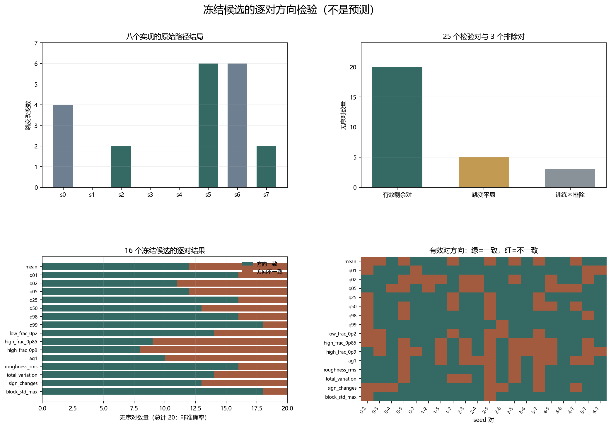

# Floquet-BdG 剩余种子候选逐对方向检验

> 日期：2026-11-12。16 个冻结候选各检验25个剩余种子相关对，共400条记录；20对跳变计数不同，5对为跳变平局。训练种子内部3对排除。只执行预登记方向检验，不是预测，不计算相关性、回归、p 值或预测准确率。不补算体 winding，未计算 N=640。

## 一、路径结局与检验对

| seed | 0 | 1 | 2 | 3 | 4 | 5 | 6 | 7 |
|---:|---:|---:|---:|---:|---:|---:|---:|---:|
| 跳变改变数 | 4 | 0 | 2 | 0 | 0 | 6 | 6 | 2 |

25 对由全部8个种子的28对中排除 seed=0、1、6 内部的3对得到。跳变计数相同的5对不提供方向信息：`(1,3)`、`(1,4)`、`(2,7)`、`(3,4)`、`(5,6)`。其余20对逐候选检查严格同向或反向。

图 1 插入位置：检验对说明之后、候选汇总之前。

**图 1**　路径结局、检验对类型、16个候选的一致与不一致计数，以及20个有效对的逐格结果。一致对数不是预测准确率。

## 二、全部候选汇总

| 指标 | 方向 | 一致对 | 不一致对 | 跳变平局 | 候选零差分 | 规则结论 |
|:---|:---|---:|---:|---:|---:|:---|
| mean | opposite_to_jump_changes | 12 | 8 | 5 | 0 | not_all_informative_pairs_consistent |
| q01 | same_as_jump_changes | 16 | 4 | 5 | 0 | not_all_informative_pairs_consistent |
| q02 | same_as_jump_changes | 11 | 9 | 5 | 0 | not_all_informative_pairs_consistent |
| q05 | same_as_jump_changes | 12 | 8 | 5 | 0 | not_all_informative_pairs_consistent |
| q25 | opposite_to_jump_changes | 16 | 4 | 5 | 0 | not_all_informative_pairs_consistent |
| q50 | opposite_to_jump_changes | 13 | 7 | 5 | 0 | not_all_informative_pairs_consistent |
| q98 | same_as_jump_changes | 16 | 4 | 5 | 0 | not_all_informative_pairs_consistent |
| q99 | same_as_jump_changes | 18 | 2 | 5 | 0 | not_all_informative_pairs_consistent |
| low_frac_0p2 | same_as_jump_changes | 14 | 6 | 5 | 1 | not_all_informative_pairs_consistent |
| high_frac_0p85 | opposite_to_jump_changes | 9 | 11 | 5 | 0 | not_all_informative_pairs_consistent |
| high_frac_0p9 | opposite_to_jump_changes | 8 | 12 | 5 | 0 | not_all_informative_pairs_consistent |
| lag1 | opposite_to_jump_changes | 10 | 10 | 5 | 0 | not_all_informative_pairs_consistent |
| roughness_rms | same_as_jump_changes | 16 | 4 | 5 | 0 | not_all_informative_pairs_consistent |
| total_variation | same_as_jump_changes | 14 | 6 | 5 | 0 | not_all_informative_pairs_consistent |
| sign_changes | same_as_jump_changes | 13 | 7 | 5 | 0 | not_all_informative_pairs_consistent |
| block_std_max | same_as_jump_changes | 18 | 2 | 5 | 0 | not_all_informative_pairs_consistent |

按全部20个有效对都必须一致的严格规则，共有 0 个候选满足；其余 16 个不满足。该结论只描述冻结规则的结果，不是预测验证、统计显著性或因果归因。所有失败和平局均保留，没有选择性筛选。

## 三、独立复核与证据边界

候选值此前已用于描述统计，因此这不是完全未触碰的外部验证集；只有路径跳变结局是新生成的。当前工作至多是结局盲的逐对方向检验，不是外部实验重复。

不删除不一致对，不删除跳变平局，不计算方向一致比例作为预测准确率，不拟合预测模型，不计算相关性、回归或 p 值。候选全对一致也不构成统计显著性；不一致也不等于证伪物理理论。

本报告不新增 Floquet 单元，不外推真实态交换、谱交叉、连续路径、普遍尺寸律、因果机制、热力学极限或新类别。

复现：`python research/floquet-bdg-tbc/analyze_holdout_pair_evaluation.py`；独立复核：`python research/floquet-bdg-tbc/verify_holdout_pair_evaluation.py`。全部400条逐对记录保存在 `holdout_pair_evaluation_analysis.json`。
