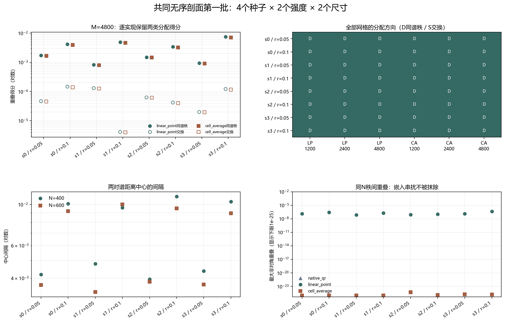

# Floquet-BdG 共同无序剖面第一批尺寸隔离

> 日期：2026-11-11。预登记 seed=0、1、2、3，r=0.05、0.1；8个无序实现、16个尺寸控制单元。每个 seed 的主网格 M=4800 只生成一次，两个强度复用同一主剖面。不新增类别，不补算体 winding，未计算 N=640。

## 一、协议与谱结构

每个粗格点的 β 值等于其覆盖主格点的算术平均，因此 N=400 和 N=600 通过嵌套块平均共享同一无序结构。两个强度使用同一主剖面，是配对控制而非独立样本。

所有预登记实现、网格和分配方向均保留，不筛选支持旧候选或支持同谱秩的结果。跨尺寸重叠不归一化，跨表示自一致性也不作为校正因子。

| seed | r | N | 最近对中心 | 次近对中心 | 中心间隔 |
|---:|---:|---:|---:|---:|---:|
| 0 | 0.05 | 400 | 8.55267e-05 | 0.00427511 | 0.00418958 |
| 0 | 0.05 | 600 | 5.15282e-06 | 0.00368308 | 0.00367793 |
| 0 | 0.1 | 400 | 3.62433e-06 | 0.0100855 | 0.0100818 |
| 0 | 0.1 | 600 | 3.58801e-08 | 0.00919662 | 0.00919658 |
| 1 | 0.05 | 400 | 0.000143316 | 0.00492612 | 0.0047828 |
| 1 | 0.05 | 600 | 7.71528e-06 | 0.00337926 | 0.00337154 |
| 1 | 0.1 | 400 | 1.73444e-06 | 0.00961996 | 0.00961822 |
| 1 | 0.1 | 600 | 3.58109e-08 | 0.0100114 | 0.0100114 |
| 2 | 0.05 | 400 | 5.89023e-05 | 0.00401614 | 0.00395724 |
| 2 | 0.05 | 600 | 2.23256e-06 | 0.00382939 | 0.00382716 |
| 2 | 0.1 | 400 | 5.58933e-07 | 0.0110335 | 0.0110329 |
| 2 | 0.1 | 600 | 6.73751e-11 | 0.00952047 | 0.00952047 |
| 3 | 0.05 | 400 | 9.23277e-05 | 0.0044666 | 0.00437427 |
| 3 | 0.05 | 600 | 7.92715e-06 | 0.00370783 | 0.0036999 |
| 3 | 0.1 | 400 | 1.90531e-06 | 0.0103548 | 0.0103529 |
| 3 | 0.1 | 600 | 3.35471e-08 | 0.00894951 | 0.00894947 |

## 二、三种网格与两种表示

D 表示同谱秩主导，S 表示交换主导；三格顺序均为 M=1200／2400／4800。下表只是描述性计数，不是统计显著性检验。

| seed | r | 线性点值 D/S | 单元平均 D/S | M=4800线性同谱秩 | M=4800线性交换 | M=4800单元同谱秩 | M=4800单元交换 |
|---:|---:|:---:|:---:|---:|---:|---:|---:|
| 0 | 0.05 | D／D／D | D／D／D | 0.00171052 | 4.6552e-05 | 0.00166723 | 4.54653e-05 |
| 0 | 0.1 | D／D／D | D／D／D | 0.00418823 | 0.000146772 | 0.00395012 | 0.000138794 |
| 1 | 0.05 | D／D／D | D／D／D | 0.000821077 | 0.000130047 | 0.000798183 | 0.000126364 |
| 1 | 0.1 | D／D／D | D／D／D | 0.00488908 | 4.13753e-06 | 0.00466802 | 3.98267e-06 |
| 2 | 0.05 | D／D／D | D／D／D | 0.00149556 | 6.27087e-05 | 0.00145002 | 6.116e-05 |
| 2 | 0.1 | D／D／D | D／D／D | 0.00338071 | 4.17625e-05 | 0.00321461 | 3.98266e-05 |
| 3 | 0.05 | D／D／D | D／D／D | 0.000937893 | 1.98894e-05 | 0.0009124 | 1.94599e-05 |
| 3 | 0.1 | D／D／D | D／D／D | 0.00742296 | 0.000121601 | 0.0070719 | 0.000115589 |

两种表示各自均有24个网格结果。线性点值计数为 `{'diagonal': 24}`，单元平均计数为 `{'diagonal': 24}`。

图 1 插入位置：全网格分配表之后、强度配对与边界之前。

**图 1**　逐实现分配得分、全网格方向、中心间隔和秩间控制。右下图仅为显示设置1e-25下限，JSON保留原值。

## 三、同主剖面的强度配对

| seed | N=400中心间隔差（0.1−0.05） | N=600中心间隔差（0.1−0.05） | 线性方向改变网格数 | 单元方向改变网格数 |
|---:|---:|---:|---:|---:|
| 0 | 0.00589224 | 0.00551865 | 0 | 0 |
| 1 | 0.00483542 | 0.00663981 | 0 | 0 |
| 2 | 0.00707571 | 0.00569331 | 0 | 0 |
| 3 | 0.00597865 | 0.00524957 | 0 | 0 |

## 四、实现依赖范围与解释边界

跨表示自一致性范围为 0.987189–0.995441。原生秩间重叠最大为 5.29529e-25，单元平均最大为 5.29521e-25，线性点值最大为 4.25189e-07。这些指标分开记录，不合并成机制名称。

8个实现中，两种表示均在全部三个网格同谱秩主导的实现数为 8；两种表示逐网格方向一致的实现数为 8。它们只描述本批指定共同无序剖面，不能外推为普遍尺寸律、真实态交换或谱交叉。

seed=6、r=0.05 的既有共同剖面定向控制不在本批计数内，其源文件哈希单独绑定。旧交换候选仍属于不同无序实现，不能与任何本批结果直接相减并命名为尺寸效应。

本批扩展的是实现依赖范围的描述性证据，不构成统计显著性、连续路径、次近对拓扑性或热力学极限结论。下一批应沿用同一协议，而不是根据本批结果修改种子或强度。

复现：`python research/floquet-bdg-tbc/analyze_matched_beta_batch_a.py`。完整主剖面、16个控制单元、重叠矩阵、跨表示与秩间控制保存在 `matched_beta_batch_a_analysis.json`。
