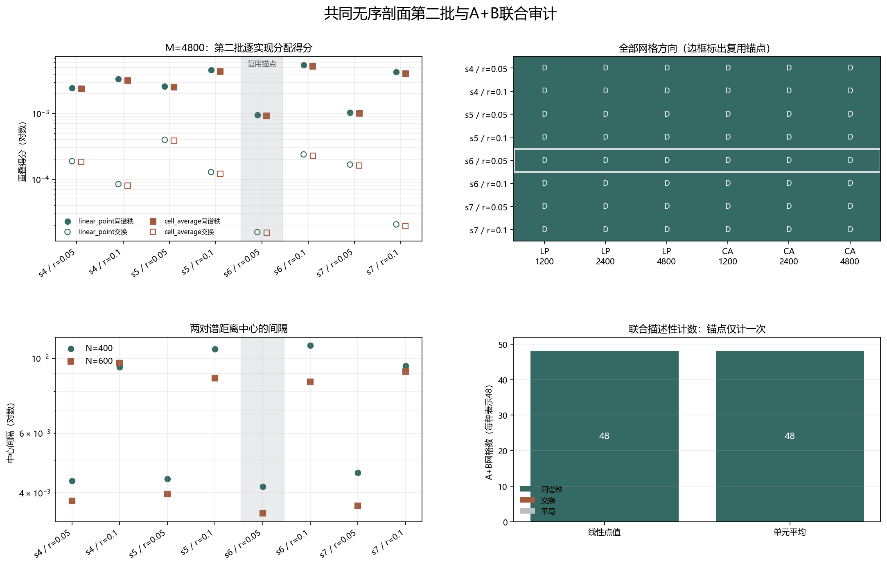

# Floquet-BdG 共同无序剖面第二批尺寸隔离

> 协议登记：2026-11-11；报告复核：2026-11-12。seed=4、5、6、7，r=0.05、0.1；7个新实现加1个复用锚点，共8个实现、16个展示单元。不新增类别，不补算体 winding，未计算 N=640。

## 一、协议、单次锚点与谱结构

每个粗格点的 β 值等于其覆盖主格点的算术平均，因此 N=400 和 N=600 通过嵌套块平均共享同一无序结构。两个强度使用同一主剖面，是配对控制而非独立样本。

seed=6、r=0.05 是复用锚点：直接读取既有共同剖面分析，不作为新实现重复计数；第二批独立复核仍重新检查它的谱。所有预登记结果保留，不筛选有利方向。跨尺寸重叠不归一化。

| seed | r | 证据角色 | N | 最近对中心 | 次近对中心 | 中心间隔 |
|---:|---:|:---|---:|---:|---:|---:|
| 4 | 0.05 | 本批新增 | 400 | 8.32229e-05 | 0.00442456 | 0.00434133 |
| 4 | 0.05 | 本批新增 | 600 | 1.83408e-05 | 0.00380355 | 0.00378521 |
| 4 | 0.1 | 本批新增 | 400 | 1.83198e-06 | 0.00941809 | 0.00941626 |
| 4 | 0.1 | 本批新增 | 600 | 3.8599e-08 | 0.00968021 | 0.00968017 |
| 5 | 0.05 | 本批新增 | 400 | 0.000157913 | 0.00455734 | 0.00439942 |
| 5 | 0.05 | 本批新增 | 600 | 6.1275e-06 | 0.00397663 | 0.0039705 |
| 5 | 0.1 | 本批新增 | 400 | 5.13976e-06 | 0.0106464 | 0.0106413 |
| 5 | 0.1 | 本批新增 | 600 | 1.44859e-07 | 0.00873696 | 0.00873681 |
| 6 | 0.05 | 复用锚点 | 400 | 7.94541e-05 | 0.00425786 | 0.0041784 |
| 6 | 0.05 | 复用锚点 | 600 | 2.27668e-07 | 0.00348161 | 0.00348138 |
| 6 | 0.1 | 本批新增 | 400 | 5.78045e-07 | 0.0109173 | 0.0109167 |
| 6 | 0.1 | 本批新增 | 600 | 3.96796e-08 | 0.0085095 | 0.00850946 |
| 7 | 0.05 | 本批新增 | 400 | 0.000110101 | 0.00469673 | 0.00458663 |
| 7 | 0.05 | 本批新增 | 600 | 1.6093e-05 | 0.00368157 | 0.00366547 |
| 7 | 0.1 | 本批新增 | 400 | 7.53537e-07 | 0.00951127 | 0.00951052 |
| 7 | 0.1 | 本批新增 | 600 | 1.76729e-08 | 0.00913795 | 0.00913794 |

## 二、三种网格与两种表示

D 表示同谱秩主导，S 表示交换主导；三格顺序均为 M=1200／2400／4800。下表只是描述性计数，不是统计显著性检验。

| seed | r | 角色 | 线性点值 D/S | 单元平均 D/S | M=4800线性同谱秩 | M=4800线性交换 | M=4800单元同谱秩 | M=4800单元交换 |
|---:|---:|:---:|:---:|:---:|---:|---:|---:|---:|
| 4 | 0.05 | 新增 | D／D／D | D／D／D | 0.00243757 | 0.000188961 | 0.00237473 | 0.000184198 |
| 4 | 0.1 | 新增 | D／D／D | D／D／D | 0.00335556 | 8.4669e-05 | 0.00317537 | 7.99306e-05 |
| 5 | 0.05 | 新增 | D／D／D | D／D／D | 0.00258552 | 0.000398978 | 0.00252232 | 0.000389483 |
| 5 | 0.1 | 新增 | D／D／D | D／D／D | 0.00457662 | 0.000128639 | 0.00434463 | 0.000121792 |
| 6 | 0.05 | 锚点 | D／D／D | D／D／D | 0.00095354 | 1.57189e-05 | 0.000929124 | 1.54108e-05 |
| 6 | 0.1 | 新增 | D／D／D | D／D／D | 0.0055008 | 0.000239245 | 0.00521663 | 0.000227881 |
| 7 | 0.05 | 新增 | D／D／D | D／D／D | 0.00104245 | 0.00016747 | 0.00101187 | 0.000162454 |
| 7 | 0.1 | 新增 | D／D／D | D／D／D | 0.004255 | 2.06037e-05 | 0.00401756 | 1.94741e-05 |

第二批两种表示各自均有24个网格结果。线性点值：同谱秩 24、交换 0、平局 0；单元平均：同谱秩 24、交换 0、平局 0。

图 1 插入位置：全网格分配表之后、强度配对与联合审计之前。

**图 1**　逐实现分配得分、全网格方向、中心间隔及A+B联合计数。灰底和边框标出复用锚点，联合计数中锚点只出现一次。

## 三、同主剖面的强度配对

| seed | N=400中心间隔差（0.1−0.05） | N=600中心间隔差（0.1−0.05） | 线性方向改变网格数 | 单元方向改变网格数 |
|---:|---:|---:|---:|---:|
| 4 | 0.00507493 | 0.00589497 | 0 | 0 |
| 5 | 0.00624188 | 0.00476631 | 0 | 0 |
| 6 | 0.00673829 | 0.00502808 | 0 | 0 |
| 7 | 0.00492389 | 0.00547246 | 0 | 0 |

## 四、A+B联合描述性审计与边界

第一批与第二批共有 16 个互不重复的“种子—强度”键和 32 个尺寸单元。联合线性点值：同谱秩 48、交换 0、平局 0；联合单元平均：同谱秩 48、交换 0、平局 0。每种表示均为48个网格结果，复用锚点只计一次。

联合跨表示自一致性范围为 0.987189–0.995468；联合中心间隔尺寸差范围为 -0.00240724 至 0.000393128。第二批线性点值秩间重叠最大为 5.1242e-07，嵌入诱导串扰仍单独保留。

联合结果只描述当前指定的共同无序剖面，不能外推为普遍尺寸律、真实态交换或谱交叉。旧交换候选仍属于不同无序实现，不能与联合结果直接相减并命名为尺寸效应。

本批闭合的是第二批预登记样本与单次锚点的联合描述性覆盖，不构成统计显著性、连续路径、次近对拓扑性或热力学极限结论。后续应依据预先声明的新问题扩展，而不是根据有利结果选择样本。

复现：`python research/floquet-bdg-tbc/analyze_matched_beta_batch_b.py`。完整主剖面、角色、重叠矩阵、跨表示与秩间控制保存在 `matched_beta_batch_b_analysis.json`。
