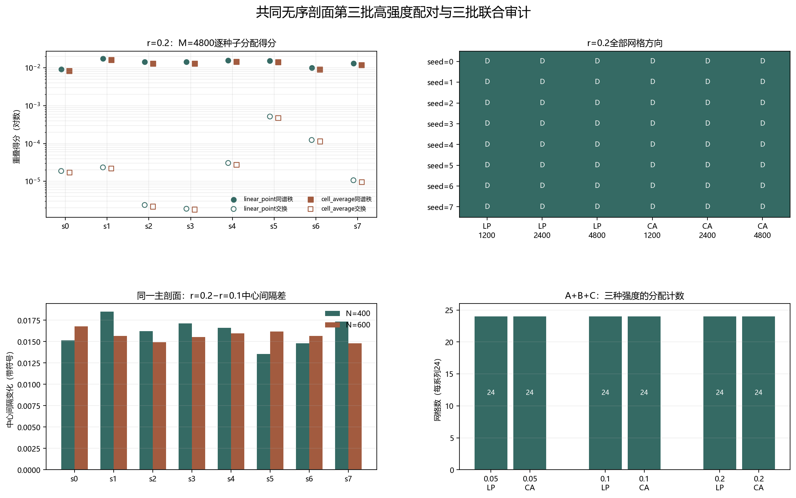

# Floquet-BdG 共同无序剖面第三批高强度配对

> 协议登记与报告复核：2026-11-12。既有8个主剖面统一新增 r=0.2，共8个新实现、16个尺寸单元，与既有 r=0.1 结果配对。不新增类别，不补算体 winding，未计算 N=640。

## 一、协议与谱结构

每个粗格点的 β 值等于其覆盖主格点的算术平均，因此 N=400 和 N=600 通过嵌套块平均共享同一无序结构。r=0.2 与 r=0.1 使用完全相同的主剖面，是配对控制而非独立样本。

此前结果只读不重算。所有预登记实现、网格和分配方向均保留，不筛选有利案例，也不根据本批结果选择下一强度。跨尺寸重叠不归一化。

| seed | r | N | 最近对中心 | 次近对中心 | 中心间隔 |
|---:|---:|---:|---:|---:|---:|
| 0 | 0.2 | 400 | 1.06773e-09 | 0.025236 | 0.025236 |
| 0 | 0.2 | 600 | 5.63695e-14 | 0.025991 | 0.025991 |
| 1 | 0.2 | 400 | 1.62998e-09 | 0.0281422 | 0.0281422 |
| 1 | 0.2 | 600 | 1.11699e-12 | 0.0256812 | 0.0256812 |
| 2 | 0.2 | 400 | 4.92799e-10 | 0.0272583 | 0.0272583 |
| 2 | 0.2 | 600 | 2.6894e-12 | 0.0244527 | 0.0244527 |
| 3 | 0.2 | 400 | 1.30989e-10 | 0.0275044 | 0.0275044 |
| 3 | 0.2 | 600 | 3.16004e-13 | 0.0245009 | 0.0245009 |
| 4 | 0.2 | 400 | 1.93408e-09 | 0.0260208 | 0.0260208 |
| 4 | 0.2 | 600 | 2.57781e-13 | 0.0256663 | 0.0256663 |
| 5 | 0.2 | 400 | 5.70632e-10 | 0.0241901 | 0.0241901 |
| 5 | 0.2 | 600 | 7.28438e-13 | 0.0249131 | 0.0249131 |
| 6 | 0.2 | 400 | 2.6184e-09 | 0.025713 | 0.025713 |
| 6 | 0.2 | 600 | 1.05119e-12 | 0.0241619 | 0.0241619 |
| 7 | 0.2 | 400 | 1.92945e-09 | 0.0268668 | 0.0268668 |
| 7 | 0.2 | 600 | 6.14584e-13 | 0.0239233 | 0.0239233 |

## 二、三种网格与两种表示

D 表示同谱秩主导，S 表示交换主导；三格顺序均为 M=1200／2400／4800。下表只是描述性计数，不是统计显著性检验。

| seed | 线性点值 D/S | 单元平均 D/S | M=4800线性同谱秩 | M=4800线性交换 | M=4800单元同谱秩 | M=4800单元交换 |
|---:|:---:|:---:|---:|---:|---:|---:|
| 0 | D／D／D | D／D／D | 0.00914712 | 1.88129e-05 | 0.00823475 | 1.70986e-05 |
| 1 | D／D／D | D／D／D | 0.0175464 | 2.34124e-05 | 0.0161797 | 2.17298e-05 |
| 2 | D／D／D | D／D／D | 0.0142775 | 2.37387e-06 | 0.0129713 | 2.15372e-06 |
| 3 | D／D／D | D／D／D | 0.0142211 | 1.89051e-06 | 0.0128032 | 1.79002e-06 |
| 4 | D／D／D | D／D／D | 0.0157867 | 3.06123e-05 | 0.0143579 | 2.74318e-05 |
| 5 | D／D／D | D／D／D | 0.0153729 | 0.000517589 | 0.0139902 | 0.000471065 |
| 6 | D／D／D | D／D／D | 0.0100071 | 0.000124012 | 0.0089945 | 0.000113124 |
| 7 | D／D／D | D／D／D | 0.0131356 | 1.071e-05 | 0.0118212 | 9.50835e-06 |

第三批两种表示各自均有24个网格结果。线性点值：同谱秩 24、交换 0、平局 0；单元平均：同谱秩 24、交换 0、平局 0。

图 1 插入位置：全网格分配表之后、高强度配对与联合审计之前。

**图 1**　r=0.2分配得分与方向、相对r=0.1的中心间隔变化，以及三种强度的联合分配计数。

## 三、同主剖面的高强度配对

| seed | N=400中心间隔差（0.2−0.1） | N=600中心间隔差（0.2−0.1） | 线性方向改变网格数 | 单元方向改变网格数 |
|---:|---:|---:|---:|---:|
| 0 | 0.0151542 | 0.0167944 | 0 | 0 |
| 1 | 0.018524 | 0.0156698 | 0 | 0 |
| 2 | 0.0162253 | 0.0149322 | 0 | 0 |
| 3 | 0.0171515 | 0.0155514 | 0 | 0 |
| 4 | 0.0166046 | 0.0159861 | 0 | 0 |
| 5 | 0.0135488 | 0.0161763 | 0 | 0 |
| 6 | 0.0147963 | 0.0156525 | 0 | 0 |
| 7 | 0.0173563 | 0.0147853 | 0 | 0 |

N=400中心间隔变化范围为 0.0135488 至 0.018524；N=600为 0.0147853 至 0.0167944。

线性点值同谱秩得分比范围为 1.81921–4.7076，单元平均为 1.7242–4.52164。比值只描述同一配对的数值变化，不归一化重叠。

## 四、A+B+C联合描述性审计与边界

三批共有 24 个互不重复的“种子—强度”键和 48 个尺寸单元。联合线性点值：同谱秩 72、交换 0、平局 0；联合单元平均：同谱秩 72、交换 0、平局 0。每种表示均为72个网格结果，既有复用锚点在联合证据中仍只计一次。

联合跨表示自一致性范围为 0.974696–0.995468；联合中心间隔尺寸差范围为 -0.00300353 至 0.00075494。第三批线性点值秩间重叠最大为 5.48289e-07，嵌入诱导串扰仍单独保留。

联合结果只描述当前指定的共同无序剖面，不能外推为普遍尺寸律、普遍强度律、真实态交换或谱交叉。旧交换候选仍属于不同无序实现，不能与联合结果直接相减并命名为尺寸效应。

本批闭合的是 r=0.2 的预登记配对和三批联合描述性覆盖，不构成统计显著性、连续路径、次近对拓扑性或热力学极限结论。后续应围绕机制问题设计检验，而不是仅凭有利方向继续增加强度。

复现：`python research/floquet-bdg-tbc/analyze_matched_beta_batch_c.py`。完整主剖面、配对、重叠矩阵、跨表示与秩间控制保存在 `matched_beta_batch_c_analysis.json`。
