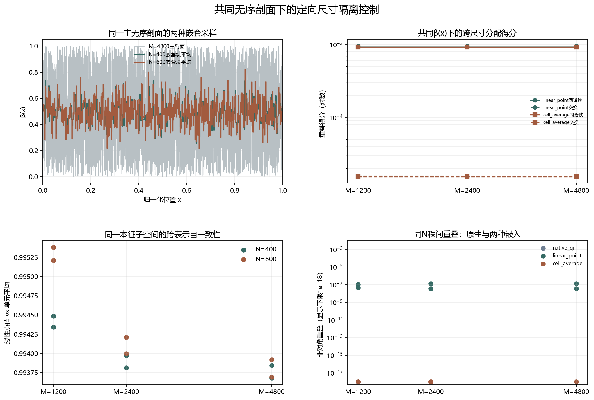

# Floquet-BdG 共同无序剖面尺寸隔离控制

> 日期：2026-11-11。仅 seed=6、r=0.05 的两个新控制单元。主网格 M=4800 固定后，以嵌套块平均采样到 N=400 与 N=600。不新增类别，不补算体 winding，未计算 N=640。

## 一、共同无序剖面与尺寸隔离

主剖面只生成一次。每个粗格点的 β 值等于其覆盖主格点的算术平均，因此 N=400 和 N=600 共享同一连续坐标下的嵌套无序结构，而不是仅共享随机种子名称。

主剖面 SHA-256 为 `cba0554b383085eb40703741fa55c2228161aa09f222fad331e027e2f62c11ff`；两种采样的嵌套块平均最大误差均为 0.0。

跨尺寸重叠仍使用同一主子空间定义，不归一化修正重叠，也不把跨表示自一致性当作校正因子。旧交换候选属于不同无序实现，不能与本次控制直接相减并命名为尺寸效应。

## 二、谱结构与跨表示结果

| N | 最近对中心 | 次近对中心 | 中心间隔 | 最近对端点权重 | 最近对L50 | 最近对诊断 |
|---:|---:|---:|---:|---:|---:|:---:|
| 400 | 7.94541e-05 | 0.00425786 | 0.0041784 | 0.580525 | 36 | True |
| 600 | 2.27668e-07 | 0.00348161 | 0.00348138 | 0.71569 | 38 | True |

| 方法 | M | 同谱秩得分 | 交换得分 | 主导分配 |
|:---|---:|---:|---:|:---|
| linear_point | 1200 | 0.000953715 | 1.57279e-05 | diagonal |
| linear_point | 2400 | 0.000953901 | 1.57229e-05 | diagonal |
| linear_point | 4800 | 0.00095354 | 1.57189e-05 | diagonal |
| cell_average | 1200 | 0.000929124 | 1.54108e-05 | diagonal |
| cell_average | 2400 | 0.000929124 | 1.54108e-05 | diagonal |
| cell_average | 4800 | 0.000929124 | 1.54108e-05 | diagonal |

图 1 插入位置：分配表之后、结论之前。

**图 1**　主剖面与嵌套采样、跨尺寸得分、跨表示自一致性及同N秩间控制。右下图仅为显示设置1e-18下限。

## 三、结论与边界

跨表示自一致性范围为 0.993681–0.99538。原生秩间重叠最大为 9.80374e-25，单元平均最大为 9.80399e-25，线性点值最大为 1.42957e-07。这些指标分开记录，不合并成机制名称。

M=4800 上，线性点值主导分配为 diagonal，单元平均主导分配为 diagonal。它们只描述这一条共同无序剖面下的数值关系，不能外推为普遍尺寸律、真实态交换或谱交叉。

本轮闭合的是此前缺失的共同 β(x) 定向控制，但不能外推为所有种子、所有强度或所有无序分布的因果结论。下一步应把同一协议扩展到预登记种子和强度，而不是后验选择有利剖面。

复现：`python research/floquet-bdg-tbc/analyze_matched_beta_control.py`。主剖面、两个控制单元、完整矩阵、跨表示与秩间控制保存在 `matched_beta_control_analysis.json`。
