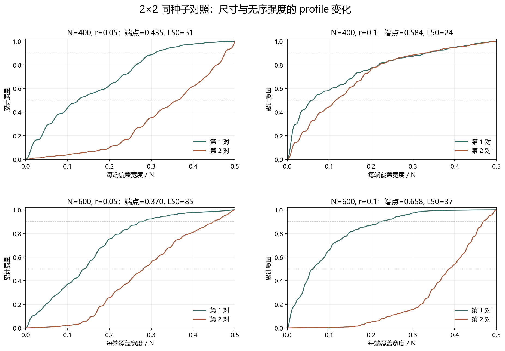

# Floquet-BdG 同强度 2×2 尺寸对照

> 日期：2026-11-11。N=400／600 × r=0.05／0.1，seed=0，使用同一嵌套随机流。新案例只做 profile 诊断，不补算体 winding，未计算 N=640。

## 一、四格实测结果

| N | r | 最近对端点权重 | L50 | L90 | 中心20%质量 | 最近对诊断 |
|---:|---:|---:|---:|---:|---:|:---|
| 400 | 0.05 | 0.43546 | 51 | 124 | 0.0242148 | False |
| 400 | 0.1 | 0.584262 | 24 | 133 | 0.0513685 | True |
| 600 | 0.05 | 0.370468 | 85 | 164 | 0.0229577 | False |
| 600 | 0.1 | 0.657705 | 37 | 136 | 0.00297626 | True |

图 1 插入位置：四格实测表之后、因子对照之前。

**图 1**　四格均同时给出最近对与次近对；次近对只作诊断，不回溯改变原端点结论。

## 二、固定强度的尺寸对照

| r | ΔL50（N600−N400） | ΔL90 | Δ端点权重 | Δ中心20%质量 |
|---:|---:|---:|---:|---:|
| 0.05 | 34 | 40 | -0.0649919 | -0.00125709 |
| 0.1 | 13 | 3 | 0.0734431 | -0.0483922 |

两条尺寸对照分别在 r=0.05 与 r=0.1 下计算，不把此前不同强度案例直接相减。

## 三、固定尺寸的强度对照

| N | ΔL50（r0.1−r0.05） | ΔL90 | Δ端点权重 | Δ中心20%质量 |
|---:|---:|---:|---:|---:|
| 400 | -27 | 9 | 0.148802 | 0.0271537 |
| 600 | -48 | -28 | 0.287237 | -0.0199814 |

描述性交互项（r=0.1 的尺寸差减去 r=0.05 的尺寸差）为：ΔL50=-21，ΔL90=-37，Δ端点权重=0.138435，Δ中心20%质量=-0.0471351。

交互项仅用于判断尺寸效应是否随强度改变方向或幅度；它是单种子有限样本的描述量，不是统计显著性、独立重复或因果证明。

## 四、本轮可支持与不可支持的解释

尺寸效应在两种强度下方向不同：r=0.05 时，N=600 相对 N=400 的 L50 增加 34、端点权重下降约 0.065；r=0.1 时，L50 增加 13、端点权重上升约 0.073。端点权重的符号反转仅是 seed=0 的实测描述，不是普遍尺寸律。

在 N=400 和 N=600 上，强度从 0.05 增至 0.1 都伴随 L50 缩短，且强度升高伴随端点权重增加。该现象只描述当前有限模型和两个强度点，不能外推为无序越强越局域的普遍结论。

N=600、r=0.1 的新 profile 判据通过，但不等于体 winding 已验证。它只登记为同尺寸、同强度、同种子的后续体积分候选，不补写拓扑恢复，也不替换 N=600、r=0.05 的既有未恢复结论。

## 五、解释边界与后续

该 2×2 设计消除了跨强度直接比较造成的混杂，但仍只有 seed=0。新计算的两个 profile 单元不补算体 winding，因此不能把任何局部端点变化单独升级为体边拓扑恢复。

下一步应增加预登记种子，而不是后验挑选阈值；先检验各对照方向是否在多个种子间一致，再讨论可复核的标度或恢复区间。

复现：`python research/floquet-bdg-tbc/analyze_matched_profiles.py`。完整剖面、对比公式和原始哈希保存在 `matched_profile_control.json`。
