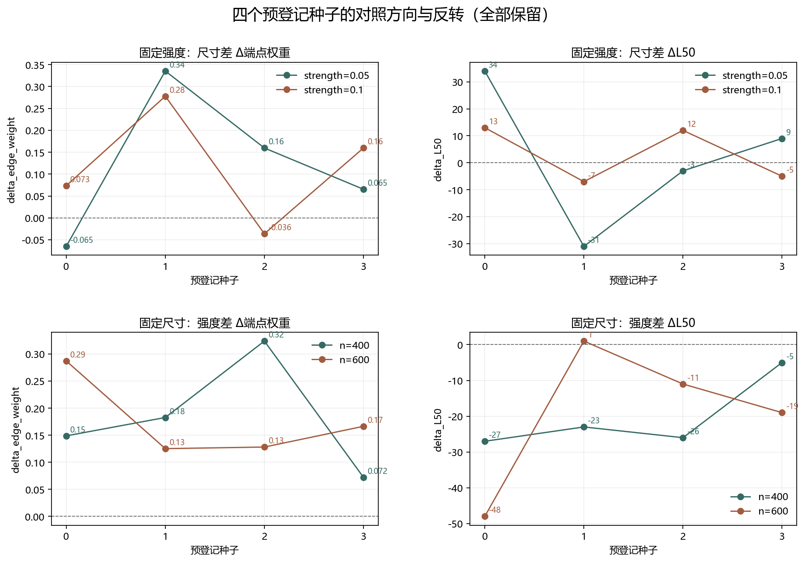

# Floquet-BdG 多种子稳健性对照

> 日期：2026-11-11。4 个预登记种子 seed=0、1、2、3，N=400／600 × r=0.05／0.1，共 16 个单元。新案例不补算体 winding，未计算 N=640。

## 一、方向计数总表

以下 `+／−／0` 是四个种子的方向计数。方向计数不是置信区间，也不是统计显著性。所有中位数和极值都只描述本次试点。

| 对照 | 指标 | +／−／0 | 中位数 | 最小值 | 最大值 |
|:---|:---|:---:|---:|---:|---:|
| size_r0.05 | delta_L50 | 2／2／0 | 3 | -31 | 34 |
| size_r0.05 | delta_L90 | 2／1／1 | 9 | -23 | 40 |
| size_r0.05 | delta_edge_weight | 3／1／0 | 0.1125 | -0.064992 | 0.33538 |
| size_r0.05 | delta_center20_mass | 0／4／0 | -0.032938 | -0.1501 | -0.0012571 |
| size_r0.1 | delta_L50 | 2／2／0 | 3.5 | -7 | 13 |
| size_r0.1 | delta_L90 | 2／1／1 | 1.5 | -15 | 40 |
| size_r0.1 | delta_edge_weight | 3／1／0 | 0.11656 | -0.036168 | 0.27786 |
| size_r0.1 | delta_center20_mass | 0／4／0 | -0.02366 | -0.048392 | -0.003738 |
| strength_N400 | delta_L50 | 0／4／0 | -24.5 | -27 | -5 |
| strength_N400 | delta_L90 | 1／3／0 | -40.5 | -85 | 9 |
| strength_N400 | delta_edge_weight | 4／0／0 | 0.16577 | 0.072136 | 0.32393 |
| strength_N400 | delta_center20_mass | 1／3／0 | -0.025795 | -0.16376 | 0.027154 |
| strength_N600 | delta_L50 | 1／3／0 | -15 | -48 | 1 |
| strength_N600 | delta_L90 | 0／4／0 | -33 | -77 | -21 |
| strength_N600 | delta_edge_weight | 4／0／0 | 0.14729 | 0.12522 | 0.28724 |
| strength_N600 | delta_center20_mass | 0／4／0 | -0.016274 | -0.032435 | -0.0054378 |
| interaction | delta_L50 | 2／2／0 | 0.5 | -21 | 24 |
| interaction | delta_L90 | 2／2／0 | -5 | -37 | 40 |
| interaction | delta_edge_weight | 2／2／0 | 0.018393 | -0.19578 | 0.13844 |
| interaction | delta_center20_mass | 3／1／0 | 0.016793 | -0.047135 | 0.13133 |

图 1 插入位置：方向计数之后、逐种子结果之前。

**图 1**　四个种子全部保留，方向反转不做删除或平滑。

## 二、固定强度的逐种子尺寸差

| seed | r | ΔL50 | ΔL90 | Δ端点权重 | Δ中心20%质量 |
|---:|---:|---:|---:|---:|---:|
| 0 | 0.05 | 34 | 40 | -0.064992 | -0.0012571 |
| 1 | 0.05 | -31 | -23 | 0.33538 | -0.1501 |
| 2 | 0.05 | -3 | 0 | 0.15961 | -0.016107 |
| 3 | 0.05 | 9 | 18 | 0.065381 | -0.049768 |
| 0 | 0.1 | 13 | 3 | 0.073443 | -0.048392 |
| 1 | 0.1 | -7 | -15 | 0.27786 | -0.018767 |
| 2 | 0.1 | 12 | 40 | -0.036168 | -0.003738 |
| 3 | 0.1 | -5 | 0 | 0.15969 | -0.028552 |

## 三、固定尺寸的逐种子强度差

| seed | N | ΔL50 | ΔL90 | Δ端点权重 | Δ中心20%质量 |
|---:|---:|---:|---:|---:|---:|
| 0 | 400 | -27 | 9 | 0.1488 | 0.027154 |
| 1 | 400 | -23 | -85 | 0.18274 | -0.16376 |
| 2 | 400 | -26 | -61 | 0.32393 | -0.017807 |
| 3 | 400 | -5 | -20 | 0.072136 | -0.033782 |
| 0 | 600 | -48 | -28 | 0.28724 | -0.019981 |
| 1 | 600 | 1 | -77 | 0.12522 | -0.032435 |
| 2 | 600 | -11 | -21 | 0.12815 | -0.0054378 |
| 3 | 600 | -19 | -38 | 0.16644 | -0.012566 |

## 四、逐种子交互项

| seed | ΔL50 | ΔL90 | Δ端点权重 | Δ中心20%质量 |
|---:|---:|---:|---:|---:|
| 0 | -21 | -37 | 0.13844 | -0.047135 |
| 1 | 24 | 8 | -0.05752 | 0.13133 |
| 2 | 15 | 40 | -0.19578 | 0.012369 |
| 3 | -14 | -18 | 0.094305 | 0.021216 |

交互项端点权重的方向计数为 2 正、2 负、0 零；交互项仍只是四个种子的描述量。

## 五、稳定性分层：哪些方向保留，哪些必须放弃普适化

尺寸端点权重并非全员同号：r=0.05 与 r=0.1 下均为 3 正 1 负，L50 则均为 2 正 2 负。尺寸效应的符号反转不能普适化，seed=0 的方向不能代表其他随机实现。

两种强度下，尺寸差的中心 20% 质量均在 4/4 种子中下降。该方向在本网格一致，但只能支持当前有限模型的中心区稀释现象，不能直接给出衰减指数或热力学标度。

强度升高端点权重在 4/4 种子中增加，N=400 和 N=600 分别成立。L50 在 N=400 的 4/4 种子中缩短，在 N=600 的 3/4 种子中缩短；seed=1 的 N=600 反例为 ΔL50=+1，必须保留。

因此，强度效应是本网格中较稳定的观察方向，尺寸效应则不稳定。幅度差异和 2 正 2 负的交互项进一步阻止将 seed=0 的符号反转提升为普适规律。

## 六、解释边界与下一步

该试点检验的是 profile 方向是否能跨随机实现保持，不证明单调物理规律。只有方向、幅度和候选子空间共同稳定时，才值得进入下一轮体积分或尺寸标度。

不补算体 winding，尤其不把单个种子的局部通过升级为拓扑恢复。下一步应针对方向不稳定或反转的单元分析其谱隔离与端部不对称，而不是追加种子直到出现想要的结果。

复现：`python research/floquet-bdg-tbc/analyze_multi_seed.py`。全部 16 个单元、两对候选模和逐种子差值均保存在 `multi_seed_profile_control.json`。
