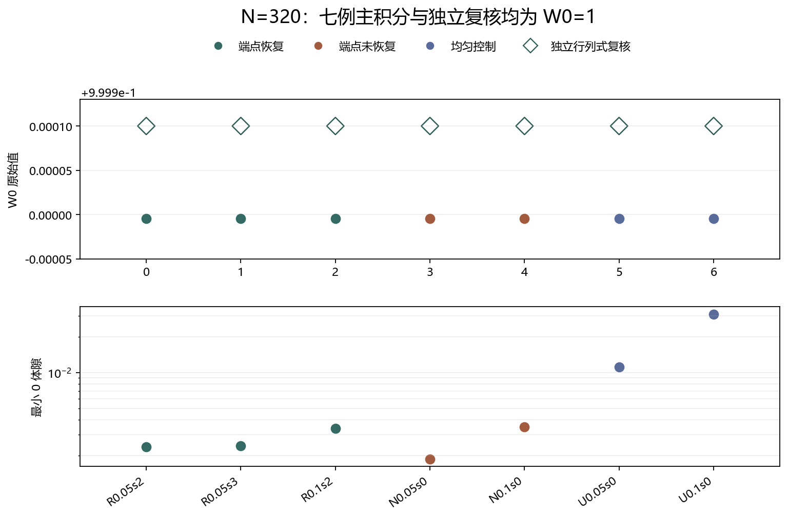
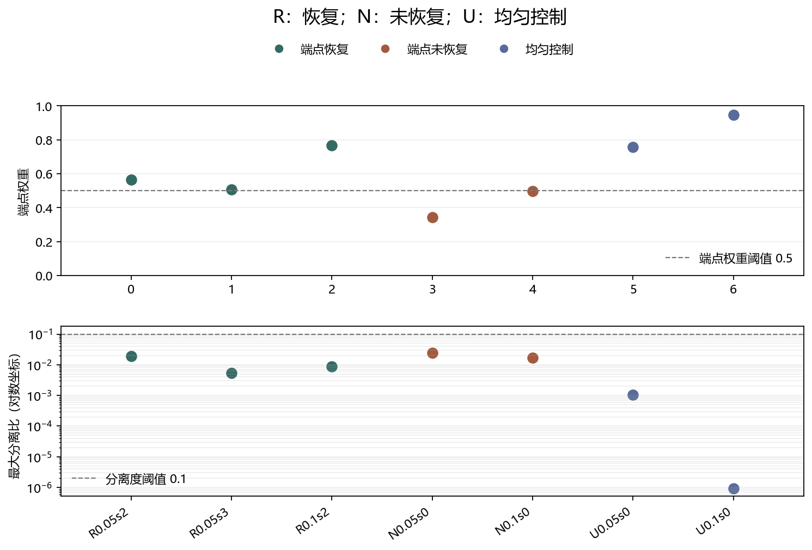

# N=320 Floquet-BdG TBC 定向 0 隙对照

> 日期：2026-11-11。范围：7 个定向有限二次型算例及原始 expm＋Schur 独立复核。本文不宣称任意无序、热力学极限或材料实验结论。

## 一、分组结论

| 分组 | 算例数 | 主 W0 有效数 | W0=1 数 | 端点联合通过数 | 最小体隙 |
|:---|---:|---:|---:|---:|---:|
| 端点恢复 | 3 | 3 | 3 | 3 | 0.00236479 |
| 端点未恢复 | 2 | 2 | 2 | 0 | 0.00187302 |
| 均匀控制 | 2 | 2 | 2 | 2 | 0.011128 |

七例主积分均为有效 W0=1，七项独立行列式复核均为 1。恢复与未恢复样本不能只用端点是否通过来解释体不变量。

图 1 插入位置：分组结论之后、逐例对照之前。

**图 1**　七例主积分和独立行列式复核一致；R 为恢复、N 为未恢复、U 为均匀控制。

## 二、逐例体与端点对照

| 分组 | r | seed | W0 原始值 | 最小体隙 | 端点权重 | 最大分离比 | 端点通过 |
|:---|---:|---:|---:|---:|---:|---:|:---:|
| 端点恢复 | 0.05 | 2 | 0.999895452545 | 0.00236479 | 0.564727 | 0.0187436 | True |
| 端点恢复 | 0.05 | 3 | 0.999895430419 | 0.00241045 | 0.505297 | 0.00538581 | True |
| 端点恢复 | 0.1 | 2 | 0.999895544643 | 0.00339405 | 0.767657 | 0.0089298 | True |
| 端点未恢复 | 0.05 | 0 | 0.999895392848 | 0.00187302 | 0.344437 | 0.0245131 | False |
| 端点未恢复 | 0.1 | 0 | 0.999895548527 | 0.00347553 | 0.495586 | 0.0167445 | False |
| 均匀控制 | 0.05 | 0 | 0.999895564654 | 0.011128 | 0.755958 | 0.001029 | True |
| 均匀控制 | 0.1 | 0 | 0.999895564672 | 0.0309471 | 0.94637 | 9.32093e-07 | True |

图 2 插入位置：逐例对照表之后、独立复核之前。

**图 2**　两个未恢复样本均在端点权重阈值 0.5 以下，但分离度通过；体 W0 仍为 1。

## 三、独立复核与解释边界

| 分组 | r | seed | 主状态／整数 | 独立状态／整数 | 独立原始值 |
|:---|---:|---:|:---|:---|---:|
| 端点恢复 | 0.05 | 2 | ok/1 | ok/1 | 1 |
| 端点恢复 | 0.05 | 3 | ok/1 | ok/1 | 1 |
| 端点恢复 | 0.1 | 2 | ok/1 | ok/1 | 1 |
| 端点未恢复 | 0.05 | 0 | ok/1 | ok/1 | 1 |
| 端点未恢复 | 0.1 | 0 | ok/1 | ok/1 | 1 |
| 均匀控制 | 0.05 | 0 | ok/1 | ok/1 | 1 |
| 均匀控制 | 0.1 | 0 | ok/1 | ok/1 | 1 |

三个恢复样本的体 winding 与端点候选一致；两个未恢复样本仍显示体 W0=1 与端点权重不足并存。由此，有限尺寸交叉假说得到加强，但体边对应并未对所有样本闭合。

下一步不应直接盲目扫描 N=640，而应先利用子空间 IPR、端点权重和尾部长度估计各未恢复样本的局域／恢复尺度，再选择能区分尺度的尺寸。

复现：python research/floquet-bdg-tbc/run_n320.py --merge-only；python research/floquet-bdg-tbc/verify_n320.py --merge-only。原始证据：n320_zero.json、n320_independent.json 及逐例独立文件。
