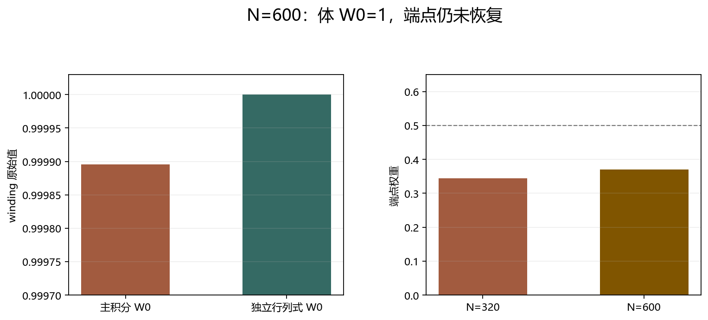
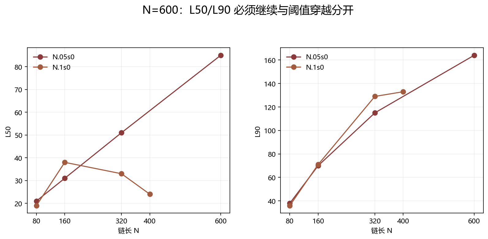

# N=600 Floquet-BdG 尾长增长诊断

> 日期：2026-11-11。N=600、r=0.05、seed=0。主双网格 dθ=0.05/0.025，独立原始 expm＋Schur 行列式 dθ=0.25。N=600 不是自动恢复尺寸。

## 一、体 winding 与端点状态

| 项目 | N=320 | N=600 |
|:---|---:|---:|
| 主 W0 原始值 | 0.999895392848 | 0.999895545532 |
| 最小 0 体隙 | 0.00187302 | 0.0013474 |
| 端点权重 | 0.344437 | 0.370468 |
| 最大分离比 | 0.0245131 | 0.00325002 |
| 端点联合判据 | False | False |

独立原始 expm＋Schur 行列式为 1，与主整数一致；最大对称误差 1.3542e-13。

图 1 插入位置：体与端点状态之后、覆盖分析之前。

**图 1**　主积分与独立复核一致，但端点联合判据仍未通过。

## 二、覆盖尾部是否继续增长

| 指标 | N=80 | N=160 | N=320 | N=600 |
|:---|---:|---:|---:|---:|
| L50 | 21 | 31 | 51 | 85 |
| L90 | 38 | 70 | 115 | 164 |
| 固定20格点质量 | 0.498719 | 0.402263 | 0.195574 | 0.144227 |
| 中心20%质量 | 0.195245 | 0.149517 | 0.0499176 | 0.0229577 |
| N·IPR | 1.61985 | 1.92775 | 2.28472 | 2.79288 |

L50 从 21→31→51→85，L90 从 38→70→115→164，未形成平台。

N=600 包络拟合 R²=0.252526。N=600 的体 W0=1 不等于端点恢复，N=600 的尺寸本身也不证明短尾平台。

图 2 插入位置：覆盖分析之后、解释边界之前。

**图 2**　N.05s0 与 N.1s0 的覆盖机制不同；N=400 的阈值穿越不能代替 N=600 的尾长诊断。

## 三、解释边界与后续方向

N=400 已验证 r=0.1、seed=0 的局部阈值穿越；N=600 则检验 r=0.05、seed=0 的尾长机制。两个案例必须分开解释。

下一步不自动扩大到 N=640 或更大尺寸，而应保留这两个未恢复样本作为体边对应边界案例，结合现有 N=80/160/320/400/600 的 profile 分析，先判断是否存在可复核的平台，再决定是否有新尺寸能区分机制。

复现：run_scale_diagnostic.py 分批执行两条网格；verify_scale_diagnostic.py --n 600 --step 0.25 使用原始 expm＋Schur 独立复核。原始数据：scale_diagnostic.json、scale_independent_n600.json、n600_scale.json。
