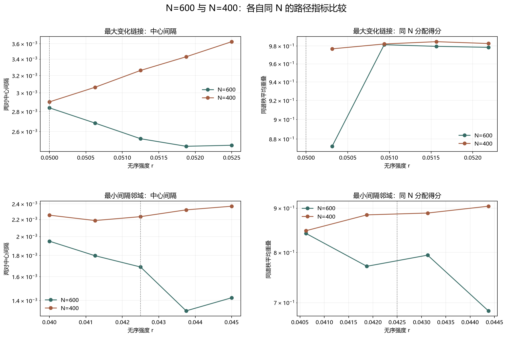

# Floquet-BdG N=600 细化路径复核

> 日期：2026-11-11。N=600、seed=6、固定随机流。复核 N=400 的两个细化邻域；各自比较同 N 子空间，不做跨尺寸本征矢点积。不新增类别、不补算体 winding，未计算 N=640。

## 一、参考点与比较规则

N=600 的 r=0.050 原冻结单元必须复现到1e-10。随后对相同强度点比较谱中心、中心间隔、既有诊断和相邻重叠；尺寸对照仅比较指标，不宣称尺寸不变性。

参考点最大数值误差为 0.000e+00。新增 N=600 参数点共9个，两个区域共10点、8条链接。

## 二、最大变化链接

| r | N=600中心间隔 | N=400中心间隔 | 绝对差 |
|---:|---:|---:|---:|
| 0.05 | 0.00283838 | 0.00290152 | 6.31357e-05 |
| 0.050625 | 0.00268271 | 0.00306293 | 0.000380217 |
| 0.05125 | 0.00253157 | 0.00326023 | 0.000728669 |
| 0.051875 | 0.00246164 | 0.00342941 | 0.000967763 |
| 0.0525 | 0.00247098 | 0.0036266 | 0.00115562 |

| 从 r | 到 r | N=600同谱秩 | N=400同谱秩 | N=600交换 | N=400交换 | 主导分配（N=600／N=400） |
|---:|---:|---:|---:|---:|---:|:---|
| 0.05 | 0.050625 | 0.872513 | 0.976756 | 0.00550209 | 0.0134985 | diagonal／diagonal |
| 0.050625 | 0.05125 | 0.981447 | 0.982274 | 0.00858314 | 0.00970519 | diagonal／diagonal |
| 0.05125 | 0.051875 | 0.979582 | 0.984894 | 0.010753 | 0.00518694 | diagonal／diagonal |
| 0.051875 | 0.0525 | 0.978467 | 0.98279 | 0.0119617 | 0.00246991 | diagonal／diagonal |

本区域 N=600 最小中心间隔为 0.00246164，位于 r=0.051875；最大相邻间隔变化为 0.000155669。最近对通过强度为 []，次近对通过强度为 []。

## 二、最小间隔邻域

| r | N=600中心间隔 | N=400中心间隔 | 绝对差 |
|---:|---:|---:|---:|
| 0.04 | 0.001949 | 0.00225319 | 0.000304185 |
| 0.04125 | 0.00179736 | 0.00218691 | 0.000389547 |
| 0.0425 | 0.00168758 | 0.0022348 | 0.000547218 |
| 0.04375 | 0.00132162 | 0.00232094 | 0.00099931 |
| 0.045 | 0.00142181 | 0.00236847 | 0.000946658 |

| 从 r | 到 r | N=600同谱秩 | N=400同谱秩 | N=600交换 | N=400交换 | 主导分配（N=600／N=400） |
|---:|---:|---:|---:|---:|---:|:---|
| 0.04 | 0.04125 | 0.84138 | 0.847642 | 0.103398 | 0.113094 | diagonal／diagonal |
| 0.04125 | 0.0425 | 0.771038 | 0.884086 | 0.0131656 | 0.0471446 | diagonal／diagonal |
| 0.0425 | 0.04375 | 0.79425 | 0.888412 | 0.0789214 | 0.0352069 | diagonal／diagonal |
| 0.04375 | 0.045 | 0.684831 | 0.904663 | 0.217437 | 0.0383119 | diagonal／diagonal |

本区域 N=600 最小中心间隔为 0.00132162，位于 r=0.04375；最大相邻间隔变化为 0.000365952。最近对通过强度为 [0.04, 0.04125, 0.0425, 0.04375, 0.045]，次近对通过强度为 []。

图 1 插入位置：两个区域的数值表之后、尺寸对照结论之前。

**图 1**　两个尺寸各自的同 N 谱指标和重叠得分，不使用跨尺寸本征矢点积。

## 三、尺寸对照结论与边界

N=600 的8条链接中，同谱秩占优 8，交换占优 0，精确并列 0。与 N=400 的主导分配一致 8/8。

N=600 最小中心间隔为 0.00132162，位于 r=0.04375；与 N=400 的最小值位置相同：False。最大相邻间隔变化为 0.000365952。

同谱秩得分的最大尺寸绝对差为 0.219833，中心间隔的最大尺寸绝对差为 0.00115562。

N=600 最近对联合诊断通过强度为 [0.04, 0.04125, 0.0425, 0.04375, 0.045]；次近对通过强度为 []。这些既有诊断不构成体 winding 证明。

细化提高各尺寸内部的可辨识性，但方向一致不是尺寸不变性，也不是连续路径、谱交叉、避免交叉、真实态追踪、次近对拓扑性或体 winding 证明。原类别和此前计数未改变。

复现：`python research/floquet-bdg-tbc/analyze_n600_path.py`。N=600 的10点8链接、参考误差和 N=400 指标对照保存在 `n600_path_analysis.json`。
