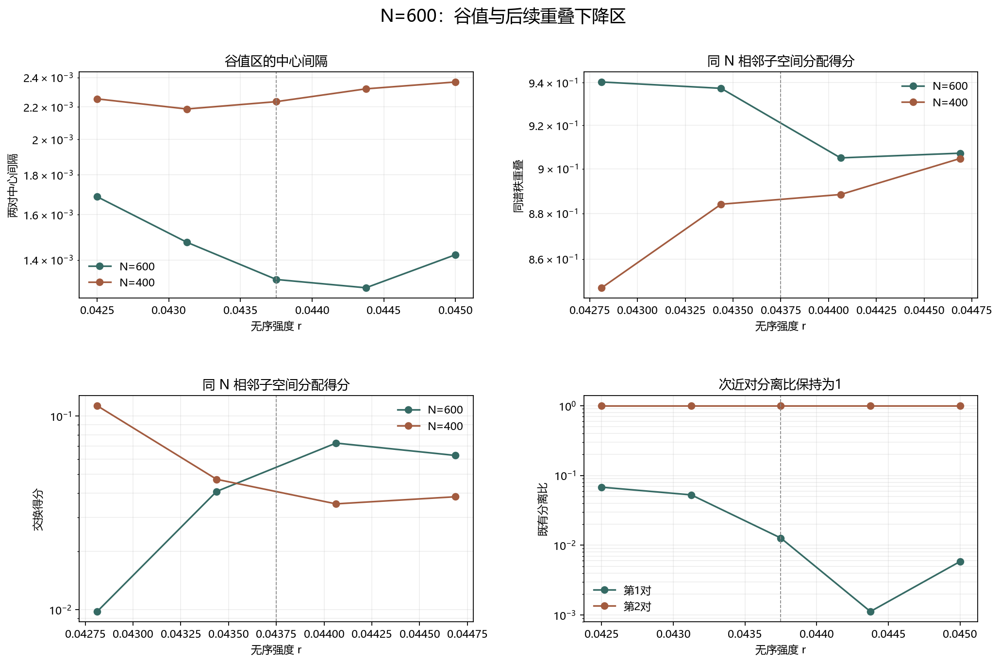

# Floquet-BdG N=600 谷值与重叠下降区细化

> 日期：2026-11-11。N=600、seed=6、固定随机流。新增 r=0.043125 和0.044375，复核0.0425、0.04375、0.045三个旧点。不新增类别、不补算体 winding，未计算 N=640。

## 一、细化协议

谷值区使用 r=0.042500、0.043125、0.043750、0.044375、0.045000。分别记录中心间隔、同谱秩重叠、交换得分和既有 profile 诊断，不把不同指标混成同一个机制名称。

三个旧点的最大数值复核误差为 0.000e+00。

| r | N=600中心间隔 | N=400中心间隔 | 绝对差 |
|---:|---:|---:|---:|
| 0.0425 | 0.00168758 | 0.00225319 | 0.00056561 |
| 0.043125 | 0.00147539 | 0.00218691 | 0.000711513 |
| 0.04375 | 0.00132162 | 0.0022348 | 0.00091317 |
| 0.044375 | 0.00128955 | 0.00232094 | 0.00103139 |
| 0.045 | 0.00142181 | 0.00236847 | 0.000946658 |

## 二、相邻重叠与分配方向

| 从 r | 到 r | N=600同谱秩 | N=400同谱秩 | N=600交换 | N=400交换 | 主导分配（N=600／N=400） |
|---:|---:|---:|---:|---:|---:|:---|
| 0.0425 | 0.043125 | 0.940225 | 0.847642 | 0.00978678 | 0.113094 | diagonal／diagonal |
| 0.043125 | 0.04375 | 0.937224 | 0.884086 | 0.0408154 | 0.0471446 | diagonal／diagonal |
| 0.04375 | 0.044375 | 0.904956 | 0.888412 | 0.0725257 | 0.0352069 | diagonal／diagonal |
| 0.044375 | 0.045 | 0.907101 | 0.904663 | 0.0626055 | 0.0383119 | diagonal／diagonal |

图 1 插入位置：相邻重叠表之后、结论之前。

**图 1**　中心间隔、同谱秩重叠、交换得分和既有分离比分别展示；虚线为此前最小值位置 r=0.04375。

## 三、结果与边界

4条链接中，同谱秩占优 4，交换占优 0，精确并列 0；与 N=400 的主导分配一致 4/4。

最小中心间隔为 0.00128955，位于 r=0.044375；最大相邻间隔变化为 0.000212183。

最大同谱秩下降为 0.0322676，最大交换得分上升为 0.0317103，最低同谱秩得分为 0.904956。这些指标描述不同方面，不能互相替代。

最大同谱秩下降和最大交换上升都位于 r=0.04375→0.044375；该链接同谱秩为 0.904956，交换为 0.0725257。粗网格末段的更低重叠没有以同样幅度出现，说明低值具有步长依赖。

最大中心间隔变化位于 r=0.0425→0.043125。最小中心间隔则位于新增点 r=0.044375；这只是当前离散网格的最小值位置。

N=600 最近对联合诊断通过强度为 [0.0425, 0.043125, 0.04375, 0.044375, 0.045]；次近对通过强度为 []。

中心间隔回升和重叠下降不是谱交叉证明，也不是尺寸不变性或连续态追踪结论。新增点只提高局部分辨率，不构成避免交叉、真实态交换、次近对拓扑性或体 winding 证明。原类别和此前计数未改变。

复现：`python research/floquet-bdg-tbc/analyze_n600_valley.py`。5个参数点、4条链接、三个旧点复核和来源哈希保存在 `n600_valley_analysis.json`。
