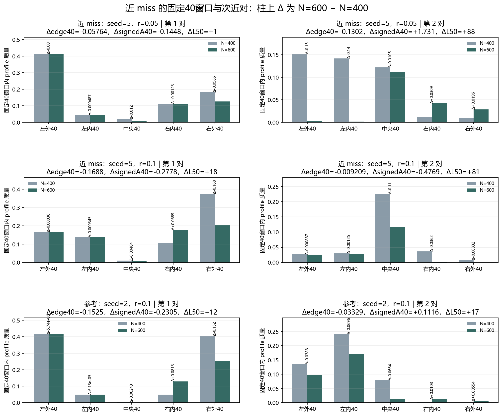

# Floquet-BdG 近 miss 空间分布与次近对诊断

> 日期：2026-11-11。只使用已冻结且经过独立复核的 N=400／600 剖面；两个近 miss 与一个参考对照，最近对和次近对各 6 条记录。不新增种子、不新增类别、不补算体 winding，未计算 N=640。

## 一、两套窗口严格分开

原类别使用既有每端10%窗口：N=400 为40格，N=600 为60格；A10%=|右外10%−左外10%|/edge10%。这些量用于逐项复现冻结比较，不能换成别的窗口。

补充空间诊断为固定40窗口：左外40=[0,40)、左内40=[40,80)、中央40=[N/2−20,N/2+20)、右内40=[N−80,N−40)、右外40=[N−40,N)。signedA40=(右外40−左外40)/edge40，与原类别的绝对不对称度不同。

初稿曾把固定40误作原10%端点，交叉校验据此失败；现已在接受结果前纠正。固定40用于观察空间细节，不回溯修改类别或阈值。所有尺寸差均为 N=600 减 N=400，固定 seed、强度和 pair_index。

## 二、最近对：近 miss 的左右端来源

| 对照 | Δ左外10% | Δ左内40 | Δ中央40 | Δ右内40 | Δ右外10% | Δedge10% | ΔA10% | ΔL50 |
|:---|---:|---:|---:|---:|---:|---:|---:|---:|
| 5／0.05 | 0.024112 | -0.0004866 | -0.012002 | 0.0012267 | -0.0064706 | 0.017641 | 0.038623 | +1 |
| 5／0.1 | 0.084382 | -0.00034546 | -0.0040364 | 0.068888 | -0.091903 | -0.0075208 | -0.32512 | +18 |
| 2／0.1 | 0.039745 | -6.1288e-05 | -0.0024257 | 0.081254 | -0.075914 | -0.036168 | 0.14779 | +12 |

seed=5、r=0.05：Δ左外10%=0.024112，Δ右外10%=-0.0064706，所以 Δedge10%=0.017641 仍为正。左端增量超过右端减量，直接解释了为何右端减弱却没有总端点减弱。

seed=5、r=0.1：Δ左外10%=0.084382，Δ右外10%=-0.091903，Δedge10%=-0.0075208。总端点虽下降，左外质量却增加，ΔA10%=-0.32512；这就是‘右端减弱但更对称’的空间含义。

参考 seed=2、r=0.1 的 Δ左外10%=0.039745、Δ右外10%=-0.075914、ΔA10%=0.14779。它同样左增右减，但绝对不对称度上升，与高强度近 miss 不同。

窗口定义敏感性也可量化：低强度近 miss 的固定 Δedge40=-0.057643，与原 Δedge10%=0.017641 符号不同，因为 N=600 的原端点包含第40至59格而固定40不包含。二者各自真实，但不能混用或借此改类。

图 1 插入位置：最近对空间分解之后、次近对表格之前。

**图 1**　左列是最近对，右列是次近对；柱上 Δ 为 N=600−N=400。图中只画固定40窗口及 signedA40，原10%类别指标见表，避免两种定义混淆。

## 三、次近对：平行的描述性对照

| 对照 | Δ左外10% | Δ左内40 | Δ中央40 | Δ右内40 | Δ右外10% | Δedge10% | ΔA10% | ΔL50 |
|:---|---:|---:|---:|---:|---:|---:|---:|---:|
| 5／0.05 | -0.149 | -0.14036 | -0.010527 | 0.030907 | 0.033809 | -0.11519 | -0.025701 | +88 |
| 5／0.1 | 0.013226 | -0.0012521 | -0.10971 | -0.036209 | -0.0082952 | 0.0049313 | 0.47596 | +81 |
| 2／0.1 | 0.044686 | -0.06963 | -0.066368 | 0.010314 | 0.011068 | 0.055754 | -0.11189 | +17 |

三例次近对的 ΔL50 分别为 +88、+81、+17，均与最近对的尾长变化分开记录。次近对的端部符号并不与最近对一一同步，因此不能假定最近对的变化会自动传给全部近零谱子空间。

次近对与最近对不相加来挽救某个类别，也不根据次近对重新命名最近对。谱隔离比一并保留；有限谱排序不构成体不变量证明。

## 四、结论与边界

两个近 miss 的原10%端点分解都显示左外质量增加：低强度时它抵消并超过右端减量，高强度时它与右端减量共同降低总外端质量、同时降低绝对不对称度。由此，未复现不能简单归结为‘右端没有减弱’，也不能归结为‘端点消失’。

本轮只说明这三个对照、两种尺寸和既有剖面中的空间关系。没有计算新本征对，没有统计总体，没有改变原类别或阈值，也没有证明因果机制、体 winding、材料实现或热力学极限。

复现：`python research/floquet-bdg-tbc/analyze_near_miss_spatial.py`。固定协议、逐窗口值、原10%指标、尺寸差、原类别和来源哈希保存在 `near_miss_spatial_analysis.json`。
