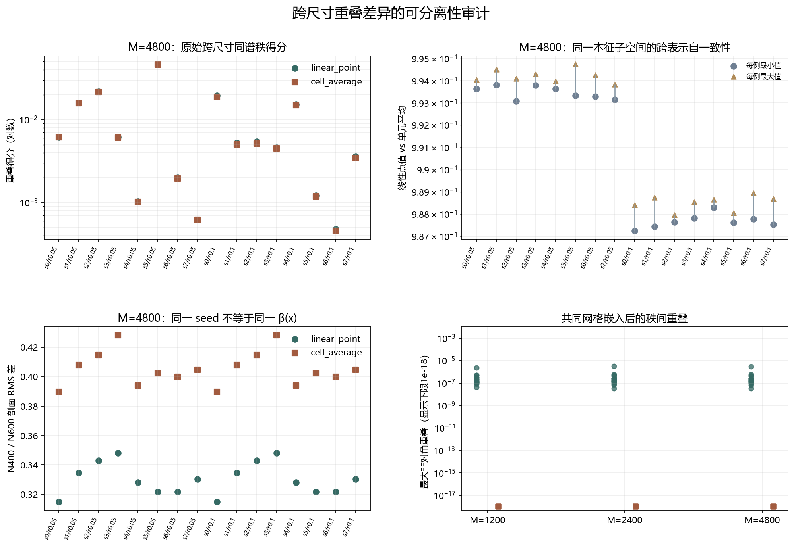

# Floquet-BdG 重叠差异混杂审计

> 日期：2026-11-11。全部16个既有对照、32个尺寸单元、三个共同网格和两种表示。只重算既有本征对，不新增物理单元或类别，不补算体 winding，未计算 N=640。

## 一、四类测量必须分开

跨尺寸重叠沿用 Oᵢⱼ=(s₁²+s₂²)/2。新增的同尺寸秩间控制比较同一 N 的最近对与次近对；跨表示自一致性比较同一本征子空间的线性点值基与单元平均基；β(x) 失配则直接比较两条实际无序数组在共同网格上的差异。

本轮不做归一化修正，不把跨尺寸得分除以跨表示自一致性，也不把这些描述量转换成物理态保真度。

全部跨尺寸矩阵已复现，最大误差 0.000e+00；冻结剖面最大误差 4.163e-17。

## 二、全样本汇总

| 诊断 | 数量 | 实测范围或上界 | 能排除什么 | 不能推出什么 |
|:---|---:|:---|:---|:---|
| 同尺寸秩间控制 | 192＋32原生 | 原生最大 1.55e-24；线性嵌入 3.21114e-06；单元平均 1.55003e-24 | 原生本征矢正交性丢失 | 线性嵌入门槛通过或真实态交换 |
| 跨表示自一致性 | 192 | 0.987256–0.995831 | 只改变表示不影响读数 | 表示不变性或尺寸不变性 |
| β(x) 剖面比较 | 96 | RMS 0.313596–0.428178；最大｜相关｜ 0.0981834 | 同 seed 就是同一无序实现 | 未匹配尺寸差的唯一来源 |
| 跨尺寸复现 | 96 | 最大复现差 0 | 旧结果无法复算 | 尺寸因果、统计显著性 |

图 1 插入位置：全样本汇总之后、逐案例表之前。

**图 1**　原始跨尺寸得分、跨表示范围、β(x) RMS 差和同尺寸秩间控制。右下图仅为显示设置10⁻¹⁸下限，JSON保留原值。

## 三、M=4800 逐案例对照

| 对照 | 线性同谱秩 | 单元平均同谱秩 | 跨表示最小值 | 线性β RMS | 单元平均β RMS | 主导一致 |
|:---|---:|---:|---:|---:|---:|:---:|
| s0／r0.05 | 0.00616468 | 0.00610888 | 0.993629 | 0.314985 | 0.38964 | True |
| s1／r0.05 | 0.0159941 | 0.0157862 | 0.993809 | 0.334688 | 0.407969 | True |
| s2／r0.05 | 0.0218501 | 0.0215142 | 0.993075 | 0.343133 | 0.414844 | True |
| s3／r0.05 | 0.00613101 | 0.00606474 | 0.993802 | 0.348172 | 0.428178 | True |
| s4／r0.05 | 0.00103577 | 0.00102168 | 0.99363 | 0.328255 | 0.39413 | True |
| s5／r0.05 | 0.0463435 | 0.0456978 | 0.993325 | 0.321762 | 0.402391 | True |
| s6／r0.05 | 0.00200693 | 0.00195621 | 0.993296 | 0.32171 | 0.400007 | True |
| s7／r0.05 | 0.000624242 | 0.000621231 | 0.993155 | 0.330408 | 0.404867 | True |
| s0／r0.1 | 0.0195102 | 0.0188455 | 0.987256 | 0.314985 | 0.38964 | True |
| s1／r0.1 | 0.00527118 | 0.00504179 | 0.987442 | 0.334688 | 0.407969 | True |
| s2／r0.1 | 0.0054298 | 0.00516477 | 0.98765 | 0.343133 | 0.414844 | True |
| s3／r0.1 | 0.00460045 | 0.00448318 | 0.987819 | 0.348172 | 0.428178 | True |
| s4／r0.1 | 0.0153599 | 0.0149482 | 0.988309 | 0.328255 | 0.39413 | True |
| s5／r0.1 | 0.00121655 | 0.00118967 | 0.987624 | 0.321762 | 0.402391 | True |
| s6／r0.1 | 0.000477155 | 0.000457662 | 0.98778 | 0.32171 | 0.400007 | True |
| s7／r0.1 | 0.00361922 | 0.00345957 | 0.987529 | 0.330408 | 0.404867 | True |

## 四、结论与未竟控制

原生 QR 的秩间重叠最大为 1.55e-24，单元平均嵌入最大为 1.55003e-24，但线性点值嵌入达到 3.21114e-06。预登记10⁻¹²秩间门槛未通过，说明线性插值可诱导秩间串扰；这不是原始谱排序交换证明。

跨表示自一致性最低为 0.987256，位置为 {"seed": 0, "strength": 0.1, "n": 600, "pair_index": 1, "m": 4800, "method": "linear_point_vs_cell_average"}。它直接量化了表示选择的影响，但不能作为跨尺寸得分的校正因子。

96个 β(x) 比较中，RMS 低于0.1的项目有 0 个。相同随机种子分别生成不同长度数组后，格心坐标并不对齐，因此同一 seed 不等于同一无序实现。现有跨尺寸差异**不能归因于尺寸**单独作用：尺寸、无序实现与共同表示选择仍然混杂。

下一步需要预先固定同一个连续或嵌套无序剖面 β(x)，在 N=400 与 N=600 上采样，再重算相同诊断；这才构成尺寸隔离控制。未完成该控制前，不宣称尺寸因果、普适标度、真实态交换或体 winding。

复现：`python research/floquet-bdg-tbc/analyze_overlap_confounding.py`。完整矩阵、192个跨表示记录、192个嵌入后秩间控制、32个原生秩间控制和96个无序剖面比较保存在 `overlap_confounding_analysis.json`。
