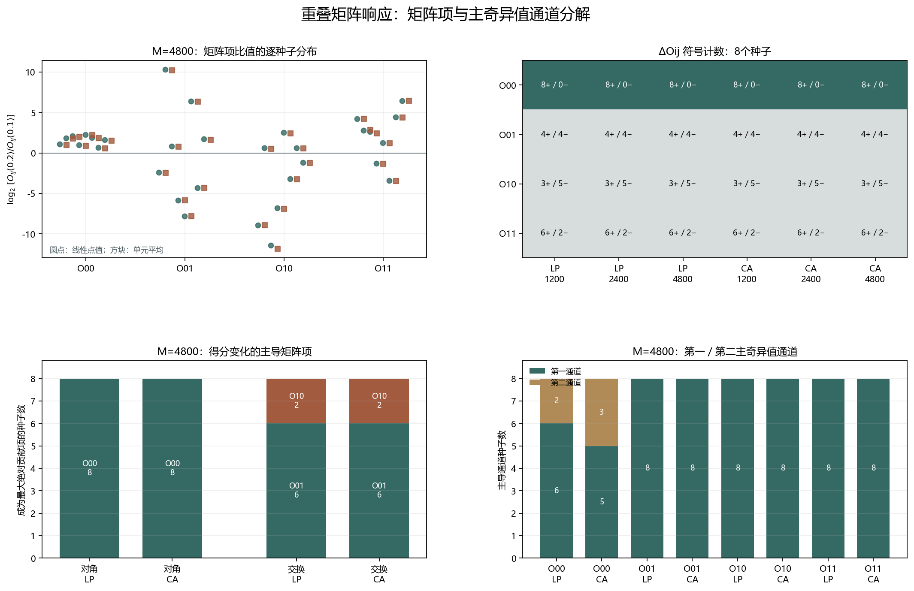

# Floquet-BdG 重叠矩阵响应分解

> 日期：2026-11-12。r=0.1→0.2 的8组配对、48个方法—网格配对、192个矩阵项配对、384个主奇异值通道配对。只读取既有证据，不新增 Floquet 单元，不补算体 winding，未计算 N=640。

## 一、完整2×2矩阵与差分定义

每个矩阵项保留 Oᵢⱼ=(s₁²+s₂²)/2。ΔOᵢⱼ 是 r=0.2 减去 r=0.1；对角与交换得分变化分别是 (ΔO₀₀+ΔO₁₁)/2 和 (ΔO₀₁+ΔO₁₀)/2。主奇异通道贡献为 Δ(sₖ²)/2。

所有预登记结果保留，不筛选有利案例。比值和 log₂ 比值只在分母为正时计算；不归一化重叠，不把跨表示自一致性作为校正因子。所谓“主导项”仅指最大绝对数值贡献，不是因果机制证明。

极大比值可能来自近零分母，必须同时查看 before_overlap_range、after_overlap_range、ΔOᵢⱼ 和原始主奇异值，不能把放大倍数直接当成同等大小的物理效应。

## 二、M=4800 的矩阵项响应

| 矩阵项 | LP比值范围 | LP Δ符号 | LP主导通道 | CA比值范围 | CA Δ符号 | CA主导通道 |
|:---:|---:|:---:|:---:|---:|:---:|:---:|
| O00 | 1.59157–4.72492 | 8+／0− | s₁:6／s₂:2 | 1.49968–4.54116 | 8+／0− | s₁:5／s₂:3 |
| O01 | 0.0043791–1270.97 | 4+／4− | s₁:8／s₂:0 | 0.00442249–1185.1 | 4+／4− | s₁:8／s₂:0 |
| O10 | 0.000372879–5.72218 | 3+／5− | s₁:8／s₂:0 | 0.0002695–5.33974 | 3+／5− | s₁:8／s₂:0 |
| O11 | 0.0940263–87.3732 | 6+／2− | s₁:8／s₂:0 | 0.0898487–86.6398 | 6+／2− | s₁:8／s₂:0 |

图 1 插入位置：矩阵项表之后、跨表示控制与边界之前。

**图 1**　矩阵项 log₂ 比值、三种网格的差分符号、主导矩阵项和主奇异通道。所有计数均来自8个同主剖面配对。

## 三、得分变化的主导项与跨表示一致性

| 得分组 | 方法 | 主导项计数（8个种子） | 得分比范围 |
|:---|:---|:---|---:|
| diagonal | linear_point | {'O00': 8, 'O11': 0} | 1.81921–4.70464 |
| diagonal | cell_average | {'O00': 8, 'O11': 0} | 1.7242–4.52164 |
| swapped | linear_point | {'O01': 6, 'O10': 2} | 0.0155469–5.65855 |
| swapped | cell_average | {'O01': 6, 'O10': 2} | 0.0154861–5.45608 |

96个跨表示差分符号比较中，一致 96 个，不一致 0 个。该一致性检查不证明表示不变性，也不把两种表示合并为校正后的重叠。

r=0.2 的跨表示自一致性范围为 0.974696–0.984394；线性点值秩间重叠最大 5.48289e-07，单元平均最大 6.59005e-27，原生最大 6.58772e-27。这些控制与矩阵项分解分开记录。

## 四、结论与边界

矩阵项分解可以定位同谱秩得分上升和交换得分比分化的具体数值来源，同时保留不同种子、不同网格和不同表示之间的差异。它不能外推为普遍尺寸律、真实态交换、谱交叉或统计显著性，也不能把最大贡献项直接命名为物理机制。

旧交换候选仍属于不同无序实现，不能与本次配对差分直接相减。后续若提出机制解释，应继续检查相同矩阵项在固定尺寸连续路径上的演化，而不是仅依据横断面的比值命名过程。

复现：`python research/floquet-bdg-tbc/analyze_overlap_matrix_response.py`。完整矩阵项、差分、比值、主奇异通道、跨表示符号比较和来源哈希保存在 `overlap_matrix_response_analysis.json`。
