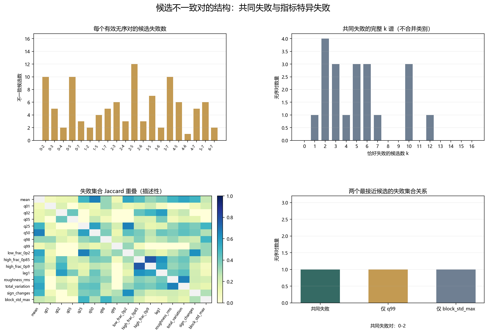

# Floquet-BdG 候选不一致对结构分析

> 日期：2026-11-12。只分析既有20个有效无序对、16个失败集合及其120组重叠；共有104条方向不一致赋值。原400条记录与5个跳变平局不变。不是因果归因，不是预测，不修改严格规则，不提出集成或新指标。不补算体 winding，未计算 N=640。

## 一、每个有效对的失败候选数

| seed 对 | 跳变计数 | 一致候选 | 不一致候选 | 候选零差分 | 不一致指标 |
|:---|:---|---:|---:|---:|:---|
| 0—2 | 4→2 | 6 | 10 | 0 | mean、q01、q25、q50、q98、q99、low_frac_0p2、high_frac_0p85、sign_changes、block_std_max |
| 0—3 | 4→0 | 11 | 5 | 0 | mean、low_frac_0p2、high_frac_0p85、high_frac_0p9、sign_changes |
| 0—4 | 4→0 | 14 | 2 | 0 | q05、sign_changes |
| 0—5 | 4→6 | 6 | 10 | 0 | mean、q02、q05、q50、q98、high_frac_0p85、high_frac_0p9、lag1、roughness_rms、total_variation |
| 0—7 | 4→2 | 13 | 3 | 0 | q01、q02、high_frac_0p9 |
| 1—2 | 0→2 | 14 | 2 | 0 | q02、q05 |
| 1—5 | 0→6 | 12 | 4 | 0 | q02、high_frac_0p85、high_frac_0p9、lag1 |
| 1—7 | 0→2 | 11 | 5 | 0 | mean、q25、q50、low_frac_0p2、total_variation |
| 2—3 | 2→0 | 10 | 6 | 0 | q02、q05、high_frac_0p85、high_frac_0p9、lag1、total_variation |
| 2—4 | 2→0 | 13 | 3 | 0 | q02、q05、lag1 |
| 2—5 | 2→6 | 4 | 12 | 0 | mean、q25、q50、q98、low_frac_0p2、high_frac_0p85、high_frac_0p9、lag1、roughness_rms、total_variation、sign_changes、block_std_max |
| 2—6 | 2→6 | 13 | 3 | 1 | q99、low_frac_0p2、sign_changes |
| 3—5 | 0→6 | 9 | 7 | 0 | mean、q02、high_frac_0p85、high_frac_0p9、lag1、roughness_rms、total_variation |
| 3—6 | 0→6 | 14 | 2 | 0 | high_frac_0p85、high_frac_0p9 |
| 3—7 | 0→2 | 6 | 10 | 0 | mean、q25、q50、low_frac_0p2、high_frac_0p85、high_frac_0p9、lag1、roughness_rms、total_variation、sign_changes |
| 4—5 | 0→6 | 10 | 6 | 0 | q02、q05、q50、high_frac_0p85、high_frac_0p9、lag1 |
| 4—6 | 0→6 | 15 | 1 | 0 | q05 |
| 4—7 | 0→2 | 11 | 5 | 0 | mean、q05、q50、lag1、sign_changes |
| 5—7 | 6→2 | 10 | 6 | 0 | q01、q02、q98、high_frac_0p85、high_frac_0p9、lag1 |
| 6—7 | 6→2 | 14 | 2 | 0 | q01、high_frac_0p9 |

完整 k 谱记录每个失败候选数对应的无序对，不把多个 k 合并成新类别。共同失败仅表示多个指标在同一无序对上不一致，不是因果归因。

| 失败候选数 k | 无序对数量 | seed 对 |
|---:|---:|:---|
| 1 | 1 | 4-6 |
| 2 | 4 | 0-4、1-2、3-6、6-7 |
| 3 | 3 | 0-7、2-4、2-6 |
| 4 | 1 | 1-5 |
| 5 | 3 | 0-3、1-7、4-7 |
| 6 | 3 | 2-3、4-5、5-7 |
| 7 | 1 | 3-5 |
| 10 | 3 | 0-2、0-5、3-7 |
| 12 | 1 | 2-5 |

图 1 插入位置：k 谱之后、失败集合重叠之前。

**图 1**　每个有效对的失败候选数、完整 k 谱、失败集合 Jaccard 重叠及两个最接近候选的集合关系。Jaccard 只描述集合重叠，不是相关性或预测能力。

## 二、120 组失败集合重叠

对16个候选的120组两两组合，计算失败集合的交集、并集、共享对、单侧对和 Jaccard。空并集记为 null，不记为1。所有计算均保留在分析 JSON。

q99 与 block_std_max 的交集为 1 对，并集为 3 对，Jaccard=0.333333。共同失败对为 [[0, 2]]；仅 q99 失败为 [[2, 6]]，仅 block_std_max 失败为 [[2, 5]]。这不构成联合使用或放宽规则的建议。

| 指标 | 失败对数 | 失败 seed 对 | 候选零差分对 |
|:---|---:|:---|:---|
| mean | 8 | 0-2、0-3、0-5、1-7、2-5、3-5、3-7、4-7 | 无 |
| q01 | 4 | 0-2、0-7、5-7、6-7 | 无 |
| q02 | 9 | 0-5、0-7、1-2、1-5、2-3、2-4、3-5、4-5、5-7 | 无 |
| q05 | 8 | 0-4、0-5、1-2、2-3、2-4、4-5、4-6、4-7 | 无 |
| q25 | 4 | 0-2、1-7、2-5、3-7 | 无 |
| q50 | 7 | 0-2、0-5、1-7、2-5、3-7、4-5、4-7 | 无 |
| q98 | 4 | 0-2、0-5、2-5、5-7 | 无 |
| q99 | 2 | 0-2、2-6 | 无 |
| low_frac_0p2 | 6 | 0-2、0-3、1-7、2-5、2-6、3-7 | 2-6 |
| high_frac_0p85 | 11 | 0-2、0-3、0-5、1-5、2-3、2-5、3-5、3-6、3-7、4-5、5-7 | 无 |
| high_frac_0p9 | 12 | 0-3、0-5、0-7、1-5、2-3、2-5、3-5、3-6、3-7、4-5、5-7、6-7 | 无 |
| lag1 | 10 | 0-5、1-5、2-3、2-4、2-5、3-5、3-7、4-5、4-7、5-7 | 无 |
| roughness_rms | 4 | 0-5、2-5、3-5、3-7 | 无 |
| total_variation | 6 | 0-5、1-7、2-3、2-5、3-5、3-7 | 无 |
| sign_changes | 7 | 0-2、0-3、0-4、2-5、2-6、3-7、4-7 | 无 |
| block_std_max | 2 | 0-2、2-5 | 无 |

## 三、证据边界

共同失败位置可能来自同一无序实现对多个统计量的共同影响，也可能只是离散跳变计数造成的集合重合；本分析不能区分这些解释，因此不是因果归因。指标特异失败也不能自动解释为指标缺陷或物理机制。

本分析不是预测验证、统计显著性检验或完全未触碰的外部验证；不提出新指标、集成规则或修正版接受阈值。严格规则下0／16全对一致的原结论不变。

复现：`python research/floquet-bdg-tbc/analyze_pair_inconsistency_structure.py`；独立复核：`python research/floquet-bdg-tbc/verify_pair_inconsistency_structure.py`。
