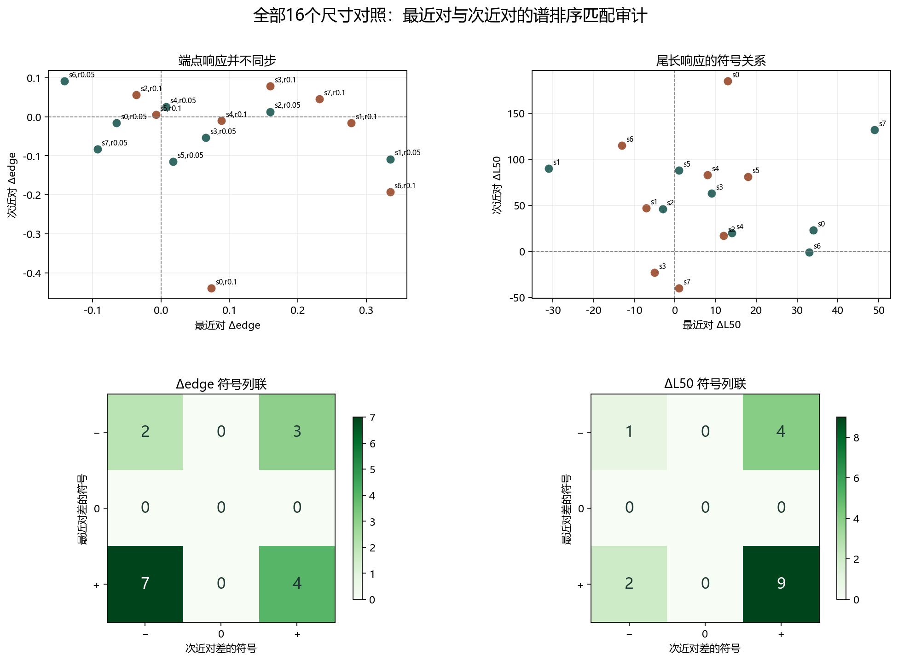

# Floquet-BdG 最近对与次近对尺寸响应审计

> 日期：2026-11-11。全部8个既有种子、2个强度、16个 N=400→600 对照，最近对与次近对分别审计。只使用冻结剖面，不新增类别、不补算体 winding，未计算 N=640。

## 一、配对和指标定义

pair_index 只是在每个尺寸内按 |λ−1| 排序后的谱秩。相同 pair_index 不代表跨尺寸追踪到同一个物理态，本审计因此是谱排序匹配，不是绝热态追踪。

端点沿用原定义：每端 N/10 格，edge=L+R，A=|R−L|/edge；尺寸差均为 N=600−N=400。符号列联使用精确符号，不增加数值阈值，不作统计显著性推断。

## 二、逐对照响应

| seed | r | 最近对Δedge | 次近对Δedge | edge符号关系 | 最近对ΔL50 | 次近对ΔL50 | L50符号关系 |
|---:|---:|---:|---:|:---:|---:|---:|:---:|
| 0 | 0.05 | -0.064992 | -0.0157 | 同号 | +34 | +23 | 同号 |
| 1 | 0.05 | 0.33538 | -0.10848 | 反号 | -31 | +90 | 反号 |
| 2 | 0.05 | 0.15961 | 0.01299 | 同号 | -3 | +46 | 反号 |
| 3 | 0.05 | 0.065381 | -0.054088 | 反号 | +9 | +63 | 同号 |
| 4 | 0.05 | 0.0072933 | 0.025894 | 同号 | +14 | +20 | 同号 |
| 5 | 0.05 | 0.017641 | -0.11519 | 反号 | +1 | +88 | 同号 |
| 6 | 0.05 | -0.14091 | 0.091532 | 反号 | +33 | -1 | 反号 |
| 7 | 0.05 | -0.092946 | -0.082743 | 同号 | +49 | +132 | 同号 |
| 0 | 0.1 | 0.073443 | -0.43913 | 反号 | +13 | +185 | 同号 |
| 1 | 0.1 | 0.27786 | -0.016102 | 反号 | -7 | +47 | 反号 |
| 2 | 0.1 | -0.036168 | 0.055754 | 反号 | +12 | +17 | 同号 |
| 3 | 0.1 | 0.15969 | 0.077954 | 同号 | -5 | -23 | 同号 |
| 4 | 0.1 | 0.088132 | -0.0098409 | 反号 | +8 | +83 | 同号 |
| 5 | 0.1 | -0.0075208 | 0.0049313 | 反号 | +18 | +81 | 同号 |
| 6 | 0.1 | 0.3349 | -0.19308 | 反号 | -13 | +115 | 反号 |
| 7 | 0.1 | 0.23169 | 0.04574 | 同号 | +1 | -40 | 反号 |

图 1 插入位置：逐对照响应表之后、符号列联统计之前。

**图 1**　上排为逐案例散点，下排为精确符号列联。不同谱秩分别展示，不把两对质量相加。

## 三、符号列联与关系计数

### Δedge

| 最近对＼次近对 | − | 0 | + |
|:---:|---:|---:|---:|
| − | 2 | 0 | 3 |
| 0 | 0 | 0 | 0 |
| + | 7 | 0 | 4 |

### ΔL50

| 最近对＼次近对 | − | 0 | + |
|:---:|---:|---:|---:|
| − | 1 | 0 | 4 |
| 0 | 0 | 0 | 0 |
| + | 2 | 0 | 9 |

Δedge：同号且非零 6 例，反号且非零 10 例，至少一个零 0 例。

ΔL50：同号且非零 10 例，反号且非零 6 例，至少一个零 0 例。

次近对在两种尺寸均满足既有 profile 联合诊断的对照数为 0/16。该计数只描述原有判据，不把次近对提升为拓扑端点。

这些计数直接检验‘最近对变化会自动传给次近对’这一直觉是否成立；它们不是相关系数、显著性检验或因果证明。

## 四、结论与未竟问题

实测端点响应有 10/16 反号、6/16 同号，因此在这组有限样本中，最近对端点变化不能预设为次近对同向变化。尾长则有 10/16 同号、6/16 反号，端点与尾长呈现不同的符号结构。

最近对与次近对必须分开记录。即使某些对照同号，也不能把谱秩匹配解释为同一态的连续变化；反号或含零则更不能被平均掉。次近对联合 profile 判据通过数为0，不构成端点消失或拓扑否证。原类别及其计数完全保留。

下一步若要把‘响应’升级为态机制，需要在不同尺寸间建立可复核的子空间对应，例如基于投影重叠的匹配，并检查排序交换与简并；当前数据只支持谱秩层面的描述。

本轮没有计算新本征对、新种子或 N=640，没有证明体 winding、材料实现、统计规律或热力学极限。

复现：`python research/floquet-bdg-tbc/analyze_pair_responses.py`。64条原始记录、32条尺寸响应、符号列联和来源哈希保存在 `pair_response_analysis.json`。
