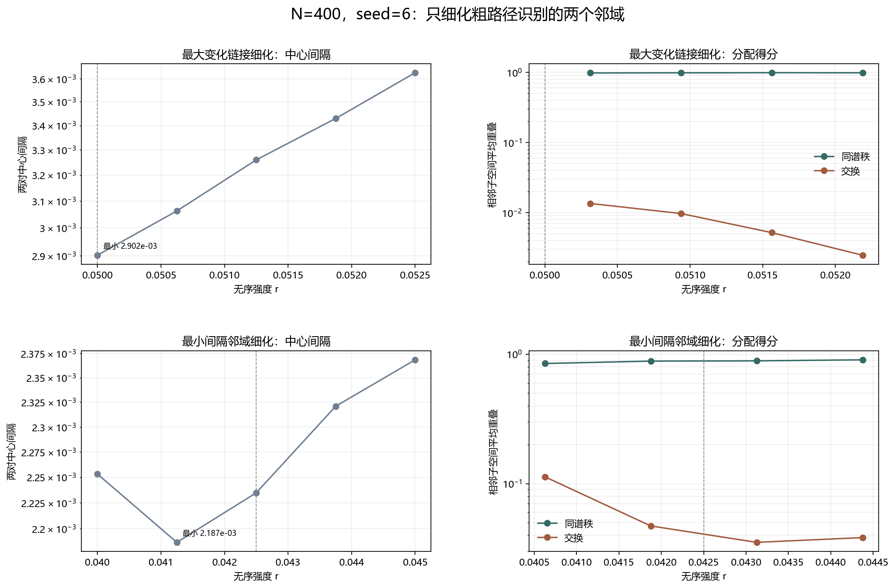

# Floquet-BdG 参数路径定向细化

> 日期：2026-11-11。N=400、seed=6、固定随机流。只细化粗路径已识别的最大变化链接与最小间隔邻域，不新增类别、不补算体 winding，未计算 N=640。

## 一、细化协议与粗点复核

最大变化区使用 r=0.050000、0.050625、0.051250、0.051875、0.052500；最小间隔区使用 r=0.040000、0.041250、0.042500、0.043750、0.045000。新增唯一点共5个，8条细分链接。

五个粗网格旧点的中心、距离、分离比、端点权重和诊断标志均复核，最大数值误差为 0.000e+00。

## 二、最大变化链接细化

| r | 最近对中心 | 次近对中心 | 中心间隔 |
|---:|---:|---:|---:|
| 0.05 | 6.05555e-05 | 0.00296207 | 0.00290152 |
| 0.050625 | 3.2226e-05 | 0.00309515 | 0.00306293 |
| 0.05125 | 4.66286e-05 | 0.00330686 | 0.00326023 |
| 0.051875 | 0.000135977 | 0.00356538 | 0.00342941 |
| 0.0525 | 0.000194847 | 0.00382145 | 0.0036266 |

| 从 r | 到 r | 同谱秩得分 | 交换得分 | 主导分配 |
|---:|---:|---:|---:|:---|
| 0.05 | 0.050625 | 0.976756 | 0.0134985 | diagonal |
| 0.050625 | 0.05125 | 0.982274 | 0.00970519 | diagonal |
| 0.05125 | 0.051875 | 0.984894 | 0.00518694 | diagonal |
| 0.051875 | 0.0525 | 0.98279 | 0.00246991 | diagonal |

本区域最小中心间隔为 0.00290152，位于 r=0.05；最大相邻间隔变化为 0.000197306。

## 二、最小间隔邻域细化

| r | 最近对中心 | 次近对中心 | 中心间隔 |
|---:|---:|---:|---:|
| 0.04 | 1.81018e-05 | 0.00227129 | 0.00225319 |
| 0.04125 | 3.81243e-05 | 0.00222503 | 0.00218691 |
| 0.0425 | 0.000219169 | 0.00245396 | 0.0022348 |
| 0.04375 | 0.00019128 | 0.00251222 | 0.00232094 |
| 0.045 | 6.08334e-05 | 0.00242931 | 0.00236847 |

| 从 r | 到 r | 同谱秩得分 | 交换得分 | 主导分配 |
|---:|---:|---:|---:|:---|
| 0.04 | 0.04125 | 0.847642 | 0.113094 | diagonal |
| 0.04125 | 0.0425 | 0.884086 | 0.0471446 | diagonal |
| 0.0425 | 0.04375 | 0.888412 | 0.0352069 | diagonal |
| 0.04375 | 0.045 | 0.904663 | 0.0383119 | diagonal |

本区域最小中心间隔为 0.00218691，位于 r=0.04125；最大相邻间隔变化为 8.61401e-05。

图 1 插入位置：两个区域的数值表之后、汇总结论之前。

**图 1**　上排为最大变化链接，下排为最小间隔邻域；左侧为中心间隔，右侧为相邻分配得分。

## 三、细化后的结论与边界

8条细分链接中，同谱秩占优 8，交换占优 0，精确并列 0。

全部细化点的最小中心间隔为 0.00218691，位于 r=0.04125；最大相邻间隔变化为 0.000197306。

最大变化区的同谱秩得分范围为 0.976756–0.984894，最小间隔邻域为 0.847642–0.904663。细步长提高了同 N 对应的可辨识性。

粗网格上的较大跳变在细化后分解为较小变化，且没有交换占优，因此粗步长跳变不是谱交叉证明。离散网格的最小值也不是连续极值；最小间隔位置从0.0425移动到新增点0.04125，只说明当前离散网格的实测最小值位置。

细化只提高这两个邻域的分辨率，不把有限步长外推为连续路径不变性。若出现交换分配链接，它只是进一步细化候选；若没有，也不构成避免交叉证明。

本轮没有证明连续路径、谱交叉、避免交叉、真实态追踪、次近对拓扑性或体 winding。原类别和此前计数未改变。

复现：`python research/floquet-bdg-tbc/analyze_path_refinement.py`。两个区域、10个细化点、8条链接和粗点复核保存在 `path_refinement_analysis.json`。
