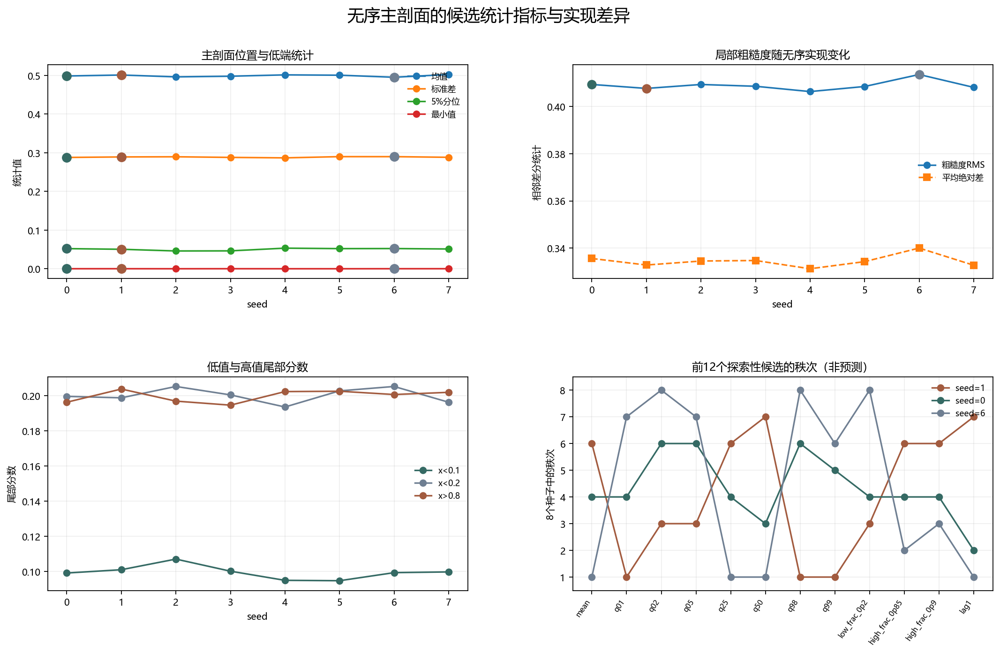

# Floquet-BdG 无序主剖面候选统计指标

> 日期：2026-11-12。全部8个主剖面、40组指标记录；只计算描述统计与预登记方向标签，不新增 Floquet 单元，不拟合预测模型，不计算 p 值。不补算体 winding，未计算 N=640。

## 一、主剖面统计与实现差异

统一计算位置、尾部、局部 block、粗糙度、总变差、符号变化和滞后相关。block 使用 N=400 的12值平均与 N=600 的8值平均，局部标准差采用 ddof=0。所有结果不归一化，不筛选有利剖面。

| seed | 均值 | 标准差 | 最小值 | 5%分位 | 95%分位 | 最大值 | 粗糙度RMS | x<0.1 | x>0.8 | lag1 |
|---:|---:|---:|---:|---:|---:|---:|---:|---:|---:|---:|
| 0 | 0.498712 | 0.287972 | 7.3312e-05 | 0.0520728 | 0.953095 | 0.999581 | 0.409318 | 0.0991667 | 0.19625 | -0.0102272 |
| 1 | 0.501231 | 0.289271 | 9.72941e-05 | 0.0503986 | 0.946775 | 0.999662 | 0.407641 | 0.101042 | 0.20375 | 0.007111 |
| 2 | 0.496408 | 0.28968 | 4.36364e-06 | 0.0460214 | 0.951712 | 0.999993 | 0.409308 | 0.107083 | 0.196875 | 0.00184853 |
| 3 | 0.498101 | 0.288085 | 9.67455e-05 | 0.0462856 | 0.949062 | 0.999992 | 0.40855 | 0.100208 | 0.194583 | -0.00570462 |
| 4 | 0.501595 | 0.286873 | 1.18937e-05 | 0.0533069 | 0.948396 | 0.999859 | 0.406308 | 0.095 | 0.202292 | -0.00282258 |
| 5 | 0.500725 | 0.29004 | 9.95653e-07 | 0.052053 | 0.951986 | 0.999987 | 0.408457 | 0.0947917 | 0.2025 | 0.0082856 |
| 6 | 0.495465 | 0.29 | 8.39738e-05 | 0.0522416 | 0.950274 | 0.999957 | 0.413528 | 0.099375 | 0.200625 | -0.0166675 |
| 7 | 0.502524 | 0.288333 | 0.000110256 | 0.0511424 | 0.951845 | 0.999905 | 0.408079 | 0.0997917 | 0.201875 | -0.00155748 |

图 1 插入位置：主剖面汇总表之后、候选规则之前。

**图 1**　主剖面位置、粗糙度、尾部分数及前12个探索性候选的秩次。秩次只用于描述，不是预测准确率。

## 二、预登记候选规则

指标在8个种子中至少有6个不同取值，并在 seed=1、0、6 上严格同向或反向于跳变计数 0、4、6，才标为探索性候选。block 指标另记录 N=400 与 N=600 是否同向。全部40组记录均保存在 JSON，报告只按协议顺序展示前12个候选。

| 指标 | 层级 | 方向 | block同向性 | 不同取值数 | seed=1值 | seed=0值 | seed=6值 |
|:---|:---|:---|:---:|---:|---:|---:|---:|
| mean | master | opposite_to_jump_changes | not_applicable | 8 | 0.501231 | 0.498712 | 0.495465 |
| q01 | master | same_as_jump_changes | not_applicable | 8 | 0.0093639 | 0.00972191 | 0.011124 |
| q02 | master | same_as_jump_changes | not_applicable | 8 | 0.0202278 | 0.0221135 | 0.0235282 |
| q05 | master | same_as_jump_changes | not_applicable | 8 | 0.0503986 | 0.0520728 | 0.0522416 |
| q25 | master | opposite_to_jump_changes | not_applicable | 8 | 0.251794 | 0.247132 | 0.240017 |
| q50 | master | opposite_to_jump_changes | not_applicable | 8 | 0.500886 | 0.495471 | 0.487223 |
| q98 | master | same_as_jump_changes | not_applicable | 8 | 0.977072 | 0.982518 | 0.983096 |
| q99 | master | same_as_jump_changes | not_applicable | 8 | 0.985922 | 0.990676 | 0.991422 |
| low_frac_0p2 | master | same_as_jump_changes | not_applicable | 7 | 0.19875 | 0.199583 | 0.205208 |
| high_frac_0p85 | master | opposite_to_jump_changes | not_applicable | 8 | 0.15125 | 0.148958 | 0.146875 |
| high_frac_0p9 | master | opposite_to_jump_changes | not_applicable | 8 | 0.100417 | 0.0975 | 0.0972917 |
| lag1 | master | opposite_to_jump_changes | not_applicable | 8 | 0.007111 | -0.0102272 | -0.0166675 |

共有 16 个探索性候选。它们只满足预设排序规则，不是统计显著性、因果归因或预测证据。

## 三、为什么仍不能直接建模

三个对照种子的跳变计数为 {'0': 4, '1': 0, '6': 6}，而主导项计数均为 {'0': 4, '1': 4, '6': 4}。主导项计数没有排序差异，不能为任何统计指标提供监督标签。跨种子最大跳变链接也完全一致的条目数为0，进一步说明实现依赖不能被单一统计量替代。

下一步若使用这些候选，必须先在剩余种子上预注册验证指标与结局定义，再评估其是否仍有一致方向；不能把本报告的方向匹配当作可推广的预测能力。

本报告不能外推为普遍尺寸律、真实态交换、谱交叉、统计显著性或热力学极限结论。旧交换候选属于不同无序实现，不能与统计差分直接相减。

复现：`python research/floquet-bdg-tbc/analyze_profile_stat_candidates.py`。完整40组指标、方向、候选规则和来源哈希保存在 `profile_stat_candidates_analysis.json`。
