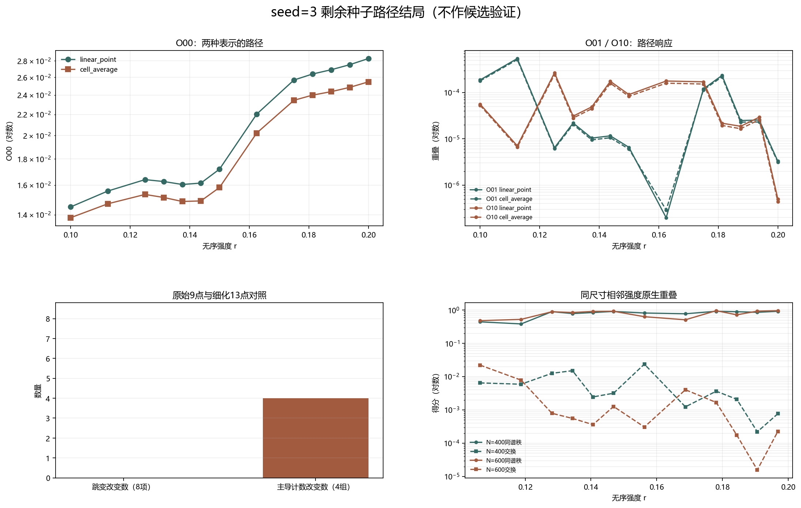

# Floquet-BdG seed=3 剩余种子路径结局

> 日期：2026-11-12。seed=3 使用既有主剖面，计算13点路径的26个尺寸单元、78组跨尺寸矩阵和24条原生链接。本报告只生成路径结局，不作候选验证。不补算体 winding，未计算 N=640。

## 一、预登记路径结局

原9点／8链接与细化13点／12链接逐种子比较，保留全部点、链接和主导项，不归一化，不筛选有利路径段。候选名单与逐对方向规则已在计算前冻结，但必须等 seed=2、3、4、5、7 的结局全部存在后才能执行。

| seed | 尺寸单元 | 跨尺寸矩阵 | 原生链接 | 跳变改变数（8项） | 主导计数改变数（4组） | 新中点参与极值数 |
|---:|---:|---:|---:|---:|---:|---:|
| 3 | 26 | 78 | 24 | 0 | 4 | 0 |

图 1 插入位置：路径结局汇总之后、逐项比较之前。

**图 1**　O00、O01／O10 路径、步长改变计数及同尺寸原生重叠。本图不作候选验证。

## 二、逐项跳变比较

| 方法 | 项 | 原最大跳变及链接 | 细化最大跳变及链接 | 改变 |
|:---|:---:|---:|---:|:---:|
| linear_point | O00 | 0.00483979（0.15→0.1625） | 0.00483979（0.15→0.1625） | False |
| linear_point | O01 | 0.000537005（0.1125→0.125） | 0.000537005（0.1125→0.125） | False |
| linear_point | O10 | 0.00025986（0.1125→0.125） | 0.00025986（0.1125→0.125） | False |
| linear_point | O11 | 0.000213116（0.1125→0.125） | 0.000213116（0.1125→0.125） | False |
| cell_average | O00 | 0.00440244（0.15→0.1625） | 0.00440244（0.15→0.1625） | False |
| cell_average | O01 | 0.000509906（0.1125→0.125） | 0.000509906（0.1125→0.125） | False |
| cell_average | O10 | 0.000238372（0.1125→0.125） | 0.000238372（0.1125→0.125） | False |
| cell_average | O11 | 0.000201406（0.1125→0.125） | 0.000201406（0.1125→0.125） | False |

## 三、证据边界

既有候选值曾在描述统计中出现，因此本设计不是完全未触碰的外部验证集；只有路径跳变结局是新生成的。它至多是结局盲的逐对方向检验，不是外部实验重复、预测模型或统计显著性检验。

端点矩阵、主奇异值和前六谱分量的最大绑定误差分别为 0.0、0.0 和 0.0。端点重算不新增无序实现。

在五个剩余种子结局齐备之前，不输出候选通过、淘汰、相关性、预测准确率或显著性结论。本报告也不能外推为连续路径、真实态交换、谱交叉、普遍尺寸律、因果机制或热力学极限结论。

复现：`python research/floquet-bdg-tbc/analyze_remaining_seed_outcome.py --seed 3`。完整路径与结局保存在 `remaining_seed3_path_outcome_analysis.json`。
