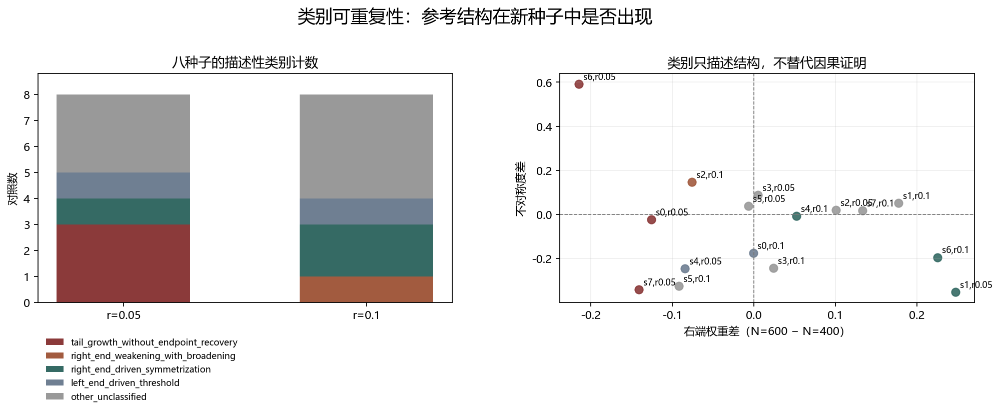

# Floquet-BdG 端部机制类别可重复性检验

> 日期：2026-11-11。既有 seed=0–3 与新增预登记 seed=4–7，共 8 个种子、16 个 N=400→600 对照。不追加阈值，不补算体 winding，未计算 N=640。

## 一、类别计数

| 类别 | r=0.05 | r=0.1 | 合计 |
|:---|---:|---:|---:|
| tail_growth_without_endpoint_recovery | 3 | 0 | 3 |
| right_end_weakening_with_broadening | 0 | 1 | 1 |
| right_end_driven_symmetrization | 1 | 2 | 3 |
| left_end_driven_threshold | 1 | 1 | 2 |
| other_unclassified | 3 | 4 | 7 |

未归类（`other_unclassified`）单元不会被强行命名。参考类别在新种子中出现，只能称为可重复候选，不能据此宣称普遍机制。

图 1 插入位置：类别计数之后、逐种子数据之前。

**图 1**　左图为类别计数，右图为右端差与不对称度差；类别由冻结的符号条件给出。

## 二、逐种子分类结果

| seed | r | Δ左端 | Δ右端 | ΔL50 | Δ不对称度 | 类别 |
|---:|---:|---:|---:|---:|---:|:---|
| 0 | 0.05 | 0.060878 | -0.12587 | 34 | -0.0238 | tail_growth_without_endpoint_recovery |
| 1 | 0.05 | 0.087855 | 0.24752 | -31 | -0.35167 | right_end_driven_symmetrization |
| 2 | 0.05 | 0.058699 | 0.10091 | -3 | 0.021037 | other_unclassified |
| 3 | 0.05 | 0.06053 | 0.0048511 | 9 | 0.088267 | other_unclassified |
| 4 | 0.05 | 0.091874 | -0.084581 | 14 | -0.24559 | left_end_driven_threshold |
| 5 | 0.05 | 0.024112 | -0.0064706 | 1 | 0.038623 | other_unclassified |
| 6 | 0.05 | 0.073849 | -0.21476 | 33 | 0.59173 | tail_growth_without_endpoint_recovery |
| 7 | 0.05 | 0.047838 | -0.14078 | 49 | -0.34108 | tail_growth_without_endpoint_recovery |
| 0 | 0.1 | 0.074167 | -0.00072365 | 13 | -0.17394 | left_end_driven_threshold |
| 1 | 0.1 | 0.10024 | 0.17761 | -7 | 0.052081 | other_unclassified |
| 2 | 0.1 | 0.039745 | -0.075914 | 12 | 0.14779 | right_end_weakening_with_broadening |
| 3 | 0.1 | 0.13549 | 0.024193 | -5 | -0.24299 | other_unclassified |
| 4 | 0.1 | 0.035613 | 0.052518 | 8 | -0.0071341 | right_end_driven_symmetrization |
| 5 | 0.1 | 0.084382 | -0.091903 | 18 | -0.32512 | other_unclassified |
| 6 | 0.1 | 0.10949 | 0.22541 | -13 | -0.19412 | right_end_driven_symmetrization |
| 7 | 0.1 | 0.098217 | 0.13348 | 1 | 0.018871 | other_unclassified |

## 三、是否形成可重复类别

参考的右端驱动—对称化在 seed=4–7 中出现 2 例；右端减弱—尾部变宽出现 0 例。seed=1 与 seed=2 的原始参照类别未改变。

新种子中出现了至少一个参考结构，因此可保留‘可重复候选’这一弱表述；但不同强度、不同种子仍不等价，不能升级为普适类别。

类别由符号条件而非拓扑相变判据定义。它们用于组织后续谱隔离和端部不对称分析，不补算体 winding，也不提供统计因果或热力学结论。

复现：`python research/floquet-bdg-tbc/build_category_cells.py`、`python research/floquet-bdg-tbc/verify_category_cells.py`、`python research/floquet-bdg-tbc/analyze_repeated_categories.py`。
