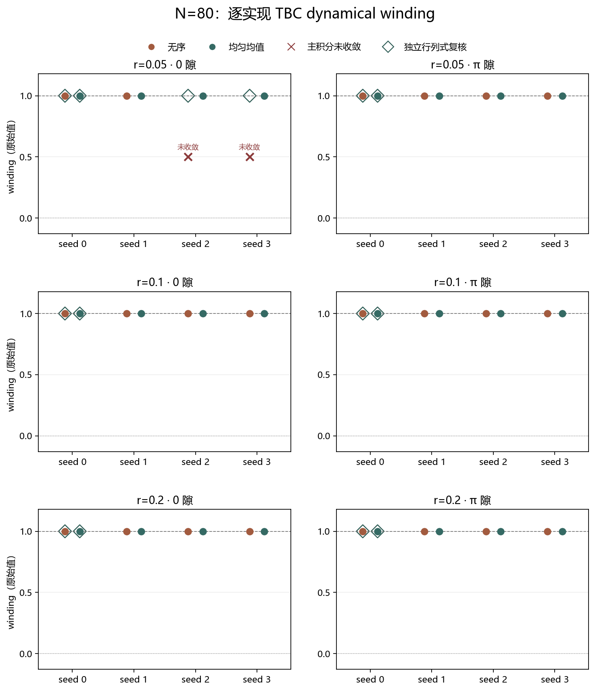
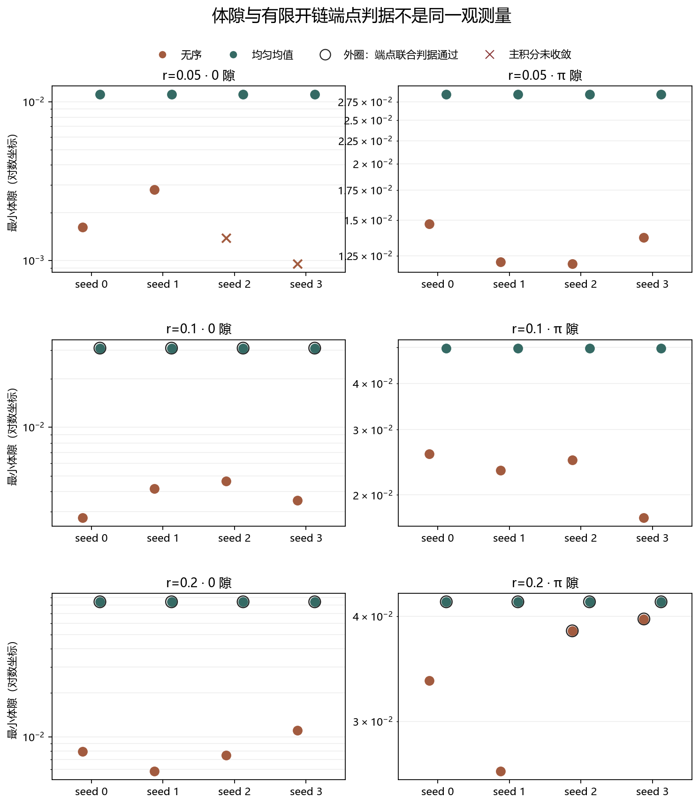

# Floquet-BdG TBC dynamical winding：无序与均匀均值对照

> 日期：2026-11-11。范围：N=80、4 个固定 seed、r=0.05/0.1/0.2 的有限二次型模型。本文不宣称热力学极限、材料 Tc、相互作用、耗散或实验验证。

## 一、结论分层

- 静态拓扑／平凡与洁净 kicked 两级基准通过；洁净 N=80 的 W0、Wπ 与 p0=pπ=1 一致。
- 正确无序协议的主积分器在 48 个能隙结果中给出 46 个有效结果，最近整数全部为 1；两个 r=0.05 的 0 支为 not_converged，未被改写为整数。
- 两个未收敛类别的独立行列式相位绕数均为 1。它们说明主积分网格未收敛，不改变主结果状态，也不允许把未收敛记为 0。
- 有限开链端点联合判据与体 winding 不等价。无序 0 模联合判据在 12 个实现中为 0/12 通过；不能据此宣称短链端点模全部通过。

## 二、模型与必要修正

Majorana 基为 (a1,b1,…,aN,bN)，S=diag(−1,+1,…)。TBC 只给 N→1 闭合键附加 exp(iθ)。对称时间帧为：

$$U_{step}(t)=F(t)H\quad(0<t<T),\qquad U_{step}(T)=H F(T)H,\qquad U_{step}(0)=I.$$

周期化采用酉 Schur 分解及端点、半周期 chiral 共同筛选的能支：

$$\phi_{eff,val}=2\varepsilon-|\phi|,\qquad \phi_{eff,cond}=|\phi|-2\pi,$$

$$W_\varepsilon=\left|\pm\frac{i}{2\pi}\int_{-\pi}^{\pi}\operatorname{Tr}[U_{\varepsilon}^{\pm}(\theta)^{-1}\partial_\theta U_{\varepsilon}^{\pm}(\theta)]\,d\theta\right|.$$

无序的 K 矩阵 onsite 参数是 rβ；半 kick 旋转角也是 rβ，完整对称旋转角为 2rβ。早期把 2rβ 误作矩阵参数的结果已原样归入 diagnostics/double-kick/，详见 ERRATA.md，不用于本报告结论。

## 三、静态与洁净基准

| 算例 | 能隙 | winding 原始值 | 最近整数 | 最小体隙 |
|:---|:---:|---:|---:|---:|
| 静态拓扑 ω=7 | 0 | 0.999895564672 | 1 | 1.56366 |
| 静态拓扑 ω=7 | π | 5.02859541177e-31 | 0 | 1.24698 |
| 静态平凡 ω=17 | 0 | 6.69008894321e-18 | 0 | 1.05286 |
| 静态平凡 ω=17 | π | 5.02859541177e-31 | 0 | 0.547326 |
| 洁净 kicked N=80 | 0 | 0.999895564641 | 1 | 0.0839051 |
| 洁净 kicked N=80 | π | 0.999895564659 | 1 | 0.0416134 |

静态 μ0=2.5、ω=7 的 0 隙为 gapless_or_undefined，未记为 0。

## 四、无序与均值汇总

| r | 类型 | 能隙 | 有效数/4 | 整数频数 | 最小体隙 | 端点联合通过/4 |
|---:|:---|:---:|---:|:---|---:|---:|
| 0.05 | 无序 | 0 | 2/4 | 1:2；None:2 | 0.000952042 | 0/4 |
| 0.05 | 无序 | π | 4/4 | 1:4 | 0.0119951 | 0/4 |
| 0.05 | 均匀均值 | 0 | 4/4 | 1:4 | 0.011128 | 0/4 |
| 0.05 | 均匀均值 | π | 4/4 | 1:4 | 0.0285504 | 0/4 |
| 0.1 | 无序 | 0 | 4/4 | 1:4 | 0.00275242 | 0/4 |
| 0.1 | 无序 | π | 4/4 | 1:4 | 0.017366 | 0/4 |
| 0.1 | 均匀均值 | 0 | 4/4 | 1:4 | 0.0309471 | 4/4 |
| 0.1 | 均匀均值 | π | 4/4 | 1:4 | 0.0498164 | 0/4 |
| 0.2 | 无序 | 0 | 4/4 | 1:4 | 0.00582414 | 0/4 |
| 0.2 | 无序 | π | 4/4 | 1:4 | 0.0261721 | 2/4 |
| 0.2 | 均匀均值 | 0 | 4/4 | 1:4 | 0.0839051 | 4/4 |
| 0.2 | 均匀均值 | π | 4/4 | 1:4 | 0.0416134 | 4/4 |

统计口径：同一强度的均匀均值控制是同一均匀链，虽然为配对列出 4 次，但不能当作 4 个独立随机样本；独立无序实现共 12 个。

图 1 插入位置：无序汇总表之后、未收敛诊断之前。

**图 1**　圆点为主积分有效结果；叉号为 not_converged；空心菱形为独立行列式复核。未收敛不记为整数。

## 五、两个未收敛类别

| r | seed | 能隙 | dθ≈0.05 原始值 | dθ≈0.025 原始值 | 主状态 | 独立行列式 |
|---:|---:|:---:|---:|---:|:---|---:|
| 0.05 | 2 | 0 | 0.998984412 | 0.9997437179 | not_converged | 1 |
| 0.05 | 3 | 0 | 0.998296305 | 0.9995692573 | not_converged | 1 |

图 2 插入位置：未收敛诊断之后、独立验证与科学边界之前。

**图 2**　纵轴为对数体隙；黑色外圈表示有限开链端点联合判据通过。体 winding 与端点权重／分离度必须分别解释。

## 六、独立验证与科学边界

独立检查共 14 项，其中失败类别 2 项；程序状态 passed=true。独立方法重建矢量无序传播、酉 Schur 周期化和 det(block) 相位展开，名义步长 0.0125。

当前证据支持：在这 24 个有限二次型样本中，体 winding 主结果或独立失败类别复核均与 W0=Wπ=1 相容。它不证明任意无序强度、任意尺寸或热力学极限的稳健性，也不替代端点模的有限尺寸分析。

复现：python research/floquet-bdg-tbc/run_verification.py。原始数据：disorder_results.json、disorder_results.csv、disorder_independent.json；错误协议勘误：ERRATA.md。

原始依据：Mondal et al., arXiv:2207.11928v2, Eq. (7)–(16)；Thakurathi et al., arXiv:1303.2300v2。实现中的时间帧和能支由端点与 chiral 合同独立筛选，未将印刷公式记号差异静默当作复现成功。
