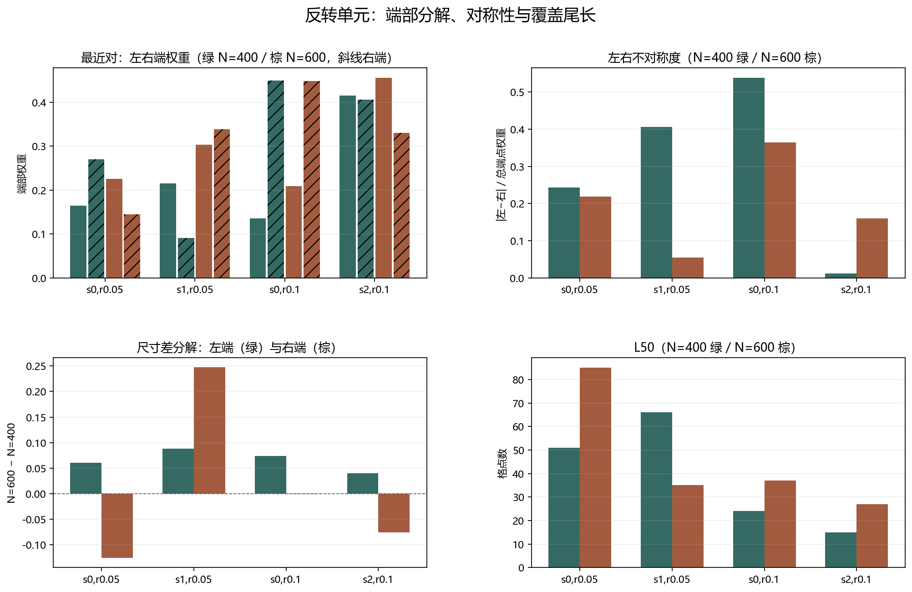

# Floquet-BdG 反转单元机制诊断

> 日期：2026-11-11。只使用已独立验证的 16 组 profile，定向分解 seed=0、1、2 的四个代表性对照。不追加种子，不补算体 winding，未计算 N=640。

## 一、左右端差值与不对称性

| seed | r | Δ左端 | Δ右端 | Δ总端点 | ΔL50 | Δ不对称度 | 机制标签（描述性） |
|---:|---:|---:|---:|---:|---:|---:|:---|
| 0 | 0.05 | 0.0608775 | -0.125869 | -0.0649919 | 34 | -0.0237999 | tail_growth_without_endpoint_recovery |
| 1 | 0.05 | 0.0878548 | 0.247523 | 0.335378 | -31 | -0.351672 | right_end_driven_symmetrization |
| 0 | 0.1 | 0.0741667 | -0.000723647 | 0.0734431 | 13 | -0.173939 | left_end_driven_threshold |
| 2 | 0.1 | 0.0397454 | -0.0759138 | -0.0361684 | 12 | 0.147786 | right_end_weakening_with_broadening |

图 1 插入位置：左右端分解表之后、个案解释之前。

**图 1**　上排为端点权重和不对称度，下排为左右端差值与 L50；绿色为 N=400，棕色为 N=600。

## 二、两类不同反转机制

### seed=1、r=0.05：右端驱动并趋于对称

N=400→600 的左端权重增加约 0.0879，右端增加约 0.2475，右端驱动更显著。L50 从 66 缩短到 35，不对称度下降。谱隔离比没有同步大幅改善，因此不能把变化完全归因于谱隔离；它更像端部空间重新分配与两端趋于对称。

### seed=2、r=0.1：右端减弱并伴随尾部变宽

N=400→600 的左端权重增加约 0.0397，右端减少约 0.0759，总端点权重下降约 0.0362；L50 从 15 增至 27，不对称度上升。这是尾部变宽和右端减弱的组合。

两种尺寸的端点权重分别约为 0.8217 和 0.7856，联合判据均通过，因此**不是端点消失**。N=600 的分离比更小，却出现端点权重下降，再次说明谱隔离与端部局域是不同指标。

## 三、seed=0 参照不能省略

r=0.05、seed=0 保持尾长增长且端点未恢复；r=0.1、seed=0 的正向端点差主要来自左端增强，右端基本持平。不同随机实现的‘尺寸效应’在方向、主导端和对称性上并不相同。

## 四、解释边界与下一步

本轮是定向解释性分解，不是普适机制命名或因果证明。数据来自已有 16 单元，原始独立后端验证未改变；本轮只重算左右端、覆盖与不对称指标。

下一步应把‘右端驱动—对称化’与‘右端减弱—尾部变宽’作为可检验的结构描述，结合更多预登记种子的同类分解，检验它们是否形成可重复的类别，而不是把单次反转当作相变。

复现：`python research/floquet-bdg-tbc/analyze_reversal_units.py`。原始对照、次近对摘要、重算误差和来源哈希保存在 `reversal_unit_analysis.json`。
