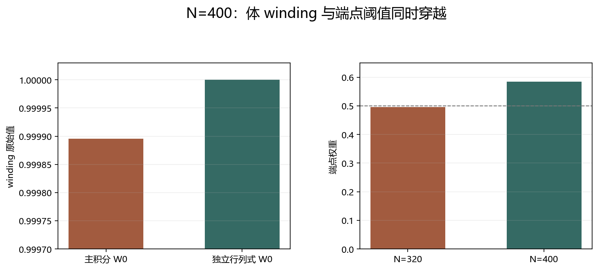
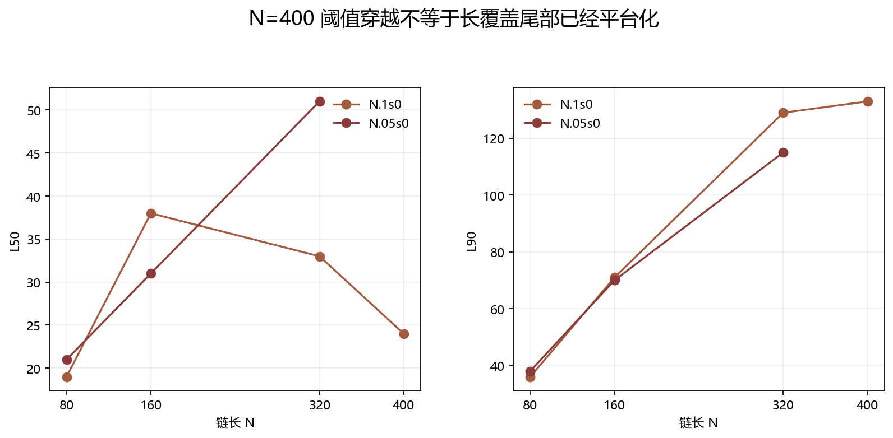

# N=400 Floquet-BdG 阈值边缘诊断

> 日期：2026-11-11。N=400、r=0.1、seed=0。主双网格 dθ=0.05/0.025，独立原始 expm＋Schur 行列式 dθ=0.1。N=400 阈值穿越不是恢复保证。

## 一、体 winding 与端点阈值

| 项目 | N=320 | N=400 |
|:---|---:|---:|
| 主 W0 原始值 | 0.999895548527 | 0.999895564547 |
| 最小 0 体隙 | 0.00347553 | 0.00246008 |
| 端点权重 | 0.495586 | 0.584262 |
| 最大分离比 | 0.0167445 | 0.0010719 |
| 端点联合判据 | False | True |

独立原始 expm＋Schur 行列式为 1，与主整数一致；最大对称误差 1.47629e-13。

图 1 插入位置：阈值结果之后、覆盖分析之前。

**图 1**　主积分与独立复核一致，端点权重从 N=320 的略低于 0.5 转为 N=400 的通过。

## 二、覆盖尾部是否平台化

| 指标 | N=80 | N=160 | N=320 | N=400 |
|:---|---:|---:|---:|---:|
| L50 | 19 | 38 | 33 | 24 |
| L90 | 36 | 71 | 129 | 133 |
| 固定20格点质量 | 0.539053 | 0.301063 | 0.32763 | 0.47065 |
| 中心20%质量 | 0.20117 | 0.173354 | 0.101029 | 0.0513685 |
| N·IPR | 1.44607 | 1.50639 | 3.3467 | 7.31009 |

N=400 包络拟合 R²=0.331553。N=400 的阈值穿越是实测结果，但长覆盖尾部仍需单独判断，不能用单一指数恢复律概括。

图 2 插入位置：覆盖分析之后、N=600 决策之前。

**图 2**　N.1s0 与 N.05s0 的覆盖机制不同；N=400 并未替代 N.05s0 的尾长增长诊断。

## 三、是否值得做 N=600

值得，但目的不同：N=400 已回答 r=0.1、seed=0 的局部阈值穿越问题；N=600 要回答 r=0.05、seed=0 的 L50 持续增长是否仍会延续。两者不是同一种恢复检验。

N=400 的端点联合通过不证明热力学体边对应，也不把 N.05s0 的 not_established 改写为恢复。后续 N=600 继续采用嵌套 RNG 和逐θ小块检查点。

复现：python research/floquet-bdg-tbc/run_scale_diagnostic.py --n 400 --grid 0.05；--grid 0.025 分批续算；python research/floquet-bdg-tbc/verify_scale_diagnostic.py --n 400。
