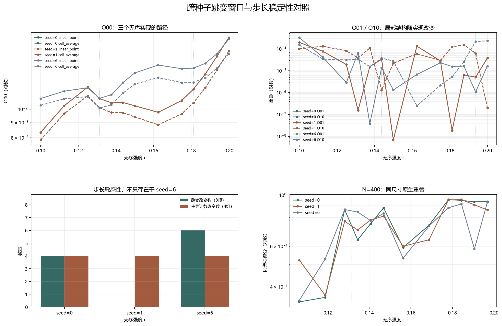

# Floquet-BdG 跨种子跳变窗口中点对照

> 日期：2026-11-12。seed=0、1 使用同一13点协议，与 seed=6 对照；共52个新尺寸单元、156组矩阵、48条原生链接。不新增类别，不补算体 winding，未计算 N=640。

## 一、三个无序实现的步长响应

每个种子分别比较原9点／8链接与细化13点／12链接，不归一化，不筛选有利路径段。跨种子一致或不一致只描述当前实现，不构成普遍性或统计显著性结论。

每条矩阵项差分同时保留两条主奇异值通道的贡献，便于区分矩阵项变化与主奇异通道变化。

| seed | 新尺寸单元 | 跳变改变数（8项） | 主导计数改变数（4组） | 新中点参与极值数 | 跨尺寸分配改变数 |
|---:|---:|---:|---:|---:|---:|
| 0 | 26 | 4 | 4 | 2 | 0 |
| 1 | 26 | 0 | 4 | 2 | 0 |

图 1 插入位置：种子汇总表之后、逐项对照之前。

**图 1**　三个无序实现的 O00、O01、O10 路径、步长改变计数及同尺寸原生重叠。数值贡献不作因果命名。

## 二、每个种子内部的最大跳变对照

| seed | 方法 | 项 | 原最大跳变及链接 | 细化最大跳变及链接 | 改变 |
|---:|:---|:---:|---:|---:|:---:|
| 0 | linear_point | O00 | 0.0019345（0.1→0.1125） | 0.0023873（0.19375→0.2） | True |
| 0 | linear_point | O01 | 0.000132116（0.15→0.1625） | 0.000132116（0.15→0.1625） | False |
| 0 | linear_point | O10 | 4.99115e-05（0.1125→0.125） | 0.000108204（0.1375→0.14375） | True |
| 0 | linear_point | O11 | 0.000734632（0.1625→0.175） | 0.000734632（0.1625→0.175） | False |
| 0 | cell_average | O00 | 0.001792（0.1→0.1125） | 0.00215243（0.19375→0.2） | True |
| 0 | cell_average | O01 | 0.000121445（0.15→0.1625） | 0.000121445（0.15→0.1625） | False |
| 0 | cell_average | O10 | 4.90899e-05（0.1125→0.125） | 0.000101157（0.1375→0.14375） | True |
| 0 | cell_average | O11 | 0.000690634（0.1625→0.175） | 0.000690634（0.1625→0.175） | False |
| 1 | linear_point | O00 | 0.00696517（0.1→0.1125） | 0.00696517（0.1→0.1125） | False |
| 1 | linear_point | O01 | 0.000255492（0.15→0.1625） | 0.000255492（0.15→0.1625） | False |
| 1 | linear_point | O10 | 8.73977e-05（0.15→0.1625） | 8.73977e-05（0.15→0.1625） | False |
| 1 | linear_point | O11 | 0.000579271（0.15→0.1625） | 0.000579271（0.15→0.1625） | False |
| 1 | cell_average | O00 | 0.00661657（0.1→0.1125） | 0.00661657（0.1→0.1125） | False |
| 1 | cell_average | O01 | 0.000238609（0.15→0.1625） | 0.000238609（0.15→0.1625） | False |
| 1 | cell_average | O10 | 8.05525e-05（0.15→0.1625） | 8.05525e-05（0.15→0.1625） | False |
| 1 | cell_average | O11 | 0.000537684（0.15→0.1625） | 0.000537684（0.15→0.1625） | False |

## 三、跨种子极值与跳变位置一致性

| 方法 | 项 | 最小值强度（0／1／6） | 最大值强度（0／1／6） | 最大跳变链接（0／1／6） |
|:---|:---:|---:|---:|---:|
| linear_point | O00 | {'0': 0.1, '1': 0.1, '6': 0.1} | {'0': 0.2, '1': 0.2, '6': 0.2} | {'0': [0.19375, 0.2], '1': [0.1, 0.1125], '6': [0.19375, 0.2]} |
| linear_point | O01 | {'0': 0.15, '1': 0.1, '6': 0.1375} | {'0': 0.1, '1': 0.1625, '6': 0.1} | {'0': [0.15, 0.1625], '1': [0.15, 0.1625], '6': [0.1, 0.1125]} |
| linear_point | O10 | {'0': 0.2, '1': 0.18125, '6': 0.1625} | {'0': 0.1875, '1': 0.1625, '6': 0.2} | {'0': [0.1375, 0.14375], '1': [0.15, 0.1625], '6': [0.1875, 0.19375]} |
| linear_point | O11 | {'0': 0.13125, '1': 0.1375, '6': 0.1625} | {'0': 0.18125, '1': 0.2, '6': 0.2} | {'0': [0.1625, 0.175], '1': [0.15, 0.1625], '6': [0.1875, 0.19375]} |
| cell_average | O00 | {'0': 0.1, '1': 0.1, '6': 0.13125} | {'0': 0.2, '1': 0.2, '6': 0.2} | {'0': [0.19375, 0.2], '1': [0.1, 0.1125], '6': [0.19375, 0.2]} |
| cell_average | O01 | {'0': 0.15, '1': 0.1, '6': 0.1375} | {'0': 0.1, '1': 0.1625, '6': 0.1} | {'0': [0.15, 0.1625], '1': [0.15, 0.1625], '6': [0.1, 0.1125]} |
| cell_average | O10 | {'0': 0.2, '1': 0.18125, '6': 0.1625} | {'0': 0.1875, '1': 0.1625, '6': 0.2} | {'0': [0.1375, 0.14375], '1': [0.15, 0.1625], '6': [0.1875, 0.19375]} |
| cell_average | O11 | {'0': 0.13125, '1': 0.1375, '6': 0.1625} | {'0': 0.18125, '1': 0.2, '6': 0.2} | {'0': [0.1625, 0.175], '1': [0.15, 0.1625], '6': [0.1875, 0.19375]} |

## 四、主导项、原生链接与边界

| seed | 方法 | 得分组 | 原主导项计数（8链接） | 细化主导项计数（12链接） |
|---:|:---|:---|:---:|:---:|
| 0 | linear_point | diagonal | {'O00': 4, 'O11': 0} | {'O00': 11, 'O11': 1} |
| 0 | linear_point | swapped | {'O01': 4, 'O10': 0} | {'O01': 5, 'O10': 7} |
| 0 | cell_average | diagonal | {'O00': 4, 'O11': 0} | {'O00': 11, 'O11': 1} |
| 0 | cell_average | swapped | {'O01': 4, 'O10': 0} | {'O01': 5, 'O10': 7} |
| 1 | linear_point | diagonal | {'O00': 4, 'O11': 0} | {'O00': 11, 'O11': 1} |
| 1 | linear_point | swapped | {'O01': 3, 'O10': 1} | {'O01': 8, 'O10': 4} |
| 1 | cell_average | diagonal | {'O00': 4, 'O11': 0} | {'O00': 12, 'O11': 0} |
| 1 | cell_average | swapped | {'O01': 3, 'O10': 1} | {'O01': 8, 'O10': 4} |

| seed | N | 同谱秩最小值及链接 | 交换最大值及链接 | 最大中心间隔变化 |
|---:|---:|---:|---:|---:|
| 0 | 400 | 0.343759（0.1→0.1125） | 0.0229995（0.1125→0.125） | 0.00210575 |
| 0 | 600 | 0.316322（0.1→0.1125） | 0.0164163（0.15→0.1625） | 0.00250142 |
| 1 | 400 | 0.367016（0.1125→0.125） | 0.00904466（0.1375→0.14375） | 0.00340951 |
| 1 | 600 | 0.336074（0.1→0.1125） | 0.00777312（0.15→0.1625） | 0.00371508 |

两个新路径的跨表示自一致性总范围为 0.97544–0.991445；线性点值秩间重叠最大为 1.51091e-06，单元平均最大为 7.9086e-26。这些控制不与路径得分混用。

中点插入和跨种子对照可以区分步长依赖与实现依赖，但都不能外推为其他种子、普遍尺寸律、真实态交换、谱交叉、统计显著性或热力学极限结论。旧交换候选属于不同无序实现，不能与路径差分直接相减。

复现：`python research/floquet-bdg-tbc/analyze_seed01_matrix_midpoint.py`。52个路径单元及全部比较保存在 `seed01_matrix_midpoint_analysis.json`。
