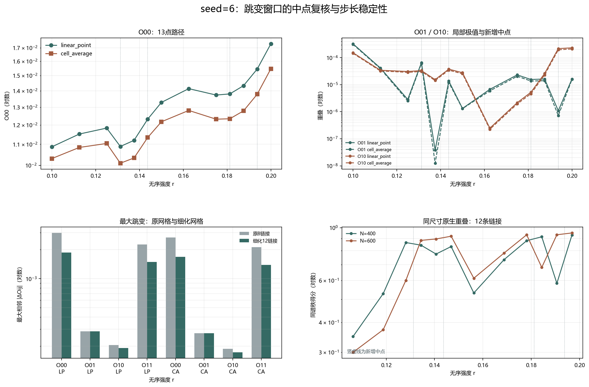

# Floquet-BdG 固定 seed=6 跳变窗口中点复核

> 日期：2026-11-12。在两个既定跳变窗口插入4个预登记中点，共8个新尺寸单元；原9点与新增4点组成13点路径、12条相邻链接。不新增类别，不补算体 winding，未计算 N=640。

## 一、协议与原路径绑定

新增强度为 r=0.13125、0.14375、0.18125、0.19375，不根据结果增删点。跨尺寸矩阵、矩阵项差分和同尺寸原生链接均不归一化，不筛选有利路径段。

原18个单元的谱最大误差为 0；原54组矩阵的最大重叠误差为 0，主奇异值最大误差为 0。复用单元不计入新增实现。

## 二、极值与最大跳变的步长对照

| 方法 | 矩阵项 | 原最大跳变及链接 | 细化最大跳变及链接 | 是否改变 |
|:---|:---:|---:|---:|:---:|
| linear_point | O00 | 0.00298092（0.1875→0.2） | 0.00186317（0.19375→0.2） | True |
| linear_point | O01 | 0.000284455（0.1→0.1125） | 0.000284455（0.1→0.1125） | False |
| linear_point | O10 | 0.000205786（0.1875→0.2） | 0.000191026（0.1875→0.19375） | True |
| linear_point | O11 | 0.00227056（0.1875→0.2） | 0.00148775（0.1875→0.19375） | True |
| cell_average | O00 | 0.00267853（0.1875→0.2） | 0.001682（0.19375→0.2） | True |
| cell_average | O01 | 0.000271587（0.1→0.1125） | 0.000271587（0.1→0.1125） | False |
| cell_average | O10 | 0.00018755（0.1875→0.2） | 0.000172332（0.1875→0.19375） | True |
| cell_average | O11 | 0.00211834（0.1875→0.2） | 0.0013902（0.1875→0.19375） | True |

图 1 插入位置：跳变对照表之后、主导项与原生链接之前。

**图 1**　13点路径、局部极值、原8链接与细化12链接的最大跳变，以及同尺寸原生重叠。竖虚线为新增中点，数值贡献不作因果命名。

## 三、主导项与原生链接的步长对照

| 方法 | 得分组 | 原主导项计数（8链接） | 细化主导项计数（12链接） | 计数是否改变 |
|:---|:---|:---:|:---:|:---:|
| linear_point | diagonal | {'O00': 8, 'O11': 0} | {'O00': 11, 'O11': 1} | True |
| linear_point | swapped | {'O01': 3, 'O10': 5} | {'O01': 8, 'O10': 4} | True |
| cell_average | diagonal | {'O00': 8, 'O11': 0} | {'O00': 10, 'O11': 2} | True |
| cell_average | swapped | {'O01': 3, 'O10': 5} | {'O01': 7, 'O10': 5} | True |

| N | 链接数 | 同谱秩最小值及链接 | 交换最大值及链接 | 最大中心间隔变化 |
|---:|---:|---:|---:|---:|
| 400 | 12 | 0.349008（0.1→0.1125） | 0.0115587（0.1→0.1125） | 0.00199386 |
| 600 | 12 | 0.299582（0.1→0.1125） | 0.00887251（0.1→0.1125） | 0.00257825 |

跨表示自一致性范围为 0.975169–0.991503；线性点值秩间重叠最大为 1.74183e-06，单元平均最大为 3.77867e-26。这些控制不与路径得分混用。

## 四、结论与边界

中点插入可以检验局部极值、最大跳变和主导项的步长稳定性，但更密的离散采样仍不等于连续路径证明。更平滑的外观不能替代独立数值收敛判据，也不能直接命名为谱交叉、避免交叉或真实态交换。

本轮不能外推为其他种子、普遍尺寸律、统计显著性、次近对拓扑性或热力学极限结论。旧交换候选属于不同无序实现，不能与路径差分直接相减。

复现：`python research/floquet-bdg-tbc/analyze_seed6_matrix_midpoint.py`。26个路径单元、78组矩阵、24条原生链接、288条矩阵项差分及原路径绑定保存在 `seed6_matrix_midpoint_analysis.json`。
