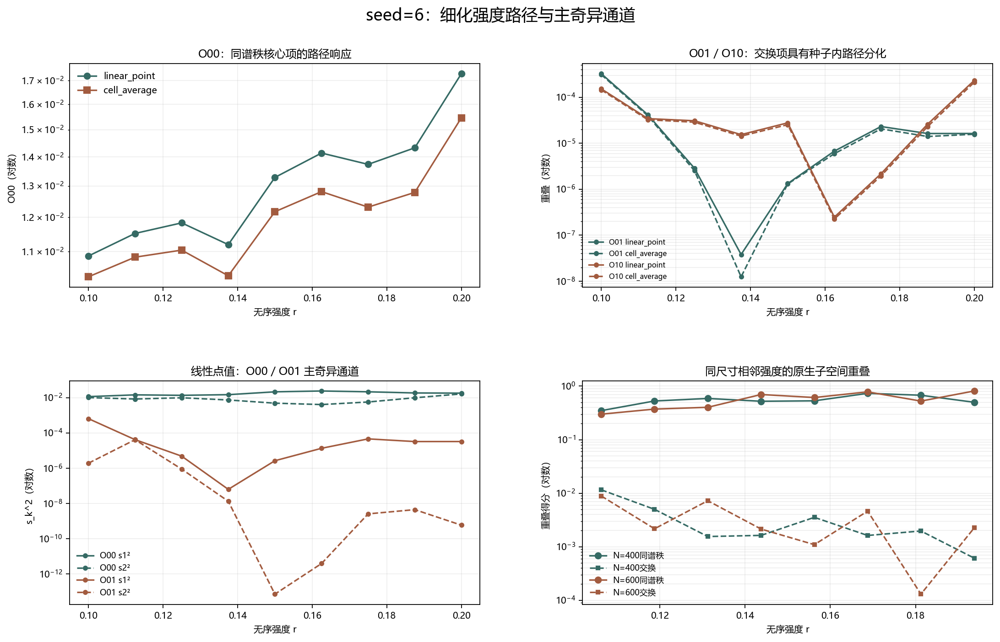

# Floquet-BdG 固定 seed=6 矩阵路径

> 日期：2026-11-12。固定 seed=6，r=0.1–0.2 共9个等距点、8条相邻链接；14个内部新尺寸单元，4个端点单元仅作路径一致性重算。不新增类别，不补算体 winding，未计算 N=640。

## 一、两类路径证据必须分开

跨尺寸 Oij 只在同一强度点的 N=400 与 N=600 子空间之间定义，不是同尺寸态追踪。相邻强度的同尺寸原生二维子空间重叠才是本报告的路径控制。两者都使用同一主无序剖面，离散网格不归一化，不筛选有利路径段。

端点矩阵最大误差为 0，端点主奇异值最大误差为 0，端点前六谱距离最大误差为 0。端点重算不并入此前批次计数。

## 二、跨尺寸矩阵项的逐点响应

| 方法 | 矩阵项 | 最小值及强度 | 最大值及强度 | 最大相邻绝对跳变 | 主导奇异通道计数 |
|:---|:---:|---:|---:|---:|:---:|
| linear_point | O00 | 0.0108735 @ 0.1 | 0.0173059 @ 0.2 | 0.00298092（0.1875→0.2） | s₁:4／s₂:4 |
| linear_point | O01 | 3.81011e-08 @ 0.1375 | 0.000326027 @ 0.1 | 0.000284455（0.1→0.1125） | s₁:7／s₂:1 |
| linear_point | O10 | 2.47354e-07 @ 0.1625 | 0.000231718 @ 0.2 | 0.000205786（0.1875→0.2） | s₁:7／s₂:1 |
| linear_point | O11 | 1.33802e-05 @ 0.1625 | 0.00270833 @ 0.2 | 0.00227056（0.1875→0.2） | s₁:5／s₂:3 |
| cell_average | O00 | 0.0103123 @ 0.1 | 0.0154652 @ 0.2 | 0.00267853（0.1875→0.2） | s₁:4／s₂:4 |
| cell_average | O01 | 1.24701e-08 @ 0.1375 | 0.000311003 @ 0.1 | 0.000271587（0.1→0.1125） | s₁:7／s₂:1 |
| cell_average | O10 | 2.24944e-07 @ 0.1625 | 0.000210568 @ 0.2 | 0.00018755（0.1875→0.2） | s₁:7／s₂:1 |
| cell_average | O11 | 1.25966e-05 @ 0.1625 | 0.00252384 @ 0.2 | 0.00211834（0.1875→0.2） | s₁:5／s₂:3 |

图 1 插入位置：矩阵项表之后、原生相邻链接与边界之前。

**图 1**　O00、O01、O10 及其主奇异通道随强度的变化，以及同尺寸相邻子空间重叠。数值贡献只用于分解，不直接命名物理机制。

## 三、得分主导项与同尺寸原生链接

| 方法 | 得分组 | 主导项计数（8条链接） | 得分比范围 |
|:---|:---|:---|---:|
| linear_point | diagonal | {'O00': 8, 'O11': 0} | 0.949588–1.35572 |
| linear_point | swapped | {'O01': 3, 'O10': 5} | 0.158534–5.8774 |
| cell_average | diagonal | {'O00': 8, 'O11': 0} | 0.940398–1.36362 |
| cell_average | swapped | {'O01': 3, 'O10': 5} | 0.157503–6.10826 |

| N | 链接数 | 同谱秩最小值及链接 | 交换最大值及链接 | 最大中心间隔变化 |
|---:|---:|---:|---:|---:|
| 400 | 8 | 0.349008（0.1→0.1125） | 0.0115587（0.1→0.1125） | 0.00281916 |
| 600 | 8 | 0.299582（0.1→0.1125） | 0.00887251（0.1→0.1125） | 0.00276699 |

跨表示自一致性范围为 0.975169–0.991503；线性点值秩间重叠最大为 9.53243e-07，单元平均最大为 1.67157e-26。这些控制不与路径得分混用。

## 四、结论与边界

细化路径可以检验横断面矩阵项关系的持续性，并定位相邻强度的最大数值贡献跳变；但8条离散链接仍不是连续路径证明。任何跳变、极小值或分配变化都不能直接命名为谱交叉、避免交叉或真实态交换。

本轮不能外推为其他种子、普遍尺寸律、统计显著性、次近对拓扑性或热力学极限结论。旧交换候选属于不同无序实现，不能与路径差分直接相减。

复现：`python research/floquet-bdg-tbc/analyze_seed6_matrix_path.py`。18个路径单元、54组矩阵、16条原生链接、192条矩阵项差分及控制保存在 `seed6_matrix_path_analysis.json`。
