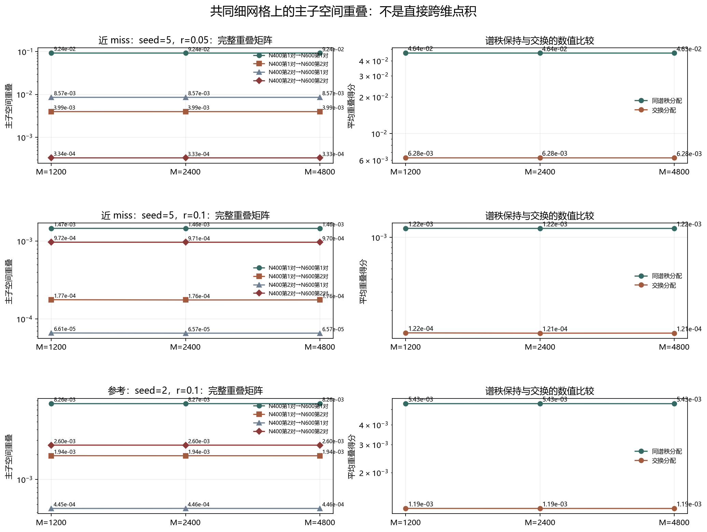

# Floquet-BdG 跨尺寸子空间重叠诊断

> 日期：2026-11-11。仅重算三个既有对照、六个既有尺寸单元的相同本征对；没有新物理单元、不新增类别、不补算体 winding，未计算 N=640。

## 一、共同网格与主子空间定义

N=400 与 N=600 的本征矢维数不同，不能直接点积。将每个复数内部旋量分量从格心 (i+1/2)/N 线性插值到共同 M 网格，再做约化 QR 正交化。M 预先固定为1200、2400、4800。

对两个二维子空间计算 Q400_i^H Q600_j 的奇异值 s1、s2，重叠 Oij=(s1²+s2²)/2，主角度为 acos(sk)。使用子空间而非单个本征矢，可消除相位和子空间内部旋转的任意性。

所有重算剖面均回到原冻结数据：最大剖面误差 2.429e-17，门槛为1e-10。

## 二、共同网格结果

| 对照 | M | 同谱秩分配得分 | 交换分配得分 | 数值主导分配 |
|:---|---:|---:|---:|:---|
| 5／0.05 | 1200 | 0.0463688 | 0.00628333 | diagonal |
| 5／0.05 | 2400 | 0.0463516 | 0.00628185 | diagonal |
| 5／0.05 | 4800 | 0.0463435 | 0.00628073 | diagonal |
| 5／0.1 | 1200 | 0.00121876 | 0.000121533 | diagonal |
| 5／0.1 | 2400 | 0.0012169 | 0.00012066 | diagonal |
| 5／0.1 | 4800 | 0.00121655 | 0.000120802 | diagonal |
| 2／0.1 | 1200 | 0.00543156 | 0.00119156 | diagonal |
| 2／0.1 | 2400 | 0.00543392 | 0.00119118 | diagonal |
| 2／0.1 | 4800 | 0.0054298 | 0.00119046 | diagonal |

图 1 插入位置：共同网格得分表之后、最细网格矩阵之前。

**图 1**　左列为四个跨尺寸子空间重叠，右列为同谱秩和交换分配的平均得分。得分只用于当前嵌入诊断。

## 三、最细网格 M=4800 的重叠矩阵

### 近 miss：seed=5，r=0.05

| N400＼N600 | 第1对 | 第2对 |
|:---:|---:|---:|
| 第1对 | O=0.0923535；角度=65.0002°／85.5193° | O=0.00398971；角度=85.1423°／88.3706° |
| 第2对 | O=0.00857174；角度=82.5075°／89.3214° | O=0.000333447；角度=88.5371°／89.7774° |

### 近 miss：seed=5，r=0.1

| N400＼N600 | 第1对 | 第2对 |
|:---:|---:|---:|
| 第1对 | O=0.00146285；角度=86.9378°／89.5137° | O=0.000175863；角度=88.9299°／89.9013° |
| 第2对 | O=6.57409e-05；角度=89.4804°／89.5979° | O=0.000970245；角度=87.6581°／89.0571° |

### 参考：seed=2，r=0.1

| N400＼N600 | 第1对 | 第2对 |
|:---:|---:|---:|
| 第1对 | O=0.00825999；角度=82.9924°／87.6822° | O=0.00193508；角度=87.0645°／87.9758° |
| 第2对 | O=0.000445841；角度=88.2944°／89.8622° | O=0.00259961；角度=86.4314°／87.914° |

## 四、能说明什么，不能说明什么

三个对照在 M=1200、2400、4800 上都由同谱秩分配取得较高分。M=4800 的同谱秩得分依次为 0.0463435、0.00121655、0.0054298，交换得分依次为 0.00628073、0.000120802、0.00119046。

因此，当前嵌入下没有由交换得分占优支持的排序交换候选；但绝对重叠均很弱，不能把相对得分优势解释为高保真态对应。三个网格上的主导分配不变，也不等于完成网格收敛证明。

重叠矩阵同时保留同谱秩与交叉项，因此可以检查‘直接按谱排序配对’是否得到较高的数值对应得分。矩阵行固定属于 N=400、列固定属于 N=600，交换 i、j 不会同时交换尺寸，故矩阵无需对称。若交换分配更高，只能称为排序交换候选，不能直接宣称发生了物理态交换。

线性插值是一种选定的共同表示，不是连续极限或真实态追踪。三个网格用于观察数值稳定性，不构成网格收敛证明；局域尖峰、振荡和简并仍可能影响结果。

本轮没有证明同一物理态、排序交换、次近对拓扑性、体 winding、材料实现或热力学极限。原类别及此前16对照符号计数均未改变。

复现：`python research/floquet-bdg-tbc/analyze_subspace_overlap.py`。协议、剖面误差、奇异值、主角度、分配得分和来源哈希保存在 `subspace_overlap_analysis.json`。
