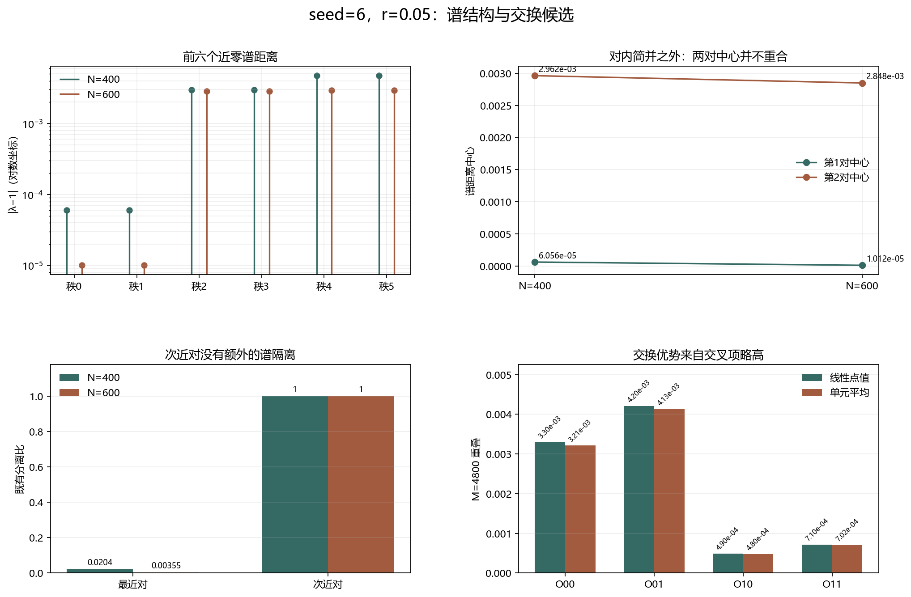

# Floquet-BdG 交换候选谱结构审计

> 日期：2026-11-11。只重算 seed=6、r=0.05 的两个既有尺寸单元，前六个近零谱距离与两对子空间。不新增类别、不补算体 winding，未计算 N=640。

## 一、谱距离与对内 TBC 简并

按 |λ−1| 升序排列，报告前六个距离和相位。对内距离差用于数值复现 TBC 简并；1e-10 仅是复现容差，不是物理近简并阈值。

| N | 谱秩 | λ实部 | λ虚部 | 相位 | \|λ−1\| |
|---:|---:|---:|---:|---:|---:|
| 400 | 0 | 1 | 6.05555e-05 | 6.05555e-05 | 6.05555e-05 |
| 400 | 1 | 1 | -6.05555e-05 | -6.05555e-05 | 6.05555e-05 |
| 400 | 2 | 0.999996 | 0.00296207 | 0.00296207 | 0.00296207 |
| 400 | 3 | 0.999996 | -0.00296207 | -0.00296207 | 0.00296207 |
| 400 | 4 | 0.999989 | 0.00471353 | 0.00471355 | 0.00471354 |
| 400 | 5 | 0.999989 | -0.00471353 | -0.00471355 | 0.00471354 |
| 600 | 0 | 1 | -1.01191e-05 | -1.01191e-05 | 1.01191e-05 |
| 600 | 1 | 1 | 1.01191e-05 | 1.01191e-05 | 1.01191e-05 |
| 600 | 2 | 0.999996 | -0.0028485 | -0.0028485 | 0.0028485 |
| 600 | 3 | 0.999996 | 0.0028485 | 0.0028485 | 0.0028485 |
| 600 | 4 | 0.999996 | 0.00293003 | 0.00293004 | 0.00293004 |
| 600 | 5 | 0.999996 | -0.00293003 | -0.00293004 | 0.00293004 |

## 二、两对中心间隔与既有谱隔离

| N | 对 | 距离中心 | 对内距离差 | 既有分离比 | profile联合诊断 |
|---:|---:|---:|---:|---:|:---:|
| 400 | 0 | 6.05555e-05 | 0 | 0.0204436 | True |
| 400 | 1 | 0.00296207 | 0 | 1 | False |
| 600 | 0 | 1.01191e-05 | 0 | 0.00355244 | False |
| 600 | 1 | 0.0028485 | 0 | 1 | False |

N=400 的两对中心间隔为 0.00290152，相对中心间隔为 0.979556；N=600 分别为 0.00283838 和 0.996448。两对中心不精确重合，但这里没有另设近简并判据。

中心间隔的尺寸差为 -6.31357e-05。次近对的既有分离比在两种尺寸均为1，且 profile 联合诊断均不通过，不能把交换候选解释为新的孤立拓扑端点。

图 1 插入位置：谱结构表之后、重叠矩阵之前。

**图 1**　谱距离、两对中心、既有分离比与交换矩阵并列。谱秩由排序构造，不是参数路径上的态追踪。

## 三、交换优势的矩阵来源

| 方法 | O00 | O01 | O10 | O11 | 同谱秩得分 | 交换得分 |
|:---|---:|---:|---:|---:|---:|---:|
| 线性点值 | 0.00330349 | 0.00420331 | 0.000489547 | 0.000710368 | 0.00200693 | 0.00234643 |
| 单元平均 | 0.00321006 | 0.00412614 | 0.000480114 | 0.00070237 | 0.00195621 | 0.00230312 |

两种方法的 O01 都分别大于 O00 和 O11，使交换平均分略高。该矩阵关系在三个网格和两种共同表示上成立，但主角度仍大，且次近对没有额外谱隔离。

## 四、结论：交换候选不等于谱交叉

对内 TBC 简并与两对中心间隔是不同问题。静态尺寸中的谱秩按定义排序，不能观察到排序自己发生交换；两个尺寸之间也没有连续参数路径，因此不能证明谱交叉或避免交叉。

当前结果只支持：交换候选来自特定交叉重叠项，而不是已经证明的物理态交换、近简并相变或体 winding 改变。后续若要检验态交换，应在固定尺寸上构造连续参数路径并追踪子空间。

复现：`python research/floquet-bdg-tbc/analyze_swap_candidate_spectrum.py`。原始谱值、距离中心、间隔、重叠矩阵和来源哈希保存在 `swap_candidate_spectrum_analysis.json`。
