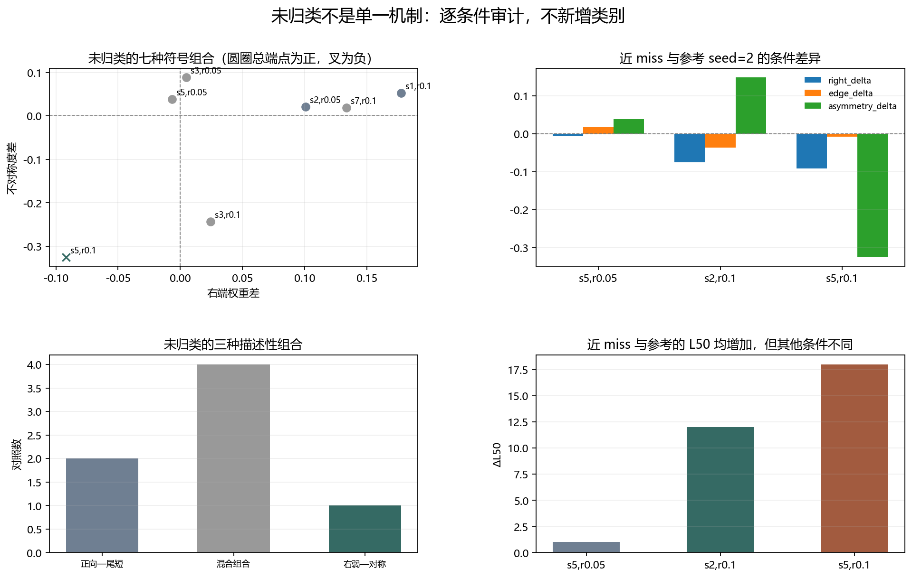

# Floquet-BdG 未归类与未复现诊断

> 日期：2026-11-11。仅审计已有 8 种子、16 个对照的符号条件，不新增类别，不追加种子，不补算体 winding，未计算 N=640。

## 一、未归类不是单一机制

三个描述性组合仅用于解释现有条件，不构成新分类学：两个端点增加但尾部缩短或不对称上升、四个混合符号组合、一个右端减弱但更对称。

| seed | r | Δ右端 | Δ总端点 | ΔL50 | Δ不对称度 | 描述性组合 | 未满足参考条件 |
|---:|---:|---:|---:|---:|---:|:---|:---|
| 2 | 0.05 | 0.10091 | 0.15961 | -3 | 0.021037 | positive_edge_tail_shorter_or_asymmetry_up | right_delta_not_negative, edge_delta_not_negative, L50_not_positive |
| 3 | 0.05 | 0.0048511 | 0.065381 | 9 | 0.088267 | mixed_nonmatching_sign_combinations | right_delta_not_negative, edge_delta_not_negative |
| 5 | 0.05 | -0.0064706 | 0.017641 | 1 | 0.038623 | mixed_nonmatching_sign_combinations | edge_delta_not_negative |
| 1 | 0.1 | 0.17761 | 0.27786 | -7 | 0.052081 | positive_edge_tail_shorter_or_asymmetry_up | right_delta_not_negative, edge_delta_not_negative, L50_not_positive |
| 3 | 0.1 | 0.024193 | 0.15969 | -5 | -0.24299 | mixed_nonmatching_sign_combinations | right_delta_not_negative, edge_delta_not_negative, L50_not_positive, asymmetry_delta_not_positive |
| 5 | 0.1 | -0.091903 | -0.0075208 | 18 | -0.32512 | right_weakening_with_symmetrization | asymmetry_delta_not_positive |
| 7 | 0.1 | 0.13348 | 0.23169 | 1 | 0.018871 | mixed_nonmatching_sign_combinations | right_delta_not_negative, edge_delta_not_negative |

图 1 插入位置：未归类条件表之后、近 miss 解释之前。

**图 1**　未归类内部存在不同结构，不能用单一机制解释，也不能通过追加阈值把它们强行归类。

## 二、右端减弱为何未复现

参考的右端减弱—尾部变宽要求同时满足：右端差为负、总端点差为负、L50 为正、不对称度差为正。seed=4–7 中没有单元同时满足，故复现数为 0。

seed=5、r=0.05 是近 miss：右端减弱且不对称度增加，但总端点仍增加，因此缺少 `edge_delta_not_negative` 条件。

seed=5、r=0.1 是另一个近 miss：右端和总端点均下降、L50 增加，但不对称度下降，形成**右端减弱但更对称**，缺少 `asymmetry_delta_not_positive` 条件。两种尺寸的联合判据仍通过，不能称端点消失。

这两个近 miss 说明，未复现不是简单的‘没有右端减弱’，而是其他条件没有共同出现。它们可指导后续结构分析，但不能用来修改参考定义以制造复现。

## 三、解释边界与下一步

本轮是条件审计，不是新的机制命名或统计因果证明。原类别及原始计数完全保留，独立后端验证文件未改变。

下一步应先检查近 miss 的左右端空间分布和次近对角色，再判断它们是否属于其他可重复结构；不要为了复现参考类别而移动阈值。

复现：`python research/floquet-bdg-tbc/analyze_unclassified_signatures.py`。全部阻断条件、原始类别、签名组合和来源哈希保存在 `unclassified_signature_analysis.json`。
