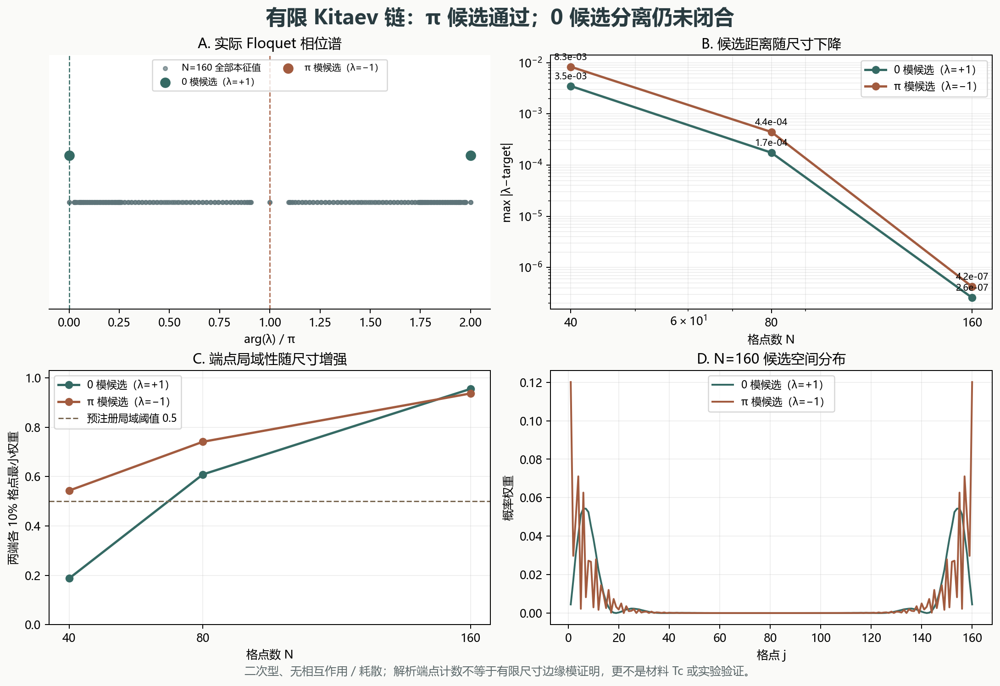

# 有限 Floquet–BdG：Kitaev 链 0／π 模数值切片

> 2026-11-11。二次型模型数值研究，不是材料超导增强证明。

## 一、结论与边界

- **π 模：`supported_finite_size`**。在 N=40、80、160 上，候选与 λ=−1 的最大距离从 8.307786e-03 降至 4.222317e-07，并同时满足预注册的谱分离与端点局域判据。
- **0 模：`inconclusive`**。距离随尺寸显著下降、端点权重增加，但 N=160 的最大分离比仍为 0.333262，超过 0.1；不能仅凭解析不变量把它登记为通过。
- 本结果只针对无相互作用、无耗散的开放二次型 Kitaev 链。不是材料 `Tc` 预测，不证明 `Tc_F>Tc_eq`，不是 Meissner、独立正向复现或实验验证，也不是热力学极限证明。

## 二、模型与约定

采用 Majorana 基 `(a1,b1,...,aN,bN)`，`a=c+c†`、`b=−i(c−c†)`，并令 `ℏ=1`。实反对称矩阵 `K` 满足

$$H=i\sum_{rs}K_{rs}\Gamma_r\Gamma_s,$$

$$K_{a_j,b_j}=-\mu,\qquad K_{a_j,b_{j+1}}=(\Delta-\gamma)/2,\qquad K_{a_{j+1},b_j}=-(\Delta+\gamma)/2.$$

取 `γ=Δ=1`、`μ0=2.5`、`μ1=0.2`、`ω=7`，周期为 $T=2\pi/\omega$。对称化自由—脉冲—自由传播为

$$F=\exp[-4K(\mu_0)T],\qquad S=\exp[-2K(\mu_1)],\qquad U=SFS.$$

脉冲只改 onsite 化学势，不改 hopping 或 pairing。**没有 Fourier 截断**：这里使用精确分段矩阵指数，因此不声称 Fourier 截断收敛，也不冒充连续高频极限。

模型与 δ 脉冲协议参照 Thakurathi et al., Phys. Rev. B 88, 155133 (2013), arXiv:1303.2300，以及 Mondal et al., arXiv:2203.16353v3 的 Eq. (4)–(6)。数值矩阵、候选和边缘权重由本仓库独立计算。

## 三、解析预期与静态基准

端点量 `b0=0.984466812`、`bπ=2.127323954`。二者之间的偶整数为 [2]，奇整数为 [1]，故解析端点计数为每端 `p0=1`、`pπ=1`。这是独立解析预期，不替代有限开放链数值。

静态 `μ=0, γ=Δ` 时，`a1` 和 `bN` 是 `K` 的精确零空间向量；该基准用于检查 Majorana 符号与矩阵构造。静态 `μ0=2.5` 的平凡控制组不继承驱动组的 0／π 标签。

## 四、实际尺寸结果

| N | 模 | 最大候选距离 | 最近体模距离 | 最大分离比 | 最小端点权重 | 跨尺寸裁决 |
|---:|:---:|---:|---:|---:|---:|:---|
| 40 | 0 | 3.491902e-03 | 7.983374e-03 | 0.437397 | 0.187201 | inconclusive |
| 40 | π | 8.307786e-03 | 3.778728e-01 | 0.021986 | 0.543271 | supported_finite_size |
| 80 | 0 | 1.741974e-04 | 3.736934e-04 | 0.466151 | 0.608829 | inconclusive |
| 80 | π | 4.420030e-04 | 3.137385e-01 | 0.001409 | 0.741187 | supported_finite_size |
| 160 | 0 | 2.565559e-07 | 7.698333e-07 | 0.333262 | 0.955368 | inconclusive |
| 160 | π | 4.222317e-07 | 2.954135e-01 | 0.000001 | 0.937020 | supported_finite_size |

候选取距 `λ=+1` 或 `λ=−1` 最近的两个本征值；边缘权重是两端各 10% 格点概率之和。联合判据预注册为：分离比 `<0.1`、边缘权重 `>0.5`，尺寸序列距离严格下降且首尾至少缩小 2 倍。原始本征值、12 行候选表和 NPZ 谱均保留，不用标签覆盖数据。



图 1：A 为 N=160 实际 Floquet 相位谱；B 为候选距离；C 为端点权重；D 为候选空间分布。图中没有示意的伪造谱点。

## 五、静态平凡控制与独立稀疏验证

| 检查 | 实测结果 | 裁决 |
|:---|:---|:---|
| 静态控制 0 候选 | 最大边缘权重 0.013584；最大分离比 0.250009 | 联合边缘判据不通过 |
| 静态控制 π 候选 | 最大边缘权重 0.206481；最大分离比 0.066557 | 有谱分离但局域不足，联合判据不通过 |
| 独立稀疏 0 附近谱 | 与稠密谱最大差 1.567258e-15 | 小于 10⁻¹² |
| 独立稀疏 π 附近谱 | 与稠密谱最大差 1.779321e-15 | 小于 10⁻¹² |

独立方法为 `scipy.sparse.linalg.eigs` 的 shift-invert，`k=6`、`σ=±1`、`tol=1e-12`、`ncv=40`，N=160。该一致性只验证数值谱，不验证材料或实验。

## 六、未竟工作

1. 0 模需要真正的体隙／拓扑指标或更长链来分离近简并体模，不能修改阈值消除当前未决状态。
2. π 模仍需 Floquet 拓扑不变量、微扰稳健性和独立实现复核；有限尺寸通过不等于热力学极限证明。
3. 连续驱动需要另做时间步或 Fourier 截断收敛；δ 脉冲精确传播不能替代该任务。
4. 相互作用、自洽配对、耗散、占据与热管理均未建模，不能由此推导超导临界温度增强。

## 七、复现

```bash
python research/floquet-bdg/run_study.py
python research/floquet-bdg/test_floquet_bdg.py -v
python research/floquet-bdg/verify_floquet_bdg.py -v
python research/floquet-bdg/build_figure.py
python research/floquet-bdg/build_markdown.py
```

机器可读结果见 `results.json`、`candidates.csv`、`spectra.npz` 和 `run.log`。原生 Word 为 `REPORT.docx`。
