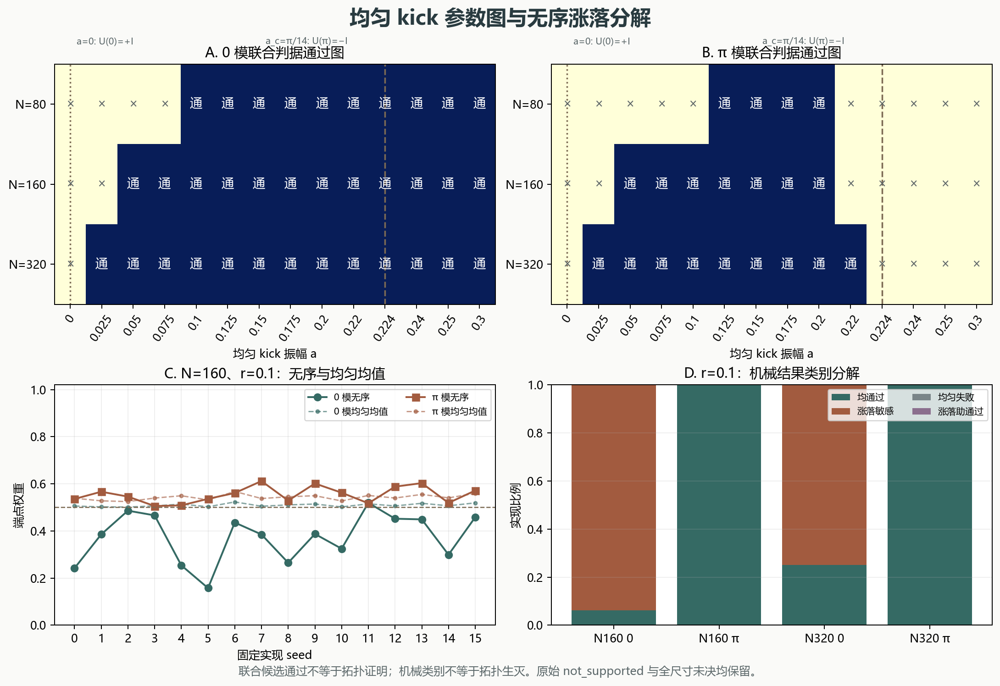

# 均匀 kick 参数图与无序涨落分解

> 2026-11-11。45 个均匀参数点＋216 行无序分解；不是无序拓扑或材料结论。

## 一、解析边界与有限网格分开

固定 `γ=Δ=1, μ0=2.5, ω=7`。端点量 `b0=4(μ0−γ)/ω+2a/π`、`bπ=4(μ0+γ)/ω+2a/π`。

- `a=0` 时 `bπ=2`，负 hopping 映射下 `k=0` 对应 `bπ`，实际 `U(0)=+I`；端点计数不能定义。
- `a_c=π/14≈0.2243994753` 时 `b0=1`，`k=π` 对应 `b0`，实际 `U(π)=−I`；端点计数不能定义。
- 两个唯一奇异振幅在 N=80、160、320 各出现一次，共 6 条奇点记录；N=640 只取 0.05、0.1、0.2 三个复核点。

临界前后核对：N=320、a=0.22 时 π 联合候选通过且 `pπ=1`；a=0.24 时 π 候选未通过且 `pπ=0`。当前结果与解析转变一致，不把机械候选通过当作独立的拓扑证明。

## 二、均匀链有限尺寸通过区间

| N | 模 | 网格通过区间 | 说明 |
|---:|:---:|:---:|:---|
| 80 | 0 | 0.1–0.3 | grid_samples_not_a_precision_boundary |
| 80 | π | 0.125–0.2 | grid_samples_not_a_precision_boundary |
| 160 | 0 | 0.05–0.3 | grid_samples_not_a_precision_boundary |
| 160 | π | 0.05–0.2 | grid_samples_not_a_precision_boundary |
| 320 | 0 | 0.025–0.3 | grid_samples_not_a_precision_boundary |
| 320 | π | 0.025–0.22 | grid_samples_not_a_precision_boundary |

区间是网格样本，不是精确相界；精确奇点只由解析条件给出。N=640 的三个选定振幅 0.05、0.1、0.2 均满足当前候选联合判据，但不外推为连续区间。



图 1：A／B 为均匀 0／π 联合判据通过图；C 为 N=160、r=0.1 的无序与均匀均值端点权重；D 为机械结果类别。

## 三、无序涨落的机械分解

逐实现使用 `rβ_n = r·mean(β) + r(β_n−mean(β))`，分别记录平均 kick、涨落 RMS、谱距离差、端点权重差和子空间 IPR 差。类别只描述联合判据结果，不代表拓扑生灭：

- `both_pass`：均匀与无序均通过；
- `fluctuation_sensitive`：均匀通过、无序失败；
- `uniform_fails`：均匀失败、无序失败；
- `fluctuation_assisted`：均匀失败、无序通过，不宣称拓扑被创造。

| N | r | 模 | 均通过 | 涨落敏感 | 均匀失败 | 涨落助通过 |
|---:|---:|:---:|---:|---:|---:|---:|
| 160 | 0.1 | 0 | 1 | 15 | 0 | 0 |
| 160 | 0.1 | π | 16 | 0 | 0 | 0 |
| 320 | 0.1 | 0 | 1 | 3 | 0 | 0 |
| 320 | 0.1 | π | 4 | 0 | 0 | 0 |

N=160、r=0.1 的 0 模有 15 个 `fluctuation_sensitive` 和 1 个 `both_pass`；π 模 16 个均为 `both_pass`。N=320 的 0 模为 3 个敏感和 1 个均通过，π 模 4 个均通过。这与此前均值对照一致，但不构成无序 winding 或热力学极限证明。

## 四、验证与边界

独立复核重建均匀链、检查两个奇点的动量与符号、临界前后计数、无序均值恒等式和子空间旋转不变性。所有 45 个网格点、216 行分解、90 行均匀 CSV 与 216 行敏感性 CSV 均保留。

```bash
python research/floquet-kick-map/run_kick_map.py
python research/floquet-kick-map/decompose_disorder.py
python research/floquet-kick-map/test_kick_map.py -v
python research/floquet-kick-map/verify_kick_map.py -v
python research/floquet-kick-map/run_verification.py
```

原始无序 `not_supported` 与全尺寸 `inconclusive_preserved` 均不改变。未计算无序拓扑不变量，不涉及材料 `Tc`、耗散、自洽配对或实验复现。

参考：Thakurathi et al., arXiv:1303.2300v2；Mondal et al., arXiv:2203.16353v3 Eq. (7)。所有适配数值由本包独立计算。
