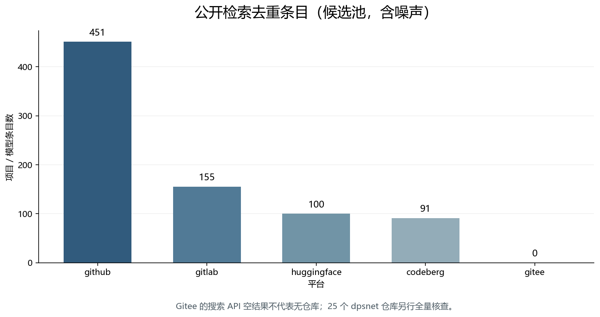
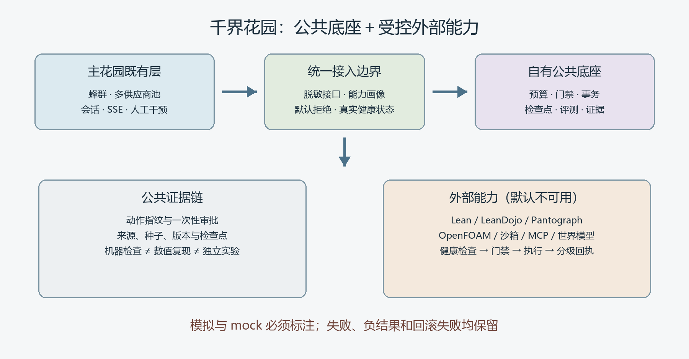

# 千界花园同类开源项目广泛调研与整体设计依据

检索日期：2026-11-09。本文是公开代码生态的可追溯采样，不是“全球所有项目”的穷尽证明。

## 摘要

本轮执行 26 组公开 API 查询并全部得到响应，保存 852 条记录，按平台与名称去重后得到 **797 个候选项目／模型条目**。另对王斌的 25 个 Gitee 公开仓库逐项盘点，读取 14 个重点上游的实际文件，并对 59 个重点 GitHub 项目发起精确元数据核验。发现池不等于可复用清单：其中混合了代码、模型、镜像、广告和无关命中，未核实的许可证或功能不会被写成已验证事实。

最终设计采用“**公共底座＋受控外部能力**”。主花园保留蜂群、供应商池与 SSE；新仓库承担故障分类、上下文预算、门禁、事务迁移、检查点、评测、研究证据和谨慎学习。Lean、OpenFOAM、沙箱和大型世界模型通过外部适配器调用，必须有健康状态与真实回执，不能用 mock 冒充执行。

图 1：平台候选条目数量。数据来自本次 `project-catalog.json`，只说明检索覆盖，不表示质量或相关性。

## 1. 平台覆盖、局限与排噪

| 平台 | 去重条目 | 解释与限制 |
|---|---|---|
| github | 451 | 十个主题查询；包含镜像、噪声与自我宣传 |
| gitee | 0 | 公开搜索 API 返回空；王斌 25 项及官方页面另查 |
| gitlab | 155 | 修正为 search 参数；许可证另核 |
| codeberg | 91 | 通用词与连字符词补查；噪声较多 |
| huggingface | 100 | 模型／数据资产，不等同代码仓库 |

Gitee 的公开搜索 API 对部分已知项目返回空数组，故不能据此宣称没有项目。GitLab 搜索必须使用 `search` 而不是 `q`；Codeberg 需要通用词与连字符词交叉补查。SourceForge 主要用于发现镜像并回溯官方仓库；ModelScope、AtomGit/GitCode、OpenI 的补充结果同样只作入口。网络失败、403 和缺失许可证分别留痕，不能相互替代。

候选项目按三层处理：实际读取源码／说明与许可证者可形成具体设计约束；只有官方 API 元数据者可作为后续候选；未明确许可证、GPL／AGPL 或仅有二手宣传者不进入代码。星标、更新时间和自述基准都不是正确性证明，本文不将项目宣传中的“预测一切”“零幻觉”“百万智能体”等表述作为本系统能力。

## 2. 已读重点上游与固定版本

| 项目 | 许可证 | 固定提交 | 实际读取 | 采用方式与边界 |
|---|---|---|---|---|
| [MuLiuSaMa/MeowCode](https://github.com/MuLiuSaMa/MeowCode) | GPL-3.0 | 9e8e20077acb | src/agent、LICENSE | 故障分类、预算、上下文与学习治理；不复制 GPL 实现 |
| [iwana888/AgentWorld](https://github.com/iwana888/AgentWorld) | MIT | 841d3a690e5f | reliability、life、LICENSE | 四态门禁、世界迁移；建议不执行，回滚失败不隐瞒 |
| [QwenLM/Qwen-AgentWorld](https://github.com/QwenLM/Qwen-AgentWorld) | Apache-2.0 | cd0aa83dc7a9 | README、eval、LICENSE | 七领域评测接口；不下载权重，不冒称复现 |
| [nv-tlabs/Gamma-World](https://github.com/nv-tlabs/Gamma-World) | Apache-2.0 | 6a95de85c439 | README | 共享 agent 轴和 hub；不复制模型性能声明 |
| [FudanDISC/SocialAgent](https://github.com/FudanDISC/SocialAgent) | Apache-2.0 | 8ab82fda471f | README | 社会智能体资料导航，不冒称 AgentWorld 平台 |
| [dpsnet/universal_fixed_point_framework](https://gitee.com/dpsnet/universal_fixed_point_framework) | CC-BY-4.0；另有 MIT 文件 | 41b3bb4fa582 | README、LICENSE | 预登记、排除与负结果；理论声明未独立验证 |
| [microsoft/agent-framework](https://github.com/microsoft/agent-framework) | MIT | 79db84204244 | README、元数据 | 中间件、检查点、恢复、模型路由 |
| [agentscope-ai/agentscope](https://github.com/agentscope-ai/agentscope) | Apache-2.0 | d286c31e4d6d | README、元数据 | 事件、权限、上下文、沙箱接口 |
| [camel-ai/oasis](https://github.com/camel-ai/oasis) | Apache-2.0 | fced8869353f | README、元数据 | 社会情景模拟；不声称本机百万 agent |
| [666ghj/MiroFish](https://github.com/666ghj/MiroFish) | AGPL-3.0 | 7657031ac011 | README、LICENSE | 多种子情景与观察者；不复制，不把模拟写成预测事实 |
| [langchain-ai/langgraph](https://github.com/langchain-ai/langgraph) | MIT | e5e37b5d70db | README、元数据 | 持久状态、人工中断、恢复 |
| [psi-oss/get-physics-done](https://github.com/psi-oss/get-physics-done) | Apache-2.0 | 0f417695ccf1 | README、官方仓库 | 健康检查、恢复、验证链；不自动安装 |
| [csml-rpi/Foam-Agent](https://github.com/csml-rpi/Foam-Agent) | MIT | c0dcbe48bdaa | README、元数据 | 真实求解器、静态审查和运行回执；外部执行 |
| [ulamai/ulamai](https://github.com/ulamai/ulamai) | 未声明 | b9ae7a30e172 | README、根目录许可检查 | 机器验证与搜索；未明确许可不复制 |

这些项目提供的是互补机制，而非需要堆叠的框架数量。Agent Framework、LangGraph 和 AgentScope 对应中间件、持久状态与恢复；AgentWorld 对应执行边界；Qwen-AgentWorld 和 Gamma-World 对应评测与共享世界；GPD、Foam-Agent 和 UlamAI 对应科研验证链。MeowCode 的预算实现和 AgentWorld 的迁移实现还揭示了需要修正的边界：输出预算不足不能继续发请求，回滚失败不能被写成恢复成功。

图 2：整体架构。外部能力仅在门禁、健康检查和回执链均有效时运行；离线示例不冒称真实工具调用。

## 3. 重点 GitHub 元数据核验

| 项目 | SPDX／状态 | 语言 | 最近推送 | 核验状态 |
|---|---|---|---|---|
| [microsoft/agent-framework](https://github.com/microsoft/agent-framework) | MIT | Python | 2026-11-09T10:53:23Z | API 元数据已核 |
| [microsoft/autogen](https://github.com/microsoft/autogen) | CC-BY-4.0 | Python | 2026-10-28T14:45:27Z | API 元数据已核 |
| [microsoft/semantic-kernel](https://github.com/microsoft/semantic-kernel) | MIT | C# | 2026-11-07T00:59:55Z | API 元数据已核 |
| [microsoft/TinyTroupe](https://github.com/microsoft/TinyTroupe) | 未核实 | — | 未核实 | 未核实：HTTP 403 |
| [microsoft/AI2BMD](https://github.com/microsoft/AI2BMD) | MIT | Python | 2025-02-18T07:56:41Z | API 元数据已核 |
| [microsoft/mattergen](https://github.com/microsoft/mattergen) | 未核实 | — | 未核实 | 未核实：HTTP 403 |
| [microsoft/bioemu](https://github.com/microsoft/bioemu) | MIT | Python | 2026-10-21T07:12:30Z | API 元数据已核 |
| [microsoft/aurora](https://github.com/microsoft/aurora) | NOASSERTION | Python | 2026-11-04T13:12:23Z | API 元数据已核 |
| [microsoft/promptflow](https://github.com/microsoft/promptflow) | 未核实 | — | 未核实 | 未核实：HTTP 403 |
| [langchain-ai/langgraph](https://github.com/langchain-ai/langgraph) | MIT | Python | 2026-11-08T00:33:40Z | API 元数据已核 |
| [crewAIInc/crewAI](https://github.com/crewAIInc/crewAI) | MIT | Python | 2026-11-09T10:14:16Z | API 元数据已核 |
| [camel-ai/camel](https://github.com/camel-ai/camel) | Apache-2.0 | Python | 2026-11-09T10:25:06Z | API 元数据已核 |
| [camel-ai/oasis](https://github.com/camel-ai/oasis) | Apache-2.0 | Python | 2026-11-09T10:25:24Z | API 元数据已核 |
| [FoundationAgents/MetaGPT](https://github.com/FoundationAgents/MetaGPT) | MIT | Python | 2026-01-21T10:12:33Z | API 元数据已核 |
| [agentscope-ai/agentscope](https://github.com/agentscope-ai/agentscope) | Apache-2.0 | Python | 2026-11-09T10:22:20Z | API 元数据已核 |
| [agentscope-ai/agentscope-runtime](https://github.com/agentscope-ai/agentscope-runtime) | Apache-2.0 | Python | 2026-06-04T03:57:19Z | API 元数据已核 |
| [agentscope-ai/ReMe](https://github.com/agentscope-ai/ReMe) | Apache-2.0 | Python | 2026-11-09T03:56:07Z | API 元数据已核 |
| [agentscope-ai/agentscope-java](https://github.com/agentscope-ai/agentscope-java) | Apache-2.0 | Java | 2026-11-09T00:55:32Z | API 元数据已核 |
| [OpenBMB/AgentVerse](https://github.com/OpenBMB/AgentVerse) | Apache-2.0 | JavaScript | 2024-09-09T05:47:44Z | API 元数据已核 |
| [OpenBMB/ChatDev](https://github.com/OpenBMB/ChatDev) | Apache-2.0 | Python | 2026-11-06T07:37:13Z | API 元数据已核 |
| [All-Hands-AI/OpenHands](https://github.com/All-Hands-AI/OpenHands) | 未核实 | — | 未核实 | 未核实：HTTP 403 |
| [FoundationAgents/OpenManus](https://github.com/FoundationAgents/OpenManus) | 未核实 | — | 未核实 | 未核实：HTTP 403 |
| [666ghj/MiroFish](https://github.com/666ghj/MiroFish) | 未核实 | — | 未核实 | 未核实：HTTP 403 |
| [tsinghua-fib-lab/AgentSociety](https://github.com/tsinghua-fib-lab/AgentSociety) | Apache-2.0 | Python | 2026-11-08T15:36:30Z | API 元数据已核 |
| [SolaceLabs/solace-agent-mesh](https://github.com/SolaceLabs/solace-agent-mesh) | 未核实 | — | 未核实 | 未核实：HTTP 403 |
| [e2b-dev/E2B](https://github.com/e2b-dev/E2B) | Apache-2.0 | Python | 2026-11-09T07:11:03Z | API 元数据已核 |
| [NVIDIA/NeMo-Guardrails](https://github.com/NVIDIA/NeMo-Guardrails) | 未核实 | — | 未核实 | 未核实：HTTP 403 |
| [guardrails-ai/guardrails](https://github.com/guardrails-ai/guardrails) | Apache-2.0 | Python | 2026-11-05T03:27:52Z | API 元数据已核 |
| [Arize-ai/phoenix](https://github.com/Arize-ai/phoenix) | 未核实 | — | 未核实 | 未核实：HTTP 403 |
| [langfuse/langfuse](https://github.com/langfuse/langfuse) | 未核实 | — | 未核实 | 未核实：HTTP 403 |
| [BerriAI/litellm](https://github.com/BerriAI/litellm) | NOASSERTION | Python | 2026-11-09T10:41:21Z | API 元数据已核 |
| [Portkey-AI/gateway](https://github.com/Portkey-AI/gateway) | 未核实 | — | 未核实 | 未核实：HTTP 403 |
| [volcengine/OpenViking](https://github.com/volcengine/OpenViking) | AGPL-3.0 | Python | 2026-11-09T10:43:04Z | API 元数据已核 |
| [mem0ai/mem0](https://github.com/mem0ai/mem0) | Apache-2.0 | Python | 2026-11-06T16:53:07Z | API 元数据已核 |
| [topoteretes/cognee](https://github.com/topoteretes/cognee) | 未核实 | — | 未核实 | 未核实：HTTP 403 |
| [letta-ai/letta](https://github.com/letta-ai/letta) | Apache-2.0 | — | 2026-10-18T22:28:04Z | API 元数据已核 |
| [run-llama/llama_index](https://github.com/run-llama/llama_index) | MIT | Python | 2026-11-08T21:41:55Z | API 元数据已核 |
| [deepset-ai/haystack](https://github.com/deepset-ai/haystack) | Apache-2.0 | Python | 2026-11-09T10:43:14Z | API 元数据已核 |
| [pydantic/pydantic-ai](https://github.com/pydantic/pydantic-ai) | MIT | Python | 2026-11-09T10:45:49Z | API 元数据已核 |
| [ComposioHQ/composio](https://github.com/ComposioHQ/composio) | MIT | TypeScript | 2026-11-09T10:50:57Z | API 元数据已核 |
| [openai/openai-agents-python](https://github.com/openai/openai-agents-python) | MIT | Python | 2026-11-09T10:49:34Z | API 元数据已核 |
| [google/adk-python](https://github.com/google/adk-python) | Apache-2.0 | Python | 2026-11-09T06:23:33Z | API 元数据已核 |
| [SakanaAI/AI-Scientist](https://github.com/SakanaAI/AI-Scientist) | NOASSERTION | Jupyter Notebook | 2025-12-19T07:46:21Z | API 元数据已核 |
| [google-deepmind/funsearch](https://github.com/google-deepmind/funsearch) | Apache-2.0 | Jupyter Notebook | 2024-02-05T10:32:18Z | API 元数据已核 |
| [google-deepmind/alphafold3](https://github.com/google-deepmind/alphafold3) | Apache-2.0 | Python | 2026-11-05T21:31:26Z | API 元数据已核 |
| [facebookresearch/vjepa2](https://github.com/facebookresearch/vjepa2) | MIT | Python | 2026-10-29T05:39:42Z | API 元数据已核 |
| [facebookresearch/fairchem](https://github.com/facebookresearch/fairchem) | NOASSERTION | Python | 2026-11-09T02:07:25Z | API 元数据已核 |
| [lean-dojo/LeanDojo](https://github.com/lean-dojo/LeanDojo) | MIT | Python | 2026-01-18T21:33:30Z | API 元数据已核 |
| [lean-dojo/LeanCopilot](https://github.com/lean-dojo/LeanCopilot) | MIT | C++ | 2026-10-13T01:17:49Z | API 元数据已核 |
| [leanprover-community/repl](https://github.com/leanprover-community/repl) | Apache-2.0 | Lean | 2026-10-28T13:16:36Z | API 元数据已核 |
| [leanprover/Pantograph](https://github.com/leanprover/Pantograph) | Apache-2.0 | Lean | 2026-10-20T18:46:34Z | API 元数据已核 |
| [stanford-centaur/PyPantograph](https://github.com/stanford-centaur/PyPantograph) | Apache-2.0 | Python | 2026-10-30T16:52:07Z | API 元数据已核 |
| [ulamai/ulamai](https://github.com/ulamai/ulamai) | 未核实 | Python | 2026-08-09T13:41:41Z | API 元数据已核 |
| [ruc-datalab/DeepAnalyze](https://github.com/ruc-datalab/DeepAnalyze) | MIT | Python | 2026-11-02T13:47:42Z | API 元数据已核 |
| [zjunlp/SciAtlas](https://github.com/zjunlp/SciAtlas) | MIT | Python | 2026-10-22T10:56:33Z | API 元数据已核 |
| [ai4s-research/open-science](https://github.com/ai4s-research/open-science) | NOASSERTION | TypeScript | 2026-11-09T10:18:23Z | API 元数据已核 |
| [K-Dense-AI/scientific-agent-skills](https://github.com/K-Dense-AI/scientific-agent-skills) | MIT | Python | 2026-11-09T09:17:48Z | API 元数据已核 |
| [ai4s-research/awesome-ai-for-science](https://github.com/ai4s-research/awesome-ai-for-science) | MIT | — | 2026-11-09T08:31:28Z | API 元数据已核 |
| [synthetic-sciences/openscience](https://github.com/synthetic-sciences/openscience) | Apache-2.0 | TypeScript | 2026-11-09T06:09:51Z | API 元数据已核 |

“NOASSERTION”表示 GitHub 未能确定标准许可证，不等于无版权约束，也不等于当然可复用。部分精确读取遇到网络超时或 403，已单独保留为未核实状态；有本地许可证或官方页面证据的另外标注。此表不提供星标排名，因为星标与适配价值没有必然关系，也不将最近推送等同于稳定性。

## 4. 后续候选与排除项

| 项目／资产 | 候选用途 | 当前证据与限制 |
|---|---|---|
| [NVIDIA/SkillEvaluator](https://github.com/NVIDIA/SkillEvaluator) | 技能质量门与行为评测 | 仅官方搜索元数据 |
| [mozilla-ai/any-agent](https://github.com/mozilla-ai/any-agent) | 跨框架接口与评测 | 仅官方搜索元数据 |
| [Giskard-AI/giskard-oss](https://github.com/Giskard-AI/giskard-oss) | 模型与智能体测试 | 仅官方搜索元数据 |
| [coze-dev/coze-loop](https://github.com/coze-dev/coze-loop) | 调试、评测与观测 | 仅官方搜索元数据 |
| [future-agi/future-agi](https://github.com/future-agi/future-agi) | 网关、门禁与仿真 | 仅官方搜索元数据 |
| [scaleapi/agentenv-framework](https://github.com/scaleapi/agentenv-framework) | 可复现 RL 环境 | 仅官方搜索元数据 |
| [pydantic/logfire](https://github.com/pydantic/logfire) | OpenTelemetry 观测 | 仅官方搜索元数据 |
| [mlbio-epfl/HeurekaBench](https://github.com/mlbio-epfl/HeurekaBench) | 数据驱动科研评测 | 仅官方搜索元数据 |
| [allenai/novelty-eval](https://github.com/allenai/novelty-eval) | 新颖性评委的局限研究 | 仅官方搜索元数据 |
| [mikamikasuki/forest](https://github.com/mikamikasuki/forest) | 长程科研图与证据链 | 仅官方搜索元数据 |
| [cloudcell/gnosislab](https://github.com/cloudcell/gnosislab) | 科学方法运行时 | 仅官方搜索元数据 |
| [OpenNSWM-Lab/FAROS](https://github.com/OpenNSWM-Lab/FAROS) | 蓝图式科研工作流 | 仅官方搜索元数据 |
| [InternScience/ResearchClawBench](https://github.com/InternScience/ResearchClawBench) | 再发现与新发现评测 | 仅官方搜索元数据 |
| [Qwen/Qwen-AgentWorld-35B-A3B](https://huggingface.co/Qwen/Qwen-AgentWorld-35B-A3B) | 世界模型资产 | Hugging Face 元数据；不下载 |
| [FudanDISC/MASER](https://github.com/FudanDISC/MASER) | 法律情景合成 | 未声明许可，不复制 |
| [yizhengzhang1/agent_world](https://github.com/yizhengzhang1/agent_world) | 机器人场景构建 | 未声明许可；不是复旦项目，不复制 |

新设计没有把所有项目打包进花园，而是先实现公共接口，再根据真实任务选择一个外部验证器、一个科研数据源或一个受控执行后端。大型模型、科研数据库和工程求解器需要单独核对硬件、数据许可、隐私、成本和实验有效性；没有证据时不预装、不生成假回执。

## 5. 王斌 Gitee 25 个公开仓库全量盘点

| 仓库 | 语言 | 许可证 | Fork | 简介 |
|---|---|---|---|---|
| [dpsnet/universal_fixed_point_framework](https://gitee.com/dpsnet/universal_fixed_point_framework.git) | Python | CC-BY-4.0 | 否 | 本项目实现元通用不动点函子范畴框架理论，实现谱去递归函子与原创谱静默机制。集成分形 RKHS、Clifford 谱、Kerr 黑洞、全息 CFT、BSM 新粒子、EFT 转化等模块，配套完整理论论文，全部数值实验可复现。 |
| [dpsnet/claude-code-source-code](https://gitee.com/dpsnet/claude-code-source-code.git) | — | 未声明 | 否 | Claude Code v2.1.88 Source Code |
| [dpsnet/claw-code](https://gitee.com/dpsnet/claw-code.git) | Rust | 未声明 | 是 | from: instructkr/claw-code |
| [dpsnet/claude-code](https://gitee.com/dpsnet/claude-code.git) | — | 未声明 | 是 | — |
| [dpsnet/VPS](https://gitee.com/dpsnet/VPS.git) | Shell | 未声明 | 否 | — |
| [dpsnet/dctc](https://gitee.com/dpsnet/dctc.git) | Go | MIT | 否 | — |
| [dpsnet/nvm](https://gitee.com/dpsnet/nvm.git) | — | MIT | 否 | — |
| [dpsnet/WCP](https://gitee.com/dpsnet/WCP.git) | Java | GPL-3.0 | 是 | 知识协作系统(知识库/知识管理)，支持手机端访问，支持版本管理、目录章节管理、附件管理、源代码发布、文档好评度管理、全文检索、细粒度权限划分、丰富统计信息等... ... |
| [dpsnet/WDA](https://gitee.com/dpsnet/WDA.git) | Java | GPL-2.0 | 是 | 配合openoffice实现文档的在线预览，实现本地文档添加，文档转换为html，文档HTML方式预览，可以实现预览的文档：doc、docx、ppt、pptx、xls、xlsx、zip、rar |
| [dpsnet/WTS](https://gitee.com/dpsnet/WTS.git) | Java | GPL-3.0 | 是 | 本系统为在线答题系统（在线考试，问卷调查，在线练题），支持在线考试、在线练习等功能... 支持题型：单选题、多选题、填空题、问答题、判断题、附件题、材料题、视频题、音频题支持答题类型：手工配置 试卷答题、随机抽题练习社交功能：试题收藏、试题评论、试题解析、试题点赞权限控制：题库权限、考场权限 |
| [dpsnet/jscdn](https://gitee.com/dpsnet/jscdn.git) | JavaScript | 未声明 | 否 | jscdn |
| [dpsnet/IBOS](https://gitee.com/dpsnet/IBOS.git) | PHP | LGPL-3.0 | 是 | 基于Yii和bootstrap的开源OA/协同办公平台，连接全平台覆盖的酷办公客户端（Win，IOS，Android,Mac,Linux），支撑您的企业管理二次开发－－作为国内首家开源OA，有的不只是颜值 |
| [dpsnet/gfwlist](https://gitee.com/dpsnet/gfwlist.git) | — | LGPL-2.1 | 否 | The one and only one gfwlist here |
| [dpsnet/html54stock](https://gitee.com/dpsnet/html54stock.git) | HTML | 未声明 | 否 | Automatically exported from code.google.com/p/html54stock |
| [dpsnet/android-app-contactless-vital-signs](https://gitee.com/dpsnet/android-app-contactless-vital-signs.git) | Java | 未声明 | 否 | Using the Android camera, the app detects faces and starts to calculate heart rate, blood pressure, and body temperature. |
| [dpsnet/jabba](https://gitee.com/dpsnet/jabba.git) | Go | 未声明 | 否 | (cross-platform) Java Version Manager |
| [dpsnet/HeartRate](https://gitee.com/dpsnet/HeartRate.git) | Java | Apache-2.0 | 否 | 【Android项目】使用Android手机的摄像头，通过闪光灯识别手指的血管，完成心率的检测，绘制出心率图 |
| [dpsnet/gitlabhq](https://gitee.com/dpsnet/gitlabhq.git) | Ruby | MIT | 否 | GitLab CE \| Please open new issues in our issue tracker on GitLab.com |
| [dpsnet/gitlab-shell](https://gitee.com/dpsnet/gitlab-shell.git) | Ruby | MIT | 否 | Replacement for gitolite |
| [dpsnet/node-weixin-request](https://gitee.com/dpsnet/node-weixin-request.git) | JavaScript | Apache-2.0 | 否 | — |
| [dpsnet/node-weixin-media](https://gitee.com/dpsnet/node-weixin-media.git) | JavaScript | Apache-2.0 | 否 | 微信多媒体信息处理接口 |
| [dpsnet/DoraCMS](https://gitee.com/dpsnet/DoraCMS.git) | — | MIT | 是 | DoraCMS是基于Nodejs+express+mongodb编写的一套内容管理系统，结构简单，较目前一些开源的cms，doracms易于拓展，特别适合前端开发工程师做二次开发。 |
| [dpsnet/base2-examples](https://gitee.com/dpsnet/base2-examples.git) | JavaScript | 未声明 | 否 | — |
| [dpsnet/base2-example](https://gitee.com/dpsnet/base2-example.git) | JavaScript | Apache-2.0 | 否 | — |
| [dpsnet/dataplay2](https://gitee.com/dpsnet/dataplay2.git) | JavaScript | 未声明 | 否 | A simple data analysis software |

王斌当前与花园研究直接相关的是主框架 `dpsnet/universal_fixed_point_framework`。其余多为历史项目、fork、镜像或未声明许可工具，不能因为属于同一作者就当成当前理论组件。`claude-code-source-code`、`claw-code`、`claude-code` 等未声明许可项目只保留清单，不复制、不运行。

## 6. 对花园的落地决定

公共底座新增 `receipts.py`，将运行清单、检查点与分级验证回执统一起来；`evaluation.py` 除七领域外，还保存多种子情景与观察记录；`research.py` 将预登记、参数来源和负结果结构化；`bridge.py` 只暴露真实健康状态。`MODIFY` 仅是建议，批准票据绑定动作哈希且一次性消费，默认学习关闭，任何 mock 必须有明确标记。

科学声明按 `generated → executed → machine_checked → numerically_reproduced → externally_validated` 分级。箭头表示证据流程而非自动升级，任何一级都不能跳过对应证据。Lean 接受一个形式命题不等于自然语言命题或物理现实成立；数值复现不等于全域定律；LLM 评委和社会模拟都不能代替真实实验。

完整总体设计见 `docs/superpowers/specs/2026-11-09-garden-ecosystem-design.md`。机器可读原始结果位于 `research/project-catalog.json` 与 `research/selected-github-projects.json`；本报告的统计由 `scripts/build_research_reports.py` 重新生成，未验证字段保留原状。
