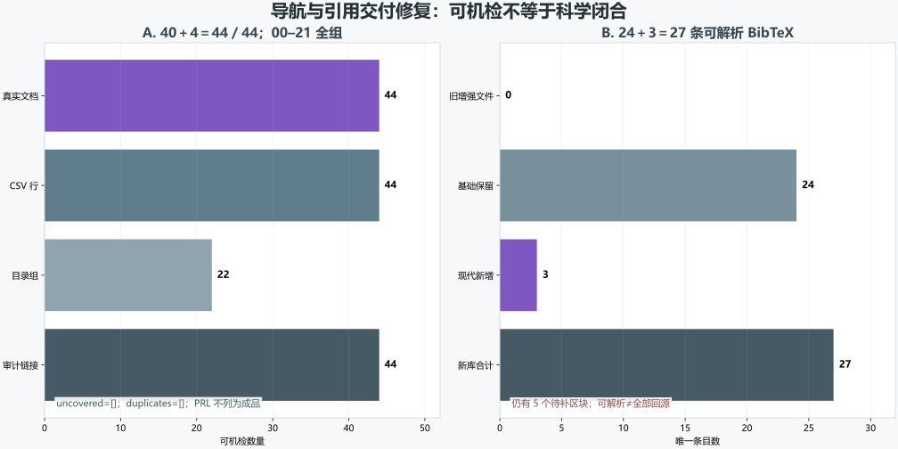

# 导航与参考文献修复包：交付、验证与剩余边界

> 2026-11-11。独立新增文件，原始证据只读。**可解析≠全部回源，44／44 覆盖≠科学验证。**

## 一、交付结果

- 真实导航 **44／44**：40＋4，00–21 全组，无遗漏、无重复。
- 新参考文献 **24＋3＝27** 条唯一 BibTeX；旧增强文件为 0 条，不能继续使用。
- 仍有 **5 个待补区块**、6 次占位字符串；旧 24 条不因复制而自动获得可信度背书。

| 文件 | 用途 | 验收重点 |
|:--|:--|:--|
| `INDEX.md` | 真实 44 份导航与审计入口 | 全路径、全目录组、无 PRL 成品、链接存在 |
| `coverage.csv` | 44 行机器覆盖表 | 唯一路径、来源哈希、方向与评审路径 |
| `references_repaired.bib` | 27 条新库 | 唯一 key、旧前缀保留、三条现代标识 |
| `remediation.json` | 统一结构化结果 | 输入哈希、证据角色和双边界 |
| `REMEDIATION.docx` | 原生整改报告 | 公式、表格、图件、脚注和逐页 QA |

**图件插入顺序：图 1 位于整改资产表之后、剩余证据边界之前。**

## 二、三条现代来源及角色

| 来源 | 标识 | 允许角色 | 禁止升级 |
|:--|:--|:--|:--|
| PNAS 2024 | `10.1073/pnas.2401840121` | 理论预测 | 实验确认 |
| Song 2025 v2 | `2510.01273` | 作者正向实验预印本 | 独立确认或必然性证明 |
| Semenok 2026 v2 | `2605.29985` | 独立负向复现预印本 | 对 Song 或材料族的最终否证 |

作者字段只使用已核实的 `He and others`、`Song and others`、`Semenok and others`，没有虚构完整作者列表。

## 三、输入血缘

| 输入 | SHA-256 |
|:--|:--|
| `coverage_inventory`：`project-intro/sources/coverage-inventory.json` | `638f1e0cfb41ed7902869d28677d6adf50cc7644abe7de3a82a9e0ba6d025f7b` |
| `base_bib`：`toe-sylva-audit/papers/room_temp_sc/organized/09-参考文献/01-参考文献.bib` | `ca014a4bae5023081149a1c4d051917e7f0540df18241400992c2b2276d43698` |
| `main_claims_review`：`main-claims/review.json` | `e9ac6ff0bc88f11b1c2c91ae61ce398a05fc077815803f48669b46536d6f2f45` |
| `main_claims_builder`：`main-claims/build_report.js` | `ebd3fa8f7459a502218f58e10f1629e0c7de38f9f37905a6ac1c0bde72a4958d` |
| `old_enhanced_bib`：`toe-sylva-audit/papers/room_temp_sc/organized/09-参考文献/02-增强参考文献.bib` | `d4a7d80243bc2fec0b05af4b0c9519d1be86edd0a62cd0d3d82b94a912ab870f` |

## 四、仍需推进的工作

1. 旧 24 条逐条回源并清偿 5 个待补区块；不得只追求条目数量。
2. 修正原目录前保留版本血缘；新导航可重复生成，原文件未被替换。
3. Lean 需要真实模块、最小命题和编译退出码；实验需要独立正向复现和直接 Meissner。
4. 参考文献可解析只表示交付可用，不表示全部可信、全部回源或科学验证完成。

## 五、双边界

| 边界 | 状态 |
|:--|:--|
| `navigation_delivery_complete` | `true` |
| `reference_delivery_parseable` | `true` |
| `reference_library_ready` | `false` |
| `scientific_validation_complete` | `false` |
| `all_unfinished_work_completed` | `false` |
| `lean_proof_complete` | `false` |
| `experimental_replication_complete` | `false` |
| `whole_repository_research_complete` | `false` |

验证命令与退出码见 `run.log`；Word 逐页结果见 `word-qa/report.json`。未修改原始证据，未新增证明、实验或独立复现。
