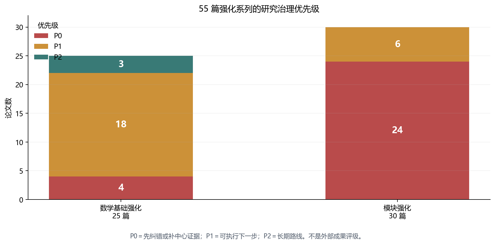

# 数学基础与模块强化：55 篇逐篇方向及未竟工作初审

> 日期：2026-11-10。范围：数学基础强化 25 篇、模块强化 30 篇。本文是基于各篇摘要、结论、局限／开放问题、系列 README 和已核 Lean 探针的**首轮裁决**，不是全库终审，更不是外部查新证明。

## 一、裁决口径

- **新方向**：只表示在项目内可形成独立问题族或证明工程；不自动意味着外部首创。

- **P0**：存在假命题、循环论证、无法编译、占位替换中心对象或中心证据缺失；先修正，再扩展。

- **P1**：有可执行的证明、计算或验证下一步；仍需保留已知假设和适用边界。

- **P2**：长期研究或基础设施路线，近期以核查、数值证书和小接口为主。

- 论文内的“已证”“原创”“定理”等自述不在本轮自动继承；本轮没有重新运行其全部手工推导或外部文献检索。

数量核对：**数学基础 P0 4、P1 18、P2 3；模块强化 P0 24、P1 6、P2 0。**合计恰为 55 个唯一 ID，证据文件均存在。

图 1　优先级是本轮研究治理顺序，不是论文质量评分，也不是对外成果等级。

## 二、两组系列构成哪些方向

数学基础系列真正可持续的主线不是“再覆盖一个大领域”，而是四条相互支撑的证据链：**课程接口与复用登记（02／03／05／08）—非平凡定义与证明度量（01／04／07）—可复算机制链（09–17、19–22、25）—长期结构猜想（18、23、24）**。其中 05、06、07 提供了真实但有限的 Lean 证据；其余大量 Lean 段落仍是未编译设计稿，不能纳入机器定理计数。

模块强化系列则构成一张“形式化病灶谱”：公理投影循环（04／26）、可推 False 的数值或函数界（15／24／26）、`True` 与 `subsingleton` 空洞化（05／11／12 等）、常值 def 与答案键（14／18／19／28／29）、前向引用和悬空引用（21–23／30）。这些文章适合作为修复工单和负例库，不应打包成 30 个已成立的新物理方向。

## 三、数学基础强化：25 篇逐篇裁决

| # | 论文 | 方向角色 | 新颖性边界 | 未竟工作与可执行下一步 | 优先级 |
|---|---|---|---|---|---|
| 01 | [公理审计与分层：从 478 条公理到可信基础](kimi-cite://text?path=C%3A%5CUsers%5C%E4%B8%80%E6%A2%A6%5CDocuments%5Ckimi%5Cworkspace%5Ctoe-sylva-audit%5Cpapers%5C%E6%95%B0%E5%AD%A6%E5%9F%BA%E7%A1%80%E5%BC%BA%E5%8C%96_%E7%B3%BB%E5%88%97%5C01_%E5%85%AC%E7%90%86%E5%AE%A1%E8%AE%A1%E4%B8%8E%E5%88%86%E5%B1%82_%E4%BB%8E478%E6%9D%A1%E5%85%AC%E7%90%86%E5%88%B0%E5%8F%AF%E4%BF%A1%E5%9F%BA%E7%A1%80.md&text=%E5%85%AC%E7%90%86%E5%AE%A1%E8%AE%A1%E4%B8%8E%E5%88%86%E5%B1%82%EF%BC%9A%E4%BB%8E%20478%20%E6%9D%A1%E5%85%AC%E7%90%86%E5%88%B0%E5%8F%AF%E4%BF%A1%E5%9F%BA%E7%A1%80 "citation") | 公理治理方法论 | 四分类与清偿流程是项目内治理增量；分类学本身不主张外部首创。 | 全量公理登记、最小独立集与模型级相对一致性；落实 O4.3 对 Flyspeck／Metamath 过度引申的更正。 | **P0** |
| 02 | [课程式形式化路线：从 Zp 与 Qp 到 L 函数](kimi-cite://text?path=C%3A%5CUsers%5C%E4%B8%80%E6%A2%A6%5CDocuments%5Ckimi%5Cworkspace%5Ctoe-sylva-audit%5Cpapers%5C%E6%95%B0%E5%AD%A6%E5%9F%BA%E7%A1%80%E5%BC%BA%E5%8C%96_%E7%B3%BB%E5%88%97%5C02_%E8%AF%BE%E7%A8%8B%E5%BC%8F%E5%BD%A2%E5%BC%8F%E5%8C%96%E8%B7%AF%E7%BA%BF_%E4%BB%8EZp%E4%B8%8EQp%E5%88%B0L%E5%87%BD%E6%95%B0.md&text=%E8%AF%BE%E7%A8%8B%E5%BC%8F%E5%BD%A2%E5%BC%8F%E5%8C%96%E8%B7%AF%E7%BA%BF%EF%BC%9A%E4%BB%8E%20Zp%20%E4%B8%8E%20Qp%20%E5%88%B0%20L%20%E5%87%BD%E6%95%B0 "citation") | p-adic 与 L-函数课程接口 | 主要复用 mathlib；价值在课程编排和胶水定理，不是重新证明解析延拓。 | 完成 T1.1 计算、T1.6 唯一性、T2.3 绝对收敛与 T2.5 小 conductor 实例；记录课程顺序分歧。 | **P1** |
| 03 | [Dedekind 整环与理想分解唯一性：形式化方案](kimi-cite://text?path=C%3A%5CUsers%5C%E4%B8%80%E6%A2%A6%5CDocuments%5Ckimi%5Cworkspace%5Ctoe-sylva-audit%5Cpapers%5C%E6%95%B0%E5%AD%A6%E5%9F%BA%E7%A1%80%E5%BC%BA%E5%8C%96_%E7%B3%BB%E5%88%97%5C03_Dedekind%E6%95%B4%E7%8E%AF%E4%B8%8E%E7%90%86%E6%83%B3%E5%88%86%E8%A7%A3%E5%94%AF%E4%B8%80%E6%80%A7_%E5%BD%A2%E5%BC%8F%E5%8C%96%E6%96%B9%E6%A1%88.md&text=Dedekind%20%E6%95%B4%E7%8E%AF%E4%B8%8E%E7%90%86%E6%83%B3%E5%88%86%E8%A7%A3%E5%94%AF%E4%B8%80%E6%80%A7%EF%BC%9A%E5%BD%A2%E5%BC%8F%E5%8C%96%E6%96%B9%E6%A1%88 "citation") | Dedekind 课程接口与计算流水线 | 三种定义和唯一分解属于成熟理论；自建空间在实例化与 Kummer–Dedekind 工作流。 | 落地 ℤ[√−5]、检验指数条件、做一个类数实例；补齐类域论的 Tate 上同调与局部互反支柱。 | **P1** |
| 04 | [纵向整合方法论：从平凡证明到深层定理](kimi-cite://text?path=C%3A%5CUsers%5C%E4%B8%80%E6%A2%A6%5CDocuments%5Ckimi%5Cworkspace%5Ctoe-sylva-audit%5Cpapers%5C%E6%95%B0%E5%AD%A6%E5%9F%BA%E7%A1%80%E5%BC%BA%E5%8C%96_%E7%B3%BB%E5%88%97%5C04_%E7%BA%B5%E5%90%91%E6%95%B4%E5%90%88%E6%96%B9%E6%B3%95%E8%AE%BA_%E4%BB%8E%E5%B9%B3%E5%87%A1%E8%AF%81%E6%98%8E%E5%88%B0%E6%B7%B1%E5%B1%82%E5%AE%9A%E7%90%86.md&text=%E7%BA%B5%E5%90%91%E6%95%B4%E5%90%88%E6%96%B9%E6%B3%95%E8%AE%BA%EF%BC%9A%E4%BB%8E%E5%B9%B3%E5%87%A1%E8%AF%81%E6%98%8E%E5%88%B0%E6%B7%B1%E5%B1%82%E5%AE%9A%E7%90%86 "citation") | 纵向整合与证明度量 | 依赖深度、证明长度、概念压缩率的组合是项目管理方案，非公认深层定理度量。 | 实现三指标测量并用已知定理校准；修正 O4.3 文献引申；阈值只能拦截平凡项，不能认证深刻性。 | **P0** |
| 05 | [课程式形式化实战案例：Zp 基础定理形式化实证](kimi-cite://text?path=C%3A%5CUsers%5C%E4%B8%80%E6%A2%A6%5CDocuments%5Ckimi%5Cworkspace%5Ctoe-sylva-audit%5Cpapers%5C%E6%95%B0%E5%AD%A6%E5%9F%BA%E7%A1%80%E5%BC%BA%E5%8C%96_%E7%B3%BB%E5%88%97%5C05_%E8%AF%BE%E7%A8%8B%E5%BC%8F%E5%BD%A2%E5%BC%8F%E5%8C%96%E5%AE%9E%E6%88%98%E6%A1%88%E4%BE%8B_Zp%E5%9F%BA%E7%A1%80%E5%AE%9A%E7%90%86%E5%BD%A2%E5%BC%8F%E5%8C%96%E5%AE%9E%E8%AF%81.md&text=%E8%AF%BE%E7%A8%8B%E5%BC%8F%E5%BD%A2%E5%BC%8F%E5%8C%96%E5%AE%9E%E6%88%98%E6%A1%88%E4%BE%8B%EF%BC%9AZp%20%E5%9F%BA%E7%A1%80%E5%AE%9A%E7%90%86%E5%BD%A2%E5%BC%8F%E5%8C%96%E5%AE%9E%E8%AF%81 "citation") | Zp 真实编译实证 | 六条中间层小定理有当次编译证据；底层数学主要是 mathlib 复用。 | 复跑保存的命令与公理审计；推进 Hensel 引理和闭单位球↔逆极限的显式等价，而非只换陈述。 | **P1** |
| 06 | [层化陈数公式：从 PFE 数值猜想到 Lean 形式化目标](kimi-cite://text?path=C%3A%5CUsers%5C%E4%B8%80%E6%A2%A6%5CDocuments%5Ckimi%5Cworkspace%5Ctoe-sylva-audit%5Cpapers%5C%E6%95%B0%E5%AD%A6%E5%9F%BA%E7%A1%80%E5%BC%BA%E5%8C%96_%E7%B3%BB%E5%88%97%5C06_%E5%B1%82%E5%8C%96%E9%99%88%E6%95%B0%E5%85%AC%E5%BC%8F_%E4%BB%8EPFE%E6%95%B0%E5%80%BC%E7%8C%9C%E6%83%B3%E5%88%B0Lean%E5%BD%A2%E5%BC%8F%E5%8C%96%E7%9B%AE%E6%A0%87.md&text=%E5%B1%82%E5%8C%96%E9%99%88%E6%95%B0%E5%85%AC%E5%BC%8F%EF%BC%9A%E4%BB%8E%20PFE%20%E6%95%B0%E5%80%BC%E7%8C%9C%E6%83%B3%E5%88%B0%20Lean%20%E5%BD%A2%E5%BC%8F%E5%8C%96%E7%9B%AE%E6%A0%87 "citation") | 层化陈数的求和结构形式化 | 整数权重的加权求和整性是真实但初等的项目内增量；不是 Chern–Weil 整性证明。 | 登记 roots 并合并类型；给出层权重的独立物理来源和真实拓扑计算，不能用加权平均解释 137。 | **P0** |
| 07 | [信息几何深化：对偶结构、最优传输与测地凸优化](kimi-cite://text?path=C%3A%5CUsers%5C%E4%B8%80%E6%A2%A6%5CDocuments%5Ckimi%5Cworkspace%5Ctoe-sylva-audit%5Cpapers%5C%E6%95%B0%E5%AD%A6%E5%9F%BA%E7%A1%80%E5%BC%BA%E5%8C%96_%E7%B3%BB%E5%88%97%5C07_%E4%BF%A1%E6%81%AF%E5%87%A0%E4%BD%95%E6%B7%B1%E5%8C%96_%E5%AF%B9%E5%81%B6%E7%BB%93%E6%9E%84%E6%9C%80%E4%BC%98%E4%BC%A0%E8%BE%93%E4%B8%8E%E6%B5%8B%E5%9C%B0%E5%87%B8%E4%BC%98%E5%8C%96.md&text=%E4%BF%A1%E6%81%AF%E5%87%A0%E4%BD%95%E6%B7%B1%E5%8C%96%EF%BC%9A%E5%AF%B9%E5%81%B6%E7%BB%93%E6%9E%84%E3%80%81%E6%9C%80%E4%BC%98%E4%BC%A0%E8%BE%93%E4%B8%8E%E6%B5%8B%E5%9C%B0%E5%87%B8%E4%BC%98%E5%8C%96 "citation") | 信息几何修复路线 | 对偶几何与最优传输为教材整理；已有玩具 Hessian／Bregman／Legendre 探针。 | 把 FIM:=0 换成参数化分布族的真实定义；完成 KL／Gibbs、一般 Cramér–Rao 与源码落地，玩具恒等式不得冒充一般定理。 | **P0** |
| 08 | [Lie 理论与对称性基础：从 Lie 群到 Borel–Weil 定理](kimi-cite://text?path=C%3A%5CUsers%5C%E4%B8%80%E6%A2%A6%5CDocuments%5Ckimi%5Cworkspace%5Ctoe-sylva-audit%5Cpapers%5C%E6%95%B0%E5%AD%A6%E5%9F%BA%E7%A1%80%E5%BC%BA%E5%8C%96_%E7%B3%BB%E5%88%97%5C08_Lie%E7%90%86%E8%AE%BA%E4%B8%8E%E5%AF%B9%E7%A7%B0%E6%80%A7%E5%9F%BA%E7%A1%80_%E4%BB%8ELie%E7%BE%A4%E5%88%B0Borel-Weil%E5%AE%9A%E7%90%86.md&text=Lie%20%E7%90%86%E8%AE%BA%E4%B8%8E%E5%AF%B9%E7%A7%B0%E6%80%A7%E5%9F%BA%E7%A1%80%EF%BC%9A%E4%BB%8E%20Lie%20%E7%BE%A4%E5%88%B0%20Borel%E2%80%93Weil%20%E5%AE%9A%E7%90%86 "citation") | Lie 理论与规范对称性课程 | Borel–Weil 等为成熟理论；项目增量是指出 U(1) 与群／代数类型错位。 | 构造 U(1) 的周期商，分离 Lie 群与李代数类型；标准模型群结构化，并核验七层—权格联系是否仅为类比。 | **P1** |
| 09 | [相变的信息几何判据：曲率奇异性与标度律的统一](kimi-cite://text?path=C%3A%5CUsers%5C%E4%B8%80%E6%A2%A6%5CDocuments%5Ckimi%5Cworkspace%5Ctoe-sylva-audit%5Cpapers%5C%E6%95%B0%E5%AD%A6%E5%9F%BA%E7%A1%80%E5%BC%BA%E5%8C%96_%E7%B3%BB%E5%88%97%5C09_%E7%9B%B8%E5%8F%98%E7%9A%84%E4%BF%A1%E6%81%AF%E5%87%A0%E4%BD%95%E5%88%A4%E6%8D%AE_%E6%9B%B2%E7%8E%87%E5%A5%87%E5%BC%82%E6%80%A7%E4%B8%8E%E6%A0%87%E5%BA%A6%E5%BE%8B%E7%9A%84%E7%BB%9F%E4%B8%80.md&text=%E7%9B%B8%E5%8F%98%E7%9A%84%E4%BF%A1%E6%81%AF%E5%87%A0%E4%BD%95%E5%88%A4%E6%8D%AE%EF%BC%9A%E6%9B%B2%E7%8E%87%E5%A5%87%E5%BC%82%E6%80%A7%E4%B8%8E%E6%A0%87%E5%BA%A6%E5%BE%8B%E7%9A%84%E7%BB%9F%E4%B8%80 "citation") | 相变信息几何的定理候选族 | 统一判据、振幅与对数修正是组内强候选；尚未独立复核全部推导和外部查新。 | 复算二维 Ising 曲率；做三维／四维数值检验与量子曲率；Lean 骨架去除 sorry 后再登记机器定理。 | **P1** |
| 10 | [随机矩阵普适性的层化理论：从 Wigner 到信息几何](kimi-cite://text?path=C%3A%5CUsers%5C%E4%B8%80%E6%A2%A6%5CDocuments%5Ckimi%5Cworkspace%5Ctoe-sylva-audit%5Cpapers%5C%E6%95%B0%E5%AD%A6%E5%9F%BA%E7%A1%80%E5%BC%BA%E5%8C%96_%E7%B3%BB%E5%88%97%5C10_%E9%9A%8F%E6%9C%BA%E7%9F%A9%E9%98%B5%E6%99%AE%E9%80%82%E6%80%A7%E7%9A%84%E5%B1%82%E5%8C%96%E7%90%86%E8%AE%BA_%E4%BB%8EWigner%E5%88%B0%E4%BF%A1%E6%81%AF%E5%87%A0%E4%BD%95.md&text=%E9%9A%8F%E6%9C%BA%E7%9F%A9%E9%98%B5%E6%99%AE%E9%80%82%E6%80%A7%E7%9A%84%E5%B1%82%E5%8C%96%E7%90%86%E8%AE%BA%EF%BC%9A%E4%BB%8E%20Wigner%20%E5%88%B0%E4%BF%A1%E6%81%AF%E5%87%A0%E4%BD%95 "citation") | 随机矩阵的层化统一框架 | 遗忘算子三分解是组织性提案；各组成普适性定理归原作者，β 几何待核。 | 验证多割位势与 β 方向 Fisher；先实现 sine 核 Paley–Wiener 刻画，不提前宣称三层统一获证。 | **P1** |
| 11 | [最优传输与耗散几何：梯度流的统一变分结构](kimi-cite://text?path=C%3A%5CUsers%5C%E4%B8%80%E6%A2%A6%5CDocuments%5Ckimi%5Cworkspace%5Ctoe-sylva-audit%5Cpapers%5C%E6%95%B0%E5%AD%A6%E5%9F%BA%E7%A1%80%E5%BC%BA%E5%8C%96_%E7%B3%BB%E5%88%97%5C11_%E6%9C%80%E4%BC%98%E4%BC%A0%E8%BE%93%E4%B8%8E%E8%80%97%E6%95%A3%E5%87%A0%E4%BD%95_%E6%A2%AF%E5%BA%A6%E6%B5%81%E7%9A%84%E7%BB%9F%E4%B8%80%E5%8F%98%E5%88%86%E7%BB%93%E6%9E%84.md&text=%E6%9C%80%E4%BC%98%E4%BC%A0%E8%BE%93%E4%B8%8E%E8%80%97%E6%95%A3%E5%87%A0%E4%BD%95%EF%BC%9A%E6%A2%AF%E5%BA%A6%E6%B5%81%E7%9A%84%E7%BB%9F%E4%B8%80%E5%8F%98%E5%88%86%E7%BB%93%E6%9E%84 "citation") | 最优传输与耗散几何 | EDE、Wasserstein 梯度流和熵正则极限以成熟理论为骨架；统一分类尚待严格化。 | 证明猜想 D 的 Γ-收敛并处理非光滑情形；明确 EDE 与路径涨落定理的统一步骤，补高斯例逐行计算。 | **P1** |
| 12 | [谱序列作为层化推理引擎：从滤过复形到计算普适性](kimi-cite://text?path=C%3A%5CUsers%5C%E4%B8%80%E6%A2%A6%5CDocuments%5Ckimi%5Cworkspace%5Ctoe-sylva-audit%5Cpapers%5C%E6%95%B0%E5%AD%A6%E5%9F%BA%E7%A1%80%E5%BC%BA%E5%8C%96_%E7%B3%BB%E5%88%97%5C12_%E8%B0%B1%E5%BA%8F%E5%88%97%E4%BD%9C%E4%B8%BA%E5%B1%82%E5%8C%96%E6%8E%A8%E7%90%86%E5%BC%95%E6%93%8E_%E4%BB%8E%E6%BB%A4%E8%BF%87%E5%A4%8D%E5%BD%A2%E5%88%B0%E8%AE%A1%E7%AE%97%E6%99%AE%E9%80%82%E6%80%A7.md&text=%E8%B0%B1%E5%BA%8F%E5%88%97%E4%BD%9C%E4%B8%BA%E5%B1%82%E5%8C%96%E6%8E%A8%E7%90%86%E5%BC%95%E6%93%8E%EF%BC%9A%E4%BB%8E%E6%BB%A4%E8%BF%87%E5%A4%8D%E5%BD%A2%E5%88%B0%E8%AE%A1%E7%AE%97%E6%99%AE%E9%80%82%E6%80%A7 "citation") | 谱序列的层化推理接口 | exact couple 提炼算子是项目内接口增量；谱序列与 Boardman 收敛均非新结果。 | 构造真实 CNF 滤过复形；先机器化 S2 导出对正合性，再处理 lim¹／RE∞ 障碍证书。 | **P1** |
| 13 | [自由概率与非交换层：从 Voiculescu 到随机矩阵的深层统一](kimi-cite://text?path=C%3A%5CUsers%5C%E4%B8%80%E6%A2%A6%5CDocuments%5Ckimi%5Cworkspace%5Ctoe-sylva-audit%5Cpapers%5C%E6%95%B0%E5%AD%A6%E5%9F%BA%E7%A1%80%E5%BC%BA%E5%8C%96_%E7%B3%BB%E5%88%97%5C13_%E8%87%AA%E7%94%B1%E6%A6%82%E7%8E%87%E4%B8%8E%E9%9D%9E%E4%BA%A4%E6%8D%A2%E5%B1%82_%E4%BB%8EVoiculescu%E5%88%B0%E9%9A%8F%E6%9C%BA%E7%9F%A9%E9%98%B5%E7%9A%84%E6%B7%B1%E5%B1%82%E7%BB%9F%E4%B8%80.md&text=%E8%87%AA%E7%94%B1%E6%A6%82%E7%8E%87%E4%B8%8E%E9%9D%9E%E4%BA%A4%E6%8D%A2%E5%B1%82%EF%BC%9A%E4%BB%8E%20Voiculescu%20%E5%88%B0%E9%9A%8F%E6%9C%BA%E7%9F%A9%E9%98%B5%E7%9A%84%E6%B7%B1%E5%B1%82%E7%BB%9F%E4%B8%80 "citation") | 自由概率的统一表述 | 五种独立性和 q 几何接口是研究纲领；自由 CLT、R-变换与渐近自由属于既有理论。 | 完成五种独立性的精确统一、超收敛速率和 q 几何；先证自由独立时 R-变换可加，避免定义即定理的空转。 | **P1** |
| 14 | [重整化群的不动点几何：从 Wilson 到精确 RG](kimi-cite://text?path=C%3A%5CUsers%5C%E4%B8%80%E6%A2%A6%5CDocuments%5Ckimi%5Cworkspace%5Ctoe-sylva-audit%5Cpapers%5C%E6%95%B0%E5%AD%A6%E5%9F%BA%E7%A1%80%E5%BC%BA%E5%8C%96_%E7%B3%BB%E5%88%97%5C14_%E9%87%8D%E6%95%B4%E5%8C%96%E7%BE%A4%E7%9A%84%E4%B8%8D%E5%8A%A8%E7%82%B9%E5%87%A0%E4%BD%95_%E4%BB%8EWilson%E5%88%B0%E7%B2%BE%E7%A1%AERG.md&text=%E9%87%8D%E6%95%B4%E5%8C%96%E7%BE%A4%E7%9A%84%E4%B8%8D%E5%8A%A8%E7%82%B9%E5%87%A0%E4%BD%95%EF%BC%9A%E4%BB%8E%20Wilson%20%E5%88%B0%E7%B2%BE%E7%A1%AE%20RG "citation") | RG 不动点几何与可复算演算 | 两套显式计算有复算价值；不动点分类和 Fisher–Zamolodchikov 关系仍是候选。 | 推进三维 Ising 不动点、两种度规的临界关系与边缘不动点分类；先闭合 S1 ε-展开的有理函数恒等式。 | **P1** |
| 15 | [可积系统与 Painlevé 超越函数：从孤子到普适性的桥梁](kimi-cite://text?path=C%3A%5CUsers%5C%E4%B8%80%E6%A2%A6%5CDocuments%5Ckimi%5Cworkspace%5Ctoe-sylva-audit%5Cpapers%5C%E6%95%B0%E5%AD%A6%E5%9F%BA%E7%A1%80%E5%BC%BA%E5%8C%96_%E7%B3%BB%E5%88%97%5C15_%E5%8F%AF%E7%A7%AF%E7%B3%BB%E7%BB%9F%E4%B8%8EPainlev%C3%A9%E8%B6%85%E8%B6%8A%E5%87%BD%E6%95%B0_%E4%BB%8E%E5%AD%A4%E5%AD%90%E5%88%B0%E6%99%AE%E9%80%82%E6%80%A7%E7%9A%84%E6%A1%A5%E6%A2%81.md&text=%E5%8F%AF%E7%A7%AF%E7%B3%BB%E7%BB%9F%E4%B8%8E%20Painlev%C3%A9%20%E8%B6%85%E8%B6%8A%E5%87%BD%E6%95%B0%EF%BC%9A%E4%BB%8E%E5%AD%A4%E5%AD%90%E5%88%B0%E6%99%AE%E9%80%82%E6%80%A7%E7%9A%84%E6%A1%A5%E6%A2%81 "citation") | 可积系统与 Painlevé 机制链 | 等谱／等单值桥和显式手工演算构成组内整合；不主张重写既有可积性理论。 | 精确化 ARS 的适用范畴，构造 τ-函子并探索一般 β；先完成不依赖深层库的 I3／I4 代数核。 | **P1** |
| 16 | [几何量子化与辛几何：从经典相空间到量子态的函子](kimi-cite://text?path=C%3A%5CUsers%5C%E4%B8%80%E6%A2%A6%5CDocuments%5Ckimi%5Cworkspace%5Ctoe-sylva-audit%5Cpapers%5C%E6%95%B0%E5%AD%A6%E5%9F%BA%E7%A1%80%E5%BC%BA%E5%8C%96_%E7%B3%BB%E5%88%97%5C16_%E5%87%A0%E4%BD%95%E9%87%8F%E5%AD%90%E5%8C%96%E4%B8%8E%E8%BE%9B%E5%87%A0%E4%BD%95_%E4%BB%8E%E7%BB%8F%E5%85%B8%E7%9B%B8%E7%A9%BA%E9%97%B4%E5%88%B0%E9%87%8F%E5%AD%90%E6%80%81%E7%9A%84%E5%87%BD%E5%AD%90.md&text=%E5%87%A0%E4%BD%95%E9%87%8F%E5%AD%90%E5%8C%96%E4%B8%8E%E8%BE%9B%E5%87%A0%E4%BD%95%EF%BC%9A%E4%BB%8E%E7%BB%8F%E5%85%B8%E7%9B%B8%E7%A9%BA%E9%97%B4%E5%88%B0%E9%87%8F%E5%AD%90%E6%80%81%E7%9A%84%E5%87%BD%E5%AD%90 "citation") | 几何量子化与整性接口 | 三层量子化和轨道方法是成熟理论；与层化陈数的连接是项目内新接口。 | 给出 Weil 整性证书，界定极化的函子性与 SYLVA 轨道边界；先做 G1 纯代数，不把结构同型说成物理导出。 | **P1** |
| 17 | [微分 Galois 理论与可积性障碍：从 Liouville 到 Morales–Ramis](kimi-cite://text?path=C%3A%5CUsers%5C%E4%B8%80%E6%A2%A6%5CDocuments%5Ckimi%5Cworkspace%5Ctoe-sylva-audit%5Cpapers%5C%E6%95%B0%E5%AD%A6%E5%9F%BA%E7%A1%80%E5%BC%BA%E5%8C%96_%E7%B3%BB%E5%88%97%5C17_%E5%BE%AE%E5%88%86Galois%E7%90%86%E8%AE%BA%E4%B8%8E%E5%8F%AF%E7%A7%AF%E6%80%A7%E9%9A%9C%E7%A2%8D_%E4%BB%8ELiouville%E5%88%B0Morales-Ramis.md&text=%E5%BE%AE%E5%88%86%20Galois%20%E7%90%86%E8%AE%BA%E4%B8%8E%E5%8F%AF%E7%A7%AF%E6%80%A7%E9%9A%9C%E7%A2%8D%EF%BC%9A%E4%BB%8E%20Liouville%20%E5%88%B0%20Morales%E2%80%93Ramis "citation") | 微分 Galois 可积性障碍 | 正向可积与反向 Galois 障碍的对照有组内整合价值；判据统一未闭合。 | 统一 Painlevé 与 Galois 判据的适用类，分析高阶复杂度；实现 G4 Kovacic 极点阶数判定。 | **P1** |
| 18 | [同伦类型论与 ∞-范畴：类型作为空间的数学革命](kimi-cite://text?path=C%3A%5CUsers%5C%E4%B8%80%E6%A2%A6%5CDocuments%5Ckimi%5Cworkspace%5Ctoe-sylva-audit%5Cpapers%5C%E6%95%B0%E5%AD%A6%E5%9F%BA%E7%A1%80%E5%BC%BA%E5%8C%96_%E7%B3%BB%E5%88%97%5C18_%E5%90%8C%E4%BC%A6%E7%B1%BB%E5%9E%8B%E8%AE%BA%E4%B8%8E%E6%97%A0%E7%A9%B7%E8%8C%83%E7%95%B4_%E7%B1%BB%E5%9E%8B%E4%BD%9C%E4%B8%BA%E7%A9%BA%E9%97%B4%E7%9A%84%E6%95%B0%E5%AD%A6%E9%9D%A9%E5%91%BD.md&text=%E5%90%8C%E4%BC%A6%E7%B1%BB%E5%9E%8B%E8%AE%BA%E4%B8%8E%20%E2%88%9E-%E8%8C%83%E7%95%B4%EF%BC%9A%E7%B1%BB%E5%9E%8B%E4%BD%9C%E4%B8%BA%E7%A9%BA%E9%97%B4%E7%9A%84%E6%95%B0%E5%AD%A6%E9%9D%A9%E5%91%BD "citation") | HoTT 与高阶结构路线 | 主要是现代基础理论重构；CNF—Postnikov 障碍字典仍是猜想。 | 跟踪半单纯类型问题，构造 CNF 障碍字典；用 Cubical 检验有限高群，并核查 mathlib 的 Kan 复形现状。 | **P2** |
| 19 | [张量网络与全息纠缠：从 MERA 到时空涌现的信息几何](kimi-cite://text?path=C%3A%5CUsers%5C%E4%B8%80%E6%A2%A6%5CDocuments%5Ckimi%5Cworkspace%5Ctoe-sylva-audit%5Cpapers%5C%E6%95%B0%E5%AD%A6%E5%9F%BA%E7%A1%80%E5%BC%BA%E5%8C%96_%E7%B3%BB%E5%88%97%5C19_%E5%BC%A0%E9%87%8F%E7%BD%91%E7%BB%9C%E4%B8%8E%E5%85%A8%E6%81%AF%E7%BA%A0%E7%BC%A0_%E4%BB%8EMERA%E5%88%B0%E6%97%B6%E7%A9%BA%E6%B6%8C%E7%8E%B0%E7%9A%84%E4%BF%A1%E6%81%AF%E5%87%A0%E4%BD%95.md&text=%E5%BC%A0%E9%87%8F%E7%BD%91%E7%BB%9C%E4%B8%8E%E5%85%A8%E6%81%AF%E7%BA%A0%E7%BC%A0%EF%BC%9A%E4%BB%8E%20MERA%20%E5%88%B0%E6%97%B6%E7%A9%BA%E6%B6%8C%E7%8E%B0%E7%9A%84%E4%BF%A1%E6%81%AF%E5%87%A0%E4%BD%95 "citation") | 张量网络—全息字典 | 三层字典是项目内组织增量；min-cut 秩界与 MERA 计数为标准可证组件。 | 显式构造 CNF 因果锥，处理 cMERA 连续极限障碍；先形式化 T2 min-cut，再计算纠缠 Hessian。 | **P1** |
| 20 | [广义对称性与高形式结构：从群到高群的统一](kimi-cite://text?path=C%3A%5CUsers%5C%E4%B8%80%E6%A2%A6%5CDocuments%5Ckimi%5Cworkspace%5Ctoe-sylva-audit%5Cpapers%5C%E6%95%B0%E5%AD%A6%E5%9F%BA%E7%A1%80%E5%BC%BA%E5%8C%96_%E7%B3%BB%E5%88%97%5C20_%E5%B9%BF%E4%B9%89%E5%AF%B9%E7%A7%B0%E6%80%A7%E4%B8%8E%E9%AB%98%E5%BD%A2%E5%BC%8F%E7%BB%93%E6%9E%84_%E4%BB%8E%E7%BE%A4%E5%88%B0%E9%AB%98%E7%BE%A4%E7%9A%84%E7%BB%9F%E4%B8%80.md&text=%E5%B9%BF%E4%B9%89%E5%AF%B9%E7%A7%B0%E6%80%A7%E4%B8%8E%E9%AB%98%E5%BD%A2%E5%BC%8F%E7%BB%93%E6%9E%84%EF%BC%9A%E4%BB%8E%E7%BE%A4%E5%88%B0%E9%AB%98%E7%BE%A4%E7%9A%84%E7%BB%9F%E4%B8%80 "citation") | 广义对称性与高形式结构 | 障碍三部曲和 SymTFT 层化联系为组内整合；非可逆融合代数已有成熟来源。 | 研究连续 SymTFT 完备性与非可逆反常分类；完成 B²U(1) 可执行化和 G4 群上同调接口核查。 | **P1** |
| 21 | [代数 K 理论：从向量丛到普适不变量](kimi-cite://text?path=C%3A%5CUsers%5C%E4%B8%80%E6%A2%A6%5CDocuments%5Ckimi%5Cworkspace%5Ctoe-sylva-audit%5Cpapers%5C%E6%95%B0%E5%AD%A6%E5%9F%BA%E7%A1%80%E5%BC%BA%E5%8C%96_%E7%B3%BB%E5%88%97%5C21_%E4%BB%A3%E6%95%B0K%E7%90%86%E8%AE%BA_%E4%BB%8E%E5%90%91%E9%87%8F%E4%B8%9B%E5%88%B0%E6%99%AE%E9%80%82%E4%B8%8D%E5%8F%98%E9%87%8F.md&text=%E4%BB%A3%E6%95%B0%20K%20%E7%90%86%E8%AE%BA%EF%BC%9A%E4%BB%8E%E5%90%91%E9%87%8F%E4%B8%9B%E5%88%B0%E6%99%AE%E9%80%82%E4%B8%8D%E5%8F%98%E9%87%8F "citation") | 代数 K 理论的普适化路线 | 群完备化统一读法是组内重组；Grothendieck 群与 Bott 周期性为经典结果。 | 先机器化 K0 的泛性质，比较 Bott 三条证明路线；再检验层化陈数与 RR／K 类的真实关系。 | **P1** |
| 22 | [动力系统与遍历论深化：从混沌到 SRB 测度与 KAM](kimi-cite://text?path=C%3A%5CUsers%5C%E4%B8%80%E6%A2%A6%5CDocuments%5Ckimi%5Cworkspace%5Ctoe-sylva-audit%5Cpapers%5C%E6%95%B0%E5%AD%A6%E5%9F%BA%E7%A1%80%E5%BC%BA%E5%8C%96_%E7%B3%BB%E5%88%97%5C22_%E5%8A%A8%E5%8A%9B%E7%B3%BB%E7%BB%9F%E4%B8%8E%E9%81%8D%E5%8E%86%E8%AE%BA%E6%B7%B1%E5%8C%96_%E4%BB%8E%E6%B7%B7%E6%B2%8C%E5%88%B0SRB%E6%B5%8B%E5%BA%A6%E4%B8%8EKAM.md&text=%E5%8A%A8%E5%8A%9B%E7%B3%BB%E7%BB%9F%E4%B8%8E%E9%81%8D%E5%8E%86%E8%AE%BA%E6%B7%B1%E5%8C%96%EF%BC%9A%E4%BB%8E%E6%B7%B7%E6%B2%8C%E5%88%B0%20SRB%20%E6%B5%8B%E5%BA%A6%E4%B8%8E%20KAM "citation") | 遍历论三层结构与数值复算 | 度量／拓扑／统计分层和 logistic、Feigenbaum 复算有教学研究价值，不是新遍历定理。 | 先证 Garsia–Hopf 极大引理并推进 Birkhoff；再研究 SRB 显式收敛率与 KAM 最优渐近。 | **P1** |
| 23 | [朗兰兹纲领：数论、几何与物理的大三角](kimi-cite://text?path=C%3A%5CUsers%5C%E4%B8%80%E6%A2%A6%5CDocuments%5Ckimi%5Cworkspace%5Ctoe-sylva-audit%5Cpapers%5C%E6%95%B0%E5%AD%A6%E5%9F%BA%E7%A1%80%E5%BC%BA%E5%8C%96_%E7%B3%BB%E5%88%97%5C23_%E6%9C%97%E5%85%B0%E5%85%B9%E7%BA%B2%E9%A2%86_%E6%95%B0%E8%AE%BA%E5%87%A0%E4%BD%95%E4%B8%8E%E7%89%A9%E7%90%86%E7%9A%84%E5%A4%A7%E4%B8%89%E8%A7%92.md&text=%E6%9C%97%E5%85%B0%E5%85%B9%E7%BA%B2%E9%A2%86%EF%BC%9A%E6%95%B0%E8%AE%BA%E3%80%81%E5%87%A0%E4%BD%95%E4%B8%8E%E7%89%A9%E7%90%86%E7%9A%84%E5%A4%A7%E4%B8%89%E8%A7%92 "citation") | 朗兰兹校验器与物理走廊 | 逐素数对账和校验器组织有复算价值；外部宣称与正式发表状态须独立更新。 | 从 Part V 经典化陈述或有限组合引理起步；实现 Sturm 有效证书；CNF 的 L-函子保持无证据猜想。 | **P2** |
| 24 | [顶点算符代数与月光理论：从共形场到魔群](kimi-cite://text?path=C%3A%5CUsers%5C%E4%B8%80%E6%A2%A6%5CDocuments%5Ckimi%5Cworkspace%5Ctoe-sylva-audit%5Cpapers%5C%E6%95%B0%E5%AD%A6%E5%9F%BA%E7%A1%80%E5%BC%BA%E5%8C%96_%E7%B3%BB%E5%88%97%5C24_%E9%A1%B6%E7%82%B9%E7%AE%97%E7%AC%A6%E4%BB%A3%E6%95%B0%E4%B8%8E%E6%9C%88%E5%85%89%E7%90%86%E8%AE%BA_%E4%BB%8E%E5%85%B1%E5%BD%A2%E5%9C%BA%E5%88%B0%E9%AD%94%E7%BE%A4.md&text=%E9%A1%B6%E7%82%B9%E7%AE%97%E7%AC%A6%E4%BB%A3%E6%95%B0%E4%B8%8E%E6%9C%88%E5%85%89%E7%90%86%E8%AE%BA%EF%BC%9A%E4%BB%8E%E5%85%B1%E5%BD%A2%E5%9C%BA%E5%88%B0%E9%AD%94%E7%BE%A4 "citation") | VOA／月光的对称代数接口 | VOA 作为朗兰兹与月光公共节点是组内组织；数值对账不等于证明月光定理。 | 探索接口式下游定理与 Witten 猜想的数学化障碍；先做 V4 数值证书，VOA–CNF 保持纲领猜想。 | **P2** |
| 25 | [纽结不变量与陈-西蒙斯理论：从 Jones 多项式到拓扑量子场论](kimi-cite://text?path=C%3A%5CUsers%5C%E4%B8%80%E6%A2%A6%5CDocuments%5Ckimi%5Cworkspace%5Ctoe-sylva-audit%5Cpapers%5C%E6%95%B0%E5%AD%A6%E5%9F%BA%E7%A1%80%E5%BC%BA%E5%8C%96_%E7%B3%BB%E5%88%97%5C25_%E7%BA%BD%E7%BB%93%E4%B8%8D%E5%8F%98%E9%87%8F%E4%B8%8E%E9%99%88%E8%A5%BF%E8%92%99%E6%96%AF%E7%90%86%E8%AE%BA_%E4%BB%8EJones%E5%A4%9A%E9%A1%B9%E5%BC%8F%E5%88%B0%E6%8B%93%E6%89%91%E9%87%8F%E5%AD%90%E5%9C%BA%E8%AE%BA.md&text=%E7%BA%BD%E7%BB%93%E4%B8%8D%E5%8F%98%E9%87%8F%E4%B8%8E%E9%99%88-%E8%A5%BF%E8%92%99%E6%96%AF%E7%90%86%E8%AE%BA%EF%BC%9A%E4%BB%8E%20Jones%20%E5%A4%9A%E9%A1%B9%E5%BC%8F%E5%88%B0%E6%8B%93%E6%89%91%E9%87%8F%E5%AD%90%E5%9C%BA%E8%AE%BA "citation") | 纽结／Chern–Simons 组合计算方向 | 手工态和和机制联系有组内价值；skein、TQFT、Khovanov 与能级整性均为成熟理论。 | 区分 unknot 探测、体积猜想和 CS 测度三个问题；先证明离散拓扑整性的极限保持，不能推出 137。 | **P1** |

## 四、模块强化：30 篇逐篇裁决

下表以系列 README 的历史诊断为起点；它记录的是各论文写作时的模块状态。后续分支若有补丁，必须给出该补丁自己的编译日志，不能据此宣称原稿原本已通过。

| # | 论文 | 方向角色 | 新颖性边界 | 未竟工作与可执行下一步 | 优先级 |
|---|---|---|---|---|---|
| 01 | [01｜01_FourForcesUnification_四力统一](kimi-cite://text?path=C%3A%5CUsers%5C%E4%B8%80%E6%A2%A6%5CDocuments%5Ckimi%5Cworkspace%5Ctoe-sylva-audit%5Cpapers%5C%E6%A8%A1%E5%9D%97%E5%BC%BA%E5%8C%96_%E7%B3%BB%E5%88%97%5C01_FourForcesUnification_%E5%9B%9B%E5%8A%9B%E7%BB%9F%E4%B8%80.md&text=%E6%A8%A1%E5%9D%97%E5%BC%BA%E5%8C%96%E8%AE%BA%E6%96%87%2001%EF%BC%9AFourForcesUnification%20%E2%80%94%E2%80%94%20%E5%9B%9B%E5%8A%9B%E7%BB%9F%E4%B8%80%E7%9A%84%E5%9B%A0%E6%9E%9C%E7%BD%91%E7%BB%9C%E5%BD%A2%E5%BC%8F%E5%8C%96 "citation") | 四力统一的玩具治理样本 | 项目内价值是公理债务解剖；不是四力统一理论。 | 将空集见证与真物理断言分离，清偿三条公理；所有参数需独立推导与可证伪检验。 | **P0** |
| 02 | [02｜02_EinsteinCartan_爱因斯坦嘉当引力](kimi-cite://text?path=C%3A%5CUsers%5C%E4%B8%80%E6%A2%A6%5CDocuments%5Ckimi%5Cworkspace%5Ctoe-sylva-audit%5Cpapers%5C%E6%A8%A1%E5%9D%97%E5%BC%BA%E5%8C%96_%E7%B3%BB%E5%88%97%5C02_EinsteinCartan_%E7%88%B1%E5%9B%A0%E6%96%AF%E5%9D%A6%E5%98%89%E5%BD%93%E5%BC%95%E5%8A%9B.md&text=%E6%A8%A1%E5%9D%97%E5%BC%BA%E5%8C%96%E8%AE%BA%E6%96%87%2002%EF%BC%9AEinsteinCartan%20%E2%80%94%E2%80%94%20%E7%88%B1%E5%9B%A0%E6%96%AF%E5%9D%A6%E2%80%93%E5%98%89%E5%BD%93%E5%BC%95%E5%8A%9B%E4%B8%8E%E6%B6%8C%E7%8E%B0%E5%9C%BA%E8%AE%BA%E7%9A%84%E5%BD%A2%E5%BC%8F%E5%8C%96 "citation") | Einstein–Cartan 几何修复 | 守恒律清偿是教材级增量；挠率—自旋耦合尚未实现。 | 先证明两条守恒律；替换六条场方程占位并建立非平凡几何实例。 | **P0** |
| 03 | [03｜03_RiemannHypothesis_黎曼猜想](kimi-cite://text?path=C%3A%5CUsers%5C%E4%B8%80%E6%A2%A6%5CDocuments%5Ckimi%5Cworkspace%5Ctoe-sylva-audit%5Cpapers%5C%E6%A8%A1%E5%9D%97%E5%BC%BA%E5%8C%96_%E7%B3%BB%E5%88%97%5C03_RiemannHypothesis_%E9%BB%8E%E6%9B%BC%E7%8C%9C%E6%83%B3.md&text=%E6%A8%A1%E5%9D%97%E5%BC%BA%E5%8C%96%E8%AE%BA%E6%96%87%2003%EF%BC%9ARiemannHypothesis%20%E2%80%94%E2%80%94%20%E9%BB%8E%E6%9B%BC%E7%8C%9C%E6%83%B3%E7%9A%84%E5%BD%A2%E5%BC%8F%E5%8C%96%E9%AA%A8%E6%9E%B6 "citation") | 黎曼ζ接口的健康脚手架 | 主要复用 mathlib；不是黎曼猜想进展。 | 清偿临界带和共轭对称两条公理；隔离其余实质假设并做独立公理审计。 | **P1** |
| 04 | [04｜04_NavierStokes_纳维斯托克斯](kimi-cite://text?path=C%3A%5CUsers%5C%E4%B8%80%E6%A2%A6%5CDocuments%5Ckimi%5Cworkspace%5Ctoe-sylva-audit%5Cpapers%5C%E6%A8%A1%E5%9D%97%E5%BC%BA%E5%8C%96_%E7%B3%BB%E5%88%97%5C04_NavierStokes_%E7%BA%B3%E7%BB%B4%E6%96%AF%E6%89%98%E5%85%8B%E6%96%AF.md&text=%E6%A8%A1%E5%9D%97%E5%BC%BA%E5%8C%96%E8%AE%BA%E6%96%87%2004%EF%BC%9ANavierStokes%20%E2%80%94%E2%80%94%20%E7%BA%B3%E7%BB%B4%E2%80%93%E6%96%AF%E6%89%98%E5%85%8B%E6%96%AF%E5%8D%83%E7%A6%A7%E5%B9%B4%E9%97%AE%E9%A2%98%E7%9A%84%E5%BD%A2%E5%BC%8F%E5%8C%96 "citation") | Navier–Stokes 循环论证警示 | 只有负面包扎价值，不构成千禧问题求解。 | 撤回解决措辞；给出非零初值的真实估计或小数据定理，禁止公理投影充当证明。 | **P0** |
| 05 | [05｜05_Hodge_霍奇猜想](kimi-cite://text?path=C%3A%5CUsers%5C%E4%B8%80%E6%A2%A6%5CDocuments%5Ckimi%5Cworkspace%5Ctoe-sylva-audit%5Cpapers%5C%E6%A8%A1%E5%9D%97%E5%BC%BA%E5%8C%96_%E7%B3%BB%E5%88%97%5C05_Hodge_%E9%9C%8D%E5%A5%87%E7%8C%9C%E6%83%B3.md&text=%E6%A8%A1%E5%9D%97%E5%BC%BA%E5%8C%96%E8%AE%BA%E6%96%87%2005%EF%BC%9AHodge%20%E2%80%94%E2%80%94%20%E9%9C%8D%E5%A5%87%E7%8C%9C%E6%83%B3%E7%9A%84%E5%BD%A2%E5%BC%8F%E5%8C%96%E9%AA%A8%E6%9E%B6 "citation") | Hodge 谓词空洞化警示 | 揭示 subsingleton 使前提失真有审计价值；没有霍奇猜想数学增量。 | 删除空洞化路径，改用有真实分量与代数循环的谓词；只保留可验证小例。 | **P0** |
| 06 | [06｜06_TopologicalInsulator_拓扑绝缘体](kimi-cite://text?path=C%3A%5CUsers%5C%E4%B8%80%E6%A2%A6%5CDocuments%5Ckimi%5Cworkspace%5Ctoe-sylva-audit%5Cpapers%5C%E6%A8%A1%E5%9D%97%E5%BC%BA%E5%8C%96_%E7%B3%BB%E5%88%97%5C06_TopologicalInsulator_%E6%8B%93%E6%89%91%E7%BB%9D%E7%BC%98%E4%BD%93.md&text=%E6%A8%A1%E5%9D%97%E5%BC%BA%E5%8C%96%E8%AE%BA%E6%96%87%2006%EF%BC%9ATopologicalInsulator/Basic%20%E2%80%94%E2%80%94%20%E6%8B%93%E6%89%91%E7%BB%9D%E7%BC%98%E4%BD%93%E7%9A%84%E5%B8%83%E6%B4%9B%E8%B5%AB%E7%90%86%E8%AE%BA%E9%AA%A8%E6%9E%B6 "citation") | 拓扑绝缘体定义层 | 良构约束较健康，属于可生长接口而非新拓扑物态理论。 | 把 Brillouin 区实现为环面并建立 Bloch 哈密顿量实例；与 Berry／陈数模块共用类型。 | **P1** |
| 07 | [07｜07_StandardModel_Basic_标准模型](kimi-cite://text?path=C%3A%5CUsers%5C%E4%B8%80%E6%A2%A6%5CDocuments%5Ckimi%5Cworkspace%5Ctoe-sylva-audit%5Cpapers%5C%E6%A8%A1%E5%9D%97%E5%BC%BA%E5%8C%96_%E7%B3%BB%E5%88%97%5C07_StandardModel_Basic_%E6%A0%87%E5%87%86%E6%A8%A1%E5%9E%8B.md&text=%E6%A8%A1%E5%9D%97%E5%BC%BA%E5%8C%96%E8%AE%BA%E6%96%87%2007%EF%BC%9AStandardModel/Basic%20%E2%80%94%E2%80%94%20%E6%A0%87%E5%87%86%E6%A8%A1%E5%9E%8B%E8%A7%84%E8%8C%83%E7%BB%93%E6%9E%84%E7%9A%84%E5%BD%A2%E5%BC%8F%E5%8C%96 "citation") | 标准模型基础的快速清偿点 | Higgs 下界是初等证明增量；三条 axiom＋sorry 不可视为成果。 | 消除三个 sorry 并先证 HiggsPotential 下界；随后实义化场强与协变导数。 | **P0** |
| 08 | [08｜08_Cosmology_DarkEnergy_暗能量](kimi-cite://text?path=C%3A%5CUsers%5C%E4%B8%80%E6%A2%A6%5CDocuments%5Ckimi%5Cworkspace%5Ctoe-sylva-audit%5Cpapers%5C%E6%A8%A1%E5%9D%97%E5%BC%BA%E5%8C%96_%E7%B3%BB%E5%88%97%5C08_Cosmology_DarkEnergy_%E6%9A%97%E8%83%BD%E9%87%8F.md&text=%E6%A8%A1%E5%9D%97%E5%BC%BA%E5%8C%96%E8%AE%BA%E6%96%87%2008%EF%BC%9ACosmology/DarkEnergy%20%E2%80%94%E2%80%94%20%E6%9A%97%E8%83%BD%E9%87%8F%E4%B8%8E%E5%AE%87%E5%AE%99%E5%AD%A6%E5%B8%B8%E6%95%B0%E9%97%AE%E9%A2%98%E7%9A%84%E5%BD%A2%E5%BC%8F%E5%8C%96 "citation") | 暗能量的最小可证模型 | ρ 常数化和加速膨胀是宇宙学入门定理，不是暗能量新机制。 | 从 51 行无定理状态实现两条推论；澄清 w=−1 的假设与结论方向。 | **P1** |
| 09 | [09｜09_QuantumChemistry_Hamiltonian_量子化学](kimi-cite://text?path=C%3A%5CUsers%5C%E4%B8%80%E6%A2%A6%5CDocuments%5Ckimi%5Cworkspace%5Ctoe-sylva-audit%5Cpapers%5C%E6%A8%A1%E5%9D%97%E5%BC%BA%E5%8C%96_%E7%B3%BB%E5%88%97%5C09_QuantumChemistry_Hamiltonian_%E9%87%8F%E5%AD%90%E5%8C%96%E5%AD%A6.md&text=%E6%A8%A1%E5%9D%97%E5%BC%BA%E5%8C%96%E8%AE%BA%E6%96%87%2009%EF%BC%9AQuantumChemistry/Hamiltonian%20%E2%80%94%E2%80%94%20%E9%87%8F%E5%AD%90%E5%8C%96%E5%AD%A6%E5%93%88%E5%AF%86%E9%A1%BF%E9%87%8F%E7%9A%84%E5%BD%A2%E5%BC%8F%E5%8C%96 "citation") | 量子化学哈密顿量语义修复 | 负数值与空洞优势声明是反面教材；无可信量子优势结果。 | 删除 ∃…True 公理，构造非零 H₂ 矩阵并以独立基准复核能量；不能用错误数值继续演示。 | **P0** |
| 10 | [10｜10_CookLevin_SAT_库克列文](kimi-cite://text?path=C%3A%5CUsers%5C%E4%B8%80%E6%A2%A6%5CDocuments%5Ckimi%5Cworkspace%5Ctoe-sylva-audit%5Cpapers%5C%E6%A8%A1%E5%9D%97%E5%BC%BA%E5%8C%96_%E7%B3%BB%E5%88%97%5C10_CookLevin_SAT_%E5%BA%93%E5%85%8B%E5%88%97%E6%96%87.md&text=%E6%A8%A1%E5%9D%97%E5%BC%BA%E5%8C%96%E8%AE%BA%E6%96%87%2010%EF%BC%9ACookLevin/SAT%20%E2%80%94%E2%80%94%20%E5%8F%AF%E6%BB%A1%E8%B6%B3%E6%80%A7%E4%B8%8E%20Tseitin%20%E7%BC%96%E7%A0%81%E7%9A%84%E5%8F%AF%E8%AE%A1%E7%AE%97%E5%9C%B0%E5%9F%BA "citation") | Cook–Levin 可计算脚手架 | 零债务门级实现是项目内最佳工程范式；Cook–Levin 定理未被重新证明。 | 推进 Tseitin 变换的 equisatisfiability，保存可计算反例与复杂度假设，不直接跳到完整 NP 完备证明。 | **P1** |
| 11 | [11｜11_BlochTheorem_布洛赫定理](kimi-cite://text?path=C%3A%5CUsers%5C%E4%B8%80%E6%A2%A6%5CDocuments%5Ckimi%5Cworkspace%5Ctoe-sylva-audit%5Cpapers%5C%E6%A8%A1%E5%9D%97%E5%BC%BA%E5%8C%96_%E7%B3%BB%E5%88%97%5C11_BlochTheorem_%E5%B8%83%E6%B4%9B%E8%B5%AB%E5%AE%9A%E7%90%86.md&text=%E6%A8%A1%E5%9D%97%E5%BC%BA%E5%8C%96%E8%AE%BA%E6%96%87%2011%EF%BC%9ABlochTheorem%20%E2%80%94%E2%80%94%20%E5%B8%83%E6%B4%9B%E8%B5%AB%E5%AE%9A%E7%90%86%E4%B8%8E%E8%83%BD%E5%B8%A6%E7%BB%93%E6%9E%84%E7%9A%84%E5%BD%A2%E5%BC%8F%E5%8C%96%EF%BC%88TKNN%20B%20%E6%96%B9%E6%A1%88%20L1%20%E5%B1%82%EF%BC%89 "citation") | Bloch 平移与周期性的接口 | 平移行为是清晰可证的接口增量；另两条 True 不承载 Bloch 定理。 | 先清偿 TranslationBehavior；将两条 True 改为实命题或移除并登记。 | **P0** |
| 12 | [12｜12_BerryConnection_Berry联络](kimi-cite://text?path=C%3A%5CUsers%5C%E4%B8%80%E6%A2%A6%5CDocuments%5Ckimi%5Cworkspace%5Ctoe-sylva-audit%5Cpapers%5C%E6%A8%A1%E5%9D%97%E5%BC%BA%E5%8C%96_%E7%B3%BB%E5%88%97%5C12_BerryConnection_Berry%E8%81%94%E7%BB%9C.md&text=%E6%A8%A1%E5%9D%97%E5%BC%BA%E5%8C%96%E8%AE%BA%E6%96%87%2012%EF%BC%9ABerryConnection%20%E2%80%94%E2%80%94%20Berry%20%E8%81%94%E7%BB%9C%E4%B8%8E%E8%A7%84%E8%8C%83%E5%8F%98%E6%8D%A2%E7%9A%84%E5%BD%A2%E5%BC%8F%E5%8C%96%EF%BC%88TKNN%20B%20%E6%96%B9%E6%A1%88%20L2%20%E5%B1%82%EF%BC%89 "citation") | Berry 联络的约束补全 | AbelLimit 可降级是工程增量；任意函数可称联络表明核心定义失真。 | 先拆 AbelLimit，再给联络加几何约束并与曲率／线积分形成闭环。 | **P0** |
| 13 | [13｜13_BerryCurvature_Berry曲率](kimi-cite://text?path=C%3A%5CUsers%5C%E4%B8%80%E6%A2%A6%5CDocuments%5Ckimi%5Cworkspace%5Ctoe-sylva-audit%5Cpapers%5C%E6%A8%A1%E5%9D%97%E5%BC%BA%E5%8C%96_%E7%B3%BB%E5%88%97%5C13_BerryCurvature_Berry%E6%9B%B2%E7%8E%87.md&text=%E6%A8%A1%E5%9D%97%E5%BC%BA%E5%8C%96%E8%AE%BA%E6%96%87%2013%EF%BC%9ABerryCurvature%20%E2%80%94%E2%80%94%20Berry%20%E6%9B%B2%E7%8E%87%E4%B8%8E%E7%AC%AC%E4%B8%80%E9%99%88%E6%95%B0%E7%9A%84%E5%BD%A2%E5%BC%8F%E5%8C%96%EF%BC%88TKNN%20B%20%E6%96%B9%E6%A1%88%20L3%20%E5%B1%82%EF%BC%89 "citation") | Berry 曲率与类型链接复 | Clairaut 委托链是后续可复用方法；原文九条平凡定理不构成曲率理论。 | 修复曲率平凡化和 L3–L4 类型断裂；分别编译原树与补丁树，不把后续 worktree 修复倒填为原稿成果。 | **P0** |
| 14 | [14｜14_ChernNumber_陈数TKNN](kimi-cite://text?path=C%3A%5CUsers%5C%E4%B8%80%E6%A2%A6%5CDocuments%5Ckimi%5Cworkspace%5Ctoe-sylva-audit%5Cpapers%5C%E6%A8%A1%E5%9D%97%E5%BC%BA%E5%8C%96_%E7%B3%BB%E5%88%97%5C14_ChernNumber_%E9%99%88%E6%95%B0TKNN.md&text=%E6%A8%A1%E5%9D%97%E5%BC%BA%E5%8C%96%E8%AE%BA%E6%96%87%2014%EF%BC%9AChernNumber%20%E2%80%94%E2%80%94%20%E9%99%88%E6%95%B0%E3%80%81TKNN%20%E5%85%AC%E5%BC%8F%E4%B8%8E%20Kitaev%20%E5%91%A8%E6%9C%9F%E8%A1%A8%E7%9A%84%E6%95%B4%E5%90%88%E5%B1%82%EF%BC%88TKNN%20B%20%E6%96%B9%E6%A1%88%20L4%20%E5%B1%82%EF%BC%89 "citation") | 陈数／TKNN 的真实化重建 | 零占位诊断有治理价值；当前 wedge、外微分和陈数均不能支撑拓扑结论。 | 实现反对称 wedge 与真实外微分；以小晶格计算非零陈数并与独立代码交叉验证。 | **P0** |
| 15 | [15｜15_GaugeTheory_规范理论](kimi-cite://text?path=C%3A%5CUsers%5C%E4%B8%80%E6%A2%A6%5CDocuments%5Ckimi%5Cworkspace%5Ctoe-sylva-audit%5Cpapers%5C%E6%A8%A1%E5%9D%97%E5%BC%BA%E5%8C%96_%E7%B3%BB%E5%88%97%5C15_GaugeTheory_%E8%A7%84%E8%8C%83%E7%90%86%E8%AE%BA.md&text=%E6%A8%A1%E5%9D%97%E5%BC%BA%E5%8C%96%E8%AE%BA%E6%96%87%2015%EF%BC%9AGaugeTheory%20%E2%80%94%E2%80%94%20%E4%B8%BB%E4%B8%9B%E3%80%81Yang%E2%80%93Mills%20%E4%B8%8E%E7%9E%AC%E5%AD%90%E7%9A%84%E5%BD%A2%E5%BC%8F%E5%8C%96 "citation") | 规范理论的假公理阻断项 | 1.22=0.65 的可证伪公理是负面结果；骨架仍可作生长点。 | 先移除或纠正可推 False 的断言，再实义化 trace、energyDensity 和 HodgeStar；登记受影响定理。 | **P0** |
| 16 | [16｜16_CondensedMatter_Superconductivity_高温超导](kimi-cite://text?path=C%3A%5CUsers%5C%E4%B8%80%E6%A2%A6%5CDocuments%5Ckimi%5Cworkspace%5Ctoe-sylva-audit%5Cpapers%5C%E6%A8%A1%E5%9D%97%E5%BC%BA%E5%8C%96_%E7%B3%BB%E5%88%97%5C16_CondensedMatter_Superconductivity_%E9%AB%98%E6%B8%A9%E8%B6%85%E5%AF%BC.md&text=%E6%A8%A1%E5%9D%97%E5%BC%BA%E5%8C%96%E8%AE%BA%E6%96%87%2016%EF%BC%9ACondensedMatter/Superconductivity%20%E2%80%94%E2%80%94%20%E9%AB%98%E6%B8%A9%E8%B6%85%E5%AF%BC%E6%9C%BA%E5%88%B6%E7%9A%84%E5%BD%A2%E5%BC%8F%E5%8C%96 "citation") | 超导定义与 d 波小定理 | 三条易证公理和节点存在性是初等增量，不解释高温超导机制。 | 清偿三条公理，机器验证 d 波节点；保持模型适用范围和物理近似显式。 | **P1** |
| 17 | [17｜17_Cosmology_Inflation_宇宙暴胀](kimi-cite://text?path=C%3A%5CUsers%5C%E4%B8%80%E6%A2%A6%5CDocuments%5Ckimi%5Cworkspace%5Ctoe-sylva-audit%5Cpapers%5C%E6%A8%A1%E5%9D%97%E5%BC%BA%E5%8C%96_%E7%B3%BB%E5%88%97%5C17_Cosmology_Inflation_%E5%AE%87%E5%AE%99%E6%9A%B4%E8%83%80.md&text=%E6%A8%A1%E5%9D%97%E5%BC%BA%E5%8C%96%E8%AE%BA%E6%96%87%2017%EF%BC%9ACosmology/Inflation%20%E2%80%94%E2%80%94%20%E5%AE%87%E5%AE%99%E6%9A%B4%E8%83%80%E4%B8%8E%E6%85%A2%E6%BB%9A%E5%8F%82%E6%95%B0%E7%9A%84%E5%BD%A2%E5%BC%8F%E5%8C%96 "citation") | 暴胀参数的谓词化治理 | Efolds 见证和 SlowRoll 谓词化是逻辑修复，不是暴胀参数推导。 | 证明 Efolds 实例，将过强类型断言改为谓词并给出非平凡模型；避免全称断言引入矛盾。 | **P0** |
| 18 | [18｜18_QuantumChemistry_QuantumMasterEquation_量子主方程](kimi-cite://text?path=C%3A%5CUsers%5C%E4%B8%80%E6%A2%A6%5CDocuments%5Ckimi%5Cworkspace%5Ctoe-sylva-audit%5Cpapers%5C%E6%A8%A1%E5%9D%97%E5%BC%BA%E5%8C%96_%E7%B3%BB%E5%88%97%5C18_QuantumChemistry_QuantumMasterEquation_%E9%87%8F%E5%AD%90%E4%B8%BB%E6%96%B9%E7%A8%8B.md&text=%E6%A8%A1%E5%9D%97%E5%BC%BA%E5%8C%96%E8%AE%BA%E6%96%87%2018%EF%BC%9AQuantumChemistry/QuantumMasterEquation%20%E2%80%94%E2%80%94%20%E9%87%8F%E5%AD%90%E4%B8%BB%E6%96%B9%E7%A8%8B%E4%B8%8E%E5%82%AC%E5%8C%96%E5%8F%8D%E5%BA%94%E7%BD%91%E7%BB%9C%E7%9A%84%E5%BD%A2%E5%BC%8F%E5%8C%96 "citation") | GKSL 真实骨架与语义债务 | 双绘景实现值得保留；熵、速率和网络的常值 def 不是新物理。 | 保留已证 GKSL 组件，逐一替换五处占位并验证示例；区分编译通过与语义忠实。 | **P0** |
| 19 | [19｜19_InformationGeometry_信息几何](kimi-cite://text?path=C%3A%5CUsers%5C%E4%B8%80%E6%A2%A6%5CDocuments%5Ckimi%5Cworkspace%5Ctoe-sylva-audit%5Cpapers%5C%E6%A8%A1%E5%9D%97%E5%BC%BA%E5%8C%96_%E7%B3%BB%E5%88%97%5C19_InformationGeometry_%E4%BF%A1%E6%81%AF%E5%87%A0%E4%BD%95.md&text=%E6%A8%A1%E5%9D%97%E5%BC%BA%E5%8C%96%E8%AE%BA%E6%96%87%2019%EF%BC%9AInformationGeometry%20%E2%80%94%E2%80%94%20%E4%BF%A1%E6%81%AF%E5%87%A0%E4%BD%95%EF%BC%88Fisher%20%E5%BA%A6%E9%87%8F%E3%80%81%E6%95%A3%E5%BA%A6%E3%80%81%E8%87%AA%E7%84%B6%E6%A2%AF%E5%BA%A6%EF%BC%89%E7%9A%84%E5%BD%A2%E5%BC%8F%E5%8C%96 "citation") | 信息几何的中心定义修复 | 零矩阵诊断与 KL／Gibbs 路径有项目内价值；一般 Fisher 定理未完成。 | 先闭合玩具 Hessian—CR 对照，再完成真实 FIM、KL、Gibbs 和一般 CR；不得以玩具结果晋升模块等级。 | **P0** |
| 20 | [20｜20_ContinuumLimit_连续极限](kimi-cite://text?path=C%3A%5CUsers%5C%E4%B8%80%E6%A2%A6%5CDocuments%5Ckimi%5Cworkspace%5Ctoe-sylva-audit%5Cpapers%5C%E6%A8%A1%E5%9D%97%E5%BC%BA%E5%8C%96_%E7%B3%BB%E5%88%97%5C20_ContinuumLimit_%E8%BF%9E%E7%BB%AD%E6%9E%81%E9%99%90.md&text=%E6%A8%A1%E5%9D%97%E5%BC%BA%E5%8C%96%E8%AE%BA%E6%96%87%2020%EF%BC%9AContinuumLimit%20%E2%80%94%E2%80%94%20%E5%9B%A0%E6%9E%9C%E7%BD%91%E7%BB%9C%E5%88%B0%E8%BF%9E%E7%BB%AD%E6%B5%81%E5%BD%A2%E7%9A%84%E7%B2%97%E7%B2%92%E5%8C%96%E4%B8%8E%E8%B0%B1%E6%94%B6%E6%95%9B "citation") | 连续极限的研究级脚手架 | 十二条真定理与两条开放公理的分离是健康治理实例。 | 保留尺度分析和有界性证明；实化 causalPreservation，分别检验两条谱收敛猜想。 | **P1** |
| 21 | [21｜21_TopologicalStatMech_拓扑统计力学](kimi-cite://text?path=C%3A%5CUsers%5C%E4%B8%80%E6%A2%A6%5CDocuments%5Ckimi%5Cworkspace%5Ctoe-sylva-audit%5Cpapers%5C%E6%A8%A1%E5%9D%97%E5%BC%BA%E5%8C%96_%E7%B3%BB%E5%88%97%5C21_TopologicalStatMech_%E6%8B%93%E6%89%91%E7%BB%9F%E8%AE%A1%E5%8A%9B%E5%AD%A6.md&text=%E6%A8%A1%E5%9D%97%E5%BC%BA%E5%8C%96%E8%AE%BA%E6%96%87%2021%EF%BC%9ATopologicalStatMech%20%E2%80%94%E2%80%94%20%E6%8B%93%E6%89%91%E7%BB%9D%E7%BC%98%E4%BD%93%E2%86%94%E4%BF%A1%E6%81%AF%E5%87%A0%E4%BD%95%E2%86%94%E7%BB%9F%E8%AE%A1%E5%8A%9B%E5%AD%A6%E7%9A%84%E5%85%AD%E5%90%91%E8%9E%8D%E5%90%88%EF%BC%88v1.0%20%E8%9E%8D%E5%90%88%E6%A8%A1%E5%9D%97%EF%BC%89 "citation") | 拓扑统计力学的编译抢救 | QGT 虚实分解可保留；原文融合叙事不构成可用理论。 | 先使模块真实编译，删除悬空引用与零占位；只从 QGT 分解重建，其他五路分别验收。 | **P0** |
| 22 | [22｜22_QuantumBiologyBridge_量子生物学桥](kimi-cite://text?path=C%3A%5CUsers%5C%E4%B8%80%E6%A2%A6%5CDocuments%5Ckimi%5Cworkspace%5Ctoe-sylva-audit%5Cpapers%5C%E6%A8%A1%E5%9D%97%E5%BC%BA%E5%8C%96_%E7%B3%BB%E5%88%97%5C22_QuantumBiologyBridge_%E9%87%8F%E5%AD%90%E7%94%9F%E7%89%A9%E5%AD%A6%E6%A1%A5.md&text=%E6%A8%A1%E5%9D%97%E5%BC%BA%E5%8C%96%E8%AE%BA%E6%96%87%2022%EF%BC%9AQuantumBiologyBridge%20%E2%80%94%E2%80%94%20%E9%87%8F%E5%AD%90%E5%8C%96%E5%AD%A6%E2%86%94%E9%87%8F%E5%AD%90%E4%BF%A1%E6%81%AF%E2%86%94%E7%94%9F%E7%89%A9%E5%AD%A6%E6%A1%A5%EF%BC%88%22v5.38%20%E6%B7%B1%E5%8C%96%22%E5%A3%B0%E7%A7%B0%E7%9A%84%E8%A7%A3%E5%89%96%EF%BC%89 "citation") | 量子生物桥的占位清理 | 负面前向引用与常值 helper 诊断有审计价值；没有量子生物实证。 | 修复声明顺序，移除常值 helper 和 x≥x 式空洞；仅保留可独立复核的四个小定理。 | **P0** |
| 23 | [23｜23_NumberTheoryPhysics_数论物理](kimi-cite://text?path=C%3A%5CUsers%5C%E4%B8%80%E6%A2%A6%5CDocuments%5Ckimi%5Cworkspace%5Ctoe-sylva-audit%5Cpapers%5C%E6%A8%A1%E5%9D%97%E5%BC%BA%E5%8C%96_%E7%B3%BB%E5%88%97%5C23_NumberTheoryPhysics_%E6%95%B0%E8%AE%BA%E7%89%A9%E7%90%86.md&text=%E6%A8%A1%E5%9D%97%E5%BC%BA%E5%8C%96%E8%AE%BA%E6%96%87%2023%EF%BC%9ANumberTheoryPhysics%20%E2%80%94%E2%80%94%20%E6%95%B0%E8%AE%BA%E2%86%94%E9%87%8F%E5%AD%90%E6%B7%B7%E6%B2%8C%E2%86%94%E9%9A%8F%E6%9C%BA%E7%9F%A9%E9%98%B5%E8%9E%8D%E5%90%88%EF%BC%88%E8%AF%9A%E5%AE%9E%E5%85%AC%E7%90%86%E4%B8%8E%E9%9A%90%E5%8C%BF%E5%80%BA%E5%8A%A1%E5%B9%B6%E5%AD%98%EF%BC%89 "citation") | 数论物理的 Selberg 债务隔离 | 四条 mathlib 借力定理可保留；Montgomery–Odlyzko 的 stub 相同不是定律证明。 | 修复编译，移除伪 rfl 证据；将 Selberg 断言转为明确猜想接口而非隐藏进公理。 | **P0** |
| 24 | [24｜24_FifteenConstants_十五基本常数](kimi-cite://text?path=C%3A%5CUsers%5C%E4%B8%80%E6%A2%A6%5CDocuments%5Ckimi%5Cworkspace%5Ctoe-sylva-audit%5Cpapers%5C%E6%A8%A1%E5%9D%97%E5%BC%BA%E5%8C%96_%E7%B3%BB%E5%88%97%5C24_FifteenConstants_%E5%8D%81%E4%BA%94%E5%9F%BA%E6%9C%AC%E5%B8%B8%E6%95%B0.md&text=%E6%A8%A1%E5%9D%97%E5%BC%BA%E5%8C%96%E8%AE%BA%E6%96%87%2024%EF%BC%9AFifteenConstants%20%E2%80%94%E2%80%94%20%E5%9F%BA%E6%9C%AC%E5%B8%B8%E6%95%B0%E7%BB%9F%E4%B8%80%E4%BB%A3%E6%95%B0%E6%A1%86%E6%9E%B6%EF%BC%88%E7%AC%AC%E4%BA%8C%E4%BE%8B%E5%8F%AF%E8%AF%81%E4%BC%AA%E5%85%AC%E7%90%86%E7%9A%84%E5%8F%91%E7%8E%B0%EF%BC%89 "citation") | 基本常数关系纠错 | 正确关系 μ₀c/(2α) 是可核算的教材级结果；原 R_K 公式为假。 | 更正并证明 R_K 关系，复跑数值一致性检查；保留 Landau 分母正性等真实证明。 | **P0** |
| 25 | [25｜25_DeterminantComplexity_行列式复杂度](kimi-cite://text?path=C%3A%5CUsers%5C%E4%B8%80%E6%A2%A6%5CDocuments%5Ckimi%5Cworkspace%5Ctoe-sylva-audit%5Cpapers%5C%E6%A8%A1%E5%9D%97%E5%BC%BA%E5%8C%96_%E7%B3%BB%E5%88%97%5C25_DeterminantComplexity_%E8%A1%8C%E5%88%97%E5%BC%8F%E5%A4%8D%E6%9D%82%E5%BA%A6.md&text=%E6%A8%A1%E5%9D%97%E5%BC%BA%E5%8C%96%E8%AE%BA%E6%96%87%2025%EF%BC%9ADeterminantComplexity%20%E2%80%94%E2%80%94%20Mignon%E2%80%93Ressayre%20%E4%B8%8B%E7%95%8C%E7%9A%84%E5%BD%A2%E5%BC%8F%E5%8C%96%EF%BC%8878%20%E8%A1%8C%E7%9A%84%22%E6%A0%87%E9%A2%98%E5%85%9A%22%E6%A0%87%E6%9C%AC%EF%BC%89 "citation") | 行列式复杂度的标题降级 | 唯一价值是暴露占位与反向上下界；不是 Mignon–Ressayre 新证明。 | 撤回下界已证措辞，替换三个零 def；把真正下界列为独立长期项目。 | **P0** |
| 26 | [26｜26_NavierStokes_DEEP_COMPLETED_NS深度版](kimi-cite://text?path=C%3A%5CUsers%5C%E4%B8%80%E6%A2%A6%5CDocuments%5Ckimi%5Cworkspace%5Ctoe-sylva-audit%5Cpapers%5C%E6%A8%A1%E5%9D%97%E5%BC%BA%E5%8C%96_%E7%B3%BB%E5%88%97%5C26_NavierStokes_DEEP_COMPLETED_NS%E6%B7%B1%E5%BA%A6%E7%89%88.md&text=%E6%A8%A1%E5%9D%97%E5%BC%BA%E5%8C%96%E8%AE%BA%E6%96%87%2026%EF%BC%9ANavierStokes_DEEP_COMPLETED%20%E2%80%94%E2%80%94%20%E6%B7%B1%E5%BA%A6%E7%89%88%20NS%20%E6%AD%A3%E5%88%99%E6%80%A7%EF%BC%88%E8%AF%9A%E5%AE%9E%20docstring%20%E4%B8%8E%E4%B8%8D%E5%8F%98%E7%9A%84%E5%BE%AA%E7%8E%AF%E6%A0%B8%EF%BC%89 "citation") | NS 深度版的循环与反例治理 | 诚实 docstring 可保留，但循环核与 1e8 固定界使中心声明不可接受。 | 撤销解决／弱化解决措辞，构造大鼓包反例；在明确小数据条件下重新开始。 | **P0** |
| 27 | [27｜27_GraphTheoreticCharge_图论电荷](kimi-cite://text?path=C%3A%5CUsers%5C%E4%B8%80%E6%A2%A6%5CDocuments%5Ckimi%5Cworkspace%5Ctoe-sylva-audit%5Cpapers%5C%E6%A8%A1%E5%9D%97%E5%BC%BA%E5%8C%96_%E7%B3%BB%E5%88%97%5C27_GraphTheoreticCharge_%E5%9B%BE%E8%AE%BA%E7%94%B5%E8%8D%B7.md&text=%E6%A8%A1%E5%9D%97%E5%BC%BA%E5%8C%96%E8%AE%BA%E6%96%87%2027%EF%BC%9AGraphTheoreticCharge%20%E2%80%94%E2%80%94%20%E5%9B%BE%E8%AE%BA%E7%94%B5%E8%8D%B7%E4%B8%8E%E8%B0%B1%E7%95%8C%EF%BC%88%E9%9B%B6%E5%8D%A0%E4%BD%8D%E8%B0%B1%E5%8D%8A%E5%BE%84%E4%B8%8B%E7%9A%84%20True-axiom%20%E7%BE%A4%EF%BC%89 "citation") | 图论电荷的可计算底座 | List 定义和非负性小定理可保留；谱界与陈数化电荷无证据。 | 替换谱半径零占位和 True 公理，修正见证漏洞；先在完全图上做可计算谱验证。 | **P0** |
| 28 | [28｜28_QuantumChemistry_HuckelModel_休克尔模型](kimi-cite://text?path=C%3A%5CUsers%5C%E4%B8%80%E6%A2%A6%5CDocuments%5Ckimi%5Cworkspace%5Ctoe-sylva-audit%5Cpapers%5C%E6%A8%A1%E5%9D%97%E5%BC%BA%E5%8C%96_%E7%B3%BB%E5%88%97%5C28_QuantumChemistry_HuckelModel_%E4%BC%91%E5%85%8B%E5%B0%94%E6%A8%A1%E5%9E%8B.md&text=%E6%A8%A1%E5%9D%97%E5%BC%BA%E5%8C%96%E8%AE%BA%E6%96%87%2028%EF%BC%9AQuantumChemistry/HuckelModel%20%E2%80%94%E2%80%94%20%E4%BC%91%E5%85%8B%E5%B0%94%E6%A8%A1%E5%9E%8B%EF%BC%88%22%E7%AD%94%E6%A1%88%E9%94%AE%20def%22%E4%B8%8E%E4%B8%80%E6%9D%A1%E7%9C%9F%E8%AE%A1%E7%AE%97%E5%AE%9A%E7%90%86%EF%BC%89 "citation") | Hückel 模型从答案键到推导 | 正则图拉普拉斯和键级 2/3 有真实计算价值；硬编码本征值不算推导。 | 用循环矩阵 DFT 推导苯环谱，删除 n≠6 返回 0 的答案键；独立核对键级与轨道系数。 | **P0** |
| 29 | [29｜29_QuantumChemistry_PartitionFunction_配分函数](kimi-cite://text?path=C%3A%5CUsers%5C%E4%B8%80%E6%A2%A6%5CDocuments%5Ckimi%5Cworkspace%5Ctoe-sylva-audit%5Cpapers%5C%E6%A8%A1%E5%9D%97%E5%BC%BA%E5%8C%96_%E7%B3%BB%E5%88%97%5C29_QuantumChemistry_PartitionFunction_%E9%85%8D%E5%88%86%E5%87%BD%E6%95%B0.md&text=%E6%A8%A1%E5%9D%97%E5%BC%BA%E5%8C%96%E8%AE%BA%E6%96%87%2029%EF%BC%9AQuantumChemistry/PartitionFunction%20%E2%80%94%E2%80%94%20%E9%85%8D%E5%88%86%E5%87%BD%E6%95%B0%EF%BC%88%E6%95%99%E7%A7%91%E4%B9%A6%E6%AD%A3%E7%A1%AE%E7%9A%84%E5%AF%B9%E8%A7%92%E6%A0%B8%20%2B%20%E5%9B%9B%E5%A4%84%E9%9B%B6%E5%8D%A0%E4%BD%8D%EF%BC%89 "citation") | 配分函数与对角系综的核保留 | 对角系综和 Ising 位运算可保留；启发式分段函数不是熵。 | 替换四个零 def 与 True 公理，统一 Fisher 定义；从谱实算配分函数、熵与对角系综。 | **P0** |
| 30 | [30｜30_InterdisciplinaryBridge_学科桥](kimi-cite://text?path=C%3A%5CUsers%5C%E4%B8%80%E6%A2%A6%5CDocuments%5Ckimi%5Cworkspace%5Ctoe-sylva-audit%5Cpapers%5C%E6%A8%A1%E5%9D%97%E5%BC%BA%E5%8C%96_%E7%B3%BB%E5%88%97%5C30_InterdisciplinaryBridge_%E5%AD%A6%E7%A7%91%E6%A1%A5.md&text=%E6%A8%A1%E5%9D%97%E5%BC%BA%E5%8C%96%E8%AE%BA%E6%96%87%2030%EF%BC%9AInterdisciplinaryBridge%20%E2%80%94%E2%80%94%20%E5%AD%A6%E7%A7%91%E6%A1%A5%EF%BC%88%E7%AC%AC%E5%9B%9B%E4%BE%8B%22%E8%9E%8D%E5%90%88%E6%A8%A1%E5%9D%97%22%E7%97%85%E7%81%B6%EF%BC%8C%E5%85%A5%E9%BB%98%E8%AE%A4%E6%9E%84%E5%BB%BA%EF%BC%89 "citation") | 学科桥的编译与命题真实性 | 只能作为跨学科代码生成失败案例；deficiency=cyclomatic 关系本身可疑。 | 先编译并删除悬空引用；用反应网络反例检验 deficiency 等式，按结果保留、修正或否决。 | **P0** |

## 五、从现在起的执行顺序

1. **阻断项先止损。** 假数值、循环核、无法编译和常值中心定义必须进入勘误或问题单；不能因论文已生成就豁免。

2. **信息几何窄链已闭合一步。** 本轮新增 ψ″=1 时倒数为 1 的玩具恒等式，并完成真实编译；真实 FIM 与一般不等式仍独立开放。

3. **随后处理跨系列接口冲突。** p+ip 相图与陈数符号须先统一约定、原始数据和计算脚本，再选择一个核心证明工程：K0 泛性质或 Garsia–Hopf 极大引理，二者不同时铺开。

4. **把重复综述改造成共享接口。** p-adic／L-函数／Dedekind 与交叉联系表使用同一来源快照；陈数、Berry、几何量子化、K 理论和纽结共享“整性”问题时，必须记录共享的是数学定理还是仅有类比。

5. **新论文的门槛后移。** 只有定义真实化、最小实例可算、证明或数据可复核、失败条件写清之后，才扩写新稿；否则优先补源文件、测试、原始结果与勘误。

## 六、本轮实际证明：仅限玩具 Cramér–Rao 对照

新增定理 `cramerRaoToy_inverse`，由已证的 `fisher_toy` 重写后 `norm_num` 闭合。其数学内容仅为：

$$\psi_{\mathrm{toy}}''(\mu)=1 \quad\Longrightarrow\quad \frac{1}{\psi_{\mathrm{toy}}''(\mu)}=1,\qquad \mu\in\mathbb{R}.$$

这里 ψ_toy(μ)=μ²/2，不是任意分布族的 Fisher 信息。[探针源码](kimi-cite://text?path=C%3A%5CUsers%5C%E4%B8%80%E6%A2%A6%5CDocuments%5Ckimi%5Cworkspace%5Ctoe-sylva-audit%5Cpapers%5C%E6%95%B0%E5%AD%A6%E5%9F%BA%E7%A1%80%E5%BC%BA%E5%8C%96_%E7%B3%BB%E5%88%97%5C_panel_records%5Cig_probe_20260812.lean&text=theorem%20cramerRaoToy_inverse%20%28%CE%BC%20%3A%20%E2%84%9D%29%20%3A "citation")

在 `papers/数学基础强化_系列/_panel_records` 目录运行 `python verify_ig_probe_20261110.py`。使用 Lean 4.29.0 与既有 mathlib olean 缓存；本次编译器退出码 **0**，15/15 检查通过，八条探针定理的 `#print axioms` 均仅 `[propext, Classical.choice, Quot.sound]`。

完整命令、环境、退出码和原始输出已保存，不以文字结论替代运行证据。[编译日志](kimi-cite://text?path=C%3A%5CUsers%5C%E4%B8%80%E6%A2%A6%5CDocuments%5Ckimi%5Cworkspace%5Ctoe-sylva-audit%5Cpapers%5C%E6%95%B0%E5%AD%A6%E5%9F%BA%E7%A1%80%E5%BC%BA%E5%8C%96_%E7%B3%BB%E5%88%97%5C_panel_records%5Cig_probe_compile_log_20261110.txt&text=%E9%80%80%E5%87%BA%E7%A0%81%3D0 "citation")

**边界：**它只证明二阶导为 1 时其倒数也为 1，不包含无偏估计、估计方差、样本量或一般 Cramér–Rao 不等式，也没有替换原模块的 `FIM := 0`。因此 T-待1 只能登记为“玩具链部分闭合”，不得迁移为信息几何修复完成。

## 七、尚未覆盖与结论边界

本轮没有完成 room_temp_sc 54 份、其他主题综述、p-adic 交叉联系表、落地验证、前沿 67 份、物理直觉 2 份和根目录独立 7 份的逐篇终审；也没有对这 55 篇逐条完成外部查新。这里的“未竟工作”是进入实际研究的入口，不代表这些研究已经完成。

## 附：机器可读证据

- `strength-review.json`：55 条完整记录，含 ID、角色、新颖性边界、未竟工作、优先级与证据路径。

- `strength-review-summary.json`：数量、唯一 ID 和证据文件存在性断言结果。

- 复核命令：`python scripts/render_strength_review.py`。退出码 0 仅表示总账结构与文件存在性检查通过，不表示数学证明或外部新颖性通过。

## K1a 群完备化泛性质复核补记（2026-11-10）

- [验证报告](kimi-cite://text?path=C%3A%5CUsers%5C%E4%B8%80%E6%A2%A6%5CDocuments%5Ckimi%5Cworkspace%5C.worktrees%5Ctoe-k0-universal%5Cpapers%5C%E6%95%B0%E5%AD%A6%E5%9F%BA%E7%A1%80%E5%BC%BA%E5%8C%96_%E7%B3%BB%E5%88%97%5C_panel_records%5CK0_UNIVERSAL_PROPERTY_VERIFICATION.md&text=K1a%EF%BC%9AGrothendieck%20%E7%BE%A4%E5%AE%8C%E5%A4%87%E5%8C%96%E6%B3%9B%E6%80%A7%E8%B4%A8%E7%9A%84%E7%9C%9F%E5%AE%9E%E7%BC%96%E8%AF%91%E9%AA%8C%E8%AF%81 "citation")及[原生 Word](C:\Users\一梦\Documents\kimi\workspace\.worktrees\toe-k0-universal\papers\数学基础强化_系列\_panel_records\K0_UNIVERSAL_PROPERTY_VERIFICATION.docx)。
- `SylvaK0Probe.universal_property` 真实编译退出码 0，10/10 检查通过，公理仅 Lean 标准三项。
- 本项只完成 K1a；K1b 消去性充要条件、K2–K4 与整篇论文的未竟工作不变。mathlib 已有 `Algebra.GrothendieckAddGroup.lift`，不主张外部数学首创。
