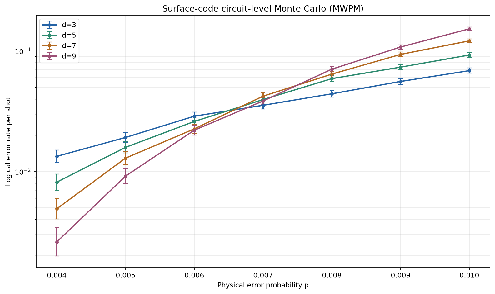

# 表面码真实电路级蒙特卡洛阈值基准

**性质**：独立 Stim＋PyMatching 基准；不是对原稿缺失模拟的重建，也不是硬件实验。
**协议 SHA-256**：`223f30a7b9520cd4e7b22a089e13d49673c635dcde64c1cf470dcdaad074fa63`
**结论边界**：交叉估计仅适用于本报告冻结的电路级噪声与 MWPM 解码，不是有限尺寸标度拟合或宇宙级通用阈值。

## 直接结论

28 个网格点全部得到非零真实逻辑错误计数，合计 **560,000 shots**。六组成对码距曲线均发生交叉，交叉中位数为 **0.6725%**，观察范围为 **0.6478%–0.7494%**。该范围是不同码距对插值交叉的离散程度，不是统计置信区间。

这一结果与 PyMatching 文档中相近电路级噪声配置约 0.7% 的示例一致。原稿的 1.03% 属于另一套尚未公开的噪声与解码配置，不能用本结果直接判错；但原稿也没有资格继续在没有原始 shots、探测器错误模型和种子的条件下声称已经完成大规模蒙特卡洛。



**图1定位**：置于直接结论之后。每个点都来自实际 Stim 采样和 PyMatching 解码，误差棒为 Wilson 95% 区间，纵轴为每个 shot 的逻辑错误率（对数坐标）。

## 冻结协议与复现命令

- 电路：`surface_code:rotated_memory_x`；码距 `d∈{3,5,7,9}`，`rounds=d`。
- 概率：`p∈{0.004,0.005,0.006,0.007,0.008,0.009,0.010}`。
- 噪声：Clifford 后、轮次数据、复位和测量四路均使用同一 `p` 的退极化／翻转错误。
- 解码：`detector_error_model(decompose_errors=True)` 后使用 PyMatching MWPM。
- 每点：20,000 shots；种子为 `20261110 + 1000*d + 概率索引`。
- 环境：Python 3.12.16、Stim 1.16.0、PyMatching 2.4.0、NumPy 2.5.4。

```bash
PYTHONPATH=research/paper-direction-audit-2026-11-10/scripts .tools/qec-venv/Scripts/python research/paper-direction-audit-2026-11-10/scripts/run_surface_code_threshold.py
PYTHONPATH=research/paper-direction-audit-2026-11-10/scripts .tools/qec-venv/Scripts/python research/paper-direction-audit-2026-11-10/scripts/verify_surface_code_threshold.py
PYTHONPATH=research/paper-direction-audit-2026-11-10/scripts .tools/qec-venv/Scripts/python research/paper-direction-audit-2026-11-10/scripts/plot_surface_code_threshold.py
```

三条命令的实际退出码均为 **0**。独立复验输出 `status: pass`、`mismatches: []`、`csv_mismatches: []`。另执行 13 项回归测试，覆盖统计边界、真实零噪声、同种子复现、独立输出复验和 SVG 标签，全部通过。

## 全部真实网格结果

| 码距 d | 物理错误率 p | 逻辑错误 shots | 总 shots | 逻辑错误率 | Wilson 95% 区间 |
|---:|---:|---:|---:|---:|---:|
| 3 | 0.004 | 267 | 20000 | 1.3350% | 1.1850%–1.5037% |
| 3 | 0.005 | 383 | 20000 | 1.9150% | 1.7341%–2.1144% |
| 3 | 0.006 | 575 | 20000 | 2.8750% | 2.6523%–3.1158% |
| 3 | 0.007 | 708 | 20000 | 3.5400% | 3.2927%–3.8052% |
| 3 | 0.008 | 882 | 20000 | 4.4100% | 4.1341%–4.7034% |
| 3 | 0.009 | 1117 | 20000 | 5.5850% | 5.2752%–5.9119% |
| 3 | 0.010 | 1373 | 20000 | 6.8650% | 6.5228%–7.2238% |
| 5 | 0.004 | 163 | 20000 | 0.8150% | 0.6995%–0.9494% |
| 5 | 0.005 | 317 | 20000 | 1.5850% | 1.4210%–1.7676% |
| 5 | 0.006 | 520 | 20000 | 2.6000% | 2.3884%–2.8298% |
| 5 | 0.007 | 790 | 20000 | 3.9500% | 3.6888%–4.2289% |
| 5 | 0.008 | 1179 | 20000 | 5.8950% | 5.5770%–6.2300% |
| 5 | 0.009 | 1468 | 20000 | 7.3400% | 6.9867%–7.7097% |
| 5 | 0.010 | 1852 | 20000 | 9.2600% | 8.8661%–9.6696% |
| 7 | 0.004 | 98 | 20000 | 0.4900% | 0.4023%–0.5967% |
| 7 | 0.005 | 258 | 20000 | 1.2900% | 1.1427%–1.4560% |
| 7 | 0.006 | 451 | 20000 | 2.2550% | 2.0582%–2.4701% |
| 7 | 0.007 | 843 | 20000 | 4.2150% | 3.9452%–4.5024% |
| 7 | 0.008 | 1285 | 20000 | 6.4250% | 6.0935%–6.7733% |
| 7 | 0.009 | 1873 | 20000 | 9.3650% | 8.9690%–9.7766% |
| 7 | 0.010 | 2427 | 20000 | 12.1350% | 11.6897%–12.5948% |
| 9 | 0.004 | 52 | 20000 | 0.2600% | 0.1983%–0.3408% |
| 9 | 0.005 | 183 | 20000 | 0.9150% | 0.7921%–1.0567% |
| 9 | 0.006 | 440 | 20000 | 2.2000% | 2.0057%–2.4127% |
| 9 | 0.007 | 769 | 20000 | 3.8450% | 3.5873%–4.1205% |
| 9 | 0.008 | 1412 | 20000 | 7.0600% | 6.7132%–7.4233% |
| 9 | 0.009 | 2157 | 20000 | 10.7850% | 10.3626%–11.2225% |
| 9 | 0.010 | 3054 | 20000 | 15.2700% | 14.7782%–15.7752% |

## 成对曲线交叉

对每个码距对的 `log10(p_L)` 做分段线性插值并求交点。六对均有交叉，未跳过任何码距对。

| 码距对 | 插值交叉 p |
|---|---:|
| d=3 与 d=5 | 0.6478% |
| d=3 与 d=7 | 0.6582% |
| d=3 与 d=9 | 0.6764% |
| d=5 与 d=7 | 0.6687% |
| d=5 与 d=9 | 0.7130% |
| d=7 与 d=9 | 0.7494% |

## 对论文三的具体修订要求

1. **把噪声模型写全。** 不能只写“独立 Pauli 错误”。必须明确是码容量、现象学还是电路级噪声，是否包含测量、复位、Clifford 和数据空闲错误，以及每一路的概率。
2. **公开原始证据。** 上传逐点 shots、DEM、解码配置、种子和有限尺寸标度输入；不能再用预设标度公式代替蒙特卡洛。
3. **统一数值。** 原稿摘要的 `1.03±0.05%` 与结论的 `1.03±0.06%` 必须给出同一拟合协议与置信区间来源。
4. **分离外部实验与本仓库模拟。** Google d=7、101 比特、0.143%／周期是真实硬件结果，不是本仓库模拟的验证标签。
5. **保留新基准的边界。** 本次中位数约 0.6725% 不是对 1.03% 的普遍否定；只有按原稿完整协议复算后，才能裁决其原始数值是否可复现。

## 下一阶段

下一阶段应扩展码距与 shots，实施显式有限尺寸标度拟合和参数不确定度传播，再把同一框架用于颜色码、qLDPC 和其他解码器。当前报告没有覆盖这些码族，也没有执行真实硬件、相关噪声、泄漏或逻辑门实验。

机器可读证据：[协议](surface-code-threshold/protocol.json)、[结果 JSON](surface-code-threshold/results.json)、[结果 CSV](surface-code-threshold/results.csv)、[独立复验](surface-code-threshold/verification.json)。
