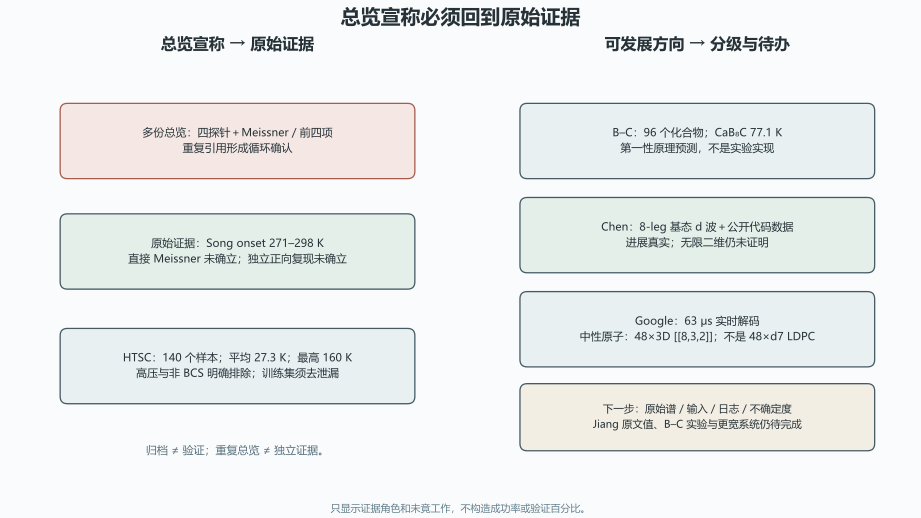

# 总览与技术复盘：事实血缘、基准范围与未竟工作审计

> 日期：2026-11-10。只审计，不修改原文，不重跑计算或实验。

## 一、血缘裁决与四个发展方向

四份文档是同一研究纲领的资料、总览与技术复盘层，不是四个独立新理论。

| 来源 ID | 只读路径 | SHA-256 |
|:--|:--|:--|
| `hydrides_overview` | `toe-sylva-audit/papers/room_temp_sc/organized/12-资料收集-氢化物与验证进展.md` | `5b3c56d2ea572412b894f6643fb2ab7e31e693ad7755b63e112e51c0fa46f277` |
| `batch_overview` | `toe-sylva-audit/papers/room_temp_sc/organized/16-资料收集-总览与下一步.md` | `243ef403bc372d13b442cc0086807fade7f7f478dba010bbfef2d3b9eeb11167` |
| `complete_overview` | `toe-sylva-audit/papers/room_temp_sc/organized/20-资料收集-总览与完整清单.md` | `314402bf0ae374bd74200c3a8492af8727b53082062d26b3bb7eaf28f2aa4fc7` |
| `technical_review` | `toe-sylva-audit/papers/room_temp_sc/organized/21-技术复盘-全领域数据审计.md` | `992707a8092e65297ebe604d16d5ca203c0f2e0e32a76b43132e16133b7bea05` |
| `htsc_pdf` | `sources/htsc-2506.03837v2.pdf` | `b1669a6771c685519a5fbcfb45258dd606b957df23720405663408f59809af01` |
| `patsnap_excerpts` | `sources/patsnap-excerpts.md` | `4c43394d89bf1d8eb48e2a9dadb6b7396b2640f1a702f7ae87a19c65bb6d6a10` |
| `boron_prb111_excerpts` | `sources/boron-prb111-excerpts.md` | `542a2bac4ad20821e68b87879c7a07a1c10128dabfe3b6e9c8207f5c51973883` |
| `main_claims_review` | `main-claims/review.json` | `e9ac6ff0bc88f11b1c2c91ae61ce398a05fc077815803f48669b46536d6f2f45` |
| `validation_materials_review` | `validation-materials/review.json` | `17eaa27d30df6849f752e3712d563ebe492ae394ea9c74b1b072ac0755acb491` |
| `isotope_dft_review` | `isotope-dft/review.json` | `e04428ca5980171619ca97bd2cc450fa772074cd9edd73f980905a72b1c2d4b4` |
| `dmrg_qec_review` | `dmrg-qec/review.json` | `367fada5ec9f68011ea50bb437922d140aa7fcb77bbab7517d8548196332a68d` |
| `methods_review` | `room-temp-methods/review.json` | `f30d15d8665644d11957166efaea95d59f7a742037dc697b737704cd15dc9e21` |

| 方向 | 已闭合的局部审计 | 未竟工作与下一步 |
|:--|:--|:--|
| `claim_lineage`：原始证据、单篇审计和多份总览之间的单一事实源与纠错传播 | Song 循环确认、Kruglov 和 QEC 重复错误已定位。 | 其余总览引文未全审，四份原文尚未同步修订。**下一步：**以结构化证据卡为唯一事实源，传播勘误并保留修改记录。 |
| `benchmark_scope`：HTSC 的样本、压力、BCS、去泄漏和外部验证范围治理 | 140 个样本、27.3 K 平均值、160 K 上限及排除规则已核实。 | Jiang 原始值、外部模型评估、独立 DFT 验证和数据版本差异未闭合。**下一步：**冻结去泄漏划分，分开常压基准与高压候选并公开失败案例。 |
| `data_completeness`：从有表格升级为谱函数、结构、输入、日志和不确定度的可复现完整性 | N_F 单位、Kruglov 文章号、方法混用和 SI 模板边界已核清。 | 完整谱函数、结构、赝势、k/q、收敛日志和不确定度仍缺失。**下一步：**为每个数据矩阵项绑定原始文件、输入、日志、单位和可复算脚本。 |
| `research_update`：B–C、Chen、Floquet 和 QEC 等方向的证据分级与动态更新 | B–C 预测、Chen 8-leg、Google 和中性原子角色已分开。 | B–C 实验、Chen 更宽系统、Floquet 实验和涡旋量子比特仍未验证。**下一步：**按预测、作者报告、独立复现和工程实现滚动更新，不复制旧结论。 |

## 二、Song 循环确认与 HTSC 真实范围

| 项目 | 总览中的问题 | 原始证据裁决 |
|:--|:--|:--|
| Song | 四探针＋迈斯纳、前四项满足 | onset 271–298 K；直接 Meissner 和独立正向复现未确立；重复总览不构成独立证据 |
| HTSC | 常压基准与 300 GPa 候选混写 | 140 个样本；平均 27.3 K；最高 160 K；高压和非 BCS 排除 |
| Li₂NaH₁₇ | 资料写 340 K，HTSC 讨论写 297 K | 明确不纳入 HTSC；Jiang 原始值待核，本批不擅断哪个值正确 |
| 五项标准 | 二手博客被当成全球共识 | Patsnap 可作内部清单；273 K 与项目 300 K 不混用 |

HTSC 的开放数据、去泄漏训练划分和 BCS 快速验证流程值得保留。后续应分开常压基准与高压候选，公开失败案例和外部 DFT 验证。

## 三、可发展的研究方向及其边界

| 方向 | 已核实进展 | 未竟工作 |
|:--|:--|:--|
| B–C 笼状结构 | 96 个化合物；CaB₈C 预测 77.1 K | 不是实验实现，需要合成与输运验证 |
| Chen DMRG | 8-leg 基态 d 波；公开代码数据 | 更宽系统与无限二维极限未闭合 |
| Kruglov／压力 | 文章号 024508；N_F 为 states/f.u./Ry；斜率算术成立 | 方法混用，不是纯实验曲线；全谱和输入未开放 |
| Google／中性原子 | 63 μs 实时解码；48×3D [[8,3,2]] | 不写绝对首次，不写 48×distance-7 LDPC |

**图件插入顺序：图 1 位于证据角色表之后、结果解释之前。** 图中没有验证百分比。

所有研究方向都可以继续，但必须按预测、作者报告、独立复现和工程实现分级更新。B–C 需要实验，Chen 需要更宽系统，Floquet 需要实验验证，涡旋量子比特需要物理实现协议。

## 四、分档勘误与数据治理任务

| 级别 | 已观察问题 | 建议动作 |
|:--|:--|:--|
| P0 | 多份总览把 Song 写成迈斯纳已证实和前四项满足。 | 改为作者正向预印本；直接 Meissner、独立复现和同行评议未确立，重复总览不是独立证据。 |
| P0 | 常压 HTSC 与 300 GPa 候选混写。 | 保留 140／27.3／160 与去泄漏规则；Li₂NaH₁₇ 不纳入，340／297 差异列 Jiang 原文待核。 |
| P1 | Patsnap 五项标准被当成全球共识。 | 降为二手博客框架；273 K 与项目 300 K 分开，具体材料逐项回源。 |
| P1 | B–C 预测被写成实验里程碑。 | 保留 96 个化合物与 CaB₈C 77.1 K 预测，明确尚无实验实现。 |
| P0 | Kruglov 文章号 224508 和 N_F 的 eV 单位重复错误。 | 改为 024508 与 states/f.u./Ry；保留参数表，不冒称全谱和输入开放。 |
| P1 | 压力斜率被当成同一方法或纯实验曲线。 | 按 Eliashberg／SCDFT／实验分轨，方法一致时再求导。 |
| P1 | 总览只重复 DMRG 全部争议，未吸收 Chen 新结果。 | 更新为 Chen 8-leg 基态进展与二维极限未闭合，复用公开代码数据。 |
| P0 | Google 首次与 48×distance-7 LDPC 的复制错误进入总览。 | Google 改为后续里程碑；中性原子改为 48×3D [[8,3,2]]，d=7 Bell 对另列。 |
| P1 | 有参数表被当成完整谱、完整输入和可复现数据。 | 为每个矩阵项绑定原始谱、结构、输入、日志、单位和不确定度。 |
| P1 | 归档和完成状态被当成证据闭合，重复引用被当成独立确认。 | 状态只表示文件归档；以原始证据卡和独立复核决定完成度。 |

数据矩阵的完整性不再以“有表格”判断，而以原始谱、结构、输入、日志、单位和不确定度判断。归档只表示文件存在，重复总览只表示同一结论被复制，均不等于验证。

## 五、验证范围与开放边界

| 边界 | 状态 |
|:--|:--|
| `meissner_verified` | `false` |
| `first_four_standards_met` | `false` |
| `htsc_high_pressure_included` | `false` |
| `boron_experimental_realization` | `false` |
| `full_spectrum_open` | `false` |
| `all_overview_claims_checked` | `false` |
| `full_repository_audit` | `false` |

本批使用十二项冻结来源、HTSC 原文、Patsnap 与 PRB 摘要及既有审计对象。命令与退出码见 `run.log`；Word 逐页结果见 `word-qa/report.json`。

本批没有重跑计算或实验，没有核实 Jiang 原始值，没有修改四份原文。**全库审计尚未完成。**
