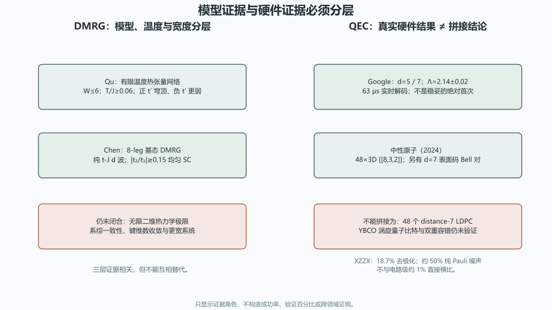

# DMRG 与量子纠错：证据阶梯、硬件角色与未竟工作审计

> 日期：2026-11-10。只审计，不修改原文，不重跑模型、解码器或硬件实验。

## 一、血缘裁决与四个发展方向

两份文档属于同一研究纲领的模型证据与跨学科资料层，不是两个独立新理论。

| 来源 ID | 只读路径 | SHA-256 |
|:--|:--|:--|
| `dmrg_notes` | `toe-sylva-audit/papers/room_temp_sc/organized/14-资料收集-DMRG-Hubbard模型.md` | `59e6b00f0cb240b9b0d3417f0f7906ae0fb5cf4a9b7cbcf79a8229181147d392` |
| `qec_notes` | `toe-sylva-audit/papers/room_temp_sc/organized/18-资料收集-量子纠错码进展.md` | `59e747f55a96fd8d93885455d7ae7c2579acdeff4139e292023f5a723ec3fce2` |
| `stripes_pdf` | `sources/stripes-2501.15709.pdf` | `d37490cd24da075fd622ef48bc3f212ce35fa09ec8db8bcd737a7fe4b04e1531` |
| `finite_temperature_pdf` | `sources/dwave-2211.06322.pdf` | `e1ce8e1480fcf95156b7fffd23800b2b8dc4d6def9b64afb5835903cca3ae107` |
| `extended_hubbard_pdf` | `sources/extended-hubbard-2206.03486.pdf` | `2cbaa6cd2ec3e9b00a61627d23cf3f5e3f5ac022b1cd80d73e495028646a7a55` |
| `global_dwave_html` | `sources/global-dwave-excerpts.md` | `3c2a77b1550f35e8a8eb8870150872cdc5e7b80c3ddd1d2799f9f455d3a2daca` |
| `google_pdf` | `sources/google-2408.13687.pdf` | `9ba05a64dfec13f5d733e0e22484e8f22db2482dc2a5a0d63e6f0766c9c3d368` |
| `xzzx_pdf` | `sources/xzzx-surface-code.pdf` | `918860f120639eb6897faff9d834aa977fbf54f781522276bff17c88c8db0cb7` |
| `neutral_atoms_pdf` | `sources/neutral-atoms-s41586-023-06927-3.pdf` | `0b81702eedfd2525eb6ab74fe82f43a7dbc930a219298f1f21c7ee7698afa8e7` |

| 方向 | 已闭合的局部审计 | 未竟工作与下一步 |
|:--|:--|:--|
| `dmrg_evidence_ladder`：短程关联、有限温度、有限宽度基态和二维极限分层 | Qu、Chen 与条纹综述的证据层级和编号映射已核清。 | 更宽系统、热力学极限、系综一致性和键维数收敛未闭合。**下一步：**复现公开代码数据，分别报告有限温度、基态、有限宽度和外推边界。 |
| `extended_model_completion`：近邻吸引、声子候选和系综／键维数对模型结论的影响 | Peng 四腿 d 波增强与前作一维 p 波通道已分开。 | 真实材料吸引强度、声子来源、二维极限和多方法交叉验证。**下一步：**以扩展模型为参数化研究对象，不把单个配对通道当完整机制。 |
| `qec_benchmark_roles`：噪声模型、解码器、阈值、延迟和硬件证据的同口径基准 | XZZX、Google 和中性原子数值及码族角色已核实。 | 跨解码器比较、码族开销、真实噪声和长期逻辑性能基准未统一。**下一步：**按噪声、码、解码器和硬件建立四维证据卡，禁止只比阈值。 |
| `cross_domain_governance`：书目、码族、硬件平台与高温超导跨学科假说的血缘治理 | Chen 时间、Google 首次、中性原子拼接和涡旋越级已定位。 | 其余引文未全审，涡旋量子比特和双重容错没有实验链。**下一步：**逐条补齐 DOI 与原文定位；跨学科内容按已验证、可行假说和待证定义分层。 |

## 二、DMRG：有限温度、有限宽度基态和二维极限

| 证据 | 实际结果 | 不能升级为 |
|:--|:--|:--|
| Qu：arXiv:2211.06322 | 有限温度；W≤6；T/J≥0.06；正 t′ 穹顶、负 t′ 更弱 | 无限二维零温基态证明 |
| Chen：arXiv:2311.15092 | 8-leg 基态；纯 t-J d 波；|t₂/t₁|≳0.15 均匀 SC；有代码数据 | 无限二维热力学极限已证明 |
| 条纹综述：arXiv:2501.15709 | [43,44] 报告 d 波，[41,42] 更接近 CDW；能量差约 0.01t | 所有 DMRG 已得到同一基态 |
| Peng：PRB 107, L201102 | 长四腿圆柱中近邻吸引增强 d 波关联 | 把前作一维 p 波当成本文直接结论 |

Chen 的结果真实且重要，应发展为公开代码复现和更宽系统研究，而不是删除。其 GCE 自然基态、有限键维数和有限宽度仍需显式披露。

## 三、QEC：阈值、解码器和硬件不能跨层拼接

| 证据 | 实际结果 | 证据边界 |
|:--|:--|:--|
| XZZX | 去极化 18.7%；纯 Pauli 约 50% | 不与电路级约 1% 直接横比 |
| Google | d=5/7；Λ=2.14±0.02；63 μs | 后续里程碑，不写成无条件的绝对首次 |
| 中性原子 | 2024 年；48×3D [[8,3,2]]；另有 d=7 表面码 Bell 对 | 不能写成 48 个 distance-7 LDPC |

**图件插入顺序：图 1 位于证据角色表之后、结果解释之前。** 图中没有成功率或验证百分比。

LDPC 的更高阈值、O(d) 开销和线性解码不是全码族统一性质。YBCO 涡旋量子比特与“拓扑保护＋QEC 双重容错”仍是待验证假说，需要相干时间、耦合、读出和实验协议。

## 四、分档勘误与发展任务

| 级别 | 已观察问题 | 建议动作 |
|:--|:--|:--|
| P0 | 有限温度、有限宽度基态和二维极限被混写。 | Qu 与 Chen 分轨；保留 8-leg 结果，不升级为无限二维证明。 |
| P1 | width-8 的 [41,42] 与 [43,44] 证据编号写反。 | 改为 [43,44] 报告 d 波，[41,42] 更接近 CDW；保留冲突和亚稳态边界。 |
| P1 | 前作一维 p 波与 Peng 四腿 d 波增强容易混淆。 | 引用 PRB 107, L201102，并区分前作和当前模型。 |
| P1 | Chen 全局相图被标为 2024-12-10，书目元数据不精确。 | 使用 PNAS 2025／arXiv:2311.15092 的真实身份，保留其科学结果。 |
| P0 | XZZX 阈值被用于跨噪声和解码器的直接比较。 | 18.7% 与约 50% 分别绑定噪声模型；不得与电路级约 1% 直接横比。 |
| P1 | Google 被写成首次低于阈值，忽略已有表面码标度工作。 | 保留距离 5/7、Λ=2.14 和 63 μs，改为后续里程碑而非绝对首次。 |
| P0 | 48 个逻辑量子比特与 distance-7、LDPC、2025 被拼成一项结果。 | 改为 2024 年 48 个 3D [[8,3,2]] 逻辑量子比特；d=7 表面码 Bell 对另列。 |
| P1 | LDPC 的更高阈值、O(d) 开销和线性解码被泛化为全码族性质。 | 逐码列参数、连接度、解码器和硬件条件，不做统一渐近承诺。 |
| P0 | YBCO 涡旋量子比特和双重容错被写成已有技术路线。 | 降为待验证假说，先提供相干时间、耦合、读出和实验协议。 |

优先顺序：先修正证据编号与码族身份，再复现 Chen 的公开代码数据、建立 QEC 四维证据卡；跨学科部分先完成物理可实现性定义，不以类比替代实验。

## 五、验证范围与开放边界

| 边界 | 状态 |
|:--|:--|
| `dmrg_2d_limit_proven` | `false` |
| `qec_threshold_cross_model_comparable` | `false` |
| `neutral_48_ldpc_d7_verified` | `false` |
| `vortex_qubit_verified` | `false` |
| `all_citations_checked` | `false` |
| `full_repository_audit` | `false` |

本批使用九项冻结来源、原始 PDF／HTML 和独立文本合同。命令与退出码见 `run.log`；Word 逐页结果见 `word-qa/report.json`。其余引文未全审。

本批没有重跑模型、解码器或硬件实验，没有修改两份原文。**全库审计尚未完成。**
