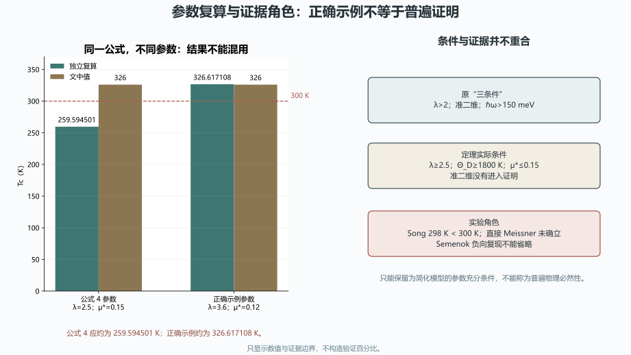

# 手册第 1–3 章：教学边界、参数复算与未竟工作审计

> 日期：2026-11-10。只审计，不修改原文，不重跑计算或实验。

## 一、血缘裁决与四个发展方向

两章属于同一研究纲领的入门教学与必然性叙事，不是两个独立新理论。

| 来源 ID | 只读路径 | SHA-256 |
|:--|:--|:--|
| `handbook_intro` | `toe-sylva-audit/papers/room_temp_sc/organized/08-手册章节/01-第1-2章_超导入门与科普.md` | `bb67c6d7b57a2dad1f42eed1bd2729697e590c643953e05e19ca0a7016463d23` |
| `handbook_theorem` | `toe-sylva-audit/papers/room_temp_sc/organized/08-手册章节/02-第3章_必然性定理.md` | `062b0011cc45b34ed8545a5890769ca71382608b09371641af5a51060c476e97` |
| `physics_foundations` | `sources/physics-foundations.md` | `93dd0cc19dc0b72c3103c607ded0a513837f664b3aaa872150e9bcb0a7d1c13e` |
| `main_claims_review` | `main-claims/review.json` | `e9ac6ff0bc88f11b1c2c91ae61ce398a05fc077815803f48669b46536d6f2f45` |
| `theory_review` | `theory-breakthrough/review.json` | `e6acb59a95f4dc159db2692e5db0a6ae40d640f8a8aef04ca1b69da80e3ed8c8` |
| `data_governance_review` | `data-governance/review.json` | `e09aeb77dd254d061d980c306e6762c1ef21ad8a5e826be6a08226d581680aa8` |

| 方向 | 已闭合的局部审计 | 未竟工作与下一步 |
|:--|:--|:--|
| `pedagogical_physics`：保留 BCS／Eliashberg 物理图像，修正类比、历史时间线和绝对化措辞 | BCS 相干配对、液氮时间线、H₃S 和 McMillan 极限角色已核清。 | 其余历史和应用事实未逐项回源，教学类比仍需统一修订。**下一步：**以正式定义校准类比，保留物理直觉但标注近似与适用范围。 |
| `conditional_model`：把第 3 章重建为指定简化公式与参数域内的充分条件 | 公式 4 的 259.594501 K 与正确示例 326.617108 K 已分开。 | 原三条件、μ*、准二维和实际参数域的逻辑映射未闭合。**下一步：**只陈述简化模型的充分条件，删除普遍物理必然性并补齐 f1/f2 和完整理论边界。 |
| `experimental_roles`：分开 PNAS 预测、Song 预印本、Semenok 负向复现和直接 Meissner 待办 | 298 K、直接 Meissner、独立复现和 P6/mmm 的角色已核清。 | 独立正向复现、直接磁测量、前驱体和同位素验证未完成。**下一步：**并列保存正负实验，按证据等级更新教学案例，不写完美验证。 |
| `unit_provenance`：频率—温度换算、参数来源、作者身份、化学式和证据血缘治理 | 210／150 meV 换算、Liu／Song 和 H₃S 问题已定位。 | Θ_D 与最大声子频率的定义、原始谱和输入参数来源未闭合。**下一步：**每个参数绑定定义、单位、来源和原始输入，禁止同值异名混用。 |

## 二、公式 4 与正确示例：同一公式不能混用参数

| 参数组 | 文中值（K） | 独立复算（K） | 裁决 |
|:--|--:|--:|:--|
| 公式 4：λ=2.5、μ*=0.15、Θ_D=2100 K | 326 | 259.594501207478 | 文中值错误 |
| 正确示例：λ=3.6、μ*=0.12、Θ_D=2100 K | 326 | 326.617107973496 | 近似值可保留 |
| λ=2.5、μ*=0.15 的 Θ_D 阈值 | 2427 | 2426.861882935184 | 约 2427 K 的算术正确 |

**图件插入顺序：图 1 位于数值复算表之后、结果解释之前。** 图中没有验证百分比。

这些结果只适用于指定简化公式和参数域。原“三条件”与定理条件并不等价，准二维也没有进入证明，因此不能称为普遍物理必然性。

## 三、实验角色与频率单位

| 项目 | 已核实结果 | 证据边界 |
|:--|:--|:--|
| Song | onset 上限 298 K，低于 300 K | 直接 Meissner、独立正向复现未确立；Semenok 负向复现不能省略 |
| 210 meV | 2436.948806 K | 若与 Θ_D 是同一最大频率，不是 2100 K；若 Θ_D 是另一有效量，单列定义和来源 |
| 150 meV | 1740.677718 K | 不与项目 300 K 必然性阈值混用 |
| 作者与结构 | Liu 与 Song 署名不统一；P6/mmm 不自动等于准二维 | 统一来源，准二维需各向异性证据 |

## 四、入门教学与分档勘误

1986 年镧钡铜氧为 35 K，仍低于液氮 77 K；1987 年 YBCO 为 93 K 才超过液氮。H₂S 应统一为 H₃S。

BCS 是由正常态和虚拟配对组态构成的相干基态，不是简单的独立玻色子气体。McMillan 的“最大 Tc”属于特定模型与历史经验背景，不是所有材料统一的 30–40 K 数学上限。

| 级别 | 已观察问题 | 建议动作 |
|:--|:--|:--|
| P0 | 公式 4 在 λ=2.5、μ*=0.15、Θ_D=2100 K 时写成 326 K。 | 改为约 259.594501 K；另列 λ=3.6、μ*=0.12 的约 326.617108 K 示例，禁止混用参数。 |
| P0 | 原三条件与定理条件不同，准二维未进入证明，μ* 后补。 | 改为简化模型参数充分条件，不称普遍物理必然性。 |
| P0 | 298 K 被写成超过 300 K 并完美验证，直接 Meissner 与负向复现被省略。 | 分开预测、作者预印本和负向复现；直接 Meissner 与独立正向复现列待办。 |
| P1 | 210 meV 与 Θ_D=2100 K 的换算不闭合。 | 若为同一最大频率，应为约 2436.948806 K；若 Θ_D 是另一有效量，单列定义和来源。 |
| P1 | 库珀对被简单等同独立玻色子，McMillan 极限被绝对化。 | 使用相干配对组态和特定模型／历史经验背景，不写统一数学上限。 |
| P1 | 1986 年 35 K 被写成突破液氮温区。 | 改为 1986 年铜基高温超导，1987 年 YBCO 93 K 才超过 77 K。 |
| P1 | 硫化氢写成 H₂S。 | 统一为 H₃S，保留其高压实验角色。 |
| P1 | Liu 与 Song 署名不一致，P6/mmm 自动等同准二维。 | 统一作者与来源；准二维需各向异性证据，不能由空间群直接推出。 |

可发展的方向不是删除教学，而是把类比、近似、公式和实验各归其位：入门章提供物理直觉，条件章只证明简化模型内的结论，实验章同时呈现正负证据。

## 五、验证范围与开放边界

| 边界 | 状态 |
|:--|:--|
| `formula4_verified` | `false` |
| `three_conditions_proven` | `false` |
| `theta_d_source_closed` | `false` |
| `experimental_necessity_proven` | `false` |
| `all_intro_facts_checked` | `false` |
| `full_repository_audit` | `false` |

本批使用六项冻结来源、原始理论文献和独立数值复算。命令与退出码见 `run.log`；Word 逐页结果见 `word-qa/report.json`。其余入门事实未全审。

本批没有重跑计算或实验，没有闭合 Θ_D 原始谱，没有修改两章原文。**全库审计尚未完成。**
