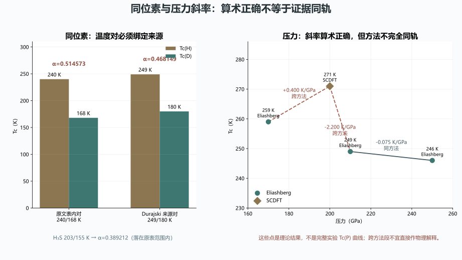

# 同位素压力与多层 DFT：参数血缘、方法分轨与未竟工作审计

> 日期：2026-11-10。只审计，不修改原文，不重跑 DFT／DFPT／SCDFT／ALIGNN，不新做实验。

## 一、血缘裁决与四个发展方向

两份文档属于同一研究纲领的实验参数与计算方法资料层，不是两个独立新理论。

| 来源 ID | 只读路径 | SHA-256 |
|:--|:--|:--|
| `isotope_pressure` | `toe-sylva-audit/papers/room_temp_sc/organized/17-资料收集-同位素效应与压力导数.md` | `6199a3f71c53ffe6dfe9505f942d713cdb8b8c8da87d35913898163c04366c07` |
| `multilayer_dft` | `toe-sylva-audit/papers/room_temp_sc/organized/19-资料收集-多层结构DFT参数.md` | `ef31a1048fe415dfff433effc7fd7caefc4b124b320b104eb5e595e6d0752c5c` |
| `kruglov_pdf` | `sources/kruglov-1810.01113.pdf` | `25632b30de626a14d2607f9c4ae1c0c57e78b4af2e0723985a6558e00c1555a4` |
| `isotope_pdf` | `sources/isotope-1912.09663.pdf` | `b5c69550005f7b4e926b12a60078a649d9939cbf6af51e07f42eec4063cfb6a6` |
| `jarvis_pdf` | `sources/jarvis-2312.12694.pdf` | `de1d282d5924f1a695e47a52f4e6bb8d696aea3e423ae894ca165452b47a03ab` |
| `nickelate_search` | `sources/nickelate-dome-scholar.csv` | `c82c8d735270ac6a154682dfcac6507e3d59224520fd15c5478be93b9e371fa4` |

| 方向 | 已闭合的局部审计 | 未竟工作与下一步 |
|:--|:--|:--|
| `isotope_lineage`：同位素公式、温度对、压力、样品与来源的一一绑定 | 标准分式和三组表内复算已完成，LaH10 的温度对错配已定位。 | 不同样品、非谐修正、结构相和原始测量点仍需统一血缘。**下一步：**每个 α 绑定同压力 H/D 温度、结构、样品和原始图号，禁止跨来源拼接。 |
| `method_aware_pressure`：Eliashberg、SCDFT 与实验曲线分轨 | 三段斜率算术正确，前两段跨方法及整组非纯实验角色已分清。 | 同一方法的完整压力曲线、实验点、相边界和不确定度未闭合。**下一步：**分别输出 Eliashberg、SCDFT 和实验 Tc(P)，仅在方法一致时求导。 |
| `reproducible_dft`：以倒空间间距、赝势和收敛日志为核心的多层计算输入契约 | 大超胞 k 点规则和通用参数保证的边界已定位。 | 六层结构、化学式、界面、赝势、k/q、截断能、声子和收敛日志均缺失。**下一步：**先定义最小结构并做收敛切片，再讨论多层材料预测。 |
| `ml_benchmark_governance`：既有／新增数据集、训练／推理成本、误差和外部测试的基准治理 | JARVIS 两类数据角色已确认，1000 倍加速缺乏同口径基准。 | 推理成本、硬件、任务定义、误差分布、外部压力和材料测试未建立。**下一步：**发布固定划分和端到端成本表，比较 DFT、训练、推理与失败案例。 |

## 二、同位素：公式、温度对和来源必须一一对应

标准公式为：

$$\alpha=-\frac{\ln T_{c,D}-\ln T_{c,H}}{\ln M_D-\ln M_H}.$$

| 温度对 | 压力 | 复算 α | 证据裁决 |
|:--|--:|--:|:--|
| 原文 LaH₁₀：240/168 K | 170 GPa | 0.514573172829758 | 不是文中 0.46，需核对温度对来源 |
| Durajski LaH₁₀：249/180 K | 约 150 GPa | 0.468148835738406 | 与原文报告约 0.46 对应 |
| H₃S：203/155 K | 155 GPa | 0.389211511910938 | 落在原表 0.3–0.6 范围 |

同位素系数支持电子-声子机制，但不能单独排他证明全部微观机制。后续必须绑定同压力 H/D 温度、结构相、样品和原始图号。

## 三、压力：斜率算术正确，但跨方法且不是纯实验曲线

Kruglov 正确书目为 **Phys. Rev. B 101, 024508**，原文写成 224508。表 1 的 271 K 星号明确标为 SCDFT，其余表内点为 Eliashberg。

| 压力段（GPa） | 方法 | 复算斜率（K/GPa） | 证据边界 |
|:--|:--|--:|:--|
| 170→200 | Eliashberg→SCDFT | +0.400 | 跨方法 |
| 200→210 | SCDFT→Eliashberg | -2.200 | 跨方法 |
| 210→250 | Eliashberg→Eliashberg | -0.075 | 同方法，但仍是理论点 |

**图件插入顺序：图 1 位于压力斜率表之后、结果解释之前。** 图中没有实验验证百分比。

三个斜率的算术均正确；问题是前两段跨方法，整组不是完整实验 Tc(P) 曲线。后续应分别输出 Eliashberg、SCDFT 与实验曲线，只在方法一致时求导。

## 四、DFT 与机器学习：从参数清单转为可复现契约

| 项目 | 已核实角色 | 未竟工作 |
|:--|:--|:--|
| 大超胞与 k 点 | 大超胞不自动需要更密集 k 点 | 用倒空间间距和收敛曲线决定网格 |
| 通用参数 | r2SCAN<1%、截断能和阈值不是跨材料保证 | 绑定赝势、k/q、能量、力与声子收敛日志 |
| JARVIS 数据 | 既有 1000+ 块体和 150+ 2D 零压数据真实；新增 over 900、0–500 GPa、122 个候选 | 两类数据不得混成同一训练或评价口径 |
| 1000 倍加速 | DFT 11500 core hours；训练 4/7 GPU hours；无端到端 1000 倍基准 | 补推理成本、硬件、任务定义和外部测试 |
| NdNiO₂/KTaO₃ | 本次 10 条检索未找到精确支持 4–8 层穹顶的来源 | 标未解析并补 DOI／图号，不判其为假 |
| 六层环体 | 尚无可计算定义 | 先定义结构、层间耦合、边界条件和化学式，再生成输入 |

## 五、分档勘误与发展任务

| 级别 | 已观察问题 | 建议动作 |
|:--|:--|:--|
| P0 | 同位素公式缺少比值，240/168 K 与 α=0.46 不相容。 | 使用标准分式；原文表内复算约 0.514573，249/180 K 来源对约 0.468149，禁止跨来源拼接。 |
| P0 | 压力斜率跨 Eliashberg 与 SCDFT，且被叙述为实验 dome。 | 保留斜率算术，按方法分轨重画曲线并附实验点和不确定度。 |
| P0 | Kruglov 文章号写成 224508。 | 更正为 Phys. Rev. B 101, 024508，DOI 10.1103/PhysRevB.101.024508。 |
| P1 | 大超胞被一概写成需要更密集 k 点。 | 改为固定倒空间间距与收敛规则；大超胞通常减少相应方向 k 点数量。 |
| P1 | 1000 倍加速没有同口径端到端基准。 | 分开 11500 core hours DFT、4/7 GPU hours 训练与推理成本，禁止自行换算加速比。 |
| P1 | NdNiO₂/KTaO₃ 4–8 层超导穹顶缺精确出处。 | 本次 10 条检索未闭合来源；标未解析并补 DOI／原始图号，不判其为假。 |
| P1 | α≈0.5 被写成电子-声子机制的排他性最强证明。 | 改为支持性证据，联合同位素、谱函数、结构和替代机制对照。 |
| P2 | 截断能、r2SCAN<1% 和收敛阈值被通用化。 | 降为初始设置，逐材料提供赝势、k/q、能量、力和声子收敛证据。 |

优先发展顺序：先清偿同位素和书目血缘，再建立方法一致的压力曲线；随后完成最小多层结构的收敛切片与 ML 成本基准。四个方向是同一研究纲领的方法任务，不是四个新理论。

## 六、验证范围与开放边界

| 边界 | 状态 |
|:--|:--|
| `dft_rerun` | `false` |
| `phonon_convergence` | `false` |
| `ml_speed_benchmark` | `false` |
| `nickelate_dome_verified` | `false` |
| `six_layer_ring_defined` | `false` |
| `full_repository_audit` | `false` |

本批使用冻结哈希、原始 PDF、Scholar 检索和独立数值复算。命令与退出码见 `run.log`；Word 逐页结果见 `word-qa/report.json`。

本批没有重跑计算、训练或实验，没有修改两份原文。**全库审计尚未完成。**
